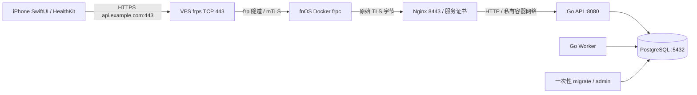

# RAI 原生 iOS App：Go + PostgreSQL 架构重设计与实施方案

文档版本：1.0  
编写日期：2026-10-27（Asia/Shanghai）  
适用项目：同级目录 `../running`  ；当前交付目录：`/Users/ta/rai`  
文档性质：**目标架构与实施蓝图，尚未实施、尚未部署、尚未完成性能及真机验收。**

## 阅读导航

- [1. 目标与决策摘要](#1-目标与决策摘要)
- [2. 当前项目依据与改造范围](#2-当前项目依据与改造范围)
- [3. 架构不变量与操作边界](#3-架构不变量与操作边界)
- [4. 部署拓扑与网络设计](#4-部署拓扑与网络设计)
- [5. Go 后端模块与工程结构](#5-go-后端模块与工程结构)
- [6. 数据所有权、身份与版本](#6-数据所有权身份与版本)
- [7. PostgreSQL 数据模型与索引](#7-postgresql-数据模型与索引)
- [8. iOS 增量采集与耐久队列](#8-ios-增量采集与耐久队列)
- [9. 上传协议、事务与回执](#9-上传协议事务与回执)
- [10. 删除、更正与路线大对象](#10-删除更正与路线大对象)
- [11. 服务端变更下发与首次拉取](#11-服务端变更下发与首次拉取)
- [12. 增量分析与训练计划](#12-增量分析与训练计划)
- [13. 后台任务、并发与恢复](#13-后台任务并发与恢复)
- [14. API 合同与安全](#14-api-合同与安全)
- [15. 资源预算、性能与可观测性](#15-资源预算性能与可观测性)
- [16. Docker 与发布设计](#16-docker-与发布设计)
- [17. 备份、恢复与维护隔离](#17-备份恢复与维护隔离)
- [18. 旧系统迁移与切换](#18-旧系统迁移与切换)
- [19. 分阶段实施清单](#19-分阶段实施清单)
- [20. 测试与发布验收](#20-测试与发布验收)
- [21. 故障处置手册](#21-故障处置手册)
- [22. 决策记录与上线前待确认项](#22-决策记录与上线前待确认项)
- [23. 官方资料与本次核查边界](#23-官方资料与本次核查边界)

## 1. 目标与决策摘要

### 1.1 推荐的最终形态

采用**原生 SwiftUI iOS + Go 模块化单体 + 单个 PostgreSQL 数据库 + PostgreSQL 持久任务队列**。后端由同一份 Go 代码构建一个镜像，以 API、Worker、一次性管理命令三种运行模式工作。

生产部署固定为：

```text
本机 macOS：SwiftUI / HealthKit 开发、Go 开发、测试、构建
                              │ 推送不可变镜像
                              ▼
手机 ── HTTPS ── 云服务器 frps ── frp 隧道 ── 家庭 N100
                                              └─ PVE
                                                 └─ fnOS 虚拟机
                                                    └─ Docker Compose
                                                       ├─ frpc
                                                       ├─ Nginx HTTPS 入口
                                                       ├─ Go API
                                                       ├─ Go Worker
                                                       └─ PostgreSQL
```

云服务器承担连接转发；健康事实、分析结果、计划与数据库保留在家庭主机。日常采集使用 HealthKit 变更游标；上传按不可变小批次提交；下发使用服务端提交顺序日志；分析由变更影响范围驱动。

### 1.2 明确选择

| 事项 | 选择 | 原因 |
|---|---|---|
| 产品范围 | 单用户、一个主要 HealthKit 采集手机；允许多个只读会话 | 与当前产品定位一致，避免无意义的多租户设计 |
| iOS | 保留 SwiftUI、HealthKit 与 WorkoutKit 集成 | 不重做客户端产品形态，不复制服务端训练算法 |
| 后端 | Go 模块化单体，API / Worker 同镜像不同进程 | 隔离 CPU 与 HTTP 生命周期，控制工程复杂度 |
| 主存储 | PostgreSQL 18 支持分支，实施时固定补丁版本和镜像摘要 | 利用事务、行锁、索引与可靠恢复；禁止使用 RC / `latest` |
| iOS 本地存储 | 保留 SQLite，分离同步耐久库与可删除页面缓存 | 手机无需 PostgreSQL；同步状态不能随缓存清理 |
| 数据访问 | [pgx/v5](https://github.com/jackc/pgx) + [sqlc](https://docs.sqlc.dev/en/stable/overview/install.html)，SQL 显式评审 | 容易确认查询范围、事务和索引，不引入通用大 ORM |
| 任务队列 | PostgreSQL jobs + 租约 + `SKIP LOCKED` | 不新增 Redis、Kafka、RabbitMQ |
| 高频路线 | PostgreSQL 内不可变版本和分块，完成后切指针 | 起步无需 MinIO、PostGIS 或时序扩展 |
| 开发部署 | 本机开发与 CI，N100 仅拉取镜像运行 | 减少 fnOS 环境漂移与本机数据库误用 |
| 同步协议 | `/v2` 原生增量批次；gzip NDJSON 文件 | 去掉日常同步中的 XML/ZIP/GPX 转换及多步导入编排 |
| 历史 XML/ZIP | 保留一次性离线导入工具 | 不是新同步的兜底路径 |
| 算法迁移 | 保持业务语义，离线固定事实对照后逐模块迁入 Go | 换语言不等于更换评分规则 |
| 备份 | 运维独立执行基础备份、WAL 归档与增量备份 | 任何同步批次均不等待备份、校验或恢复 |

这些是本项目的设计选择，不是宣称相关技术天然保证零扫描、零丢失或零停机。

### 1.3 成功标准

1. 一个新增样本只引起该样本、其索引、相关变更日志及受影响派生范围的工作。
2. 同一批次重试任意次，业务结果和服务端原始回执不变。
3. 云服务器、家庭网络或 fnOS 不可达时，手机能保存待传数据并在恢复后继续。
4. API 不依赖全库摘要、整表对比、整库扫描、数据库复制或换库来判断是否增量。
5. 原始事实保存成功与分析发布成功是两个状态，分析失败不要求重新采集已保存事实。
6. 删除和更正可追踪，迟到数据不会因为事件日期早于“上次同步时间”而被过滤。
7. 发布、备份、迁移均有明确隔离、回滚与验收办法。

## 2. 当前项目依据与改造范围

### 2.1 本次实际查看的现状

本次读取了本地 `../running` 的工程指令、架构及同步文档，并抽查了对应源码。没有连接生产数据库或服务器。仓库已有多项未提交改动，以下结论只描述**当前本地工作树**，不能代表某个已发布版本。

| 现状 | 本地依据 | 新架构处理 |
|---|---|---|
| 单用户、唯一客户端为原生 iOS | [AGENTS.md](../running/AGENTS.md)、[README](../running/README.md) | 保留，暂不增加其他客户端 |
| Node.js / TypeScript / Fastify + SQLite | [当前架构](../running/docs/ARCHITECTURE.md)、[API 主入口](../running/apps/api/src/server.ts) | 改为 Go / PostgreSQL |
| 主库、控制库、运行时库及 epoch / restore 侧车 | [数据管线](../running/docs/DATA_PIPELINE.md) | 收敛为同一个 PostgreSQL 数据库内的表域 |
| 正常导入已有 data-only 与 direct-sync 两条车道 | [直接接收器](../running/apps/api/src/direct-sync-ingest.ts)、[data-only](../running/apps/api/src/data-only-import.ts) | 保留事务回执与事实/分析分离语义，不机械搬运双车道 |
| 正常导入已明确禁止全库备份、复制、换库、quick_check | [数据管线](../running/docs/DATA_PIPELINE.md) | 强化成所有新在线路径的可执行约束 |
| HealthKit 已有分类型 anchor、本地 SQLite 任务和成功提交 | [记录游标](../running/apps/ios/RAI/HealthKitRecordCursor.swift)、[任务存储](../running/apps/ios/RAI/SyncTaskStore.swift) | 复用可靠性经验；引入明确的采集/交付双水位 |
| 当前正式同步合同仍包含 ZIP 上传、inspect、import job | [iOS 同步协议](../running/docs/IOS_NATIVE_SYNC_PROTOCOL.md) | 新 `/v2` 不要求三步在同一次唤醒内完成 |
| 本地存在 native payload 和 package 能力相关工作 | [Swift 编码](../running/apps/ios/RAI/HealthKitNativePayload.swift)、[能力注册](../running/packages/api-contracts/src/handshake-registry.ts)、[包方案](../running/docs/HEALTHKIT_WORKOUT_PACKAGE_PLAN.md) | 接续其数据表达与分块思想，不能假设已经完整上线 |
| 训练计划 V2、手工保护、执行授权、幂等回执已有合同 | [原生 API 合同](../running/docs/IOS_NATIVE_API_CONTRACT.md)、[闭环合同](../running/docs/TRAINING_PLAN_V2_CLOSED_LOOP_CONTRACT.md) | 建立行为对照表后迁移，避免功能退化 |
| 当前 Xcode 工程最低 iOS 配置为 17.0 | [Xcode 工程](../running/apps/ios/RAI.xcodeproj/project.pbxproj) | 默认维持；新 API 必须做可用性判断 |

当前架构文档与数据管线文档对某些离线校验细节存在口径差异；这些旧流程需要在迁移前按实际调用路径复核。本方案不据此认定当前线上存在全量同步缺陷。

### 2.2 与旧工程约束的关系

旧仓库约束默认使用 SQLite、Node.js 和原部署方式。本次用户明确要求 Go、PostgreSQL 与 N100 / PVE / fnOS / Docker，构成本方案的架构输入；实际实施前需要新增 ADR 并更新这些约束。**本次只交付文档，不修改原项目代码、工程指令、生产数据库或部署配置。**

继续保留：HealthKit 健康事实只读；WorkoutKit 训练排程为单独授权边界；不新增独立 Watch App；核心算法只有一个生产实现；不恢复已退役的计划写接口或备份创建/删除接口。

## 3. 架构不变量与操作边界

### 3.1 必须机械验证的不变量

| 编号 | 不变量 |
|---|---|
| INV-01 | 普通同步入口不能调用基础备份、恢复、迁移、全库校验或数据库切换工具 |
| INV-02 | 不能用 `MAX(event_time)`、最后上传时间或“最近 N 天”替代 HealthKit 正式变更游标 |
| INV-03 | anchor 与样本类型、查询谓词指纹、采集代次绑定，不能拿同一 anchor 更换查询范围 |
| INV-04 | 页内所有新增、删除及必要待办耐久保存后，才能推进本地采集水位 |
| INV-05 | 页内全部批次收到服务端事务提交回执后，才能推进该页交付水位 |
| INV-06 | 事实、删除、批次最终回执、变更账本与分析待办在同一数据库事务中提交 |
| INV-07 | 上传确认、事实提交、分析发布、手表排程确认分别表达 |
| INV-08 | 缺席、空查询、未授权或锁屏不能被解释成删除 |
| INV-09 | 相同身份不同内容的重试必须拒绝，不能覆盖已确认批次 |
| INV-10 | 服务端下发日志按受控提交顺序生成，不能直接把普通 sequence 当提交水位 |
| INV-11 | 分析只依赖已声明的输入版本；过期结果不能覆盖更新结果 |
| INV-12 | 删除后迟到的旧上传不能复活原 UUID；路线半成品不能覆盖有效版本 |
| INV-13 | 故障不能自动清空全部 anchor、重建数据库、启动全量重算或换库 |
| INV-14 | 超预算必须切块、排队或给出明确阻塞，不得丢数据来“加速” |

### 3.2 “全链路增量”的成本定义

在线同步的目标成本为：

```text
O(本批字节数 + 本批事件数 × 索引定位成本 + 本批造成的实际影响范围)
```

不承诺每次成本严格为常数。B-tree 查询随库大小存在对数开销；删除旧训练可能使递推负荷从历史某天传播到今天，这部分是业务依赖造成的真实影响。必须通过检查点和分块后台重算控制成本，不能改称“无影响”或偷偷退回全库扫描。

### 3.3 日常路径与低频操作分离

| 操作 | 日常同步中 | 独立操作方式 |
|---|---|---|
| 本批大小/Schema/哈希/外键校验 | 允许，范围严格限定本批 | 同步事务正常执行 |
| 按实体 ID、类型、时间范围读取 | 允许，有索引及预算 | 分页，不能一次载入全历史 |
| 扫描整个事实表做摘要或计数 | 禁止 | 有实际需求才安排离线审计 |
| 全库完整性扫描 / 全表 checksum | 禁止 | 恢复副本、隔离维护窗口 |
| 创建整库备份 / `pg_dump` / `pg_basebackup` | 禁止 | 运维任务，资源限流 |
| 候选库、复制旧库、恢复后切库 | 禁止 | 显式迁移或灾难恢复 |
| 自动重置全部 HealthKit anchor | 禁止 | 仅人工批准的单类型修复 |
| 首次历史建立基线 | 必需但仅一次 | 按类型分页、预算控制、断点续传 |
| SQLite → PostgreSQL 历史搬迁 | 必需但仅一次 | 每张表按主键分块迁移与分块核验 |
| PostgreSQL WAL / checkpoint / autovacuum | 必须保留 | 数据库内部维护，调度及监控，不能禁用 |

“避免影响同步”不等于永远不备份、不维护或物理上从不读取所有历史。在线同步零依赖这些操作；维护仍共享磁盘，必须实测干扰并控制资源。

## 4. 部署拓扑与网络设计

### 4.1 推荐：公网 TCP 转发，HTTPS 在家庭入口终止



iPhone 建立的 HTTPS 会话穿过 VPS 与 frp，到家庭 Nginx 才解密。公网证书属于 `api.example.com`；DNS 指向云服务器。云服务器能看到连接元信息和流量大小，但正常转发时不持有业务 TLS 私钥。frpc → frps 另使用经 CA 验证的 TLS，推荐双向认证。

frp 官方说明：默认启用 TLS 不等于默认验证 frps 证书；需要显式配置 CA、证书及校验身份，见 [frp TLS 文档](https://gofrp.org/en/docs/features/common/network/network-tls/)。

云服务器 443 若已被其他服务占用，采用另一独立公网 IP 或明确调整入口。不要临时在公网暴露未认证的内部映射端口。若未来选择云端终止 HTTPS，需要另立 ADR，说明云端可见明文的边界。

### 4.2 端口与信任域

| 节点 | 端口 | 可达范围 |
|---|---|---|
| 云 frps | 443/TCP | iPhone 公网 HTTPS |
| 云 frps 控制端口 | 7000/TCP，示例值 | frpc 出站连接；证书认证，能限制来源则限制 |
| 云 SSH | 实际管理端口 | 管理者受控网络 |
| fnOS Nginx | 8443/TCP，容器内 | frpc；生产不发布到 fnOS 所有网卡 |
| Go API | 8080/TCP | Nginx 与内部探针 |
| PostgreSQL | 5432/TCP | API / Worker / 一次性运维容器 |
| frp 管理面、fnOS、PVE 管理面 | 各自内部端口 | 不经业务 frp 代理向公网暴露 |

容器网络分为 `edge_net` 与 `db_net`：frpc / Nginx 属于前者；API 同时接入两者；Worker / PostgreSQL 只接入后者。生产 PostgreSQL 不设置主机 `ports` 映射。

### 4.3 fnOS / PVE 持久化

- PostgreSQL 数据目录放在 fnOS VM 可提供正确 `fsync` 与文件锁语义的持久本地块存储上，优先 SSD。不要放 SMB 挂载或跨机器共享 `PGDATA`。
- 盘位通过 PVE 虚拟磁盘或受控直通提供；实际文件系统、缓存模式、断电保护必须在现场确认。
- `PGDATA`、接收暂存区、备份仓库使用不同目录与配额；备份至少保留一份家庭主机故障域之外的加密副本。
- 不把 PVE VM 快照或 fnOS 文件快照单独宣称为已经验证的 PostgreSQL 恢复方案。
- PVE / fnOS / Docker 自动启动顺序与关机超时必须验证；NTP 保持正常。单节点家庭系统不承诺家庭断网时仍能在线服务。

证书建议通过 DNS-01 自动续签，续签账号最小权限；证书热重载不停止 PostgreSQL。双向 frp 证书与公网 HTTPS 证书分开管理。

## 5. Go 后端模块与工程结构

### 5.1 模块职责

| 模块 | 负责 | 禁止承担 |
|---|---|---|
| `httpapi` | 路由、鉴权、限流、DTO、错误映射 | 核心评分、隐式迁移、全库维护 |
| `syncing` | 流、批次、顺序、回执、变更下发 | HealthKit anchor 解码、全库比较 |
| `health` | 原始样本、Workout、来源、删除、关联 | 页面缓存或训练计划策略 |
| `routes` | 路线版本、分块、完整性与发布指针 | 覆写旧版本点集合 |
| `analysis` | 影响规划、局部特征、检查点、结果发布 | 上传生命周期、静默修改训练算法 |
| `training` | 计划、修订、人工保护、执行与完成回执 | 把展示投影当作执行授权 |
| `jobs` | 任务调度、租约、重试、fencing | 成为第二套事实来源 |
| `storage/postgres` | 显式 SQL、事务、映射、repository | 接受上层任意 SQL 或万能条件表达式 |
| `admin` | 迁移、恢复、审计、定点修复 | 被普通同步 handler 调用 |

依赖方向：`httpapi → application → domain`；`storage` 实现 application 需要的窄接口。初期无需为所有结构建立接口，仅在事务、HealthKit adapter、时钟、故障点等真实边界抽象。

### 5.2 建议目录

以下均为**拟新增或迁移的路径**，不是当前已存在的命令或实现。

```text
apps/
  ios/RAI/
    HealthKit/            # 查询、类型/单位适配、系列细项
    Sync/                 # coordinator、outbox、传输、回执恢复
    Persistence/          # sync.sqlite 与 cache.sqlite
    Features/             # SwiftUI 页面和 ViewModel
  server/
    go.mod
    cmd/rai/main.go       # api / worker / migrate / admin
    internal/
      httpapi/
      syncing/
      health/
      routes/
      analysis/
      training/
      jobs/
      storage/postgres/
      observability/
    migrations/
    queries/
    testdata/             # 合成、脱敏、固定事实用例
contracts/
  openapi-v2.yaml
  sync-v2.md
  fixtures/
tools/legacy-export/     # 一次性旧数据导出与语义对照
deploy/fnos/
  compose.yaml
  nginx.conf
  frpc.toml.example
  postgres.conf
  pgbackrest.conf.example
  release.sh
  restore-runbook.md
```

初期使用 Go 标准 `net/http` 路由、`slog`、`pgx`、`sqlc` 和一个固定版本的迁移工具。Go 版本在 P0 固定为届时支持的稳定版本，并固定 `go.sum` 与构建镜像。不要在 fnOS 现场执行 `go get`、编译 iOS 或隐式升级依赖。

### 5.3 API 与 Worker 的隔离

两个进程来自同一镜像；API 优先保证短事务与回执可查，Worker 负责派生计算。PostgreSQL 是它们共享的持久状态，不通过内存 channel 保证任务不丢。

API 每个请求传递 `context` 到 SQL，数据库设置独立 `statement_timeout` / `lock_timeout`；上传 body 的网络读取与事务执行预算分开。Go 支持通过 context 取消进行中的数据库操作，但最终提交结果可能需要查询回执确认，参见 [Go 数据库取消文档](https://go.dev/doc/database/cancel-operations)。

## 6. 数据所有权、身份与版本

### 6.1 事实源

| 数据 | 事实来源 | 冲突处理 |
|---|---|---|
| HealthKit 样本与 Workout | 主要采集手机可见的 HealthKit 数据 | UUID 幂等、明确删除、不可静默改写同 UUID |
| 路线与系列细项 | HealthKit 查询结果 | 不可变内容版本，完整后发布 |
| 手工覆盖、主观反馈、计划操作 | 服务端接受的用户命令 | `expectedRevision` + 操作幂等键 |
| 分析与预测 | 指定算法版本消费指定输入 | 不可变结果与显式发布指针 |
| 手表排程状态 | WorkoutKit 实际结果和回执 | 与服务端计划有效状态分别保存 |
| 页面缓存 | 服务端已发布结果的本地副本 | 可删除；不能影响 outbox / anchor |

HealthKit 中 `(sample_type, sample_uuid)` 是来源身份；服务器内部实体 ID、canonical workout ID、training session ID 是不同概念。迁移保留旧稳定 ID 和映射，不用“重新导入”重新生成所有业务身份。

### 6.2 必须区分的标识

| 字段 | 含义与变化规则 |
|---|---|
| `dataset_id` | 个人数据集的稳定 UUID，日常部署不变 |
| `dataset_epoch` | 数据集逻辑代次；仅恢复、重置或受控切换时改变 |
| `device_id` | App 安装/设备注册身份，不等于 HealthKit 样本来源设备 |
| `collector_epoch` | 某个采集器生命周期；迁移、重装或切换主要采集器时受控新建 |
| `stream_id` | 一个类型 + 固定谓词指纹 + collector epoch 的上传顺序流 |
| `client_seq` | 流内单调递增的批次序号，持久化后不能复用 |
| `batch_id` | 一份不可变批次的随机 UUID；重试复用 |
| `page_id` | 一次 HealthKit 查询页；一页可拆为多个 batch |
| `commit_rev` | 数据集已提交的业务变更版本，由受控事务生成 |
| `entity_revision` | 某实体版本，命令 CAS、缓存失效和派生输入绑定使用 |
| `algorithm_version` | 计算语义版本，不与数据库 schema 版本合并 |
| `schema_version` | 数据库结构版本，不能当作“历史已经算完” |

scope 至少绑定稳定服务身份、数据集、采集器代次和类型。域名改名后，只有校验服务身份相同才能继续；连接另一个数据集不能复用本地交付状态。

### 6.3 时间语义

保存 `event_start/end`、`received_at`、`available_at`、`computed_at`、`as_of`，不能互相替代。统一用 UTC `timestamptz` 存时刻，保留来源时区；业务日期按显式 IANA 时区计算，初始默认 Asia/Shanghai。

旧数据没有真实入库时间时标记 `availability_unknown`，不能把迁移时间冒充原始可得时间。手机传输时间采用整数微秒或固定精度 RFC3339，Swift、Go、PostgreSQL 使用同一舍入规范；跨语言 fixture 验证，避免浮点时间回读不一致。

## 7. PostgreSQL 数据模型与索引

### 7.1 表域

一个 PostgreSQL 数据库内存放事实、控制、运行时与发布状态，消除当前多 SQLite 文件之间的跨库发布协调。以下表名为建议模型。

| 表域 | 关键表 | 主要键及用途 |
|---|---|---|
| 元信息 | `datasets`、`devices`、`collector_leases` | epoch、提交版本、主要采集器 fencing |
| 同步 | `sync_streams`、`sync_batches`、`sync_page_receipts` | 流内顺序、批次不可变身份、页交付确认 |
| 样本 | `health_samples`、`sample_identity_map`、`entity_tombstones` | 来源 UUID、旧 ID、永久删除屏障 |
| 训练 | `workouts`、`workout_statistics`、`workout_events`、`workout_sample_links` | 训练主体、统计、事件、明确关联 |
| 路线 | `route_versions`、`route_chunks`、`workout_active_routes` | 分块耐久保存、完整性、发布指针 |
| 变更账本 | `entity_changes`、`change_events` | 旧/新影响证据与客户端可下载事件 |
| 工作队列 | `jobs`、`job_attempts`、`dirty_scopes` | 去重、租约、脏范围和失败诊断 |
| 派生 | `analysis_runs`、`workout_features`、`daily_metrics`、`analysis_checkpoints` | 输入版本与可复用检查点 |
| 发布 | `result_releases`、`active_result_releases` | 受控结果清单和原子发布指针 |
| 计划 | `training_plans`、`plan_revisions`、`plan_sessions`、`command_receipts`、`execution_receipts` | 当前计划、历史修订、执行授权及幂等 |
| 模型 | `model_artifacts`、`model_activations` | 工件身份、评估证据与激活记录 |

健康记录不要全部塞入单个 JSONB：类型、UUID、时间、单位、数值、来源、修订、可得时间使用强类型列，扩展 metadata 用 JSONB。高频点和系列细项分表或分块，避免一条无限大的 JSON。

### 7.2 核心 DDL 示意

下面是用于评审事务与索引边界的核心骨架，**不是完整生产 migration**。正式实现需要补充用户命令、数据格式、审计、权限与所有复合外键，并由 migration 测试确认。

```sql
CREATE TABLE datasets (
    id uuid PRIMARY KEY,
    epoch uuid NOT NULL,
    commit_rev bigint NOT NULL DEFAULT 0 CHECK (commit_rev >= 0),
    created_at timestamptz NOT NULL DEFAULT now()
);

CREATE TABLE sync_streams (
    dataset_id uuid NOT NULL REFERENCES datasets(id),
    id uuid NOT NULL,
    collector_epoch uuid NOT NULL,
    query_fingerprint text NOT NULL,
    last_client_seq bigint NOT NULL DEFAULT 0,
    last_batch_id uuid,
    PRIMARY KEY (dataset_id, id)
);

CREATE TABLE sync_batches (
    dataset_id uuid NOT NULL,
    batch_id uuid NOT NULL,
    stream_id uuid NOT NULL,
    client_seq bigint NOT NULL CHECK (client_seq > 0),
    dataset_epoch uuid NOT NULL,
    envelope_sha256 bytea NOT NULL,
    payload_sha256 bytea NOT NULL,
    event_count integer NOT NULL CHECK (event_count BETWEEN 0 AND 1000),
    state text NOT NULL CHECK (state IN ('registered','committed','rejected')),
    receipt jsonb,
    committed_at timestamptz,
    PRIMARY KEY (dataset_id, batch_id),
    UNIQUE (dataset_id, stream_id, client_seq),
    FOREIGN KEY (dataset_id, stream_id)
        REFERENCES sync_streams(dataset_id, id),
    CHECK (octet_length(payload_sha256) = 32),
    CHECK (state <> 'committed' OR receipt IS NOT NULL)
);

CREATE TABLE health_samples (
    dataset_id uuid NOT NULL REFERENCES datasets(id),
    sample_type text NOT NULL,
    sample_uuid uuid NOT NULL,
    event_start timestamptz NOT NULL,
    event_end timestamptz NOT NULL,
    value_numeric double precision,
    value_text text,
    unit text,
    source_id text NOT NULL,
    content_sha256 bytea NOT NULL,
    entity_revision bigint NOT NULL,
    first_received_at timestamptz NOT NULL,
    available_at timestamptz,
    metadata jsonb NOT NULL DEFAULT '{}',
    PRIMARY KEY (dataset_id, sample_type, sample_uuid),
    CHECK (event_end >= event_start)
);

CREATE INDEX health_samples_type_time
    ON health_samples(dataset_id, sample_type, event_start, sample_uuid)
    INCLUDE (event_end, value_numeric, unit);

CREATE TABLE entity_tombstones (
    dataset_id uuid NOT NULL REFERENCES datasets(id),
    entity_kind text NOT NULL,
    entity_key text NOT NULL,
    deleted_rev bigint NOT NULL,
    previous_start timestamptz,
    previous_end timestamptz,
    reason text NOT NULL,
    PRIMARY KEY (dataset_id, entity_kind, entity_key)
);

CREATE TABLE change_events (
    dataset_id uuid NOT NULL REFERENCES datasets(id),
    commit_rev bigint NOT NULL,
    ordinal integer NOT NULL,
    event_id uuid NOT NULL UNIQUE,
    entity_kind text NOT NULL,
    entity_key text NOT NULL,
    operation text NOT NULL,
    payload jsonb NOT NULL,
    created_at timestamptz NOT NULL DEFAULT now(),
    PRIMARY KEY (dataset_id, commit_rev, ordinal)
);

CREATE TABLE jobs (
    id uuid PRIMARY KEY,
    dataset_id uuid NOT NULL REFERENCES datasets(id),
    kind text NOT NULL,
    scope_key text NOT NULL,
    target_generation bigint NOT NULL,
    state text NOT NULL,
    run_after timestamptz NOT NULL DEFAULT now(),
    lease_until timestamptz,
    fencing_token bigint NOT NULL DEFAULT 0,
    attempts integer NOT NULL DEFAULT 0,
    payload jsonb NOT NULL,
    UNIQUE (dataset_id, kind, scope_key, target_generation)
);

CREATE INDEX jobs_ready ON jobs(run_after, id)
    WHERE state = 'queued';
CREATE INDEX jobs_expired ON jobs(lease_until, id)
    WHERE state = 'running';
```

### 7.3 必要的读取索引

- Workout 列表：`(dataset_id, start_at DESC, id DESC)`，使用 `(start_at,id)` 游标分页。
- 样本精确访问：主键 `(dataset_id,sample_type,sample_uuid)`。
- 训练与样本：`workout_sample_links(dataset_id,workout_id,sample_type,sample_uuid)`；反向关联另建对应索引。
- 时间相交查询：同时约束 dataset、type 和日期桶；对跨日睡眠建立 `sample_day_membership` 或经过验证的范围索引，不默认无限长事件。
- 路线块：`(dataset_id,route_version_id,chunk_no)`；每块记录点数、首尾时间、字节数与哈希。
- 变更账本：`entity_changes(dataset_id,batch_id,ordinal)`；不要按全表事件日期排序寻找变化。
- 日结果：`(dataset_id,metric_kind,local_date,algorithm_version)`。
- 幂等命令：`(dataset_id,command_id)` 唯一键。

初期不分区，避免分区主键、唯一约束及维护复杂度。实际样本/路线规模、VACUUM 与索引证据证明有必要后，再设计按月分区。BRIN、GiST、PostGIS 均按真实查询需要引入。

### 7.4 防止“有 WHERE 仍然扫全表”

每个 repository 方法写明：实体/时间范围、最大行数、分页键、预算和依赖索引。大表上的关键 SQL 在合成规模数据中执行 `EXPLAIN (ANALYZE, BUFFERS)`；禁止将 `enable_seqscan=off` 当修复。

小表顺序扫描合理，验收禁止的是**在线成本随无关历史数据线性增长**。`COUNT(*)`、全表 `MIN/MAX`、全量 JSON 聚合和运行时生成全库哈希均不能用于握手、同步准入或变更判定。

## 8. iOS 增量采集与耐久队列

### 8.1 分层

```text
SwiftUI View / ViewModel
  └─ SyncCoordinator actor
      ├─ HealthKitReader：只负责查询与类型映射
      ├─ DurableOutbox：本地事务、页、批次、文件、游标
      ├─ BackgroundTransfer：URLSession 文件上传
      ├─ ReceiptReconciler：查询服务端最终结果
      └─ ChangeFeedConsumer：缓存下发、计划、分析状态
```

`@MainActor` 只更新 UI。HealthKit 回调处理、编码、gzip、文件落盘和 SQLite 写入放在受控后台执行环境，不在 SwiftUI `body` 或主线程进行。

### 8.2 按类型维护变更流

对 Workout、所需数量样本、类别样本和路线发现使用各自独立的变化状态。`HKObserverQuery` 用来触发，正式差量由 `HKAnchoredObjectQuery` 读取；anchor 是不透明对象，只序列化保存，不能转成时间戳比较。Apple 对这些能力的说明见 [Anchored Query](https://developer.apple.com/documentation/healthkit/hkanchoredobjectquery?changes=__4&language=objc) 和 [HealthKit 读取方式](https://developer.apple.com/documentation/healthkit/reading-data-from-healthkit?changes=_6)。

默认沿用固定查询谓词；不在每次同步改成“最近 7 天”。旧游标绑定过覆盖下界时，迁移必须保留该谓词。扩大覆盖范围采用单独补读任务/新流并保留原流，不能直接换谓词复用 anchor。

注意 `limit` 控制返回样本数，**不能假设新增数组和删除数组相加也受同一上限约束**。删除风暴必须先耐久保存完整返回集合，再拆批；不能截断删除后直接推进 anchor。

### 8.3 双水位：采集与交付

这是新协议相对旧“服务端成功才提交唯一 anchor”模型的显式调整，需要新 ADR 和崩溃恢复测试。

| 水位 | 推进条件 | 用途 |
|---|---|---|
| `captured_anchor` | 查询页所有事件及必要子任务，已耐久进入本地队列 | 家里离线时仍可继续捕获变化，减少删除事件过期风险 |
| `delivered_anchor` | 该页及之前所有页的批次全部获得服务端 committed 回执 | 表示远端已经收到，支持恢复与界面展示 |

两个 anchor 是 HealthKit 不透明数据；“之前/之后”由本地 `page_seq` 维护，不能直接比较 anchor 字节大小。不能将 `captured_anchor` 命名为“同步成功”。

本地最小表：

```text
hk_streams：scope、type、query_fingerprint、collector_epoch、captured/delivered anchor
capture_pages：page_seq、anchor_before/after、batch_count、receipted_count、状态
outbox_batches：batch_id、stream_id、client_seq、prev_batch_id、payload/envelope hash、状态
outbox_files：文件名、字节数、哈希、文件保护等级、保留策略
pending_route_reads：route UUID、workout UUID、读取代次、进度和重试时间
receipt_journal：服务端原回执、已核验 epoch / revision
download_state：下载游标和已应用的事件 ID
```

### 8.4 一页采集的崩溃一致性

1. 从 `captured_anchor` 查询一页，保持同流 single-flight。
2. 编码新增和删除；超出批次预算则拆为多个不可变文件，任何一条不能丢弃。
3. 文件写入同卷临时文件，完成 flush / fsync，原子 rename 为最终文件名；必要时同步父目录。应用退出或锁屏导致失败时保留旧 anchor。
4. **同一个 SQLite 事务**登记页、所有批次、文件引用、路线待办，以及 `captured_anchor=anchor_after`。
5. 提交成功后允许读取下一页；事务前遗留的孤儿文件按目录增量清理，不推进水位。
6. 服务端提交回执逐一进入 receipt journal；一页全部确认时，在同一个本地事务中推进连续交付页和 `delivered_anchor`。
7. 待传文件仅在交付确认且超过本地重放保留期后清理，不能按“文件比较旧”删除未确认批次。

文件系统与 SQLite 没有联合事务，因此顺序固定为“先形成耐久不可变文件，后提交数据库引用”。重启先验证待办文件存在和哈希；缺失时停住对应流并定点恢复，不能跳过。

### 8.5 首次历史、优先级与容量

- 第一次接入某类型，从 nil anchor 开始分页建立基线；每轮限制时间、内存、文件字节与记录数，跨唤醒续接。
- 初始建议查询页 500 条，可按设备缩小；每批不超过 1000 事件、解压 8 MiB、传输 2 MiB，超大单对象走专项分块协议。
- 普通增量优先于历史补齐；首次基线未追平时，可使用独立、有固定窗口的近期发现流改善体验，不能污染正式流或用窗口缺席推断删除。
- 本地 outbox 建议初始上限 512 MiB / 最多占可用空间 10%，取较小值；低于最低可用空间阈值暂停采集并提示。该值需真机校准。
- 达到容量限制后停止推进 `captured_anchor`，上传继续；不能循环覆盖旧待传数据。
- 双水位只能降低暂时网络故障的风险，不能保证手机被卸载、损坏后仍保住尚未送达数据。

### 8.6 后台与权限

Observer 回调尽快登记耐久意图并调用 completion，不等待远端分析；BGProcessingTask 负责分段采集和收尾；Background URLSession 从文件传输，taskDescription 绑定 batch ID，重启枚举系统任务对账，避免重复创建在途上传。

后台执行与网络传输由 iOS 调度，不能承诺固定每分钟唤醒。锁屏数据库不可读进入 `blocked_protected_data`，认证失败进入 `blocked_auth`；这些状态不推进查询游标。可用性由解锁/认证修复触发，不盲目定时重试。

HealthKit 不能可靠区分所有类型的读取拒绝与无数据；新系统支持的时间范围授权 API 必须按 SDK availability 使用，不能直接提升当前 iOS 17 的最低要求。权限变化后历史补齐能否自然到达必须真机验证，不能把旧项目文档中的该假设直接当保证。参见 [Apple 授权文档](https://developer.apple.com/documentation/healthkit/authorizing-access-to-health-data)。

## 9. 上传协议、事务与回执

### 9.1 协议分工

上传统一为“不可变批次登记 → 文件 PUT → 最终回执”，任何一步都可跨会话恢复；不要求手机在同一次后台唤醒里完成 upload / inspect / startImport。

| 接口 | 语义 |
|---|---|
| `GET /v2/handshake` | 服务身份、epoch、支持版本、字节/事件限额；只读小元数据 |
| `POST /v2/sync/streams` | 受控登记类型与谓词固定的流；请求幂等 |
| `POST /v2/sync/batches` | 登记不可变 envelope，返回已有状态或上传位置 |
| `PUT /v2/sync/batches/{batchID}/body` | 上传完整小文件，校验后短事务提交事实；可重复 |
| `GET /v2/sync/batches/{batchID}` | 按主键查询原始状态与最终回执 |
| `GET /v2/sync/streams/{streamID}` | 查询连续确认的 client seq / batch ID |
| `GET /v2/jobs/{jobID}` | 分析状态，不能替代事实回执 |

P1 首版使用小批次同步提交，不增加“文件落盘就最终成功”的歧义。未来需异步接收时可返回 `202 stored`，但只有 `committed` 才能推进交付水位；必须先补持久接收作业与崩溃恢复测试。

### 9.2 Envelope 与事件格式

登记请求示例，标识和值为虚构示意，哈希占位符不是真实合法请求：

```json
{
  "protocolVersion": 2,
  "datasetID": "11111111-1111-4111-8111-111111111111",
  "datasetEpoch": "22222222-2222-4222-8222-222222222222",
  "collectorEpoch": "33333333-3333-4333-8333-333333333333",
  "streamID": "44444444-4444-4444-8444-444444444444",
  "batchID": "55555555-5555-4555-8555-555555555555",
  "clientSeq": 42,
  "previousBatchID": "66666666-6666-4666-8666-666666666666",
  "pageID": "77777777-7777-4777-8777-777777777777",
  "fragmentIndex": 0,
  "fragmentCount": 1,
  "queryFingerprint": "sha256:<固定查询定义摘要>",
  "contentEncoding": "gzip",
  "wireBytes": 84321,
  "decodedBytes": 452100,
  "eventCount": 500,
  "payloadSHA256": "<传输文件字节的SHA-256>"
}
```

body 使用 `application/x-rai-health-delta+ndjson`，传输编码及解析规则在合同固定；示例：

```jsonl
{"op":"upsert","kind":"sample","type":"HKQuantityTypeIdentifierHeartRate","uuid":"88888888-8888-4888-8888-888888888888","startUs":1793059200000000,"endUs":1793059200000000,"quantity":{"value":132.0,"unit":"count/min"},"source":{"bundleID":"example.source"},"metadata":{}}
{"op":"delete","kind":"sample","type":"HKQuantityTypeIdentifierHeartRate","uuid":"99999999-9999-4999-8999-999999999999"}
```

哈希对**持久保存的实际传输字节**计算；重试原文件，不重新 gzip 生成不同字节。envelope 采用合同固定的规范化字段编码计算独立摘要，绑定 batch ID、顺序、epoch、fragment、载荷哈希等全部语义字段。服务端同时验证传输字节、解压上限、单行上限、字段与事件数量；不能只相信 Content-Length。

HealthKit anchor 只留在手机；服务器不解析它，也不根据它判定“手机还有多少健康数据”。

### 9.3 写入顺序与事务

网络接收、解压与结构解析先在有界暂存/内存中完成；**不要拿着 PostgreSQL 行锁等手机传文件**。

一次提交按固定顺序执行：

```text
接收文件 → 有界校验 → BEGIN
  1. SELECT dataset FOR UPDATE；校验 epoch 与 collector fencing
  2. SELECT sync_stream FOR UPDATE
  3. 读取 batch；相同 envelope + payload 且已 committed → 返回原回执
  4. 校验 client_seq == last_client_seq + 1 和 previousBatchID
  5. 按排序后的实体键锁定/读取本批旧值；执行 UUID 去重与 tombstone 规则
  6. 写本批事实、删除、旧/新范围、实体 revision 和受影响范围
  7. 如确有业务变化，datasets.commit_rev += 1
  8. 写本次变更日志与 dirty_scopes / jobs
  9. 固化完整最终 receipt，更新 stream 的连续确认位置
 COMMIT → 才向手机返回 committed
```

dataset 行锁让单用户所有可下发变更获得提交顺序，事务保持短小。没有业务变化的幂等数据批次可不增加 `commit_rev`，但必须提交独立批次回执和流位置。任务执行不长期持有 dataset 行锁。

若超时或进程退出导致 COMMIT 结果未知，手机查询 `batchID`；有 committed 就接受原结果，没有则重发原字节。服务端不能用 HTTP 连接已断判断事务必然失败。

### 9.4 最终回执

```json
{
  "batchID": "55555555-5555-4555-8555-555555555555",
  "ingestStatus": "committed",
  "datasetEpoch": "22222222-2222-4222-8222-222222222222",
  "clientSeq": 42,
  "payloadSHA256": "<原请求摘要>",
  "commitRevision": 1234,
  "counts": {"inserted": 480, "unchanged": 18, "deleted": 2},
  "analysisStatus": "queued",
  "analysisJobIDs": ["aaaaaaaa-aaaa-4aaa-8aaa-aaaaaaaaaaaa"]
}
```

`analysisStatus=queued` 必须意味着同一事务真实创建/绑定待办；无影响时为 `not_required`。回执记录的是提交时状态，之后分析完成通过 job / changefeed 表达，不能不断改写同一最终事实回执。

### 9.5 幂等、乱序与坏数据

| 情况 | 返回与行为 |
|---|---|
| 相同 batch ID、相同 envelope/载荷 | 原状态或原 committed 回执 |
| 相同 batch ID、不同语义或字节 | `409 batch_identity_conflict` |
| 同流序号跳跃 | `409 sequence_gap`，返回 expected seq，先补前批 |
| 相同序号不同 batch ID | `409 sequence_identity_conflict` |
| epoch 已变 | `409 dataset_epoch_changed`，停住该 scope，进入恢复握手 |
| 旧主要采集器继续写 | `409 collector_fenced`，旧队列不能自动取得新写权限 |
| 文件过大 | `413 batch_too_large`；尚未消费序号时可显式撤销登记后按合同重封装 |
| 不支持的已知协议字段/版本 | `422 unsupported_payload`，保留原数据，升级适配器 |
| 行级坏数据 | 全批不提交；显示具体索引及错误，不静默跳过 |

登记已占用的 seq 不能被随便删掉。需要修复未提交批次时，使用受审计的“终结为 rejected / superseded 并登记替代链”管理协议，只有确认无事实提交才能替换；普通客户端不得重用原身份写新内容。首版可先阻塞并修复编码器，避免加入自动跳过复杂度。

## 10. 删除、更正与路线大对象

### 10.1 删除处理

删除必须来自明确 `HKDeletedObject` 或授权的用户删除命令；服务端按 `(dataset,type,uuid)` 定位，保存旧时间范围、旧所属训练和旧贡献，再写 tombstone、移除当前可见事实并登记脏范围。

同页重复删除幂等；同页同 UUID 同时出现新增与删除时删除优先。普通样本同 UUID 不同内容属于冲突或适配错误，不能按 HTTP 到达时间直接覆盖。HealthKit 更正通常应表达为旧 UUID 删除、新 UUID 新增；来源 syncIdentifier / syncVersion 只作为有明确定义的附加映射，不能跨来源混用。

未知 UUID 删除也保存精简 tombstone，防止旧包后来到达。若该 UUID 从未存在于新库、也没有派生映射，删除没有可撤销的贡献，可明确 no-op；若发现旧派生结果依赖该 UUID，却缺旧范围，记录 `repair_required`，定点修复依赖关系，不能自动发起全库重算。

基础版本默认保留精简 tombstone 和紧凑回执，不做简单按天清理。若未来必须清理，需要采集器 fencing、最大重放窗口和各流确认水位共同证明旧数据不可能重入。

### 10.2 纯增量删除的保证边界

Apple 将 deleted objects 作为临时记录，并不保证无限保留，见 [Apple 删除对象说明](https://developer.apple.com/documentation/healthkit/hkhealthstore/delete(_:withcompletion:)-78l1m?changes=l_5&language=objc)。

因此“长期离线、App 长期未被调度、被卸载、anchor 丢失后，仍然绝对不漏历史删除”与“永不核对历史”不能同时保证。推荐默认策略：

1. 平时持续捕获删除到本地 outbox，网络不可用不影响本地采集。
2. anchor 可用且本地队列完整时继续增量，不因闲置时间自动重置。
3. 已知中断造成覆盖不确定时，显示 `deletion_coverage_uncertain`；不能误报“全历史已一致”。
4. 用户需要修复时，按类型、固定时间分桶做**显式、可暂停、低优先级定点核对**；只有能证明查询覆盖完整时才能将缺席当删除。
5. 无法证明 HealthKit 读取授权覆盖时，不用集合差执行删除；可导出疑点供核实或保留不确定状态。

这不是普通同步步骤，也不能偷偷变成每次遍历所有分桶的整库校验。若产品坚持任何情形都不允许历史核对，就必须接受这项无法消除的完整性限制。

### 10.3 路线独立发布

路线可能晚于 Workout 出现、被后处理替换，位置数据分批返回。使用路线变化发现与 `HKWorkoutRouteQuery`，不以“Workout 已同步”判定路线完成，参见 [Apple 路线读取文档](https://developer.apple.com/documentation/healthkit/reading-route-data?changes=lates_7)。

```text
发现 route UUID
  → 在本地事务登记 pending_route_read
  → 分批读取点并保存不可变块
  → 上传 route_version 的各块，单块耐久确认
  → seal manifest（块数、顺序、点数、hash、workout revision）
  → 服务端确认全部块齐备
  → 短事务 CAS 切换 active route 指针并登记分析影响
```

关键规则：

- 路线发现 anchor 可在“路线 UUID 与读取待办已耐久保存”后推进，不能在只收到内存通知时推进。
- 路线内容交付确认与发现流交付确认分开；UI 显示“训练已保存，路线补齐中”。
- 单块建议解压不超过 4 MiB / 5000 点，实际以限额先到为准；每块独立校验并写入。
- 路线正文可作为 PostgreSQL `bytea` 压缩块，另存索引元信息；需要频繁逐点 SQL 时再落 `route_points`，不要双份长期存储。
- 原始点保留，不为提速自动降采样；地图显示层可生成独立简化派生版本。
- 最终 seal 只检查本路线的分块清单，不重新读取所有历史路线；大清单校验放 Worker，切指针事务保持短。
- 未完成的新版本不覆盖旧有效版本；Workout 已删除、revision 不符或 lease 被 fencing 时，seal 拒绝。
- HealthKit 路线查询不是任意点偏移可续读接口。进程中断后可能需要**重读这一条路线**并按块去重；不能宣称一定能从第 N 个点继续，也不能因此重读全部 Workout。
- Route 无全局长期可靠通知保证的情形，通过现有已知待办和有限近期发现处理；保留定点退避复查，不每次枚举全部历史训练。

数量 series 等细项同样采用“父对象发现 + 耐久细项任务 + 不可变分块 + 完整标记”，不把容器单值冒充全部高频数据。

## 11. 服务端变更下发与首次拉取

### 11.1 为什么不能直接使用 BIGSERIAL 水位

假设事务 A 先拿到序号 100，事务 B 拿到 101 并先提交；手机拉取到 101 后把游标推进到 101，A 之后提交的 100 就会漏掉。PostgreSQL sequence 的分配不等于事务提交顺序，相关特殊语义见 [PostgreSQL 事务隔离](https://www.postgresql.org/docs/18/transaction-iso.html)。

本方案所有对外可下发写事务均先锁 `datasets` 的单行，再在该事务内分配 `commit_rev`、写事件并提交。下一事务拿到行锁时，上一事务已提交或回滚，因此可以用已提交连续版本下发。**所有事实写、用户命令、路线发布、分析发布均必须遵循，不能只约束上传。**

### 11.2 下载游标

接口：`GET /v2/changes?cursor=<opaque>&limit=500`。

游标经 HMAC 签名，包含服务身份、dataset、epoch、`(commit_rev,ordinal)`、固定 `through_rev`、日志版本与过滤规则。客户端不能自行拼接版本绕过权限。

```sql
SELECT commit_rev, ordinal, event_id, entity_kind, entity_key, operation, payload
FROM change_events
WHERE dataset_id = $1
  AND (commit_rev, ordinal) > ($2, $3)
  AND commit_rev <= $4
ORDER BY commit_rev, ordinal
LIMIT $5;
```

第一次拉取固定 `through_rev`，后续页沿用，追平后再开始下一轮。手机**同一个本地事务**应用事件并保存游标；应用失败不推进。重复 event ID 幂等。

变更 payload 保存该版本可直接应用的有界投影或不可变结果引用，不只给 ID 让客户端取“当前最新行”却声称属于旧版本。大路线通过指定不可变版本按需下载，不把全部 GPS 点塞入 changefeed。

同一发布内有多事件时，客户端收到结束标记后切换发布引用；也可用单一“release manifest 可用”事件表达原子可见性。不得在分页中途把半套训练计划作为有效计划展示。

### 11.3 新手机或游标失效

- 页面默认按需读取已发布 read model，不先下载所有原始健康记录。
- 首次缓存初始化创建不可变 bootstrap manifest，引用训练计划版本、汇总结果版本及有界近期 Workout 投影，记录一致的 `through_rev`。首版最多包含最近 30 天、500 条摘要，任一先到；不在初始化事务内枚举所有历史训练。
- 该 manifest 在一次短 `REPEATABLE READ` 事务中固定读取，并将所需的有界可变摘要复制成不可变 bootstrap 页。现有不可变结果直接引用；资源不足时使用 Worker 构建版本化有界投影，不跨 HTTP 长期持有数据库快照。
- 之后读取 `> through_rev` 的变更；历史实体通过稳定 keyset 页按需获取。普通历史列表注明响应版本，允许随后用变更刷新，不能宣称多次按需查询构成同一历史快照。客户端未缓存实体的更新可暂记失效标记，再按需读取最新版本。
- 若业务以后要求完整离线历史，单独建设实体版本历史或快照导出协议；不能用多次普通 READ COMMITTED 分页冒充一致全量快照。
- 日志保留初始建议 180 天；实际清理由活跃设备确认水位和最低保留期共同控制，离线过久的设备需 bootstrap。
- 游标过期返回 `410 cursor_expired`，客户端保留上传 outbox，只重建页面缓存；**不清空 HealthKit anchor，不重传整份 HealthKit。**

## 12. 增量分析与训练计划

### 12.1 从变更证据推导影响

每次事实应用保存新增、更新、删除的旧/新类型、时间区间、所属 Workout、旧/新值与实体版本。影响规划只读取本批账本和已有依赖索引，不用当前库与旧库做 EXCEPT / JOIN 全量差异比较。

| 变更 | 脏范围 | 计算方式 |
|---|---|---|
| Workout 新增/更正/删除 | 该训练、关联特征、相关日期、后续递推状态 | 重算单训练，更新日贡献，传播检查点 |
| 心率/配速等训练内样本 | 明确关联训练；必要时有限时间相交候选 | 依赖索引定位，不枚举所有训练 |
| 跨夜睡眠 | 旧/新区间涉及的候选夜，按现有归属规则扩边 | 局部重建候选夜，保留未变行的可得时间 |
| HRV / 静息心率 | 当日及算法声明的参考窗口 | 日期桶和范围索引读取 |
| Route 替换 | 该训练的路线相关特征与分享结果 | 不重复计算与路线无关的指标 |
| 用户主观反馈 | 相应恢复、教练及计划输入 | 事实先确认，计算异步 |
| 阈值/训练区间配置 | 配置生效范围及依赖训练 | 明确版本，不改未受影响历史 |
| 算法版本升级 | 指定算法的明确回填范围 | 独立 backfill 作业，不挂在普通同步上 |

### 12.2 可增量的几类计算

1. **单实体特征**：键为 `(workout_id,input_revision,algorithm_version)`，命中可复用，变化只算该训练。
2. **可加总贡献**：保存 `workout_contributions`，更正时撤销旧贡献、加入新贡献；不能仅累加而不支持删除。
3. **有限滚动窗口**：明确最大回看范围，按日期桶索引读取；不每次载入全部历史。
4. **递推状态**：按天/周保存检查点，历史 D 发生变化，从 D 之前有效检查点起分块向前重放。
5. **非线性全局依赖**：如全历史个人最佳记录删除，先通过有序候选索引寻找下一候选；确需广泛重算时创建独立范围作业并向 UI 报告。

递推重放只有算法定义允许时才能依据“状态收敛”提前停止；未经证明不能任设误差阈值。不存在有效检查点时可以需要较大范围历史读取，但必须限时分块、后台执行，不能阻塞事实提交。

### 12.3 脏范围合并与防丢唤醒

`dirty_scopes` 保存 scope、dirty generation、最早/最晚影响范围。新变更通过同一提交事务递增 generation 并合并范围。Worker 认领 generation G，完成时仅清理自己消费的 G；若期间又有 G+1，不得将新脏状态清掉。

对训练局部、日桶、递推序列分别设 scope。合并只合并相邻或相交范围，不能因为两个相距三年的事件就必然把三年全部重算；对必须递推的指标再按其依赖规则扩展。

### 12.4 计算输入与发布

```text
事实提交 R
  → 脏范围 / job 同事务入库
  → Worker 获取 scope generation 和输入依赖版本
  → 在有界一致读取中取得输入，事务外计算
  → 写不可变结果及依赖清单
  → 短事务校验依赖未变、fencing 有效
  → 更新 active release 指针、写 changefeed
```

Worker 不用“数据库当前最新”混合不同读取时刻的行：一个小范围使用短只读 REPEATABLE READ 取得输入；大型回填先固化版本化输入清单。发布通过依赖 generation / entity revision 的 CAS；失配则结果保留为未发布证据并重排任务。

不使用全数据集最新版本作为每项分析唯一失效条件，否则无关样本到达会反复废弃正在计算的结果。依赖按 scope 精确记录；算法的输入定义必须覆盖所有真实依赖。

### 12.5 训练计划与算法迁移

保留现有 Fitness CA/TA、Readiness、负荷、分区、预测、训练闭环的领域边界。Python 离线模型训练可保留为按需工具；生产 Go 对 ONNX 的推理库和 Linux amd64 原生依赖需单独验证，失败时按现行合同展示可解释回退或不可用，不能伪造预测。

迁移顺序：单位/时间与标准化 → 训练负荷/日状态 → 单训练特征 → 评分/准备度 → 预测 → 计划闭环。使用相同固定事实输入，对照旧 TS 输出、缺失值、reason code、修订与可得时间；有意语义变化另立 ADR。仅离线测试短期对照，不部署常驻全量双跑。

计划命令采用 `command_id + expected_plan_revision`，一个 PostgreSQL 事务更新计划、人工保护、执行状态、命令回执和 changefeed。保留暂停、恢复、结束、受保护课程、执行授权、训练完成幂等匹配；自动刷新不能覆盖人工锁定。

## 13. 后台任务、并发与恢复

### 13.1 认领任务

使用短事务 `SELECT ... FOR UPDATE SKIP LOCKED LIMIT N` 认领就绪行，更新 `lease_until`、`fencing_token` 和 attempt 后提交；实际计算在事务外执行。`SKIP LOCKED` 适合队列消费，不用于普通业务一致性读取，参见 [PostgreSQL SELECT](https://www.postgresql.org/docs/18/sql-select.html)。

起步限制：事实入库并发 1、CPU 分析并发 1、后台范围回填并发 1 且可让位；网络传输并发 1–2。Go goroutine 不等于无限并发，任务池、HTTP、数据库连接和临时文件都要有限额。

### 13.2 租约与 fencing

租约初始 60 秒、每 15 秒续租，长任务保存阶段检查点。所有任务进度/发布写入带 `WHERE fencing_token=$expected AND state='running'`；lease 失效后旧 Worker 即使恢复，也不能发布结果。

过期 running 任务通过 `jobs_expired` 索引小批重排；不启动时遍历所有事实来“恢复队列”。失败按可重试/永久/需要修复区分，指数退避加 jitter，保留最大尝试数和最后原因。

### 13.3 崩溃点

| 崩溃点 | 恢复 |
|---|---|
| 手机写完文件、本地事务前退出 | 文件为孤儿，anchor 未进；下次重采，孤儿延后回收 |
| 手机本地事务后、上传前退出 | 从 outbox 继续，不重新读该页 |
| 服务端 COMMIT 后、响应前断网 | batch ID 查询原回执，禁止重复副作用 |
| 手机拿到回执、本地确认前退出 | receipt query 重放，本地确认幂等 |
| 分析中 Worker 退出 | 租约到期重排，从阶段检查点继续 |
| 分析写结果后、发布前退出 | 结果未激活，恢复校验后发布或废弃 |
| 新路线已传部分块后退出 | 补缺块，旧有效路线仍可读 |
| PostgreSQL 重启 | API 短暂 503，恢复连接；未提交事务回滚，已提交回执可查 |

## 14. API 合同与安全

### 14.1 合同策略

OpenAPI 先定义，再生成/校验 Go DTO 与 Swift DTO。新同步放在 `/v2`；迁移期 `/v1` 由原服务承接，切换时对仍受支持业务端点提供显式兼容适配。不得以重写为名自动删除现存 `/v1` 端点。

旧计划写面与备份创建/删除等已退役能力继续返回原合同的 `410` 与稳定错误码；原有备份恢复不直接映射成在线换库，要在兼容矩阵中明确维护模式、所需权限与安全行为，不能默认开放新库恢复操作。

### 14.2 安全措施

- 单用户仍要独立设备凭证；使用高熵 opaque bearer token，服务器仅保存不可逆摘要，手机放 Keychain，支持撤销与轮换。
- 配对初始凭证通过受控管理命令生成，不能默认密码或在 App 包内写固定生产 token。
- API、Worker、migration、backup 分开 PostgreSQL 角色。API 不拥有超级用户、建扩展、读服务端文件、恢复或删库权限。
- 请求 token 决定 dataset；body 中 datasetID 必须与凭证一致，不能相信客户端任意选择。
- Nginx 做连接及上传限流，API 做 dataset / device / batch 限额；只在可信入口接受代理头。
- 原始健康值、GPS、token、完整请求体不进日志；日志仅记脱敏关联 ID、数量、字节、耗时与 reason code。
- 分享坐标在服务器生成公开投影前执行隐私区裁剪，客户端不得取得按合同应隐藏的公开轨迹点。
- 文件暂存、手机文件保护等级、fnOS 存储与异地备份按健康隐私处理；Keychain 和磁盘加密不能替代应用鉴权。
- 不依赖单机 Compose secrets 自动加密磁盘。其本质是按服务挂载秘密文件，宿主机权限仍需保护，见 [Docker secrets](https://docs.docker.com/compose/how-tos/use-secrets/)。

## 15. 资源预算、性能与可观测性

### 15.1 未测量硬件的起始预算

当前只知道 N100 + PVE + fnOS，未核实内存、磁盘、VM 配额及其他容器。以下是**4 vCPU / 8 GiB fnOS VM 可用额度假设下的初始调优值**，不是实测推荐配置；若实际不足，先调整预算再压测，不假设需要购买硬件。

| 项目 | 初始值 |
|---|---|
| API 内存硬上限 | 512 MiB；Go `GOMEMLIMIT` 384 MiB |
| Worker 内存硬上限 | 1024 MiB；Go `GOMEMLIMIT` 768 MiB |
| PostgreSQL 容器内存上限 | 2 GiB，保留 VM 其余空间给 fnOS/其他任务 |
| PostgreSQL `shared_buffers` | 512 MiB |
| PostgreSQL `work_mem` | 4 MiB，按执行节点倍增，不能按连接数简单相乘估算 |
| 连接池 | API 8、Worker 4；管理和备份预留，`max_connections` 初始 30 |
| 普通 SQL timeout | 2 秒；同步事务 5 秒；锁等待 500 毫秒 |
| 同步批次 | 1000 事件 / 8 MiB 解压 / 2 MiB 传输，任一先到 |
| API 空载并发上传 | 每设备 1–2；每流提交顺序 1 |
| CPU 分析 | 1 个执行者起步，低优先级回填可暂停 |

`GOMEMLIMIT` 不是进程 RSS 硬限制；原生 ONNX、文件映射和驱动开销另计。PG 保持 `fsync=on`、`full_page_writes=on`、`synchronous_commit=on`；初始化启用数据页 checksum，并保留 autovacuum。不能通过关闭持久性制造快速回执。

### 15.2 SLO 与规模验证

候选目标均需 P7 压测和真机实测后定稿：

| 场景 | 验收目标 |
|---|---|
| 健康检查/握手，家庭服务可达 | 家庭端处理 p95 < 100 ms；公网端到端另测 |
| 1000 条普通样本提交，不含上传传输 | p95 < 1 秒，最大事务预算 5 秒 |
| 断网/响应丢失重试 | 重复业务事实 0，原最终回执一致 |
| 增加无关历史 | 100 万、1000 万样本下同批查询无历史线性放大；缓存条件一致时耗时劣化目标 < 30% |
| 分析积压 | 上传确认不等待分析；显示最老待办年龄与当前计算范围 |
| 大路线 | 峰值内存受块大小约束，旧路线持续可读 |
| 备份运行期间 | 同步 p95 劣化目标 < 20%，超过即降低备份 IO/并发或改窗口 |
| 所有在线同步 | 整库备份、整库校验、全库摘要、换库调用数均为 0 |

压测使用合成数据，记录磁盘、VM 配额、数据库/索引大小、冷/热缓存、连接数、批次形态、备份是否并行和版本摘要。只报告执行过的结果，不能把目标值写成已达到。

### 15.3 最小监控

起步使用结构化日志、内部 `/metrics` 和已有主机监控即可，不强制安装 Prometheus / Grafana 常驻堆栈。

- 同步：待传批次/字节、连续确认 seq、最老 outbox 年龄、captured-delivered 页距、重复批次、冲突码。
- 入库：上传与解析字节、事件计数、commit p50/p95/p99、锁等待、连接池等待、每次读取行/块数。
- 分析：待办年龄、scope generation 差距、过期结果丢弃数、repair_required、lease 重领。
- PostgreSQL：WAL 空间、归档成功时间、死元组、autovacuum、长事务、查询错误和磁盘剩余。
- 网络：frpc 重连、隧道可达、HTTPS 证书剩余天数；不能用“容器运行中”当端到端可用。
- 恢复：最近成功备份、最近恢复演练、异地副本可用性；备份文件存在不等于可恢复。

告警初始阈值：PGDATA 所在卷剩余 < 20% 预警 / < 10% 严重；归档落后超目标 RPO；lease 连续失效；已有新数据却分析长期无进展。磁盘接近满时优先停止回填和可清理暂存，不自动删除 tombstone、未确认批次或 WAL。

## 16. Docker 与发布设计

### 16.1 容器清单

| 服务 | 内容与权限 |
|---|---|
| `frpc` | 只读配置/证书；连接 frps；只接 edge_net |
| `ingress` | Nginx、只读 TLS 证书、限流及代理配置 |
| `api` | 非 root；只读根文件系统；独立可写暂存卷；无 Docker socket |
| `worker` | 同 Go 镜像；独立资源限制；只接 db_net |
| `postgres` | 固定版本镜像，持久数据卷，内部监听 |
| `migrate` | Compose profile，一次性执行，完成即退出 |
| `backup` | profile / fnOS 定时任务按需运行，PG 备份角色和独立仓库 |

pgBackRest 的 `archive-push` 可执行程序及配置需要在 PostgreSQL 运行环境内可用；不能只在另一个容器装工具就认为 PG 的 archive_command 能运行。制作经过测试的 PG + pgBackRest 运维镜像，或实现官方支持的远端仓库连接方式，版本一并固定。

### 16.2 持久化目录建议

```text
<fnOS实际持久卷>/rai/
  config/                 # compose / nginx / postgres / frpc 非秘密配置
  secrets/                # 设备配置、数据库密码、证书，限制宿主机权限
  postgres/               # PGDATA，由匹配版本容器管理
  spool/                  # 有配额的上传与路线暂存
  backup-repository/      # 与异地加密副本配合
  release-manifests/      # 镜像 digest、schema、构建提交、发布时间
```

不用假设 fnOS 实际卷名是 `/vol1` 或 `/srv`；P0 现场确认路径、owner、UID/GID、文件系统与可恢复性后写入部署参数。

### 16.3 Compose 模板必须实现的配置

- 固定镜像摘要、`restart: unless-stopped`、资源硬限制、日志滚动、优雅退出。
- `depends_on: condition: service_healthy` 只帮助首次启动，API 仍实现数据库断连重试。
- `/livez` 检查进程是否有响应；`/readyz` 做有超时的 `SELECT 1` 和小型 schema/epoch 检查，不扫描业务表。
- 数据库数据卷与暂存卷分开；api/worker 共享同 DB，不共享未经声明的本地文件任务状态。
- secrets 通过文件挂载；不把生产 token 写进 Compose、镜像层、Git 或 shell 历史。
- `stop_grace_period` 足够完成短事务；Worker 收到 SIGTERM 停止认领并释放/失效租约，未完成任务可重领。
- PostgreSQL 主版本升级不得仅修改镜像 tag 后直接挂载旧 PGDATA。

### 16.4 本机到家庭部署流程

1. macOS 本地跑合成 PostgreSQL，独立开发凭证；iOS 真机通过受控局域网开发 API 测试。
2. CI 在 Linux amd64 构建 Go 镜像，执行集成测试；Mac / Apple Silicon 本地构建生产镜像时明确 `linux/amd64`，含 CGO 的推理依赖不能只交叉编译后假设可用。
3. 推送私有镜像或将 `docker save` 工件送到家庭主机；记录镜像 digest 与源码 commit。
4. 发布前检查 migration 兼容、磁盘余量、最近可恢复备份与当前任务状态。备份是计划发布的运维前置，不是每个同步批次前置。
5. 使用 expand → backfill → contract：先兼容加表/加可空列，后台分块回填，再切读写，最后在回滚窗口结束后清理旧列。
6. 一次性 migration 容器执行；禁止每个 API replica 启动时自动抢跑迁移。大索引用经过评审的 concurrent 建索引步骤，处理不可置于普通事务内的命令。
7. 拉取新镜像，等待 API ready，做合成批次冒烟与公网 HTTPS 真机验证，再放行新版本写流量。
8. 保存 release manifest；旧镜像与前一兼容 schema 在回滚窗口内保留。

单 API 容器更新可能有短暂中断，手机 outbox 承接重试；无需为了单用户引入常驻多副本。应用回滚优先回退兼容镜像，**不自动回滚已经接收的新事实或恢复旧整库**。

## 17. 备份、恢复与维护隔离

### 17.1 三类增量不能混同

| 概念 | 机制 | 不解决的问题 |
|---|---|---|
| 手机增量同步 | HK anchor + outbox + 批次回执 | 服务器磁盘损坏 |
| 客户端结果增量下发 | 提交顺序 changefeed | 数据库物理灾难恢复 |
| 数据库增量备份 | 基础备份 / 增量链 + WAL | 手机未交付数据与 HealthKit 删除通知过期 |

### 17.2 推荐备份政策

使用 pgBackRest 管理一个经过恢复演练的备份仓库；起始建议：首次完整基线、日增量、月度或按恢复耗时触发的新完整基线，持续 WAL 归档，保留至少两条完整可恢复链。启用 block incremental 能降低保存变更文件的体积，但不能据此保证完全不遍历文件或没有 IO，见 [pgBackRest 官方指南](https://pgbackrest.org/user-guide.html)。

WAL 持续归档依赖有效基础备份，不能凭空恢复一个完整数据库。PostgreSQL 原生增量备份还依赖 WAL summaries 和完整备份链；本项目首版不同时维护两套备份体系。参见 [PostgreSQL 连续归档与增量备份](https://www.postgresql.org/docs/18/continuous-archiving.html)。

备份安排在低活跃窗口，限制并发、CPU、IO，按在线同步延迟自动降速或暂停可暂停的工作。在线 PostgreSQL backup 本身不要求同步停机，但会共享 IO，必须实测，不能承诺绝无性能影响。

初始目标：已 committed 服务端数据的异地恢复 RPO ≤ 15 分钟，RTO ≤ 2 小时；这是待演练目标，受上行、WAL 归档和备份规模影响。手机未提交数据不包含在该 RPO 中。使用合适的 `archive_timeout` 与归档延迟监控，低写入时不能只等 WAL 自然填满。

不将“永不做完整备份”设为硬要求：无限增长 WAL 与无限长增量链会恶化恢复成本。完整备份在维护面低频执行，永不进入同步依赖图。若用户坚持生产磁盘从不承担后续全量读取，则需要额外备份副本或可验证的存储方案，属于新资源决策。

### 17.3 恢复后的客户端状态

灾难恢复步骤：隔离写入 → 恢复到新 PGDATA → 校验备份/WAL/关键约束 → 确认恢复终点 → **在重新开放业务前更换 dataset_epoch** → fencing 旧服务进程与采集写会话 → 启动 API → 客户端恢复握手。

更换 epoch 不能只依赖恢复出来的旧行自行判断。恢复命令生成外部恢复记录和新随机 epoch，并要求启动配置与数据库一致；旧服务路由/容器必须下线，防止两套历史同时被写入。

手机对比每个流服务器的最后连续 seq 与本地已确认 seq：

- 服务器回退到本地保留重放窗口内：受控新 epoch 接纳流程按原逻辑批次链重放，重新出具新 epoch 回执，不把旧 epoch 的 committed 回执直接当新库证据。
- 本地目标保留最近 30 天已确认上传字节或可重建事件，受空间限制时可以缩短，但必须持久记录每流 `earliest_replayable_seq`，不能仍声称覆盖 30 天。空间优先保证未确认 outbox，已确认重放文件使用独立配额；服务器保留紧凑 seq / batch / hash 账本。
- 回退超出可重放窗口：标记明确缺口，尝试类型/实体定点恢复；需要历史扫描时作为独立恢复任务，不能假装普通增量已补齐。
- 页面下载游标因 epoch 改变失效，重建 read model 缓存；HealthKit captured anchor 不自动重置。

恢复握手需要一个受鉴权的专用协议，不能由普通客户端自行改写 epoch：服务端以新 epoch 出具每流“恢复后确实存在的最后连续 seq、batch ID 和 hash”检查点。手机核对该边界后，将超出服务端检查点的本地页重新标为待交付，在新 epoch 下重封装缺失批次；载荷字节、逻辑 batch ID 和流内顺序保持不变，envelope 摘要因 epoch 改变而重新登记。服务端不存在的批次才能这样接纳；已经存在的旧 epoch 批次由新检查点确认，不拿新 envelope 覆盖旧回执。若最后 seq 相同但 hash 不同，立即停止恢复并报告分叉，不自动选一边。P7 必须覆盖该恢复协议及部分批次幸存的场景。

### 17.4 维护任务

保留 autovacuum / ANALYZE；大规模 `VACUUM FULL`、`REINDEX`、checksum 核验和 PG 主版本升级仅在专门窗口执行。大表清理按主键/时间分块，每批短事务，避免事务、WAL 和死元组同时膨胀。

清理先处理已终结且过期的接收暂存、无引用路线半成品和明确可删除的派生结果；数据事实、未确认 outbox、tombstone、有效备份链与 WAL 不能按磁盘压力随意删除。

## 18. 旧系统迁移与切换

### 18.1 原则：一次迁移，两个写入时期

旧库保留完整的稳定 ID、UUID 映射、删除屏障、原可得时间、人工修改、计划修订、执行回执、模型激活证据与 pending 状态。只迁 `health_records` 和 Workout 会造成业务丢失，不能作为完整迁移。

**默认采用一次受控维护窗口切换**，适合单用户家庭部署。手机在窗口内先不采集新的旧协议批次，已交付旧任务全部收尾后保留原 anchor；新采集数据暂留 HealthKit。若维护时间可能较长，可先上线只使用本地 outbox 的新采集器，但其旧/新协议切换和 epoch 需先验收。

### 18.2 分块迁移流程

1. **盘点与冻结映射**：列出现存全部 SQLite 表、行数估计、稳定主键、表所有者、保留/转换/退役决策；不得凭本文表域清单省略未知表。
2. **迁移演练**：用明确允许的隔离副本或脱敏数据测量时长、空间和映射；不让 CI 读取生产健康数据。
3. **冻结旧写入**：停止旧 Worker、计划定时器和所有 CLI 写者，旧 API 返回维护状态；排空手机已登记旧 source/job，再记录一致的业务边界。
4. **形成一次一致迁移源**：按现有旧系统备份协议取得主库、控制库、运行时及侧车的协调快照，或保持冻结只读源直读。不能直接复制仍活跃的一个 `.sqlite` 文件。
5. **新建 PostgreSQL schema**：执行 migration、基础约束与索引；导入时不关闭 fsync 或长期禁用约束。
6. **主键 keyset 分块导出/导入**：按表依赖顺序，每块 5000–20000 行起步，按字节进一步收缩；迁移日志保存表、主键上下界、数量、规范化摘要、状态与错误。
7. **分块核验**：导出端在读该块时计算规范化 digest，导入端在写入/读取该块时核对，固定处理时区、数值、NULL、JSON、二进制与精度；不在每批后重新 hash 全库。
8. **关系与语义核验**：分块验证外键、UUID 映射、tombstone、训练会话与计划修订；迁移累计计数与成功清单核对。首次完整核验可能覆盖全部迁移数据，但只属于迁移窗口。
9. **派生结果策略**：能够保持语义的旧发布结果迁为不可变 legacy release；新 Go 算法需要的结果按依赖版本后台分块建立，不要求上线前所有历史重新计算。
10. **新协议接续**：为现有主要手机颁发 collector epoch / streams；保留可解码 anchor、固定谓词和已确认水位。native/ZIP 待办要么旧端收尾，要么通过明确适配迁移，不能直接删除。
11. **验收后切域名/入口**：同一时刻只有一个生产事实写入端；新库开始写后旧端保持只读，防止两个版本分叉。
12. **观察与退役**：保存旧库、旧镜像、迁移清单与恢复步骤；满足约定保留期后才人工归档。日常链路不携带旧 parser / 文件换库兜底。

### 18.3 若无法接受一次完整维护窗口

可以另行实现“旧系统事务内变更 journal → 一次历史分块迁移 → 按 journal 补增量 → 短冻结追平”的在线迁移方案。journal 必须覆盖健康事实、删除、计划、覆盖、回执及所有其他写入口，并在迁移起点前启用；不能用 `updated_at` 轮询假装捕获了删除。

这增加明显开发与验收成本，默认不做。没有完整 journal 时，宁可明确维护窗口，也不能承诺无损在线双写迁移。禁止把新旧库永久双写作为最终架构。

### 18.4 回滚分界

| 阶段 | 回滚方式 |
|---|---|
| 新库尚未接受生产写入 | 恢复旧入口，新库保留供分析，手机仍使用原确认状态 |
| 新库已接收生产写入，但新版本代码有问题 | 回退兼容的 Go 镜像 / 功能开关，保留 PostgreSQL 新事实 |
| 必须退回旧 Node / SQLite | 先冻结新写入，将新增事实、删除、计划命令和回执反向转换并核验，再切旧入口；未实现转换前不能宣称可直接回滚 |
| PostgreSQL 已损坏需恢复 | 按灾难恢复流程处理，改变 epoch，核对各流缺口 |

P0 就要决定生产切换后的回滚承诺。首选向前修复和同库兼容镜像回退，不能在旧库落后时仅把 DNS 切回去。

## 19. 分阶段实施清单

阶段按依赖顺序推进；工期取决于算法、旧数据和可投入时间，不在尚未盘点时给出虚构交付日期。

| 阶段 | 工作包与主要产物 | 验收退出条件 |
|---|---|---|
| P0：决策与基线 | ADR、完整表/路由/算法清单、硬件盘点、合成数据基线、回滚边界 | 约束已写清；已知未提交工作不被覆盖；迁移范围没有遗漏 |
| P1：骨架与数据库 | Go 工程、PG migration、角色、事务、commit rev、jobs、CI、Docker 骨架 | 并发提交与回执/事实原子性测试通过；恢复连接、超时可验证 |
| P2：上传内核 | streams、batch 登记/PUT/GET、UUID/tombstone、dirty scopes、限额 | 重试、乱序、冲突、删除风暴与 COMMIT 响应丢失全部通过 |
| P3：iOS 新同步 | Reader 抽取、outbox 双水位、文件后台上传、系统任务对账、旧任务接续 | 真机断网/杀进程/锁屏/重启继续；无全量重导与提前交付 |
| P4：路线与结果下发 | 分块/封口/指针、changefeed、bootstrap、缓存事务 | 半路线不发布；页游标不漏；旧游标不触发 HealthKit 全量 |
| P5：分析与计划 | Go 业务模块、检查点、输入谱系、原子发布、计划命令与执行 | 固定事实语义对照、人工保护、删除传播及过期结果 fencing 通过 |
| P6：迁移工具 | 旧表映射、分块 exporter/importer、核验清单、接续票据 | 多次断点恢复同结果；旧身份与删除不丢；演练记录完整 |
| P7：生产预演 | fnOS Compose、frp TLS、证书续期、资源限额、备份恢复、规模及干扰压测 | 端到端真机、恢复 RPO/RTO、禁用操作计数与性能目标有实证 |
| P8：切换与收口 | 冻结旧写者、迁移、接续、放行、观察、旧端归档 | 业务清单逐项验收；新链路唯一；文档与实际部署一致 |

### 19.1 预计修改与迁移的现有模块

| 原路径 | 实施动作 |
|---|---|
| `apps/ios/RAI/HealthKitExport.swift` | 抽取共享查询读取，不再以 XML/GPX 作为正式同步内部模型 |
| `apps/ios/RAI/HealthKitSync.swift` | coordinator 接入新 outbox、回执查询和跨会话恢复 |
| `apps/ios/RAI/HealthKitRecordCursor.swift` | 保留旧游标/谓词迁移，增加双水位明确语义 |
| `apps/ios/RAI/SyncTaskStore.swift` | 追加本地 migration 与页/批次/文件/回执表，不删除未确认旧任务 |
| `apps/ios/RAI/BackgroundUploadSession.swift` | 文件 PUT、batch ID 绑定、系统任务枚举与回执落盘 |
| `apps/ios/RAI/RouteSyncState.swift` 及状态机 | 适配路线发现/读取/内容确认分离与定点恢复 |
| `apps/ios/RAI/APIModels.swift` / API Client | 新 `/v2` DTO、能力判断和错误语义 |
| `packages/contracts` / `packages/api-contracts` | 先导出合同 fixtures，迁入中立 `contracts/`，保留旧版兼容边界 |
| `packages/*` 算法包 | 离线对照迁入 Go；按模块退役 TS 生产实现 |
| `packages/storage-sqlite` | 保留冻结旧迁移与一次性导出能力；不作为新生产 DB 层 |
| `apps/api` | 迁移期旧服务；新链路稳定后按端点兼容清单退役 |
| `docs/DECISIONS.md` / `AGENTS.md` 等 | 实施开始后明确新 ADR、环境和工具链，逐阶段更新 as-built |
| `.github/workflows/ci.yml` | 增加 Go / PG / 兼容合同；已迁模块稳定后再移除旧门禁 |
| `deploy/n100` | 旧配置只作核对；新增 `deploy/fnos`，不复用旧在线换库语义 |

### 19.2 任务定义模板

每个工作包至少包含：输入合同、预计路径、事务边界、失败状态、旧数据兼容、定向测试、模块回归、真机/环境依赖、完成证据、回滚方式。完成时记录源码 SHA、镜像 digest、schema 版本和真实测试结果；“文件已生成”不能替代该阶段验收。

## 20. 测试与发布验收

### 20.1 必测矩阵

| 领域 | 场景与断言 |
|---|---|
| iOS 页提交 | 在文件写入前后、SQLite commit 前后故障注入；未耐久页不推进采集水位 |
| iOS 页交付 | 单页多批，最后一批未确认；交付水位停在前页 |
| 删除风暴 | 单次返回删除数远超 sample limit；删除全量保存、拆批、不丢不截 |
| 后台恢复 | App 挂起、进程终止、系统重启、系统仍在上传；task 对账不重复发送在途字节 |
| 权限与锁屏 | 锁屏、读权限收缩/扩大、限定历史窗口；不把空数据当删除或成功覆盖 |
| 上传事务 | 事实后、回执前、COMMIT 后响应前断开；事实与最终回执不能只存在一个 |
| 顺序/并发 | 相同 batch 并发、不同内容同 ID、seq gap、旧 collector；稳定错误码且无副作用 |
| 提交日志 | A 获取写权后暂停，B 尝试发布；游标不能越过未提交 A 而漏事件 |
| 删除更正 | 先删后旧包、同页增删、未知删除、旧派生缺范围；无复活，无自动全量重算 |
| 路线 | 晚到、替换、缺块、错 hash、乱序、读取中断、Workout 已删后 seal；旧版本有效 |
| 下发 | 分页、重复、事件应用后保存游标前退出、过期游标、epoch 变化；缓存可恢复 |
| 分析 | 删除贡献撤销、跨夜、历史递推、无效检查点、期间新变更；发布只绑定正确输入 |
| 工作队列 | lease 过期、旧 Worker 恢复、重领任务；fencing 阻止旧结果发布 |
| 计划 | 人工修改保护、暂停/恢复/结束、revision 冲突、执行授权与完成回执幂等 |
| 迁移 | 块边界重启、数值/时间/JSON、未知表、旧 UUID/墓碑/计划/回执；结果可证明 |
| 运维 | frp 断连、证书过期预警、数据库重启、磁盘满、WAL 归档失败、备份恢复 |

### 20.2 “禁止全量操作”门禁

采用三层证据，不能只搜索函数名：

1. **依赖边界**：同步 application 包不能 import admin / backup / restore / migration / legacy DB publication；CI 检查真实导入图。
2. **运行时探针**：集成测试替换维护 adapter 为 panic / fail；提交所有同步载荷形态后确认备份、整库校验、全库摘要、换库调用数为 0。
3. **数据规模与 SQL 证据**：真实 PostgreSQL 合成大数据运行，检查关键查询计划、实际 buffer/行访问与 p95；同批在增加无关历史后不发生线性扫描。

保留 PostgreSQL 常规后台维护；不能通过禁止 autovacuum 或全局关闭顺序扫描来满足计数。

### 20.3 测试层级与命令规划

旧工程继续按 AGENTS 的 L1–L4 分级；新 Go 模块也采用同样风险分级。拟新增的 Go 验证入口示例，需在 P1 真正实现后才可作为命令使用：

```bash
# 位于未来 apps/server；示意，不代表本次执行过
go test ./internal/syncing/... ./internal/health/...
go test -race ./internal/jobs/... ./internal/syncing/...
go test ./...
go vet ./...
```

PG 集成测试必须使用隔离临时数据库；数据库行为不能全靠 mock 证明。关键事务、迁移与核心架构发布运行完整有效回归；普通可逆文档修改无需跑全部业务测试。

iOS 源码门禁、模拟器编译与真机 HealthKit/后台验收分别记录。CI 缺真机、Xcode 或环境时明确 NOT VERIFIED，不得写“全链路通过”。

### 20.4 生产放行清单

- [ ] P0 的现有功能、数据表、API、算法清单逐项有迁移结论。
- [ ] 所有 INV 不变量有真实代码门禁/集成测试证据。
- [ ] 手机已确认旧任务全部处理，anchor/谓词/UUID 迁移验证完成。
- [ ] 正常同步不会触发备份、全库校验、全库摘要、换库或全量重算。
- [ ] 断网、杀进程、删除风暴、路线未完成、COMMIT 响应丢失真机验证完成。
- [ ] 隐私裁剪、token 撤销、frp 证书身份验证、公网 HTTPS 证书续期验证完成。
- [ ] N100 实际资源预算及备份干扰压测通过。
- [ ] 数据分块核验与计划/回执语义核验完成，没有只迁健康表。
- [ ] 在隔离恢复环境实际恢复成功，RPO/RTO、epoch 与重放缺口处理验证完成。
- [ ] 应用镜像回滚与“新数据写入后不能直接切旧库”的边界已记录。
- [ ] GitHub CI、源码 SHA、镜像摘要、schema 版本、跳过项都有发布记录。

## 21. 故障处置手册

| 现象 | 首先检查 | 允许动作 | 禁止的自动动作 |
|---|---|---|---|
| 手机连不上家里 | DNS、HTTPS、frps/frpc、家庭网络 | 本地排队、退避、网络恢复续传 | 清 anchor、反复重导全部历史 |
| 401/403 | 设备 token 是否撤销/过期 | 保留批次，修复凭证后查询/重传 | 删除待传数据或换匿名接口 |
| `sequence_gap` | 本地前批、服务器连续 seq | 查询前批回执，补缺批 | 直接将服务端 seq 跳到客户端值 |
| 上传超时 | 回执主键、SQL/锁等待、网络 | 先 GET batch，再重传原文件 | 新建 batch ID 掩盖未知提交 |
| 分析慢但入库成功 | jobs 年龄、scope、依赖版本 | 保留事实，暂停低优先级回填，定点重排 | 让用户重新同步已提交事实 |
| anchor 解码失败 | 某类型游标字节、旧版本迁移 | 停该流，人工定点修复并记录覆盖不确定 | 清所有类型和全部本地状态 |
| 路线不完整 | pending route、缺块、源 done、seal 错误 | 补该路线，旧路线继续可读 | 发布半路线或重读所有训练 |
| PostgreSQL 磁盘接近满 | PGDATA / WAL / spool / 备份占用 | 停回填、清理已终结暂存、修复归档 | 删除 WAL、墓碑、未确认批次 |
| 数据库损坏 | 日志、存储、可恢复链 | 隔离写入，独立恢复演练，换 epoch | API 自动创建空库或自动换库 |
| 结果与事实不一致 | 输入 revision、release、algorithm version | 定位对应 scope 修复 | 启动无边界全量重新计算 |
| 恢复后手机说已同步但服务端缺数据 | epoch、各流 seq、手机重放保留期 | epoch 恢复握手、缺口重放 | 继续接受旧 epoch 回执 |

## 22. 决策记录与上线前待确认项

### 22.1 应新增的 ADR

| ADR 主题 | 决策 |
|---|---|
| 后端与存储迁移 | Go 模块化单体 + PostgreSQL，替换旧 Node/SQLite 生产路径 |
| 家庭部署与信任边界 | N100 / PVE / fnOS / Docker，公网 TCP 转发、家庭 HTTPS 终止 |
| 原生增量协议 | 不可变小批次、单流顺序、事务回执、独立路线版本 |
| iOS 双水位 | 采集耐久即可前进 captured，远端提交才前进 delivered |
| 提交顺序与下发 | dataset 行锁生成提交版本，固定高水位分页 |
| 业务分析增量化 | 变更账本、影响索引、贡献撤销、检查点和受控发布 |
| 运维隔离 | 普通同步不得触发维护；备份/迁移/恢复为独立流程 |
| 删除保证边界 | 临时删除通知无法覆盖无限离线，明确不确定状态及可选定点修复 |
| 迁移回滚边界 | 默认受控冻结迁移；生产新写入后优先同库代码回退 |

### 22.2 实施前确认，但不影响本方案交付的参数

1. N100 总内存、PVE 给 fnOS 的 CPU/内存、其他容器负载、SSD/文件系统和可用容量。
2. 家庭上行、云服务器带宽、443 占用、现有 frp 版本与证书管理方式。
3. 当前生产 schema、实际数据规模、样本/路线日增量、已发布 App 版本与待办状态。
4. 是否继续以一个主要手机作为唯一 HealthKit 采集器；更换手机走受控交接。
5. 可接受的一次迁移维护窗口、旧库保留时间、需要支持的旧 App 版本。
6. 是否可提供家庭主机外的加密备份位置，以及 RPO/RTO 实际要求。
7. ONNX 预测是否为首发必需，Go 推理依赖及 amd64 目标是否已验证。
8. 手机已确认上传的重放保留容量、日志最低保留天数与完整离线历史需求。

未获得更多参数时，按本文“单用户、一个主要采集器、单节点、受控维护切换、现有业务语义保持”的默认值推进 P0。实际生产写入、迁移与部署仍应按照项目授权流程另行执行。

## 23. 官方资料与本次核查边界

官方机制与项目选择需要区分。本文的批次大小、双水位、提交锁、日志保留期、资源预算、阶段划分和 SLO 都是工程设计，必须通过项目实现与测试验证；不是 Apple、Go、PostgreSQL 或 frp 对本项目的保证。

### 23.1 官方参考

| 主题 | 一手资料 |
|---|---|
| HealthKit anchor 与变化 | [HKAnchoredObjectQuery](https://developer.apple.com/documentation/healthkit/hkanchoredobjectquery?changes=__4&language=objc) |
| 查询类型与后台通知 | [Reading data from HealthKit](https://developer.apple.com/documentation/healthkit/reading-data-from-healthkit?changes=_6) |
| 临时删除对象 | [HealthKit delete / deleted objects](https://developer.apple.com/documentation/healthkit/hkhealthstore/delete(_:withcompletion:)-78l1m?changes=l_5&language=objc) |
| 读取权限与有限授权 | [Authorizing access to health data](https://developer.apple.com/documentation/healthkit/authorizing-access-to-health-data) |
| 路线晚到、替换与批次读取 | [Reading route data](https://developer.apple.com/documentation/healthkit/reading-route-data?changes=lates_7) |
| PostgreSQL 事务快照与 sequence 边界 | [Transaction Isolation](https://www.postgresql.org/docs/18/transaction-iso.html) |
| 队列认领 | [SELECT / SKIP LOCKED](https://www.postgresql.org/docs/18/sql-select.html) |
| WAL、基础备份、增量链及恢复 | [Continuous Archiving and PITR](https://www.postgresql.org/docs/18/continuous-archiving.html) |
| 增量备份、块增量和保留 | [pgBackRest User Guide](https://pgbackrest.org/user-guide.html) |
| frp 证书验证 | [Custom TLS Protocol Encryption](https://gofrp.org/en/docs/features/common/network/network-tls/) |
| Go 数据库取消 | [Canceling in-progress operations](https://go.dev/doc/database/cancel-operations) |
| Compose secrets | [Docker Compose secrets](https://docs.docker.com/compose/how-tos/use-secrets/) |

核查日期为 2026-10-27；上线时重新核对固定版本文档、iOS SDK availability 和已选镜像配置，不能直接采用搜索结果中的未来预发布版本。

### 23.2 本次已完成与未验证

本次已完成：本地源码及文档抽查、现状与目标边界整理、官方机制查证、架构/协议/数据模型/部署/运维/迁移/验收实施文档编写。

本次没有：修改 `running` 源码或其已有未提交改动；执行生产 SQL；运行迁移；构建 Go 服务；编译 iOS；执行真机 HealthKit / 后台测试；登录云服务器、PVE 或 fnOS；测试备份恢复；测量实际性能。

本文是后续实施和评审依据，不代表新架构已经完成，也不替代生产发布证据。
