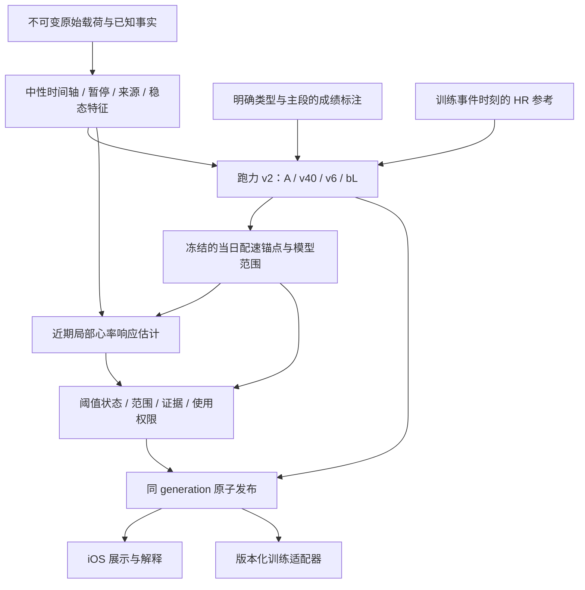

# RAI 乳酸阈值自动更新模型设计与实施方案

日期：2026-11-13（v1.1 修订：2026-11-16）  
方案版本：1.1  
建议模型：`rai.lactate_threshold/v1`  
配套跑力升级：`rai.running_fitness/v2`  
状态：v1 已在本机实现（见 20.1，含与本文的差异）；未校准、未部署、未在真机验收。

> 本文按本次明确要求交付独立 Markdown 方案，不是阶段证据文件。实施时将最终生效规则同步到 `README.md`、`docs/ARCHITECTURE.md`、`docs/API.md`；保留现有原方案原文。本文不能替代数据库、真机、模型有效性或部署验收。

## 0. v1.1 修订摘要（2026-11-16）

v1.1 依据第 2 节补充的佳明、高驰公开资料和 2025 年独立验证研究修订。v1.0 原文的定义、不变量、事务和发布边界不变；下列各条在对应章节就地修改，冲突时以 v1.1 为准。

| # | 问题（v1.0） | v1.1 修订 | 依据 | 章节 |
| --- | --- | --- | --- | --- |
| R1 | 配速为 `prior_based` 时，v40 实质就是"线性 HRR 推到 85% 的速度"，在其附近观测得到的 hT 会在数值上回到约 `RHR+0.85×HRR`，构成循环，和"不用心率比例代替"自相矛盾 | 配速为 `prior_based` 时，路线 A/B 的 hT 不发布为阈值心率（只进证据接口作诊断，原因码 `anchor_prior_based_hr_circular`）；新增不依赖 v40 的路线 C | 循环论证；两家都要求先有可信的配速/能力输入 | 9.4、10.2 |
| R2 | 心率只能从 v40 附近的日常片段反推，没有利用最常见、最可靠的现场证据 | 新增路线 C：用户确认的 30 分钟最大努力计时主段取后 20 分钟平均心率，定义记为 `field_tt30_last20`；可控 25 分钟阈值跑作为稳态观测进入路线 A | 高驰测试用 25 分钟稳态段确定阈值心率与配速；独立研究中各家手表的心率误差都远小于配速误差 | 9.4、11.1 |
| R3 | 近点窗口 ±2% 过窄：v40 自身范围约 ±3%，±2% 只相当于约 2 bpm，导致长期收集不到 | 近点窗口放宽到 ±5%：±2% 内直接使用；2%～5% 按同课斜率或 HRR 比例先验斜率修正到 v40，修正不确定性计入范围 | 高驰 Z4 本身是阈值配速 ±2～5% | 9.2、9.6 |
| R4 | 心率趋势 ≤1 bpm/min、未知坡度一律 limited，会剔除大量真实阈值段 | 速度 ≥0.90×v40 的窗口趋势上限放宽到 1.5 bpm/min（记录漂移）；未知坡度在距离核对通过时降权 ×0.8 后可进入支持池 | 阈值强度存在慢成分；HealthKit 海拔噪声大 | 7.2、9.5 |
| R5 | 28 天窗口、≥3 个独立日才 supported，对每周 0～1 次节奏课的用户长期达不到 | 心率窗口 42 天、τ=21 天，与跑力日常窗口一致；supported 条件改为 ≥2 个独立日、跨度 ≥7 天，或 1 次合格路线 C 加 1 个一致的日常日 | 高驰 90 天滚动窗口、单次合格训练即可更新；佳明单次合格跑即可检测 | 9.5、10.2、10.4 |
| R6 | 逐日留一时每轮都要重拟合跑力曲线，计算贵、测试面大 | 心率范围只做：v40 范围两端经局部斜率映射、心率日间 MAD、±5 bpm 底限三者取包络；逐日留一只重算心率聚合 | 个人项目的规模；精度主要受传感器与日间差异限制 | 9.6、17 |
| R7 | 变化确认只依赖数据 | 保留数据驱动的待确认；增加可选的用户"采用/暂不采用"输入（模型输入，确定性可重放），采用后解除待确认 | 佳明首次估计提示更新区间，之后每次由用户接受或拒绝 | 10.3 |
| R8 | 阈值训练直接用 v40 | 阈值训练配速区间取 `[v(3600), v(2400)]`，即偏保守的一侧；展示值仍为 v40 | 独立研究中三家手表都显著高估阈值配速 | 14.2 |
| R9 | 每条训练都要做完整窗口扫描 | 借鉴高驰的门槛先做候选预筛：训练内需有 ≥15 分钟连续跑动、速度 ≥0.90×v40 或心率 ≥75% HRR 的段落，才进入阈值心率扫描 | 高驰日常更新要求至少一次 ≥25 分钟、心率 ≥65% HRR 的连续跑 | 7.2 |

预期准确度（写入产品说明，不作为承诺）：商用手表对比实验室血乳酸 LT 的心率 MAE 约 9～11 bpm，配速 MAPE 约 13%～26%，单次测试成功率 47%～78%。RAI 没有逐搏 RR 或呼吸信号，不应预期优于这一水平；心率范围底限 ±5 bpm、配速只称"能力代理"的设定保持不变。

## 1. 推荐方案与交付边界

RAI 采用“跑步能力曲线确定配速工作点，近阈值稳态片段确定对应心率，按独立训练日更新”的专属模型。

- 配速只有一个权威来源：升级后的跑力能力曲线，复用其 40 分钟速度锚点 `vT`。本文将其明确记为 `v40`，避免与实验室乳酸阈值混淆。
- 心率使用近期真实的心率—速度配对观测，在 `v40` 附近做局部估计；不使用固定最大心率百分比生成乳酸阈心率。
- 日常跑步自动进入证据池；足够接近工作点的连续稳定跑能够更新心率，不强制每次完成专项测试。
- 只有轻松跑时，可更新有氧能力与依赖先验的配速估计，但不能据此宣称已识别个体生理阈值，也不远距离外推心率。
- 配速、心率、数据质量、时效、可用于训练的程度分别出状态。允许有配速无心率、有心率观测但配速未确认。
- 新模型先作为候选栈验证，再经所有者授权激活；不自动部署、不迁移真实数据、不切换旧入口。

本版最终产品名称可沿用“乳酸阈值”，但详情必须写明“RAI 工作阈值估计”。正常自动结果的 `definition` 固定为 `rai_t40_working_proxy`，不是 `lab_lt2`。

这是一项有实际用途的工程估计：给出当前接近阈值训练强度的配速与对应心率。没有血乳酸、气体分析或其他经过验证的识别信号时，无法保证找到了个人真实 LT2。本方案把这个限制纳入契约和训练权限，不把它藏在免责声明里。

## 2. 调研依据与能借鉴的部分

| 来源 | 官方公开内容 | RAI 采用的设计原则 |
| --- | --- | --- |
| 佳明 / Firstbeat | 经典路径分析运动心率、HRV 与由其推算的呼吸变化；当前整体估算也使用 VO₂max、近期心率与配速、预测成绩 | 分析强度变化与输入质量，要求跨训练证据；不把晨间 HRV 当运动逐搏信号 |
| 高驰 EvoLab | 配速区间公开使用配速—持续时间模型；跑步能力测试的 25 分钟稳定阶段用于评估阈值，后续高强度阶段主要评估最大心率 | 复用能力曲线、区分阈值评估与最大心率评估、提供测试校准入口 |
| 验证研究 | 消费级阈值估算与特定实验室定义之间存在误差，设备和固件有差异 | 保存定义、方法、范围和版本，验收工程正确性与生理有效性分开 |

### 2.1 佳明（Firstbeat）公开设计要点（v1.1 补充）

- **输出**：乳酸阈值心率与配速（骑行为功率）。官方定义为"乳酸开始在血液中累积的强度"。
- **自动检测**：默认开启，在稳定、较高强度、带心率的户外跑中后台检测；依赖用户资料和 VO₂max 估计，后者需要先积累几次带心率的跑步。官方建议：测不出结果时可以手动调低最大心率，说明 HRmax 参与了检测门槛或归一化。
- **引导测试**：户外、需 GPS；早期型号要求胸带。手表逐步给出**心率目标**和每段时长，按阶梯递增，结束后提示保存。
- **信号**：营销材料称分析心率、配速、心率变异和由此推算的呼吸频率变化，以心率与呼吸频率快速上升的拐点换算对应的心率和配速。之前要求胸带是为了取得逐搏 RR；第三方报道 2024 年起部分型号接受腕式光学心率，噪声和滞后更大。
- **采纳**：首次估计时提示是否用阈值心率更新心率区间；之后每次新估计都由用户接受或拒绝。
- **公开验证**：Heiber 等（2024，Fenix 7，26 人场地血乳酸）阈值心率偏差约 −1.7%（不显著），配速偏差约 12%；Carrier 等（2021，Fenix 6）速度 MAE 8.4%、心率 MAE 6.2%。来源为第三方转述，未逐篇核对原文。
- **RAI 借鉴**：心率是更可靠的一半；测试用心率或体感引导比用配速提示更容易得到稳态；新估计需要采纳步骤。不借鉴：RAI 没有运动中逐搏 RR，不做 HRV/呼吸拐点检测。

### 2.2 高驰 EvoLab 公开设计要点（v1.1 补充）

- **输出**：阈值心率、阈值配速；心率与配速各分六区。心率区间以阈值心率为基础；配速区间以阈值配速为唯一锚点，其中 Z4 约为阈值配速 ±2%～5%（可持续 30～60 分钟）。
- **跑步能力测试**：热身 5 分钟 → 马拉松配速稳态 25 分钟（"吃力但可持续"）→ 约 10K 配速 3 分钟 → 约 5K 配速 3 分钟（目标心率超过 90% HRR，不到则加一段）→ 放松 5 分钟。阈值心率与阈值配速来自 25 分钟稳态段；递增段只用于最大心率。只要完成 25 分钟段就能得到阈值结果。测试前需要输入近期 10K 成绩或保守估计。
- **日常更新**：至少有一次 ≥25 分钟、不暂停、心率 ≥65% HRR（另一页写作 65%～95% HRmax，官方口径不一致）的户外跑才开始计算；之后只要每 90 天滚动窗口内有一次 25 分钟户外跑就持续更新。检测到能力变化时，阈值配速/心率、区间、跑力分与成绩预测一起更新。
- **配速—持续时间模型**：从跑步数据拟合最大速度、1 分钟无氧做功、临界速度三参数；临界速度接近 10K 或阈值配速。区间变化不追溯，历史训练保留当时的区间。
- **公开验证**：Lu 等（2025）中 Coros Pace 3 单次测试成功率 47.1%，作者归因于测试用配速提示，3 分钟内心率达不到稳态；另外失败者的阈值心率和配速明显更低，说明对输入的 10K 成绩敏感。
- **RAI 借鉴**：持续 ≥25 分钟稳态段是阈值心率的主要证据；先设训练入口门槛再分析；区间不追溯（RAI 已有跑前冻结规则）；单次合格训练即可给出初步值。不借鉴：不要求用户输入 10K 成绩作为唯一先验；不用 3 分钟变速段估计阈值。

### 2.3 独立验证：商用估算能做到什么程度

Lu 等（2025，100 名大众跑者，跑步机分级测试 + 指尖血乳酸，参照方法为改良 Dmax）：

| 手表 | 单次成功率 | 阈值心率偏差 | 阈值配速 |
| --- | --- | --- | --- |
| 华为 GT Runner（n=100） | 78% | +2.9 bpm，不显著 | 高估约 1.0 km/h（显著） |
| 佳明 Forerunner 265（n=23） | 65% | +6.3 bpm，不显著 | 高估约 2.1 km/h（显著） |
| 高驰 Pace 3（n=17） | 47% | +5.4 bpm，不显著 | 高估约 1.8 km/h（p=0.08） |

三家的心率 MAE 约 9～11 bpm，配速 MAPE 约 13%～26%；双单侧等效检验均未达到与实验室等效。心率平均偏差小但个体相关性低（R² 0.02～0.45），作者认为估计值容易向人群均值收拢。论文摘要与表 4 的部分心率误差数值对不上，上表只采用两处一致的数据。

对 RAI 的结论：

1. 心率比配速更可靠，配速普遍偏快。RAI 的训练用配速应取偏保守的一侧（R8）。
2. 稳态时长决定成败：3 分钟段不足以稳定，25～30 分钟稳态段是行业共识的核心证据（R2、R9）。
3. 先验输入（HRmax、VO₂max、10K 成绩）会拖着结果走。RAI 必须在先验锚点下拒绝发布由先验推出的心率（R1）。
4. 单次估计个体误差大，需要多次证据或用户确认才能用于训练（R5、R7）。

完整商业公式与参数未公开。本文的算法、权重、窗口和门槛均为 RAI 自主设计，不声称复现佳明或高驰。

主要来源：

1. [佳明：乳酸阈值技术说明](https://www.garmin.com/zh-CN/garmin-technology/running-science/physiological-measurements/lactate-threshold/)。
2. [佳明：设备检测条件与改进检测](https://support.garmin.com/en-CA/?faq=bslU8erVhw62Xil6ptnEE6)。
3. [高驰：配速—持续时间模型](https://www.coros.com/stories/coros-metrics/c/evolab-updated-pace-zones)。
4. [高驰：跑步能力测试，2026-09 更新](https://support.coros.com/hc/en-us/articles/36183438217364-Running-Fitness-Test)。
5. [高驰：日常指标更新条件](https://support.coros.com/hc/en-us/articles/360061448611-How-to-Receive-and-Update-Running-Fitness-Metrics)。
6. [Lu 等，2025：佳明、高驰等阈值估算验证](https://pmc.ncbi.nlm.nih.gov/articles/PMC12309276/)。
7. [McGehee 等，2005：30 分钟计时跑等阈值估计方法](https://pubmed.ncbi.nlm.nih.gov/16095403/)。其参照为特定的 4 mmol/L 定义，不能扩展为所有 LT2 定义均适用。
8. [2021 年原始研究：临界速度与最大乳酸稳态的差异](https://pmc.ncbi.nlm.nih.gov/articles/PMC8505327/)。支持保留不同指标定义，不把 CS、MLSS、LT2 直接等同。
9. [Apple：HealthKit HRV SDNN 类型](https://developer.apple.com/documentation/healthkit/hkquantitytypeidentifier/heartratevariabilitysdnn)。SDNN 汇总值不能代替运动中连续 RR 间期。
10. [佳明手册：引导测试确定乳酸阈值](https://www8.garmin.com/manuals/webhelp/forerunner935/EN-US/GUID-1B0C9B93-01CD-4A0C-A30F-B815C0347159.html)。
11. [the5krunner：Garmin Lactate Threshold 详解](https://the5krunner.com/garmin-features/physiology/lactate-threshold/)，第三方，含 Heiber 2024、Carrier 2021 的转述。
12. [高驰：如何使用跑步能力测试](https://coros.com/stories/coros-metrics/c/running-fitness-test)。
13. [高驰：EvoLab 更新的配速区间](https://coros.com/stories/coros-metrics/c/evolab-updated-pace-zones)。
14. [Lu 等，2025，Frontiers in Physiology 全文](https://www.frontiersin.org/articles/10.3389/fphys.2025.1621996/full)。
15. [80/20 Endurance：Garmin 乳酸阈值估计准确吗](https://www.8020endurance.com/garmin-lactate-threshold-accuracy/)，教练经验，非研究；提供 30 分钟计时跑后 20 分钟平均心率的场地参照。
16. [Garmin Rumors：无需外接心率带的设备端乳酸阈值估算](https://garminrumors.com/on-device-lactate-threshold-estimation-now-possible-without-external-heart-rate-monitor/)，第三方报道，未经官方发布说明确认。

高驰帮助中心的"如何获得与更新跑步能力指标"等页面禁止自动抓取，2.2 节的日常更新条件来自搜索摘要，实施前需人工打开原页核对。

## 3. RAI 当前基础与必须处理的差异

以下仅根据 2026-11-13 工作区源码与文档检查，不表示已检查线上运行状态。

| 现有模块 | 已有能力 | 本方案的改动 |
| --- | --- | --- |
| `internal/workoutfeatures` | 时间轴、暂停、来源、坡度、180 秒稳态片段、最快窗口、长跑块 | 新增中性的长稳态阶段与心率局部拟合特征，不在特征层计算阈值 |
| `internal/runfitness` | 日常 HRR 标准化能力 A、`vT/v6/bL` 联合拟合、长期状态、六区配速 | 升级 v2：保持 T40 定义，修正测试证据语义，输出可供阈值模块使用的类型化曲线摘要 |
| `internal/hrref` | 最大/静息心率参考、来源、修订与基线 | 沿用，不自动改写用户最大心率；心率局部估计可不依赖 HRmax/RHR |
| `storage/postgres/model_stack_inputs.go` | `analysis.model_stack_v2` 日计算与同代产物 | 在跑力后增加阈值计算与原子发布 |
| `internal/modelmanifest` | 不可变配置、栈身份、候选与激活 | 增加阈值组件、特征策略与新产品契约身份 |
| `internal/athletemodel` | schema4 跑力投影 | 新增 schema5 与独立阈值指标 |
| iOS `ProductCore/RunningFitness.swift` | 展示估计配速，心率显示“暂未提供” | 读取服务端阈值字段，展示独立状态、解释与证据 |

现有代码的重要事实：

1. `runfitness/policy.go` 中 `TT=2400`、`RT=0.85`、`RefIntensity=0.70`；无校准成绩时，`vT` 很大程度来自有氧能力与固定关系先验，不能称为检测出了乳酸拐点。
2. 现有 `fit.go` 是 `v6—vT—bL` 分段能力曲线，并非公开的高驰 CS 模型。无需再增加一套竞争的 CS 曲线。
3. `single.go` 当前会把 `race/threshold_test/speed_test` 都映射为整次训练成绩证据；这会让测试的热身和放松段混入校准。v2 必须明确主段。
4. 日常健康 HRV 不能直接接入本模型当运动 RR 数据；恢复模型结果也不反向决定阈值数值。
5. 现有统计中有固定配速分桶、HRR 分桶和跑力六区间三种口径。本次不得把它们静默替换成阈值区间。

## 4. 指标定义与不可违反的不变量

### 4.1 定义

| 符号 / 字段 | 定义 | 单位 |
| --- | --- | --- |
| `A` | 70% HRR 等效平地速度，沿用跑力 | m/s |
| `v40` | 能力曲线在 2400 秒处的速度，即现有 `vT` | m/s |
| `pT` | `1000 / v40`，工作阈值配速 | 秒/公里 |
| `hT` | 在近期相近条件下，接近 `v40` 的稳定跑对应心率估计 | bpm |
| `rT_observed` | 可选诊断量 `(hT−RHR)/(HRmax−RHR)` | 无量纲 |
| `modelRange` | 输入误差、拟合差异和定义敏感性形成的模型范围 | 与物理量一致 |

`rT_observed` 是结果诊断，不是用来反算 `hT` 的固定参数。HRmax/RHR 缺失时它为 null，不连带删除已经有实际观测支持的 `hT`。

### 4.2 不变量

- `threshold.pace.speedMPS == runningFitness.params.vTMPS`，在未取整的内部值上保持一致。
- 所有计算先使用速度；仅在输出时转换配速。速度增大意味着秒/公里减小。
- `hT` 不保证随能力提高而升高；进步可以体现为相似心率下速度提高。
- 普通跑步最快窗口是已展示表现，只对能力曲线提供单边约束，不自动成为全力成绩。
- 未检测到明显心率拐点，不等于没有阈值；检测到心率拐点，也不等于测得乳酸阈值。
- 模型范围不叫“95% 置信区间”；证据等级不叫“准确率”。
- 同一输入、配置、评估时刻和修订视图，计算必须得到相同结果；重复上传、重试和任务重跑不增加权重。
- 本次训练可影响跑后新估计；本次训练的历史分区和训练效果必须使用跑前冻结参考。
- 缺失心率不能用 0 或整次平均心率填充；单条异常只隔离该条证据。

## 5. 总体架构与计算顺序



依赖方向固定为“中性事实 → 跑力 → 阈值”。阈值结果不反向参与同一代跑力拟合，也不反向生成用于证明自己的训练标注。

`internal/lactatethreshold` 是纯 Go 包：不读数据库、不读时钟、不 import HTTP/admin/恢复/训练计划包。通过自身定义的 DTO 接收曲线摘要，不直接 import `runfitness`；存储编排层负责转换。

每个评估日从有界事实窗口独立计算，不使用递归 EMA、上一次 API 读取结果或“今天更新次数”。没有昨日发布也能计算今天，符合新栈从激活日累积发布的约束。

## 6. 数据输入、支持与时间语义

### 6.1 输入清单

| 输入 | 用途 | 缺失处理 |
| --- | --- | --- |
| 起止时间、活动类型、活动段、暂停事件 | 建立真实连续跑动区间 | 时间轴冲突时隔离片段 |
| 原生跑速 / 合格距离时间流 | 配速曲线、局部速度 | 仅有汇总时不可拟合心率响应；明确主段成绩可单独支持配速 |
| 心率样本及真实支持区间 | 局部心率模型 | 心率分量 collecting；配速独立 |
| 路线、海拔、精度 | 平路筛选与中性坡度速度 | 未知坡度只可给 limited，不提升为高支持 |
| 来源身份 | 设备隔离、重复冲突处理 | 来源不明只供诊断 |
| HRmax、RHR 与已知时间 | 沿用跑力 HRR 路径与异常诊断 | 不阻断独立成绩路径；不虚构参考 |
| 天气与室内标记 | 条件分层与降权 | 不调用外部天气 API 猜测历史；未知单独标记 |
| 用户确认的测试 / 比赛主段 | 能力曲线校准 | 没有标注仍可日常更新；不自动判定全力 |

v1 不新增 RR、呼吸、血乳酸采集需求；不新增 Watch、Web、桌面客户端或实时采集链路。

### 6.2 两个时间维度

- `eventTime`：运动实际发生时间，决定证据窗口与年龄。
- `knownAt`：载荷或标注进入服务端的时间，决定该次计算可知的事实。
- `evaluationAt`：显式传入的计算截点；窗口只包含已结束且 `end <= evaluationAt` 的训练。
- 当前与修订历史使用 `revised`：允许后补、但事件发生在评估日前的证据。
- `published` 返回历史当时保存的不可变发布，不拿今天输入伪造“当时已知”。
- 沿用当前 `as_known` 未实现时返回 `409 historical_input_unavailable` 的约定，不新增虚假的历史视图。

日界使用数据集本地日，年龄与跨度按本地日期计算；UTC 微秒用于区间相交。跨午夜训练归开始日，但未结束的训练不能泄漏进入此前截点。

### 6.3 来源和重复

来源身份沿用当前 `HealthKitSource.StableIdentity()`，以 bundle、productType、硬件等构成；不因系统或 App 升级重置。保留实际 HR 与速度来源对 `(hrEpoch, speedEpoch)`。

心率按当前选定的来源对独立建模，不默认混合腕式、胸带或其他导入源。更换来源后重新积累心率证据，旧结果保留历史；v1 不实施自动跨设备偏差校正。传感器类型未知时不根据商品名猜测精度。

同 UUID 重试不增加证据。不同 UUID 但区间重叠的重复记录复用既有 overlap/source-selection 决策；未解决的冲突片段退出拟合。原始载荷保持原样保存，未知字段不阻断上传。

## 7. 中性特征与质量控制

### 7.1 新增特征块

在 `workout_features` 内增加可选 `thresholdFeatures`，内部 schema 为 `rai.threshold_features/1`。外层缓存必须按新的 feature configHash 失效，不能把缺少新块的旧缓存当完整结果。

每个阶段保存：起止、活动区间 ID、来源对、净支持秒数、速度及心率覆盖、速度均值/CV、心率中位数/MAD/趋势、坡度覆盖/最大坡度、距离核对、异常比例、阶段累计时间，以及中性子窗口摘要。

每个 180 秒子窗口保存 `meanSpeedMPS/flatSpeedMPS/medianHR/hrTrend/nativeCoverage/start/end`。不在中性特征中保存“这是阈值片段”的结论。

### 7.2 处理顺序

1. 沿用现有时间轴、单位、暂停、重叠和异常样本处理，保留原始区间支持语义。
2. 禁止跨暂停、长缺口、来源变化做平滑或连接；心率支持最大间隙 15 秒，速度 10 秒。它们是插值支持上限，不是创造原生采样。
3. 普通运动先排除开跑后 10 分钟；暂停恢复后排除 3 分钟。
4. 使用相邻 60 秒速度中位数识别强度变化：相对变化 >5% 时开始新阶段。新阶段先等待 3 分钟，再按不重叠的 180 秒切片取样。
5. 每个候选 180 秒窗口检查下表。整阶段至少持续 6 分钟，才能贡献一个完整稳定窗口；10 分钟及以上阶段可形成更好的支持。
6. 开始累计跑动 60 分钟后的片段不进入 v1 心率工作点拟合，只作漂移诊断。能力曲线仍按自身规则处理长跑。
7. （v1.1 候选预筛）一次训练只有满足以下任一条件，才进入第 9 节的阈值心率扫描：存在一段 ≥15 分钟、无暂停的连续跑动，且其中位速度 ≥0.90×v40；或者该段中位心率 ≥ RHR+0.75×(HRmax−RHR)（参考可用时）。预筛只决定是否分析，不参与数值计算；HRR 条件只用于筛选，不用于推算 hT。被筛掉的训练记 `threshold_candidate_absent`，仍正常参与跑力。

| 检查项 | 自动心率拟合默认门槛 | 不满足时 |
| --- | --- | --- |
| 心率与速度共同有效覆盖 | ≥90% | <70% 排除；70%～90% 仅诊断 |
| 速度 CV | ≤3% | 排除该窗口，不把间歇平均成稳态 |
| 心率趋势绝对值 | ≤1 bpm/min；窗口速度 ≥0.90×v40 时 ≤1.5 bpm/min（v1.1） | 漂移诊断，不作为可靠工作点；放宽区间内的窗口记录 `hr_drift_moderate` |
| 心率残差异常占比 | ≤10% | 排除窗口 |
| 实测最大绝对坡度 | ≤3%，覆盖 ≥90% | v1.1：坡度未知但距离核对通过时窗口质量 ×0.8 并标 `grade_unknown`，可进入支持池；坡度未知且距离不可核对时为 limited；更陡退出心率拟合 |
| 距离交叉核对 | 差异 ≤5% | 不一致排除；不可核对降级 |
| 暂停 / 冲突 | 窗口内均无 | 排除 |

心率残差异常的确定性初筛：窗口内 `abs(HR−medianHR) > max(10 bpm, 4×1.4826×MAD)` 的支持秒占比；异常过滤仍需保留异常时长而非补齐。

腕式步频锁定仅在有可信步频、持续高度贴合且与相邻 HR 响应不一致等多项证据时标 `cadence_lock_suspected`；仅“心率接近步频”不足以删除。v1 将可疑窗口退出高支持，不宣称已识别传感器故障。

### 7.3 条件处理

- 已知 5～25℃、湿度 ≤85%、户外平路：`conditionQuality=1`。
- 气温 0～5℃ 或 25～30℃：×0.7；湿度 >85%：再 ×0.8。
- 气温或湿度缺少一项及以上：统一 ×0.8，并标未知；不重复乘缺失因子。
- 已知 <0℃ 或 >30℃：心率仅作条件性观测，不进入标准工作点汇总；不得据此上下调标准 `hT`。
- 跑步机的速度标定未知：v1 心率结果至多 limited，不进入自动 HR 目标；配速继续遵循跑力限制。
- 不用天气、准备度分数或恢复分数直接加减心率或配速；没有经过验证的生理修正函数。

以上均为候选设计门槛，必须通过合成边界测试，并在未来经单独授权的真实校准中评估偏差。

## 8. 配速模型：复用并升级跑力，而非另建曲线

### 8.1 能力曲线

沿用现有分段定义，`t` 单位秒：

```text
tT = 2400
z(t) = ln(t/360) / ln(2400/360)

360 <= t <= 2400:
    ln v(t) = (1-z) ln v6 + z ln v40

t > 2400:
    v(t) = v40 × (t/2400)^(1/bL - 1)

pT = 1000/v40
```

日常 HRR 标准化的先验关系继续为：

```text
r = (HR - RHR)/(HRmax - RHR)
A_observed = v_flat × 0.70/r
ln v40 = ln A + ln(0.85/0.70) + δT
```

`0.85` 是既有能力关系先验，不是检测出的个体阈值比例。成绩证据支持不足时 `δT` 受先验约束，输出必须为 `prior_based`。

拟合继续使用现有 bL 网格、有界 Huber IRLS 与形状惩罚。v2 不另写一套求解器；修改证据适配与预算，并把所有新策略纳入配置哈希。

目标函数的语义保持：

```text
J = ΣwA ρ((ln Aobs - ln A)/σA)
  + ΣwE ρ((ln v_effort - ln v(t_effort))/σE)
  + ΣwL ρ(max(0, ln v_demonstrated - ln v(t))/σL)
  + 阈值关系、短时形状和 bL 的先验惩罚
```

第三项只在模型低于已展示表现时生效；一次普通快跑不能给未知最大能力增加双向等式。

### 8.2 v2 必须修正的证据规则

| 证据 | 如何进入曲线 | 能否证明生理 LT2 |
| --- | --- | --- |
| 普通稳定跑 | 质量合格的 A 观测 | 不能 |
| 普通最快连续窗口 | 对相应持续时间的单边表现约束 | 不能 |
| 用户确认的完整比赛 | 准确的比赛距离 / 总历时作为能力点 | 不能直接证明 |
| 明确主段的最大努力计时跑 | 主段距离 / 总历时作为能力点 | 只能校准能力代理 |
| 可控 25 分钟阈值练习 | 原始稳定观测与表现约束；不作为 25 分钟最大能力 | 不能 |
| 旧 `threshold_test` / `speed_test` 无主段与最大努力说明 | 保留标注审计，只用中性观测，不按整次训练生成最大成绩 | 不能 |

完整比赛需用户明确整次记录不含热身/放松；否则要求主段。v2 不能仅凭既有标签替用户作此确认。

同一原始主段只能占用一个证据预算。日常、最快窗口和成绩证据的重叠须先构成 provenance group，再分配权重；普通窗口也按训练日封顶，防止同一跑步的多种时长重复放大影响。

继续使用日常 42 天、τ=21 天及末 7 天收尾，比赛/明确测试 90 天、τ=42 天及末 14 天收尾。每个日常日预算最多 1，明确比赛/测试日最多 2；有成绩的同日总预算最多 2，日常和成绩共享，不额外叠加。

### 8.3 配速支持等级

- `collecting`：没有有限、有效的 `v40`。
- `prior_based`：有可展示曲线，但阈值关系仍主要靠先验；仅作为能力代理。
- `estimated`：有普通跑步表现约束，尚无足够的明确最大努力主段校准。
- `field_calibrated`：90 天内至少一个 20～60 分钟的明确最大努力比赛/主段进入拟合，且逐日留一敏感性、曲线有效性与条件检查通过。
- `conflict`：来源冲突、曲线域无效或输入参考无法自洽。

仅短跑成绩不能单独把阈值配速升级为 `field_calibrated`；其作用主要约束短时形状。

等级可以随证据过期而下降。`field_calibrated` 也只是能力代理得到场地校准，不等于 `lab_verified`。

### 8.4 定义敏感性

除了现有测量与能力模型范围，额外给出：

```text
workingSpeedRange = envelope(v40_model_low, v40_model_high)
definitionSensitivity = [v(3600), v(2400)]
```

第二项描述“选用 40 还是 60 分钟能力作为工作阈值”的差异，不把它当个体真实 LT2 的统计界限，也不将两种范围混成置信区间。

## 9. 心率模型：工作点附近的局部响应估计

### 9.1 核心思想

计算的是“近期在该配速工作点附近稳定跑时，对应多少心率”。不使用 Conconi 心率折线拐点作为主识别器，不把心率漂移当成乳酸积累证据。

对每个合格子窗口 j：

```text
xj = ln(vj / v40)
yj = 窗口中位心率
```

先在同一训练内做估计，再按独立日汇总，避免把不同天气、疲劳或设备的多次训练拼成一条虚假的心率—速度直线。

### 9.2 方法 A：近点观测，优先使用（v1.1 放宽到 ±5%）

v1.0 只接受 `abs(xj) <= ln(1.02)`。v40 自身的模型范围就有约 ±3%，±2% 窗口换算只有约 2 bpm，收紧它并不能提高精度，只会让结果长期为空。v1.1 分两档：

- **直接档**：`abs(xj) <= ln(1.02)`，`y_corr,j = yj`，不需要斜率。
- **修正档**：`ln(1.02) < abs(xj) <= ln(1.05)`，按斜率修正到 v40：

```text
y_corr,j = yj − b̂ × xj
b̂ = 本次训练方法 B 识别出的局部斜率（若可识别）
    否则 b0 = 0.773 × (HRmax − RHR)    // 来自现有跑力关系：0.15 HRR / ln(0.85/0.70)
    参考缺失时 b0 = 100 bpm / log-speed
斜率不确定区间 [0.6×b0, 1.2×b0]；修正不确定性 = |xj| × (1.2−0.6)/2 × b0
```

同一训练两档合计至少 600 秒不重叠、合格支持时：

```text
hT_workout = weighted_median(y_corr,j, qualityj × supportedSecondsj × tierj)
tierj = 1（直接档）或 0.7（修正档）
method = near_anchor_observed（全部直接档）或 near_anchor_corrected（含修正档）
```

斜率先验只用于 ±5% 以内的小幅修正，单窗口修正量上限约 ±5 bpm，并计入 9.6 的范围；它不是从 HRmax 推出 hT，也不允许用于 ±5% 以外的外推。直接档不需要 HRmax/RHR。未满 600 秒的片段只供诊断，不能独立建立 `hT`。

可控 25 分钟阈值跑（11.1）的稳态段按普通窗口进入本方法；它只在速度落在 v40 ±5% 内时贡献 hT。

### 9.3 方法 B：同次训练内局部插值

没有足够近点支持时，可在同次训练的多个稳定阶段间插值。要求：

- 合格窗口均位于 `[0.90×v40, 1.08×v40]`。
- 至少两个稳定阶段，共同支持 ≥900 秒。
- 两侧分别有至少一个完整窗口，目标速度确实被包围。
- 两侧代表速度差至少为 `0.04×v40`；阶段顺序可以升或降，但每次变速后仍排除 3 分钟。

拟合：

```text
yj = a + b × ln(vj/v40) + errorj
min Σwj × Huber((yj - a - b×xj)/s)
s = max(3 bpm, 1.4826 × weighted_MAD(y))
Huber delta = 1.5
```

使用二维 IRLS，最多 30 次，参数变化 <1e-6 时停止。局部可识别域：`20 <= b <= 180 bpm / log-speed`；拟合边界命中、矩阵病态或不收敛时记 `local_fit_unidentified`，不输出插值。

`hT_workout=a`，并保存斜率、残差和两侧支持。斜率域是防外推失真的工程边界，不是人类生理规律。

同一训练方法 A、B 都可用时只采用 A；B 用作差异诊断，不额外增加权重。两者差异 >5 bpm 时该训练降为 `within_workout_conflict`，退出高支持。

### 9.4 不做远距离外推

没有近点支持，也没有包围目标的局部插值条件时，当前训练不提供 `hT`。例如全部数据只有 `0.65～0.80×v40` 的轻松跑，即使累计数月，也不能生成高支持阈值心率。

v1 不使用跨训练的统一斜率外推，不通过 `HRmax×0.9` 或固定 HRR 推导 hT。可展示“已有日常跑步，尚缺接近阈值配速的稳定片段”。

### 9.4.1 先验锚点门禁（v1.1，R1）

配速 basis 为 `prior_based` 时，`ln v40 = ln A + ln(0.85/0.70)`，而 A 又是按 HRR 线性归一化得到的。所以 v40 实际上被定义为"按线性 HRR 关系推到 85% HRR 的速度"，在它附近观测到的心率会在数值上回到约 `RHR+0.85×HRR`。这只反映心率—速度关系在高强度端偏离线性多少，并没有识别出阈值。

规则：

- 配速 `prior_based` 时，方法 A/B 的结果**不发布**为 `heartRate.bpm`。它们只写入证据接口作诊断，组件状态为 `collecting`，原因码 `anchor_prior_based_hr_circular`。
- 配速达到 `estimated` 及以上（有普通跑步的最快窗口约束，或有明确成绩）时，方法 A/B 才可发布。节奏跑、阈值课本身的最快 20～40 分钟窗口通常就能把配速推到 `estimated`。
- 方法 C 不依赖 v40，在任何配速 basis 下都可发布。

### 9.4.2 方法 C：现场计时主段心率（v1.1，R2）

佳明、高驰的测试都以一段持续的较高强度稳态段为核心证据。教练常用的现场参照是 30 分钟全力计时跑后 20 分钟的平均心率。RAI 将其作为独立于 v40 的心率路线：

- 输入：用户确认的 `maximal_time_trial` 主段，protocol `rai.tt30/1`，主段 ≥28 分钟、无暂停、质量通过 7.2 的覆盖、坡度、距离与异常检查（速度 CV 不适用，计时跑允许前快后慢）。
- 计算：主段最后 1200 秒内合格心率的支持秒加权平均，记 `hT_C`；`definition = field_tt30_last20`，`method = field_time_trial`。
- 质量：后 20 分钟心率覆盖 ≥90%；趋势超过 2 bpm/min 时标 `tt_hr_not_settled`，只作 preliminary。
- 汇总：作为一个独立日估计进入 9.5，日支持 `ui = 1`，与方法 A/B 同日并存时取 C，A/B 只做差异诊断。
- 一致性：同期 A/B 汇总与 `hT_C` 相差 >6 bpm 时标 `definition_disagreement`。两者定义不同（40 分钟工作点和 30 分钟全力后段），差异本身是信息，不自动取平均。
- 完整比赛（10K～半马）的平均心率通常高于阈值心率，v1.1 只作上界诊断 `race_hr_upper_bound`，不作为 hT 估计。

### 9.5 按独立日汇总

心率只使用最近 42 个本地日、相同来源对的合格训练（v1.1：由 28 日放宽到 42 日，与跑力日常窗口一致；高驰为 90 日滚动窗口）。

窗口质量 `qj = coverage × conditionQuality × distanceQuality × gradeQuality`；已核对距离为 1，不可核对为 0.7；已知平路 gradeQuality=1，坡度未知且距离核对通过为 0.8（v1.1），坡度未知且距离不可核对时只计算 limited 诊断结果。

```text
Qi = 按支持秒数加权的窗口质量均值
Mi = 合格净支持分钟数
ui = Qi × min(Mi/20, 1)

Uday = min(1, Σui)
h_day = weighted_median(hT_workout_i, ui)
w_day = Uday × exp(-ageDays/21) × min(1, (42-ageDays)/7)

hT = Huber_location(h_day, w_day)
```

只计 `0 <= ageDays < 42`。方法 C 的日估计 `ui=1`，同日方法 A/B 不再叠加。`Huber_location` 初值为加权中位数，尺度为 `max(3,1.4826×MAD)`，delta=1.5，最多 30 次、1e-6 收敛；不收敛返回明确失败。

同日多个训练先汇总，不让一天跑两次自动等于两个独立日。单次长跑的支持分钟封顶，拆分上传不能获得更多置信。

### 9.6 心率范围与可识别性

同时计算三类敏感性，取它们结果的包络：

1. 按训练日留一，重新计算心率汇总。v1.1：只重算心率聚合，**不再**每轮重拟合跑力曲线；锚点不确定性统一由第 2 项表达，避免 42 轮曲线重拟合的成本与测试面。
2. 把 `v40` 移到配速模型范围两端，按 9.2 的斜率区间映射为心率偏移 `b̂ × ln(vEdge/v40)`（取斜率区间中更不利的一端），并加上修正档窗口的修正不确定性；端点超出 ±5% 近点域时记 `anchor_range_unsupported`。
3. 观测误差底限：中心值至少 ±5 bpm；额外纳入拟合残差和训练日间 `1.4826×MAD`，取最大半宽而不是假设独立后平方合成。

方法 C 的日估计不参与第 2 项（不依赖 v40），但参与第 1、3 项。

可用的扰动结果决定 `heartRate.modelRange`；任何必要扰动无法识别时，标 `rangePartiallyIdentified=true`、等级至多 preliminary，并禁用自动 HR 目标。不得仅删除失败扰动，让范围显得更窄。

`definitionSensitivity` 的 60 分钟端点可以另算条件性心率；不支持时留 null，不远距离外推。它不影响 40 分钟工作点本身是否有观测。

### 9.7 生理参考与异常

如果已有可靠 HRmax，且合格阶段的持续心率明显超过参考，输出 `hrmax_review_suggested`。不把数据强行裁到 HRmax，也不自动修改用户参考。

新结果出现 `hT <= RHR`、非有限数或来源冲突时，该分量失败；HRmax 冲突影响归一化诊断和基于 HRR 的配速证据，不必否决独立比赛配速。所有关联影响通过输入 lineage 重算。

## 10. 自动更新、状态与时效

### 10.1 触发条件

| 事件 | 动作 |
| --- | --- |
| 新运动 / 晚到流 / 可解释事实变化 | 同步事务提交失效事件；Worker 重算受影响已发布日与当前日 |
| 新成绩主段、撤销或修订 | 更新类型化模型输入、记录依赖并排队 |
| HRmax/RHR 参考修订 | 重算真正依赖这些参考的配速路径和下游阈值 |
| 日界推进 | 更新证据年龄、时效和权限，不能凭时间自动抬高数值 |
| 来源选择改变 | 新来源重建心率支持；不承接旧来源置信度 |
| 模型配置变化 | 新 stack，不在原 stack 中改常数 |

“自动更新”表示无需每次人工发起分析；不表示每次运动都必须改变数值。

### 10.2 心率证据等级

| 等级 | 要求 | 展示 |
| --- | --- | --- |
| collecting | 无合格训练工作点 | `--` 与缺少的证据 |
| preliminary | ≥1 个合格日，支持 ≥600 秒；方法 A/B 要求配速 basis 不为 `prior_based`（9.4.1），方法 C 不要求 | 数值 + “初步估计” |
| supported | （v1.1）满足其一：① ≥2 个独立日、跨度 ≥7 天、支持 ≥1800 秒、有效日数 ≥1.8；② 1 个合格方法 C 日加 1 个与之相差 ≤6 bpm 的方法 A/B 日。两种情况都要求近 21 天至少一个合格日，质量与敏感性通过 | 数值 + “多次稳定跑支持” |
| conflict | 来源或日间明显矛盾、拟合不可识别 | 不给新的自动目标，保留历史可查看 |

有效日数 `Neff=(Σw_day)^2/Σ(w_day²)`，按日计算。`supported` 的附加要求：HR 模型范围总宽 ≤12 bpm、逐日留一中心变化 ≤5 bpm、无局部斜率边界命中、无未解决条件/参考冲突，且 ≥50% 日权重来自已知平路且距离核对合格的窗口（v1.1 由 70% 放宽，配合 7.2 的未知坡度降权）。

`supported` 描述对应工作点心率得到支持，不表示生理乳酸阈值已验证。若配速为 `prior_based`，整体仍是 `prior_based_proxy`，不能靠心率多次重复自动升级配速的生理意义；v1.1 起此时只有方法 C 的心率可以发布（9.4.1）。

v1.1 的放宽依据第 2 节：两家商用产品单次合格训练即可更新，且独立研究显示多次一致证据比单次更重要。放宽后 supported 仍要求至少两个不同日或一次现场计时加一次日常交叉印证，不接受单日结果。

环境未知的证据可以建立 preliminary 数值，但 supported 还要求至少 70% 日权重来自已知非极端环境。未知环境占比过高时保留 `conditions_not_comparable`，而不是假定多次跑步条件可比。

### 10.3 变化保护

不使用按 Worker 次数累计的 EMA，也不对结果施加每天固定步长上限。采用数据驱动的影响检查：

- 对最近 14 天中新加入的独立日做留一。某日使心率变化 >5 bpm，或使 v40 变化 >3%，标 `change_unconfirmed`。
- 普通训练的明显变化，需要第二个不同日、相隔至少 48 小时的合格证据与同方向变化相符，才能解除变化待确认。
- “相符”的具体算法：移除这两个新日计算基线；分别仅加回一个新日，心率差同号且均超过 2 bpm，或速度差同号且均超过 1%；二者候选心率差 ≤5 bpm、速度差 ≤3%。
- 明确最大努力主段可解除其所校准的配速待确认，不自动解除心率待确认。
- 只有单条可疑证据时仍可展示候选数值，但 `updateStatus=pending_confirmation`，禁用相关自动训练权限；历史最近可靠值只能以“上次可靠值”展示，不能冒充当前值。

- （v1.1，R7）用户采纳：iOS 详情页对 `pending_confirmation` 的候选值提供“采用 / 暂不采用”，提交为模型输入 `threshold_decision`（字段：`date`、`component=heartRate|pace`、`candidateInputHash`、`decision=accept|decline`）。`accept` 只在 `candidateInputHash` 与当前候选一致时解除该分量的待确认；`decline` 让该候选保持待确认，直到出现新的独立日。决定是有版本的模型输入，与成绩标注共用 model-inputs 的 ID、哈希、撤销与失效事务规则，因此仍可确定性重放。这一项列入 P5，可不在首版实现；未实现前只按数据规则确认。
- 用户采纳只影响 `updateStatus` 与训练权限，不改变 hT 数值、范围或证据等级。

这些检查统一从当前有界证据集（含有效的 `threshold_decision` 输入）计算，不依赖是否已有旧发布。相同数据重放不会因为调用次数不同而逐步改变答案。

### 10.4 时效

| 分量 | fresh | aging | stale / expired |
| --- | --- | --- | --- |
| 配速 | 沿用跑力：最近日常有效证据 ≤14 天 | 15～28 天 | 29～42 天 stale；日常过期后仅比赛证据为 race_only，超过各自窗口 expired |
| 心率 | 最近合格工作点 ≤21 天 | 22～41 天（实际池仅保留 age<42） | 没有窗口内合格证据为 expired；历史值保留 |

年龄边界按整数本地日（v1.1）：age=42 的心率证据不再参加汇总。心率 `aging` 在 age=22～41 有实际值；age=42 起 expired。

跑一条轻松跑可刷新配速日常证据，不能刷新心率工作点时效。缺测不补零，过期不伪装成能力下降。

## 11. 专项测试与标注设计

### 11.1 推荐两种测试，语义明确分开

| 测试 | 设计 | 对模型的贡献 |
| --- | --- | --- |
| 可控稳定跑 `rai.controlled25/1` | 热身 10～15 分钟；25 分钟按**体感**（RPE 约 7/10，"吃力但可持续"）保持均匀，不追配速提示；放松 5～10 分钟 | 前 5 分钟作为稳定等待，后 20 分钟的窗口进入方法 A；只在速度落在 v40 ±5% 内时更新 hT，不把它当最大能力点 |
| 最大努力计时跑 `rai.tt30/1` | 有经验用户主动选择；热身后完成 30 分钟均匀的最大可持续计时主段；放松 | 用户确认努力性质且质量通过时，以准确主段校准曲线；心率按方法 C 取后 20 分钟平均（9.4.2），同时作为配速 `field_calibrated` 的证据 |

v1.1 依据：Lu 等（2025）把高驰成功率最低归因于测试用配速提示，3 分钟段心率达不到稳态；佳明用心率目标引导，结果更稳定。RAI 当前没有 Watch App，也不依赖 WorkoutKit 排程，因此用体感引导代替配速提示，并要求稳态段 ≥25 分钟。

RAI 不要求追加最大心率冲刺阶段，不自动给用户安排测试，也不把“完成了测试课程”当成测试成功。主段暂停、配速大幅失控、心率质量不足时分别返回失败原因。

30 分钟测试不是实验室测量。本文采用“明确主段校准能力曲线 + 稳态心率映射”，不是承诺复制高驰 25 分钟算法，也不无条件采用“最后 20 分钟平均心率”作为真值。

### 11.2 新模型输入

新增模型输入 kind `workout-effort-segments`（内部 `workout_effort_segment`），不修改 HealthKit 事实，不改变原始上传协议。建议载荷：

```json
{
  "schemaVersion": "rai.workout_effort_segment/1",
  "workoutID": "00000000-0000-4000-8000-000000000001",
  "startOffsetSeconds": 900,
  "durationSeconds": 1800,
  "effortType": "maximal_time_trial",
  "protocol": "rai.tt30/1",
  "userConfirmed": true
}
```

支持 `race/maximal_time_trial/controlled_threshold` 三种 effortType；protocol 为 `rai.tt30/1`、`rai.controlled25/1` 或 `user_defined/1`。自定义可记录但不自动获得标准测试资格。

主段必须完全位于已存在 Workout 内，长度与 protocol 一致；数值必须有限且为非负整数秒，主段时长 >0。时间按原始总历时定位，不能以移动时间跳过暂停。标准最大努力主段含暂停则不能进入最大能力点。主段速度用主段有效距离/总历时，距离支持不足不退回整次距离。

修订通过新增并明确 supersedes/revocation 关系；同一主段或重叠主段不得重复计权。相冲突且未撤销的标注返回 `effort_annotation_conflict`，不按最后写入静默选一个。复用现有 model-inputs 的输入 ID、内容哈希与重试规则；标注提交和撤销的事务中同时提交模型输入、提交日志与失效待办，不能先返回成功再异步补失效。

用户可不使用专项测试；日常符合条件的稳定阶段照常自动贡献证据。原生 iOS 仅提供说明、记录选择和主段标注；不增加 Watch App。WorkoutKit 若未来排程测试，继续独立授权，本期不依赖它。

## 12. 数据结构与 API 契约

### 12.1 核心 DTO

```go
// 拟新增类型，仅说明边界，非已实现代码。
type CurveAnchor struct {
    SpeedMPS, SpeedLowMPS, SpeedHighMPS float64
    PaceBasis, Freshness, InputHash string
    Definition string // rai_t40_working_proxy
    EvidenceAtUs int64
    AutomaticPaceEligible bool
}

type Input struct {
    DatasetID, Date, TimeZone, View, SourcePair string
    EvaluationAtUs, CapturedAtUs, Generation int64
    Curve *CurveAnchor
    Workouts []WorkoutEvidence
    ReferenceLineage []InputRef
    Exclusions []ExcludedRef
    ConfigHash string
}
```

结果必须包含：`schemaVersion/modelVersion/configHash/inputHash/datasetID/stackID/generation/date/evaluationAt/evidenceAt`、配速和心率分量、敏感性范围、来源对、证据日数、原因、训练权限及依赖 lineage。

### 12.2 返回示例

以下全部为合成示例，不是现有数据或验证结果：

```json
{
  "schemaVersion": "rai.lactate_threshold/1",
  "modelVersion": "rai.lactate_threshold/v1",
  "date": "2026-11-13",
  "definition": "rai_t40_working_proxy",
  "status": "field_calibrated_proxy",
  "updateStatus": "confirmed",
  "pace": {
    "speedMPS": 3.6,
    "paceSecondsPerKm": 277.7777777778,
    "basis": "field_calibrated",
    "freshness": "fresh",
    "speedModelRange": {"low": 3.49, "high": 3.71},
    "definitionSensitivity": {"durationSeconds": [2400, 3600]},
    "evidenceAt": "2026-11-11T00:00:00Z"
  },
  "heartRate": {
    "bpm": 166,
    "basis": "supported",
    "method": "near_anchor_observed",
    "freshness": "fresh",
    "modelRange": {"low": 160, "high": 172},
    "rangePartiallyIdentified": false,
    "independentDays": 3,
    "effectiveDays": 2.8,
    "evidenceAt": "2026-11-12T00:00:00Z"
  },
  "trainingUse": {
    "paceEligible": true,
    "heartRateEligible": false,
    "automaticIntensityIncreaseAllowed": false,
    "reasonCodes": ["hr_training_adapter_not_activated"]
  },
  "reasonCodes": ["working_threshold_not_lab_measurement"]
}
```

正式载荷必须补齐上述身份与 lineage 字段；示例省略长哈希与发布身份。任何不可用的物理量均为 null，不用 0 或默认值。

整体 `status` 的确定性映射：任一必要分量 conflict → `conflict`；无配速 → `collecting`；配速 prior_based → `prior_based_proxy`；配速 field_calibrated → `field_calibrated_proxy`；其余有效配速 → `estimated_proxy`。心率是否缺失由其分量独立表达，不阻断已有配速展示。

### 12.3 读取接口

拟新增：

- `GET /v2/analysis/lactate-threshold/current`：返回 assignment、发布身份和阈值结果。
- `GET /v2/analysis/lactate-threshold/history?from=&to=&view=&cursor=&limit=`：独立配速/心率序列，不插值缺日。
- `GET /v2/analysis/lactate-threshold/evidence?date=&component=pace|heartRate`：已发布结果使用及排除的证据，附原因、权重和依赖。
- `GET /v2/analysis/athlete?schemaVersion=rai.athlete_model/5`：新增 `lactateThreshold` 指标，保留 `runningFitness`。

所有读取仍需当前设备令牌，按 dataset 隔离。历史范围最长 366 天，游标绑定 dataset/stack/view/range/component。`published` 不修改旧值，`revised` 指向最新修订。

复用 `POST /v2/analysis/running-fitness/reanalyses` 重算同栈的跑力和阈值，不增加第二套重算执行器。新栈接受 `algorithmVersion=v2`，同键不同请求仍 409，202 仅表示排队。

模型栈不支持时返回既有 `409 model_version_unsupported`；未启用为 `409 not_product_activated`；支持但未发布时返回标准 pending/collecting，不返回伪造数值。非法查询沿用 422。

### 12.4 版本兼容

- 新增 `rai.athlete_model/5`、`rai.product_metric_mapping/5` 和 Swift 对应解码。
- 跑力 v2 使用 `rai.running_fitness/2`，不能在 `/1` 下改变测试解释规则。
- schema5 的完整响应计数增加阈值组件；配速与心率的部分可用仍按其 envelope 规则表达，不把有一个数就算整项完整。
- 老客户端请求旧 schema 时继续既有兼容策略：返回可解码的 `model_update_required`，不把新语义塞进旧字段。
- 单独 running-fitness 接口也要做版本协商/不支持响应；只升级 athlete 接口不足以保护旧客户端。
- 旧发布按冻结版本读取；契约新增字段不能让旧栈自动具备阈值心率。

## 13. 数据库、事务、任务与重算

### 13.1 存储选择

复用 `analysis_artifacts`、发布记录、day scope、generation、输入依赖和作业表，不建可被随意 UPDATE 的“用户当前阈值”真值表。

拟新增 artifact key `lactate_threshold`、schema `rai.lactate_threshold/1`，以及 family `model_product_v2/lactate_threshold`；同一日与跑力及其他核心产物一起发布。家族白名单、发布完整性检查、栈 manifest 与投影读取必须同时更新。

建议阈值产物预算 512 KiB、最多 512 条训练级证据引用；全量窗口细节保存在已限额的特征产物，不在日结果重复展开。超过预算显式失败 `threshold_artifact_limit`，不静默截断。日证据条数也不得通过截断改变估计器。

需要新迁移：扩展 artifact/schema 检查、新模型输入 kind/schema、必要索引与模型支持范围。迁移编号由实施时工作区最后一份迁移决定，本文不预占 62 或覆盖并行开发的迁移。

必须使用 pgx/v5 与 sqlc；新增查询进入 `queries/` 并生成 dbgen，不在模型纯函数中手写 SQL。

### 13.2 同步事务保持原有边界

在 dataset 行锁产生的提交序中，同一事务写入原始载荷、可解释事实、既有删除屏障、commit log、分析待办和最终上传回执。阈值只是新增失效消费者，不在上传事务内计算模型。

重试返回原回执；回执只能表示事实提交、分析已排队，不能表示阈值已生成。不能用 sequence 值当下载或计算水位。

### 13.3 Worker 发布

1. 领取 `analysis.model_stack_v2`，冻结 stack/config、评估日、输入 revision 和 generation。
2. 读取有界输入，计算中性特征与跑力 v2，再计算阈值。
3. 在发布前校验 scope generation、输入 revision、lease 与栈仍可发布。
4. 使用既有原子发布事务写全部必需产物和依赖，推进 clean generation 并完成 job。
5. 竞争失效时丢弃计算结果并按现有机制重排；不能提交“跑力为新一代、阈值为旧一代”的混合结果。

输入不足是一个真实的 collecting 产物，可随日栈发布成功；计算异常、预算溢出或数据库错误必须任务失败，不能以 collecting 掩盖。

### 13.4 失效范围

- 某训练或其成绩主段改变：其开始日至 +89 日内相关已发布日，并包含当前日（仅当当前仍受影响）。
- 心率模型自身只依赖 42 日（v1.1），但配速锚点依赖最长 90 日，因此不能只重算 +41 日。
- HR 参考、RHR 基线或来源选择变化：先找受影响训练，再沿其跑力/阈值依赖展开。日健康 RHR 的影响还包含后续最多 28 日基线窗口，不能简单套用“样本日+89”。
- 删除、撤销或冲突解决与新增事实使用相同依赖闭包规则。
- 缓存缺失时从限定时间范围的事实重新构建，不依赖备份、全库摘要或全量重算。

仅重新排队当前栈曾发布过的受影响日及正常推进的当前日；从未发布的真实历史日不自动补建。候选栈今日可以利用其允许窗口内的既有事实，不等于给真实数据集全量回填历史发布。

### 13.5 删除与审计

不新增 Workout 删除同步，不根据快照缺席推断删除。既有 v3/管理删除仍优先，被删 UUID 的旧上传不得复活。

daily-facts 的删除例外继续生效：被删 RHR 不参与基线；其 tombstone 进入依赖哈希和原因。不能因窗口内存在任意墓碑就整体阻断阈值，只有实际依赖消失的分量降级。撤销测试标注同样只移除该证据；不得保留受撤销证据支撑的“冻结当前真值”。

### 13.6 哈希与日志

`inputHash` 覆盖：原始事实/特征版本、选中与排除的证据引用、模型输入修订/撤销、来源选择、HR 参考与相关日健康墓碑、配速锚点内容哈希、窗口、视图、日界及全部策略配置。列表排序固定为时间、UUID、子段起点，拒绝 NaN/Inf。

日志和运行指标仅记录耗时、计数、状态、原因码、算法版本与不可逆标识；不记录 HR、配速、健康值、坐标、原始 JSON 或凭证。证据 API 是鉴权后的产品数据，不是公开日志。

## 14. iOS 展示与训练联动

### 14.1 展示

在现有跑力基础指标位置展示两项：

- 乳酸阈值配速：例如 `4′38″/km`，附“能力代理 / 有场地校准 / 证据过期”。
- 乳酸阈值心率：例如 `166 bpm`，附“初步估计 / 多次稳定跑支持 / 仍缺近阈值数据”。

点击进入详情：显示工作点定义、模型范围、最近有效证据日、独立支持日、来源、最近变化原因和历史。配速范围须按 `1000/vHigh` 至 `1000/vLow` 转换；不把范围反过来。

`change_unconfirmed` 展示“发现变化，等待更多训练确认”。缺失组件展示 `--`，保留另一组件；未知与 0 分明确区分。iOS 不补算阈值、范围或区间。

不显示“心率更高所以能力更强”。不把 hT 的上下浮动渲染为必然进步/退步。模型大版本改变时在趋势上标记，避免把语义变化当训练进步。

### 14.2 阶段化训练使用

第一阶段交付：新心率仅展示和解释；训练继续使用已获准的跑力六区配速。新栈中的配速目标也必须通过新的支持与待确认检查。

（v1.1，R8）阈值课的训练配速区间取 `[v(3600), v(2400)]`，即 60 分钟能力到 40 分钟能力之间偏保守的一侧，展示值仍为 v40。依据是独立研究中三家手表都显著高估阈值配速（约 +1～2 km/h）。若该区间宽度不足 v40 的 2%，下限取 `0.98×v40`；该规则只在阈值课适配器中生效，不改写现有六区配速。

第二阶段独立启用版本化 HR 适配器，至少满足：

- hT supported 且 fresh，范围完整、总宽 ≤12 bpm；无 pending change。
- 配速至少 field_calibrated，或经另行验证允许的 estimated；prior_based 不生成自动 HR 目标。
- 只提供阈值训练的参考心率区间，不从 hT 推断 LT1，也不直接替换低强度训练的既有 HRR 规则。
- 使用模型范围作为不确定性展示，训练目标范围另有版本化策略，两者不能混用。
- 初次启用不自动提高训练量或强度；恢复/准备度限制仍由现有训练系统独立执行。

本方案不直接修改 TRIMP、训练效果、负荷焦点或恢复计算。若以后改用 hT 分区，必须另立模型版本与验证，不能顺手更改历史负荷。

跑前参考继续使用同栈、运动开始日之前可用且未过期的已发布 profile，保存 publicationID/date/configHash。既有分区“向前最多 7 日寻找”的规则可复用；找不到则未分类，不用本次跑后新阈值给本次归类。

## 15. 默认参数与版本管理

下表是 v1 的实现起点，均未经过真实健康数据标定，不是官方商业参数或已证明的生理常数。

| 参数 | 默认值 | 用途 |
| --- | --- | --- |
| 工作配速时长 | 2400 秒 | 与现有 vT 一致 |
| 定义敏感性时长 | 2400～3600 秒 | 显示代理定义差异 |
| 配速日常/成绩窗口 | 42 / 90 日 | 复用能力曲线 |
| 心率窗口 / 衰减 τ / 收尾 | 42 / 21 / 7 日（v1.1） | 近期工作点 |
| 候选预筛 | ≥15 分钟连续段，速度 ≥0.90 v40 或 HR ≥75% HRR（v1.1） | 只决定是否扫描 |
| 修正档斜率先验 | b0=0.773×HRR（缺参考 100）bpm/log-speed，区间 0.6～1.2×b0（v1.1） | 方法 A 修正档 |
| 修正档权重 | 0.7（v1.1） | 方法 A |
| 方法 C 主段 / 取值段 | ≥28 分钟 / 后 1200 秒（v1.1） | 现场计时心率 |
| 方法 C 与 A/B 不一致阈值 | 6 bpm（v1.1） | 定义差异诊断 |
| 未知坡度降权 | 0.8，距离核对通过时（v1.1） | 质量 |
| 普通热身排除 | 600 秒 | 减少起始响应影响 |
| 恢复/阶段稳定等待 | 180 秒 | 减少变速心率滞后 |
| 子窗口 | 180 秒、不重叠 | 可重复的支持单元 |
| 共同覆盖 | 90% | 高质量最低要求 |
| 速度 CV / 心率趋势 | 3% / 1 bpm/min；≥0.90 v40 时 1.5 bpm/min（v1.1） | 稳定性 |
| 近点速度误差 | 直接档 ±2%，修正档 ±5%，按 log 对称（v1.1） | 方法 A |
| 同次插值速度域 | 0.90～1.08 v40 | 方法 B，不外推 |
| 每训练最小近点/插值支持 | 600 / 900 秒 | 防短片段决定长期值 |
| 本地斜率域 | 20～180 bpm/log-speed | 防病态解 |
| 心率日预算 | ≤1 | 防重复/同日放大 |
| HR 初步 / 支持日数 | 1 / 2 日，或方法 C + 1 个一致日（v1.1） | 证据等级 |
| HR 支持跨度 / 总秒数 | 7 日 / 1800 秒 | 独立性与样本量 |
| HR 最小 Neff | 1.8（v1.1） | 防权重集中 |
| HR fresh / aging | ≤21 / 22～41 日（v1.1） | 时效 |
| HR 观测误差底限 | ±5 bpm | 防虚假精确 |
| HR 支持范围总宽上限 | 12 bpm | 自动使用前置条件 |
| 留一心率 / 配速影响检查 | 5 bpm / 3%速度 | 变化保护 |
| IRLS | Huber 1.5，30 次 | 有界确定性求解 |

所有门槛、权重、时长、舍入、范围、排序及冲突策略进入 policy/configHash。缺少配置不得默默取运行环境默认值；模型包不读当前时钟或外部服务。

## 16. 合成数据验证与验收标准

### 16.1 必须覆盖的模型场景

| 场景 | 必须得到的行为 |
| --- | --- |
| 只有多次轻松跑 | 配速可为 prior_based；无近点 HR 时 hT 为空 |
| 只有 10 公里明确比赛、无 HR | 配速可校准；心率继续 collecting |
| 3 次跨 7 日近点稳定跑 | 心率收敛到生成工作点附近；满足所有门槛才 supported |
| 相同速度、炎热导致 HR 升高 | 极端条件退出标准 HR 汇总，不自动宣称阈值升高 |
| 相同心率、真实速度逐步提高 | 配速允许改善，不要求心率同步上升 |
| 长慢跑后半程心率漂移 | 不把 60 分钟后的漂移作为工作点支持 |
| 3 分钟间歇、多次恢复 | 不用全课平均值建立稳定 hT |
| 25 分钟可控测试 | 不作为 25 分钟最大能力点 |
| 30 分钟最大计时主段加热身放松 | 只用正确主段校准曲线 |
| 最大心率参考过低或变更 | 不裁剪真实 HR；参考依赖失效且给复核原因 |
| 来源更换、重叠导入、同 UUID 重试 | 不混入旧置信，不增加独立日与权重 |
| 同一日一条拆成两条 | 在相同中性片段与主段不变前提下，日预算与结果不因拆分放大 |
| 撤销成绩、管理删除、daily RHR 墓碑 | 正确移除实际依赖，不能窗口内有墓碑就全模型失败 |
| 单个异常训练影响很大 | 待确认、自动权限关闭，不能慢慢靠重跑放行 |
| 后补历史、乱序上传、同一截点重跑 | 最终 revised 结果与排序无关，published 原值不变 |
| 模型范围两端超出 HR 支持域 | 部分可识别，降级并禁用自动 HR 目标 |
| 没有昨日发布、新栈首次计算 | 从窗口事实独立建值，不伪造历史发布 |
| （v1.1）配速 prior_based，且有 v40 附近的稳定跑 | hT 不发布，原因 `anchor_prior_based_hr_circular`；证据接口可见诊断值 |
| （v1.1）配速 prior_based，有一次合格 tt30 | 方法 C 发布 preliminary hT；配速同时升为 field_calibrated |
| （v1.1）稳定段速度在 v40 的 +3.5% | 进入修正档；hT 修正量与范围随斜率区间变化，生成数据改变真实斜率时中心误差落在范围内 |
| （v1.1）稳定段速度在 v40 的 +6% | 不贡献 hT，不外推 |
| （v1.1）阈值课后半段心率以 1.3 bpm/min 缓升 | 窗口保留，标 `hr_drift_moderate` |
| （v1.1）坡度缺失但距离核对通过 | 降权 0.8 后进入支持池；全部如此时 supported 被 50% 已知平路要求拦住 |
| （v1.1）tt30 后 20 分钟心率与日常近点估计相差 8 bpm | 标 `definition_disagreement`，不取平均；不满足 supported 路径 ② |
| （v1.1）用户对过期候选（哈希不一致）提交 accept | 不解除待确认 |
| （v1.1）每周一次 25 分钟节奏跑，持续 3 周 | 第 2 周可达 supported（若质量与范围通过），不再需要 3 个独立日 |

性能生成器至少分离：真实能力变化、心率日偏移、设备偏差、漂移、GPS 偏差与缺失机制。不能只用与估计公式相同的直线生成数据，然后把拟合成功当有效性证明。

### 16.2 数值和性质要求

- 单位、速度/配速转换、曲线单调、范围顺序、有限数检查正确。
- 合成无噪近点情形内部 HR 中心误差 ≤0.5 bpm；已知曲线主段与锚点转换相对误差 ≤1%。这是数值正确性要求，不是现实准确率承诺。
- 同一规范化输入序列化的 inputHash 与结果稳定；重复运行不能积累变化。
- 删除/撤销必须撤回证据，不能因“避免下降”保留其数值影响。
- 未确认最大努力、训练目标名称、模型自己的标签均不能产生最大能力证据。
- 逐日留一若无法识别，结果必须降级而不是漏掉该轮。
- 不把范围缩小或支持等级提升作为更多重复样本的必然结果。

### 16.3 真实隔离 PostgreSQL 18 集成测试

必须验证：同步提交与失效原子性、重复回执、并发 generation 竞争、lease 丢失、同代完整发布、事务回滚、撤销/墓碑闭包、跨日推进、来源切换、修订/已发布视图、旧客户端兼容、迁移前后约束、artifact 预算错误及重算操作统计。

集成测试要真正连接本机或允许测试入口的隔离 PostgreSQL 18；SQL mock 或表文件存在不算完成。

### 16.4 iOS 与真机

Swift 包覆盖 schema4/5、null、独立状态、范围顺序与 pending change；模拟器覆盖字号、历史、证据入口、旧服务器与版本升级提示。

真实 HealthKit 采样质量、导入记录主段定位、后台晚到流、连续自然日时效及新来源行为，需要之后单独授权的真机验收。使用本机独立验收状态，不搬迁或清除原云端验收数据。

本轮实施测试只使用合成数据。任何未来真实校准只能在用户明确授权的独立环境中开展，不读取生产数据库或在日志中记录健康值。

### 16.5 生理有效性验证单独立项

工程门禁不能证明 LT2 准确。若未来需要“更接近真实乳酸阈值”的声明，需要明确参照方法（例如某种血乳酸 LT2），在不同日、不同设备/条件下评价配速与 HR 的 MAE、偏差、重复性和一致性界限。

候选目标可设 HR MAE ≤5 bpm、速度相对 MAE ≤5%，但这只是待验证的产品目标，不是本模型已达成的指标，也不是仅凭个人少量记录可证明的总体性能。若没有此验证，始终保留 proxy 定义，不发布 `lab_verified`。

## 17. 性能、资源与诊断

- 重用已有 workout_features 缓存，新策略哈希触发必要重建；原始 JSON 不在每个评估日重新解析。
- 180 秒片段提取线性扫描；局部拟合每训练最多 30 次；心率留一最多 42 轮，只重算心率聚合。
- v1.1 起不再做跑力曲线的逐日留一重拟合（9.6）；候选预筛（7.2 第 7 步）把阈值扫描限制在少数高强度训练上。
- 批量加载窗口内特征与标注，避免每训练一个 SQL；用测试 EXPLAIN 检查 dataset + event time + stack/input 索引。
- 初始性能预算：100 条窗口内训练，新增阈值计算 P95 ≤500 ms、额外峰值内存 ≤32 MiB；500 条时 P95 ≤2 s。只作为本机基准目标，必须记录硬件与是否 race 后再判断。
- 超过预算的任务按既有超时/退避失败；不得拿不完整结果冒充成功。计算较慢时先限制并发与优化缓存，不阻塞上传提交。
- 诊断码包括 `near_threshold_support_missing`、`anchor_prior_based`、`anchor_range_unsupported`、`source_pair_changed`、`steady_support_low`、`hr_drift_high`、`local_fit_unidentified`、`change_unconfirmed`、`effort_segment_invalid`、`effort_annotation_conflict`、`threshold_artifact_limit`。

### 17.1 一次评估的伪代码

```text
freeze(evaluationAt, capturedAt, datasetRevision, stack, generation)
facts = loadBoundedFactsAndEffectiveAnnotations()
features = getOrBuildFeaturesByContentAndConfigHash(facts)
fitness = calculateRunningFitnessV2(features, references, effortSegments)

if fitness.v40 unavailable:
    threshold = collecting(paceReasons, heartRate=null)
else:
    anchor = mapCurveAnchor(fitness)  // 不再拟合第二套配速
    candidates = []
    for workout in last42DaysOfSelectedSourcePair:
        if workout.hasConfirmedTT30():
            candidates.append(fieldTimeTrialLast20(workout))   // 方法 C，不依赖 anchor
            continue
        if not passesCandidatePrefilter(workout, anchor, references):
            continue
        if anchor.basis == prior_based:
            recordDiagnostic(workout, "anchor_prior_based_hr_circular")
            continue
        windows = qualityFilter(workout.thresholdFeatures)
        interpolation = localInterpolationIfIdentified(windows, anchor)
        estimate = nearPoint(windows, anchor, slope=interpolation.slope or prior)  // 直接档 + 修正档
        candidate = chooseOneAndCheckConsistency(estimate, interpolation)
        candidates.append(candidate)
    threshold = aggregateByIndependentDay(anchor, candidates)
    threshold.range = envelope(anchorEdgesViaSlope(), dayMAD(), floor5bpm())  // 不重拟合曲线
    threshold.status = deriveComponentStatesAndPendingChange()
    threshold.trainingUse = applyVersionedUsagePolicy()

assert threshold.pace.speedMPS == fitness.v40  // 配速可用时
publishAllRequiredArtifactsIfGenerationStillCurrent()
```

### 17.2 合成使用例子

| 输入情况 | 预期解释 |
| --- | --- |
| 日常有氧 A=3.0 m/s，无明确成绩 | 中性先验给 `v40=3.0×0.85/0.70≈3.643 m/s`，即约 4′35″/km；标 prior_based。不是测得阈值 |
| 只有上述轻松跑，HR 都远离 v40 | 心率仍为 null，不能用 0.85 HRR 补值 |
| 曲线 v40=3.6 m/s，近期多个合格阶段实际围绕该速度、HR 约166 | 配速约4′38″/km；可建立 hT≈166，等级由独立日、范围与条件决定 |
| 一个炎热训练在同配速下 HR 变成178 | 标条件性观测，不直接把标准 hT 从166改到178 |
| 撤销唯一最大努力测试 | 配速可能退回 prior_based，心率仍可描述对应工作点；整体等级必须随配速降级 |

例子的所有数值均为合成说明；实际输出仍须执行完整质量、窗口与变化检查。

## 18. 文件落点与实施顺序

| 阶段 | 具体工作 | 主要落点 | 完成条件 |
| --- | --- | --- | --- |
| P0：冻结语义与契约 | T40/proxy 定义、证据分级、新主段输入、schema5 | `contracts/`、`internal/modelinput`、`internal/athletemodel` | 所有缺失/冲突/兼容场景有明确契约；没有假接口 |
| P1：中性特征 | 长稳态阶段、支持质量、来源对、窗口摘要 | `internal/workoutfeatures` | 暂停、坡度、间歇、缺口、漂移合成案例通过 |
| P2：配速 v2 | 复用求解器，修正测试主段、共享预算、先验标记 | `internal/runfitness`、`storage/postgres/model_stack_fitness.go` | 正确主段改变曲线；可控测试不冒充最大成绩 |
| P3：心率纯模型 | 近点、同课插值、按日聚合、范围、变化检查 | 新增 `internal/lactatethreshold` | 定向单测、留一、乱序/重复与拒绝出值验证通过 |
| P4：持久化与发布 | 新迁移、sqlc、artifact/family、manifest、依赖失效、API | `migrations/`、`queries/`、`storage/postgres`、`modelmanifest`、`httpapi` | 隔离 PG18 原子性/竞争/迁移/旧契约集成测试通过 |
| P5：iOS 与训练保护 | schema5、两项指标、详情历史、主段标注；HR 训练保持关闭 | `ProductCore`、`RunningFitnessComponents`、`ProductViews` | Swift/模拟器验收通过，旧客户端行为明确 |
| P6：候选验证 | 合成完整链路、资源预算、发布/回滚演练 | 既有本机脚本与候选栈管理 | 完成门禁通过，交付未验证项；不自动激活 |
| P7：之后的实际验收 | 经另行授权的真机与独立校准；评估 HR 训练适配器 | 本机独立验收状态 | 明确记录实际验证边界，再决定是否启用训练联动 |

预计工作量：P0～P6 约 8～12 个开发日，仅为排期估计，不含等待真机、实际校准和部署。单人可顺序实施，不需要多代理并行，也不依赖额外服务。

每阶段完成后更新三份维护文档，不新增阶段证据文件；结果以真实测试与发布状态为准。

### 18.1 实施后的验证命令

以下命令是未来实施验收要求，本次方案编写没有执行这些代码测试。

```bash
# 日常反馈；不能代替最终 gate。
scripts/local/test.sh quick

# 未来新增包后运行定向 Go 测试。
scripts/local/test.sh unit ./internal/lactatethreshold ./internal/runfitness ./internal/workoutfeatures ./internal/athletemodel

# SQL/事务改动后的真实隔离 PostgreSQL 18 集成测试。
# 测试名为拟新增约定，实施时必须确认实际匹配并执行，零匹配不算通过。
scripts/local/test.sh integration -run 'Test(LactateThreshold|RunningFitness|ModelStack|ModelRelease)' ./integration

# Swift 契约与展示。
scripts/local/test.sh swift

# 完成门禁：Go race、vet、依赖边界及固定 admin 迁移集成测试。
scripts/local/test.sh gate

# 需要全量集成回归或 sqlc/构建全检查时。
scripts/local/test.sh full
```

gate 内须实际包含 `go test -race ./...`、`go vet ./...` 和依赖边界检查；不能以 quick 或定向测试替代。只修改本方案文件不构成 Go/SQL 实现变更。

## 19. 发布、回滚与最终交付检查

1. 先完成本机合成数据的 API → Worker → PG18 → iOS 闭环，输出真实的检查结果。
2. 准备新 manifest、schema5 契约和升级说明；确认当前工作区其他未部署功能是否进入同一发布，避免拿旧方案中的 StackID 覆盖新内容。
3. 候选栈只读既有事实、写自己的发布结果；真实历史不全量重建。数据结构迁移与模型激活分开。
4. 构建与验证完毕后，再按既有所有者授权流程决定是否部署/激活；本次设计请求不授权此动作。
5. 回滚恢复旧通道、保留新产物审计；schema5 客户端能显示旧栈“乳酸阈心率暂未提供”。不改写旧结果来模拟回滚。

实现完成的最低交付要求：

- 新运动能自动触发分析并更新有依据的配速或心率；证据不足时解释明确。
- 心率不再永远是占位，但也不会在只有轻松跑时捏造数值。
- 两处配速来自同一个 v40，配速模型范围与生理定义差异均可追溯。
- 可控阈值跑、最大努力测试与完整比赛不会混为一类证据。
- 重试、晚到、撤销、来源改变、墓碑和并发发布不破坏结果一致性。
- 旧客户端/旧栈可解码，训练参考在跑前冻结，未启用 HR 训练适配器时不产生 HR 目标。
- race/vet/边界、隔离 PG18 与 Swift 检查如实报告；真机、实际校准和部署分别报告。

## 20. 本文的实施状态

### 20.1 实施记录（2026-11-16，本机，未部署）

已实现：纯模块 `internal/lactatethreshold`（方法 A 直接档＋修正档、方法 B、方法 C、先验门禁、候选预筛、按日聚合、范围、等级、时效、变化保护、`Freshen`）；跑力成绩主段（`workout_effort.segment`、`maximal_time_trial`、`controlled_threshold`，测试类无主段不再按整次计成绩）；日栈同 generation 发布 `lactate_threshold` 产物；迁移 64；新 manifest 组件与冻结 release；schema4 `runningFitness.value.lactateThreshold`；OpenAPI 1.16.0；iOS 解码、基础指标阈值心率、运动详情主段标注。实现细节以 `docs/ARCHITECTURE.md`、`docs/API.md` 为准。

与本文的有意差异（简化，均不放宽“不伪造”的约束）：

| 本文 | 实施 | 原因 |
| --- | --- | --- |
| 12.4 新增 schema5、`product_metric_mapping/5` | 在 schema4 `runningFitness.value` 下新增可选 `lactateThreshold`；schema2/3 投影不含该字段 | 新增字段不改变任何旧字段语义；旧 App 忽略未知键；避免整套契约版本协商 |
| 12.3 `/v2/analysis/lactate-threshold/current`、`/history`、`/evidence` | 未实现；当前值随 athlete schema4 返回，按日证据在 `lactateThreshold.evidence` | 个人项目先交付读取主路径；未实现的接口不注册路由 |
| 7.1 新增 `thresholdFeatures` 特征块 | 复用跑力中性特征的 180 秒窗口；“阶段稳定”用“前一相邻窗口同阶段”实现；窗口心率为 15 秒中位数平滑后的均值，未单独计算残差异常占比 | 不改特征配置哈希、不触发全量特征重建 |
| 8 `rai.running_fitness/2` | 跑力 schema 仍为 `/1`，主段规则进入跑力 policy 与 `configHash` | 改 schema 会使所有读取跑力产物的路径同时升级；产物形状只新增 `raceEquivalent.basis` |
| 8.3 field_calibrated 需逐日留一敏感性 | 90 天内 20–60 分钟 supported 的比赛／计时跑／阈值测试主段即为 field_calibrated | 跑力层已有逐日留一与 `change_unconfirmed` |
| 8.2 主段距离按主段有效距离 | 主段内 180 秒窗口均速×主段时长（覆盖 ≥75%） | 特征中没有逐秒距离 |
| 9.4.2 比赛平均心率作上界诊断 | 未实现 | 需整场心率汇总，暂无该特征 |
| 10.3 `threshold_decision` 用户采纳 | 未实现（本文已标为可选 P5） | 先按数据规则确认 |
| 13.1 产物预算 512 条证据 | 诊断最多 512 条训练；数据库产物上限 512 KiB | 同本文 |

验证（全部为合成数据）：`lactatethreshold`、`runfitness`、`modelinput` 单测；真实隔离 PostgreSQL 18 集成测试 `TestLactateThresholdPublishedWithRunningFitness`（迁移 64 接受测试标注与主段、计时跑方法 C 端到端出值、产品读取与 schema3 不泄漏）及受影响的跑力／日栈／release 集成测试；Swift 包测试；iOS App 目标编译。未做：真机、真实数据、部署与激活。

v1.1（2026-11-16）补充了佳明、高驰公开资料与独立验证研究的调研，并就地修订第 0 节所列各处；同样只改了本文，没有任何代码、迁移或部署变更。部分竞品细节来自第三方转述，或来自无法自动抓取的帮助页的搜索摘要，第 2 节已逐条标注。

v1.0：本次仅完成方案设计与现有源码核对；没有新增模型代码、数据库迁移、API 或 iOS 功能，没有读取生产数据库，没有使用真实健康数据进行校准，没有执行 Go/PG/Swift 实现验收，没有部署或激活模型。

后续实施以本方案的定义和不变量为起点；如果验证表明仅凭现有数据不能可靠识别某个分量，应保留 collecting/limited 或调整新版本定义，不能为了展示完整而补出结果。
