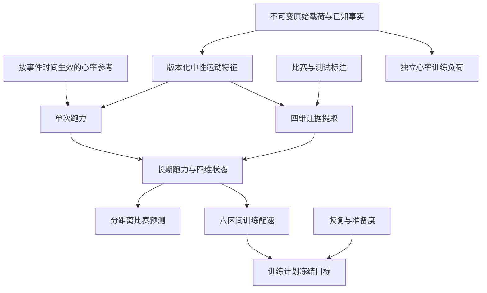

# RAI 跑力系统重设计方案

> 日期：2026-11-12（Asia/Shanghai）
>
> 状态：设计提案，尚未实施；不是当前功能说明或模型验收结论。
>
> 核查基线：工作区 `c0aa904` 及核查时已有的未提交内容；本次不修改业务代码。
>
> 目标：完整替换现有跑力设计，实现单次跑力、长期跑力、高驰式四维能力、分距离比赛预测、训练配速及可追溯历史重算。
>
> 修订：v1.2（2026-11-12 两轮审查后修订，见第 0 节）；仍是提案，未实施、未改任何业务代码。

## 0. 审查修订摘要（v1.1）

本次审查重新打开了 RQrun R1–R4 与 COROS C1–C3 页面、复算了文中全部数值例、并用 grep 核对了旧跑力的实际消费方。原稿的总体结构（单次／长期双层、四维、分距离、六区间、三种历史语义、旧链完全退出）成立，数值例（48.9 分、vT_ref、A_ref、v6_ref）复算无误。修订集中在下列会导致“做出来不像 RQ／高驰”或“实现后自相矛盾”的地方：

| # | 问题 | 修订 | 位置 |
|---|---|---|---|
| 1 | HRR 核心域上限 0.85，以上未定义：节奏跑、未标注的比赛、间歇课拿不到单次跑力，与“每次跑步都有即时反馈”的目标相悖 | 增加 0.85–0.92 高强度边缘域；增加间歇“整周期平均”片段；>0.92 只作已展示下界 | 6.2、7.1 |
| 2 | 片段是固定 180 秒窗口，权重里的 `min(净支持秒/600,1)` 恒为 0.3，是无效因子 | 从片段权重删除，改在训练级质量使用 | 7.1 |
| 3 | 长跑后段心率漂移会系统性压低单次分，长跑越多长期分越低 | 累计跑动 60 分钟后的片段在单次 A 中降权，漂移信息交给 retention | 7.1 |
| 4 | 最大心率是全模型最敏感的输入（±10 bpm 即 40–58 分），原稿只有“待设置”，没有维护机制 | 增加“观测峰值提示确认”与用户显式选择的年龄估计冷启动 | 5 |
| 5 | 8.2 的“分别 Huber 拟合”与 10.1 的“联合拟合”是两套估计器，未说明谁为准 | 10.1 联合拟合为唯一估计器，8.2 是其无确认成绩时的闭式特例 | 8.2、10.1 |
| 6 | bL／bS 在“识别”与“未识别”之间硬切换，会让总分在能力没变时跳 5 分以上，比赛过窗后又跳回 | 先验始终作为惩罚项连续收缩；“已识别”只是状态标签 | 10.1 |
| 7 | 证据在窗口末端权重仍有约 13% 时被硬截断 | 末 7 天线性收尾到 0 | 8.2 |
| 8 | `change_unconfirmed` 未说明比较对象，若与“昨天发布值”比较会破坏有界重建 | 明确为同一评估日的留一比较 | 8.3 |
| 9 | 四维评分按速度取 log2、总分按时间取对数，同一个 A 在两处得到不同分数 | 四维评分斜率乘 bL₀=1.10，使有氧评分与单次同政策分数完全同刻度 | 9.3 |
| 10 | 冲刺用 45 秒窗口且要求原生采样 ≤2 秒；现有特征层按 ≤5 秒原生间隔设计，该维度可能永远无值；且高驰的 Sprint 对应的是无氧能力配速区，不是极短冲刺 | 锚点改为 90 秒（`v90s`），采样要求与现有结构政策对齐 | 6.1、9、12 |
| 11 | Z5 要求“已识别个人短时形状”才生成，多数用户永远没有间歇配速；与“训练配速支持”目标不符 | Z5 可按先验生成并标 `prior_based`，只限制自动排课 | 12 |
| 12 | 高驰每项能力都附带建议训练配速区，原稿四维卡片没有 | 四维卡片绑定对应区间 | 9.3、13.2 |
| 13 | 响应示例 `overall.score: null` 与第 11 节“prior_based 仍给中心估计”矛盾 | 修正示例 | 15 |
| 14 | 代码路径缺 `apps/server/` 前缀；旧跑力消费方漏列 7 处 | 补全清单 | 3、16 |
| 15 | 预测范围里的“按训练日重采样”增加不确定性来源却不增加可解释性，且加重字节一致性负担 | v1 删除，只用角点范围 | 10.3 |
| 16 | 2.1/2.2 对 C2 页面的两处转述与当前页面不符 | 更正 | 2 |

已确认的决定（2026-11-12）：冲刺锚点为 90 秒（`v90s`）；允许年龄估计最大心率冷启动，但须用户显式选择。bL／bS 形状证据不使用长于 90 天的窗口，与成绩证据同窗，保持有限影响范围。

第二轮修订（v1.2，同日）在不改变算法的前提下补了六处工程与产品缺口：

| # | 问题 | 修订 | 位置 |
|---|---|---|---|
| 17 | 每天到达的静息心率都会改写参考的输入集合，按输入失效会让日常同步反复触发 28+42 天重算 | 各层按“输出值是否变化”截断失效传播 | 14.3 |
| 18 | 预测与六区间是长期状态的纯函数，却单独成表，凭空制造“同一 generation”一致性问题 | 并入每日状态产物 | 15 |
| 19 | 训练计划现用 E/T/I 三类配速，新六区间如何对应没有定义 | 给出映射与缺失时的降级 | 12 |
| 20 | 有比赛预测却没有比赛配速参考（RQrun 有马拉松配速） | 增加由预测派生的比赛配速参考 | 12 |
| 21 | 室内跑步机只写了“环境未知为 limited”，没说是否进入长期模型 | 明确权重与上限规则 | 6.3 |
| 22 | “本地自然日”未指明用哪套日历 | 沿用现有 local-days 政策，不另立 | 14.3 |

另在 17.3 增加“已知局限”清单，把设计上明知存在、v1 不解决的偏差写明。

## 1. 方案结论与范围

采用“RQrun 式单次／长期双层模型 + COROS 式四维能力”的产品结构，算法由 RAI 独立定义。

1. **单次跑力**回答“这一次跑步展示了怎样的表现”。以本次配速—心率时间序列为主，一次合格训练即可计算，不要求先积累长跑。
2. **长期跑力**回答“近期相对稳定的跑步能力怎样”。按日期融合近期单次证据、确认比赛／测试成绩，区分短期波动与能力变化。
3. **四维能力**为有氧耐力、阈值能力、速度能力、冲刺能力。每项独立记录证据、物理量、估计范围与状态；轻松跑不能直接证明冲刺能力。
4. **比赛预测**分别估计 5K、10K、半马、全马；用不同持续时间的能力约束，不再把一个 v60 和一个 gamma 外推全部距离。
5. **训练配速**由长期能力服务端生成六区间，注明依据和适用条件；训练计划消费冻结的配速快照。
6. **历史重算**是正式产品能力：单次重新分析、参数修正、指定时间段重算、算法升级重算，均有任务状态、版本和完整发布机制。
7. **旧跑力完全退出运行链路**：删除旧算法、三分支选择、旧资格门槛、旧评分和 iOS 本地预测公式。保留原始事实与必要的历史审计记录，不把“完全移除”实现为销毁健康数据。

本方案中的公式、窗口、阈值和先验均是 **RAI v1 的待验证设计参数**，不是 COROS 或 RQrun 的私有算法。工程测试通过只证明实现遵守定义，不证明人体预测准确。初版以确定性、可解释、可重算模型实现，不依赖人群训练集或黑箱机器学习。

仅做原生 iOS 与 Go 服务端，不增加 Watch、Web、桌面客户端；HealthKit 继续只读。WorkoutKit 仅在已有独立授权下用于排程，不通过它采集生理数据。

## 2. 官方资料核实

### 2.1 可以直接借鉴的公开机制

| 来源 | 已核实的公开机制 | 对 RAI 的决定 |
|---|---|---|
| RQrun 即时／当前跑力说明 | 单笔训练计算即时跑力；当前跑力综合约 42–60 天，作为训练配速依据 | 单次与长期分别存储、分别展示，不混为一个数。[R1](https://rq.run/article/content?id=253) |
| RQrun 心率设置说明 | 同配速低心率、同心率快配速对应更高表现；最大心率影响结果，允许单笔重新分析；记录中出现持续 15 秒以上高于设定值的心率时自动更新最大心率，之后的记录按新值计算 | 心率参数必须版本化，支持明确范围的历史修正；RAI 采用“观测峰值提示、用户确认”而非静默自动更新（第 5 节）。[R2](https://rq.run/article/content?id=257) |
| RQrun 当前跑力／竞赛跑力说明 | 当前跑力综合近期即时跑力、比赛记录与各距离最佳成绩，无训练时会下降；竞赛跑力另按成绩建模 | 长期模型同时接收心率型证据与成绩证据；RAI 不做“无训练自动扣分”，只做时效衰减（8.4）。[R3](https://www.rq.run/article/content?id=261)[R4](https://runningquotient-support.gitbook.io/rq-3/premiummore/runlevelvs) |
| RQrun 过程数据说明 | 计算关注过程中的心率、配速、时间、距离、海拔，平均值相同不代表结果相同 | 不以整次平均配速／平均心率代替时间序列。[R3](https://www.rq.run/article/content?id=261) |
| COROS 当前跑力说明 | 综合跑力反映马拉松表现，随配速—心率关系变化；四项能力是 Endurance、Threshold、Speed、Sprint | 保留四维结构；总分采用明确的马拉松等效刻度，而非四项简单求平均。[C1](https://support.coros.com/hc/en-us/articles/25464626934164-Understanding-Your-Running-Fitness-Score) |
| COROS 能力与配速区的对应 | 四项能力各有一个按当前能力给出的建议配速区；Endurance 与 Threshold 建议区之间的空档就是 Aerobic Power 区，官方称主要在该区训练时跑力往往持平；任一能力有变化时，一次跑步后分数就可能变 | 四维卡片各绑定一个训练区间（Z2／Z4／Z5／Z6），Z3 不对应任何一维；长期值允许单次更新，不设“几次才变一次”。[C1](https://support.coros.com/hc/en-us/articles/25464626934164-Understanding-Your-Running-Fitness-Score) |
| COROS 指标说明 | 跑步专项指标列有 Race Predictor、Efficiency Score、VO2 Max、Running Fitness Score、阈值心率区间等；解锁需至少一次 25 分钟、心率达 65% HRR 的跑步，或直接做跑力测试 | 分距离预测与单次效率分别建模；测试可作为即时校准通道。[C2](https://support.coros.com/hc/en-us/articles/360061452651-COROS-Fitness-Metrics-Explained) |
| COROS 跑力获取说明 | 首次为至少 25 分钟连续户外 Run／Track Run、达到 65% HRR；更新文档写滚动 90 天 | 参考其质量思想，RAI 不机械复制整条 25 分钟门槛。[C3](https://support.coros.com/hc/en-us/articles/360061448611-How-to-Receive-and-Update-Running-Fitness-Metrics) |
| COROS 跑力测试 | 结构化测试评估阈值配速、阈值心率、最大心率；建议约 12–16 周或明显能力变化后复测 | 设计独立测试录入与校准通道，但不要求拥有 COROS 设备。[C4](https://support.coros.com/hc/en-us/articles/36183438217364-Running-Fitness-Test) |

以上机制均据官网公开页面核实；其余拟合、融合、评分与门槛由下文独立定义。

### 2.2 对用户资料的修正和保留

- 本次复核打开的 C2 当前页面中，“42 天”只出现在 Training Status（训练负荷的 7 天／42 天滚动），不是跑力窗口；跑力更新条件页 C3 明确写滚动 90 天、且每 90 天至少一次 25 分钟户外跑。C5 早期介绍文本次未复核，其中“最近六周”的说法不作为依据。这不能合并为“所有指标都只看 42 天”或“全部统一 90 天”。RAI 自行确定有界窗口，不追随有歧义的品牌窗口。[C2](https://support.coros.com/hc/en-us/articles/360061452651-COROS-Fitness-Metrics-Explained)[C3](https://support.coros.com/hc/en-us/articles/360061448611-How-to-Receive-and-Update-Running-Fitness-Metrics)[C5](https://coros.com/stories/coros-metrics/c/introducing-running-fitness)
- COROS 较早介绍的 Base／Endurance 与现在 Endurance／Threshold 名称不同；本方案采用现行四维名称。官方说明已确认这次改名。[C6](https://coros.com/stories/latest-news/c/coros-inside-track-edition-1)
- RQrun 旧功能手册写稳定跑 10 分钟、心率和配速有效、坡度小于 5%；这是该版说明，不能作为现行所有版本的唯一门槛。[R4](https://runningquotient-support.gitbook.io/rq-3/premiummore/runlevelvs)
- 用户资料中“2026 年 RQrun 3–5 分钟即可出分”的说法，本次打开对应问卷正文未找到可核对的文字证据，部分内容是图片，故不当作已确认规则。下文短跑的净支持门槛明确是 RAI 自己的设计。[R5](https://training.rq.run/article/content?id=426)
- RQrun 五力不采用。用户要的是 COROS 式跑步能力，不是意志力／经验等训练行为分解。
- 两家都没有公开可完整复现的评分、四维融合和预测代码。RAI 不承诺与它们同分，也不把本方案宣称为逆向复现。

## 3. 当前实现为什么要替换

核查到的当前链路：

```text
WorkoutFeatures
  → performance v2：20/30/40/60/90 分钟窗口、每时长前三、中位数幂律拟合
  → demonstrated / maximal_supported
RAI VO2
  → runningability：f60 先验或标定 → submax_estimated
  → 确认全力 > 亚极量 > 已展示的选择
  → v60 对数评分；iOS 据 v60/gamma 派生区间和成绩
```

主要问题：

1. 单次训练没有独立完整的跑力产品；较短日常跑难以参与旧曲线。
2. 已展示分支的 5 次、跨度 14 天、长短各两次、3 个目标日，是曲线识别门槛，不适合作为日常跑力统一门槛。
3. 三分支含义不同，优先切换会同时改变数值和解释；长期趋势不容易理解。
4. 四维能力缺失，无法说明长距离、阈值、速度、冲刺分别如何变化。
5. 亚极量分支受 RAI VO2 产品门槛连带阻断，即使跑步心率和配速足够，也可能无单次反馈。
6. 一个 v60/gamma 服务所有比赛距离与训练目标，难以表达短距离强、全马准备不足。
7. 当前历史 API 明确不支持真实 `as_known` 视图；现有重建机制不能直接被称为本方案所需的完整历史重算。

关键代码位置（均在 `apps/server/internal/` 下）：`performance/`、`runningability/`、`workoutfeatures/windows.go`、`storage/postgres/model_stack_inputs.go`、`model_stack_optimized.go`、`athletemodel/schema3.go`、`training/generator.go`、`trainingload/pace.go`、`trainingload/focus.go`；iOS `ios/RAI/Sources/ProductCore/RunningAbilityDerived.swift`。完整消费方清单见 16.1。

## 4. 新领域模型与依赖方向



新增纯 Go 领域包 `internal/runfitness`，内部按 `single`、`evidence`、`longitudinal`、`profile`、`prediction`、`zones` 拆文件或子包。不得导入数据库、HTTP、管理工具、旧 performance／runningability，也不调用真实时钟。

输入时间、日历、来源、参数和版本由 application 显式传入。单次跑力不读取长期跑力，不用“近期能力”修饰本次计算；长期能力不反向把自己当新证据。恢复、负荷和准备度不作为跑力分的输入。

RAI VO2 与 Apple VO2 可作为独立指标保留，但新跑力不消费它们的产品结果，不受其出值状态限制。

## 5. 输入契约与缺失行为

| 输入 | 心率型单次跑力 | 比赛／测试证据 | 缺失处理 |
|---|---|---|---|
| 时间戳、Workout 身份、运动类型 | 必需 | 必需 | 无法解释时不计算对应结果，原载荷保留 |
| 速度／距离时间序列 | 必需 | 有可信距离和计时可单独成立 | 只有整次均值时不伪造时间序列 |
| 心率时间序列 | 必需 | 可选 | 日常跑无心率则不出心率型跑力；确认成绩仍可参与能力 |
| 最大／静息心率参考 | 必需 | 可选 | 显示待设置；不静默采用 220−年龄 |
| 暂停与停止信息 | 高优先 | 比赛用完整 elapsed 计时 | 暂停缺失标质量风险，不能自动把停等移除后当比赛 |
| 路线、海拔、精度 | 用于坡度和质量 | 用于赛道判断 | 可缺省降级，不因全程无海拔直接否决全部慢跑 |
| 室内／户外／田径场 | 必需可解释 | 必需可解释 | 环境未知为 limited，不自动认定平路 |
| 温度、湿度 | 可选 | 可选 | 缺失降支持，不硬阻断；不补造天气 |
| 跑步功率、步频、触地时间 | 可选 | 可选 | v1 不作为评分必需输入 |
| HRV、睡眠、日常静息心率流 | 非必需 | 非必需 | 跑力不因恢复数据缺失停算 |
| 全力／比赛／测试标注 | 日常不要求 | 作为上限证据时要求 | 普通训练最快片段只作为已展示下界 |

静息心率参考可来自用户明确设置，或按当时已知的既有心率参考选择政策取得；来源、有效期、推导窗口均入哈希。不能读取训练后未来日常健康事实去“改善”过去的参数。删除 daily-facts 对参考产生影响时按依赖关系失效，不因存在墓碑整体阻断。

**最大心率的维护（v1.1 新增）。** 第 7.4 节的合成例表明 HRmax ±10 bpm 就能让单次分在约 40–58 之间移动，它是整个模型最敏感的输入，必须有维护机制而不只是“待设置”：

- 观测峰值提示：某次跑步中经 15 秒中位数平滑后的心率持续 ≥15 秒高于当前 HRmax，且来源可信、非步频锁定候选时，生成“建议更新最大心率”提示。用户确认后才生成新的参考版本，默认“今后生效”，可选“纠正指定历史有效期”（触发 14.2 的重算）。不静默自动更新：自动更新会让历史分数在用户不知情时改变含义。
- 冷启动：没有任何 HRmax 时，允许用户**显式选择**“暂用年龄估计”。该参考标 `age_estimated`，单次与长期一律 limited，HRmax 敏感性范围由 ±10 扩为 ±12 bpm，不自动提高训练目标。不选择则保持“待设置”。这仍满足“不静默采用 220−年龄”。
- 下限保护：观测到的可信峰值高于设定值却未确认期间，r>1 的片段隔离并标 `hr_reference_exceeded`，不产生越界的 A。

每类结果单独给 `status`、`reasonCodes`、`evidenceAt`、`validUntil`。局部信号不可用只排除对应区段和能力；不把一个坏点升级为整次、整天所有模型失败。

## 6. 中性特征层与质量规则

不复用旧 `Qualification.Performance/PerformanceGAP` 作为新模型资格。它们包含旧时长、平路、来源及候选链语义；可复用经过核对的底层单位、距离积分、暂停解析和 Minetti 纯测量函数。

### 6.1 时间线

- 以秒为积分网格，但同时保存每秒的原生支持区间和插值跨度。插值到 1 Hz 不等于原生每秒采样。
- 心率最多连接 15 秒的有效样本间隔，速度最多 10 秒；超过即断开。90 秒冲刺证据要求原生速度间隔 ≤5 秒（与现有 `workoutfeatures/structure.go` 的原生支持政策一致）且窗口内距离积分与路线距离交叉核对误差 ≤5%。原稿的“45 秒窗口、原生间隔 ≤2 秒”在只读 HealthKit 的实际采样密度下很可能永远不满足，实施阶段 A 须先用合成的 2.5 秒／5 秒采样序列确认该维度可达。
- 跑前 120 秒、暂停恢复后 90 秒不参与心率—配速关系；仅 3–5 分钟短跑因此经常只能得到有限片段，不能保证出分。
- 用 15 秒中位数抑制心率尖峰，速度用 10 秒稳健平滑；原生支持与异常点仍用于质量检查。冲刺窗口不套用会削平峰值的 10 秒速度平滑。
- 可比较来源按硬件／传感器稳定身份识别，App、OS 更新不拆证据。不同设备可分别分析；没有交叉校准时不强行融合为同一精度。

### 6.2 片段条件（RAI v1 初始参数）

心率型片段采用互不重叠的 180 秒窗口，窗口内部优先使用：

| 项目 | 核心区 | 边缘区／处理 |
|---|---|---|
| 心率储备比例 r | 0.50–0.85 | 0.40–0.50 为低强度代理，支持降级；0.85–0.92 为高强度边缘域，条件质量 ×0.6；<0.40 或 >0.92 不产生心率型 A，>0.92 的片段只提供已展示速度下界 |
| 速度 | ≥1.4 m/s 且为持续跑步 | 更慢／走跑混合给基础效率，不伪称等效竞赛能力 |
| 心率与速度共同有效覆盖 | ≥90% | 70%–90% 仅诊断，不进入标量跑力 |
| 速度 CV | ≤8% | 不合格区段独立排除 |
| 心率稳态趋势 | 绝对值 ≤2 bpm/min | 避免把心率滞后当经济性提高 |
| 暂停／明显停等 | 不跨越 | 拆段，不要求整条训练完全无暂停 |
| 距离交叉核对误差 | ≤5% | >5% 隔离对应速度来源；缺核对渠道为 limited |
| 坡度 | 已知且绝对值 ≤5% 优先 | 5%–8% 只保留坡地表现；更陡不估平地能力 |

至少 180 秒合格净支持可以生成 `limited` 单次估计，≥600 秒合格净支持且覆盖／来源可靠可到 `supported`。加上前 120 秒适应期，通常至少需要 5 分钟连续记录；不是 3 分钟记录必然出分。训练总时长不是充分条件。区段中断不以零填充，不为凑够 10 分钟拼接无关数据。

窗口摆放必须确定：每个连续可用区间（适应期、暂停恢复期之后）从起点开始贪心连续切 180 秒窗口，尾部不足 180 秒丢弃；不做滑动搜索“最好的窗口”，否则同一记录会因实现差异得到不同分数，也会偏向挑选有利片段。

**间歇课的整周期片段（v1.1 新增）。** 重复跑中每组快段心率持续上升、慢段持续下降，都过不了稳态趋势门槛，原稿下一堂间歇课往往只有热身慢跑能出分。补充一种 `cycle_averaged` 片段：结构层已识别出 ≥3 个连续“快段＋恢复段”完整周期、合计 ≥600 秒、全程持续跑动（恢复段不是走或停）时，取整段的平均 v_flat 与平均 r 作为一个片段。心率滞后在完整周期内大体相消，这是它可用的理由。该片段条件质量 ×0.5，单次状态最高 limited，r 平均值仍须落在 0.50–0.92。恢复段为走／停的间歇课不生成心率型 A，只给已展示下界。

高强度边缘域存在的理由：节奏跑、未标注的比赛常落在 0.85–0.92，原稿在此没有定义，结果是最能说明能力的训练反而没有单次分。>0.92 时心率趋近平台、对速度不再敏感，继续归一化会低估，故只作下界。

这些阈值须经过合成边界和测量噪声测试，不能标成已有人体验证的生理边界。

### 6.3 坡度与环境

沿用 Minetti 纯函数作已知坡度的成本归一化：

```text
C(g) = 155.4g^5 − 30.86g^4 − 43.3g^3 + 46.3g^2 + 19.5g + 3.6
v_flat = v × C(g) / C(0)
```

`g` 是小数坡度。海拔按至少 100 米空间基线平滑后求坡度，不对噪声 GPS 高程逐点微分。未知坡度段不伪装 g=0：允许以 `unadjusted` 模式输出 limited 日常估计，质量权重 ×0.6、速度敏感性扩至 ±8%；不用于上调已建立的能力上限，也不支持精确成绩点预测。上下坡交替不得用全程平均坡度抵消。

室内跑步机：坡度视为已知（无坡度记录时按 0），但速度来自手表加速度计估计、没有路线可交叉核对，属于“缺核对渠道”。规则：可生成 limited 单次分；进入长期模型时质量权重 ×0.5；与未知坡度段一样不用于上调已建立的能力上限，不提供冲刺与已展示下界证据。高驰只用户外 Run／Track Run 更新跑力（C3），RAI 保留室内反馈但不让它主导长期值。

温湿度已知异常时 v1 只作降权和“条件不同”提示，不宣称可以用固定公式精确折算到理想天气。初始政策：温度 <5℃ 或 >25℃ 权重 ×0.7，湿度 >85% 再 ×0.8；0℃ 以下、30℃ 以上的心率效率只作当次条件表现，不上调长期能力。天气缺失 ×0.8。以上均为质量政策，不是医学或热生理结论。

## 7. 单次跑力算法

### 7.1 不依赖旧 VO2／f60 的独立观测

对每个合格片段 j：

```text
r_j = (HR_j − HRrest) / (HRmax − HRrest)
A_j = v_flat,j × (0.70 / r_j)^β
```

`A_j` 为“70% HRR 标准强度等效速度”，单位 m/s。v1 的 `β=1`，敏感性范围 0.85–1.15。它是有限强度域内的工程代理，不宣称 HRR 与速度严格线性，也不宣称直接测到了 VO2、乳酸阈或跑步经济性。

β=1 的依据与局限：跑步的净耗氧量近似与速度成正比，HRR 比例又近似等于摄氧量储备比例，所以“速度与 r 成正比”在中等强度域是合理的一阶近似；它在低速（走跑过渡）和接近最大心率处失效，这正是 6.2 限定强度域的原因。R3 记录了 RQrun 用户“轻松跑即时跑力偏低”的同类现象。v1 不在单次层个体化 β；长期层可诊断性地报告“A 随强度的残差斜率”，若实施后发现系统性偏差，再以升版本方式引入个人 β，不在 v1 内悄悄修正。

同一运动内的片段按 `覆盖 × 来源质量 × 稳态质量 × 条件质量 × 漂移权重` 加权，对 `ln(A_j)` 求加权中位数，得到本次 `A_i`。原稿权重中的 `min(净支持秒/600,1)` 因窗口固定为 180 秒而恒等于 0.3，不起作用，已删除；净支持时长改为只在训练级使用（6.2 的 limited／supported 判定和 8.2 的 `min(有效分钟/20,1)`）。短片段多不等于独立证据多；一条训练最终只产生一条有总权重上限的日常心率证据。

漂移权重：片段起点之前的累计跑动时间 ≤60 分钟为 1，之后为 0.5。长跑后段同配速心率上升是正常的心血管漂移，若与前段等权，长跑越长单次分越低，长期分会因为多跑长距离而下降；后段信息由 9.1 的 retention 单独表达。

初始稳态质量取 `max(0.25,1−CV/0.10) × max(0.25,1−abs(HR趋势)/3)`，只在已通过硬门槛的片段内使用。来源质量：可信且相容为 1，身份缺失为 0.5，冲突为 0 并隔离。全部规则版本化。

### 7.2 单次分数使用共同刻度，但不是完赛承诺

为让不同训练可比较，将 A 换算成固定中性假设下的马拉松等效表现：

```text
vT_i = A_i × (rT / 0.70)^β
tT = 2400 秒                   # 40 分钟参考持续时间
rT = 0.85                      # 功能性阈值代理，非乳酸实测
bL = 1.10                      # 长距离衰减先验
T_M,i = tT × (42195 / (vT_i × tT))^bL
score_i = clamp(100 × ln(28800 / T_M,i) / ln(4), 0, 100)
```

刻度定义：马拉松等效 8 小时为 0 分，4 小时为 50 分，2 小时为 100 分。刻度由 RAI 自定义，超界保留 rawScore 和 saturation，UI 不把 0 分当缺失。该刻度不等于 RQ、COROS、VDOT、VO2 或人群百分位。

本次分数只说明“在统一假设下，本次心率—配速表现折合到什么水平”。**不会在运动详情把 T_M,i 当本次可跑出的全马成绩展示**。单次记录还必须显示实际净支持时间、A、区段、范围、条件及证据类型。先验不藏在一个看似实测的分数后面。

### 7.3 比赛型单次跑力

确认全力的比赛／测试可在没有心率时，通过距离、elapsed 时间和赛道质量产生 `race_equivalent` 单次分数。它和 `hr_normalized` 是证据类型，不是旧“三分支择优”模型：

- 以真实成绩约束第 10 节的能力曲线；只在同一规定中性先验下算本次等效分。
- 不读取训练后的长期能力修饰这场比赛；需要训练前校准时固定 `referenceSnapshotID`。
- 心率型和比赛型可同时保留，但同一 Workout 在长期拟合中共用预算并建相关性，不能算两次独立训练。
- 未确认全力的最快片段只作为能力下界，不能直接把它当“该距离极限成绩”。
- 逆风、炎热、越野、非标准距离只影响对应证据和预测资格，不篡改比赛原成绩。

### 7.4 范围和质量

区分“标准化表现分的不确定性”和“把它解释为比赛能力的不确定性”，避免把缺长距离证据重新变成单次跑力的出分门槛。

- `scoreSensitivityRange`：评分政策中的 β=1、rT=0.85、bL=1.10 固定，传播 HRrest ±5 bpm、HRmax ±10 bpm、速度 ±2% 的测量／参考误差。它回答“本次标准化表现分对心率与速度误差有多敏感”。
- `abilitySensitivityRange`：再传播 β 0.85–1.15、rT 0.80–0.90、bL 1.06–1.18，供能力解释和比赛预测使用。它通常显著更宽，不用于否决一个可计算的本次标准化表现分。
- 未知坡度采用第 6.3 节的扩展速度范围；有可靠测试误差时以版本化测量范围代替默认误差。

不把角点范围称为 95% 置信区间。范围反映参数假设，不覆盖疾病、风、补给等全部不确定性。核心信号合格且参考有效，即可展示本次中心分和范围；范围宽时显示 limited、解释局限并禁止据此自动提高训练目标。只有输入不成立、来源冲突或无法形成有限解时不出中心分，不能以“没跑过全马／缺少长跑校准”否决单次分数。

合成核对例：HRrest=50、HRmax=190、片段 HR=141、平地速度 2.6m/s，得到 r=0.65、A=2.8m/s、固定刻度单次分约 48.9。按上述默认测量范围，分数约 40.1–57.7；加入能力形状先验后约 23.4–71.3。后者很宽，说明不能把这个单次分数解释为精确全马预测；它不妨碍显示一个明确标为 limited 的本次表现分。

## 8. 长期跑力：滚动证据融合

### 8.1 窗口与启动

日常单次证据主窗口为 42 个本地自然日，按时间常数 21 天衰减；有效比赛／结构化测试证据为 90 天，时间常数 42 天。每个窗口都有硬终点，支持有限影响范围。

| 阶段 | 证据 | 输出 |
|---|---|---|
| 初次 | 1 次合格训练 | 单次跑力；长期初步估计，可只给范围 |
| 初步 | ≥3 个独立训练日，跨度 ≥7 天 | preliminary 长期跑力及已支持维度 |
| 建立 | ≥8 个独立训练日，跨度 ≥21 天；质量与稳定性通过 | established 长期跑力 |
| 局部不足 | 没有速度／冲刺／长距离证据 | 对应项待补充，其余照常计算 |

不再要求每人必须两次 40 分钟跑步才能看到长期跑力，也不要求四维齐全后才显示总分。建立阶段不等于四维全都建立。

### 8.2 稳健融合

日常训练 i 的未归一化权重：

```text
w_i = q_i × min(有效分钟/20,1) × exp(−ageDays/21) × min(1,(42−ageDays)/7)
```

最后一个因子让权重在窗口末 7 天线性收尾到 0。只有指数衰减时，第 41 天的证据仍有约 14% 权重，第 42 天突然归零，长期值会在没有任何新训练的日子出现台阶。比赛／测试证据同理，用 `exp(−ageDays/42) × min(1,(90−ageDays)/14)`。影响范围不变（仍是 d 到 d+41、d 到 d+89）。

同一本地日期的训练先归一化，使总权重不超过 1；一条训练内重复片段总量不超过该训练预算。确认比赛／测试的初始总预算最多为 2，再按 42 天衰减。样本不足时保留低支持状态，不用“次数少就给予 100% 置信”。

在对数物理量空间使用 Huber 稳健目标：

```text
μ* = argmin Σ w_i × Huber((ln(x_i) − μ)/s)
s = max(1.4826 × weightedMAD, 0.03)
Huber δ = 1.5
```

**唯一的估计器是第 10.1 节的联合拟合。** 上式是它在“窗口内没有任何确认成绩、只有日常 A 观测”时的闭式特例：此时 A 取上式的 μ*，vT、v6、bL 由先验关系给出。实现只写一个求解入口，并用测试断言“无确认成绩时联合解与上式逐位一致”，不能维护两套会各自演化的拟合代码。冲刺 `v90s` 不进入联合拟合，单独按同一 Huber 规则对其直接观测求位置估计。日常 A 到阈值的派生先验与 A 共享训练身份，不能增加独立样本数。先验只约束未识别参数，不计入证据条数、质量或建立状态。

不是选每种时长最快三次，也不是把所有单次分数求平均。低强度表现正常的轻松跑能贡献有氧证据；冲刺、比赛等证据只更新自己能支持的能力。

### 8.3 稳定性与新证据

- 逐训练／逐日留一重拟合记录敏感性，检查总分和各物理锚点变化；不稳定只降级对应项。
- 已建立模型下，单次导致总分变动 >5 分或物理锚点变动 >10%，标 `change_unconfirmed`。“变动”定义为**同一评估日、同一证据集合下包含与剔除该训练的两次拟合之差**（即上一条的留一结果），不是与前一天已发布值之差；后者会让某天的结果依赖发布历史，破坏“每日从有界证据重建”和重算的字节一致性。支持充分的确认比赛／测试可正常更新；普通异常记录保留、降权，等另一独立训练日复现后再确认。
- 不以“只能每 2–5 次变一次”硬控制产品。使用未舍入物理量计算，UI 显示一位小数；证据增加但分数不变也可说明支持改善。
- 不引入无限递归 EWMA。每日结果从有界证据集合重建，可确定受影响日期；图表平滑仅是视图选项，不修改训练决策值。
- 所有参数只看评估时点之前的证据。禁止用 11 月的比赛修正 9 月的默认能力曲线后仍称“9 月当时能力”。

### 8.4 过期

最新可用证据 ≤14 天为 fresh，15–28 天 aging，29–42 天 stale；stale 的旧数值可在历史显示，但停止自动提升配速。超过日常 42 天仍可有 90 天内的比赛证据，须标 `race_only`；全部证据越过窗口则当前值为空。

没有新训练不会自动扣分伪造退化，只衰减支持和标时效。未来若增加停训退化预测，须作为独立的估计模型升版本。四维独立过期，不能因冲刺证据缺失把全部跑力清空。

## 9. 四维能力设计

四维均保存物理锚点，而非把总分复制成四个数字。

| 能力 | 主要物理量 | 日常证据 | 高质量校准 | 不能推断的内容 |
|---|---|---|---|---|
| 有氧耐力 Endurance | A：70% HRR 等效速度；长跑效率保持率、长距离衰减 bL | 核心域稳态跑；长跑前后段效率 | 半马／全马成绩、可靠长跑 | 跑量大不自动等于能力高 |
| 阈值 Threshold | vT：功能阈值配速代理；有依据时的阈值 HR | 不同中高强度稳态表现，仅初步估计 | 20–40 分钟结构化阈值测试、可信比赛约束 | HRR 85% 不等于测到了乳酸阈 |
| 速度 Speed | v6：6 分钟等效全力速度 | 3–12 分钟高强度段先给已展示下界 | 确认 3–12 分钟测试／短距离比赛 | 轻松跑心率改善不能直接证明最大摄氧量 |
| 冲刺 Sprint | v90s：90 秒连续最快合格均速，辅以 60/120 秒 | 可靠短重复表现下界 | 明确测试或 ≥2 次独立训练日确认的短重复 | 不用单秒 GPS 峰值，不由 vT 推出已测冲刺分 |

冲刺锚点由原稿的 45 秒改为 90 秒，命名 `v90s`（带单位后缀，避免与旧 60 分钟能力 v60 混淆）。理由有二：其一，C1 说明高驰每项能力对应一个建议配速区，Sprint 对应的是最快的无氧能力配速区，属于可重复的短间歇强度，不是极短的全速冲刺（这一点是据官方“能力—配速区”说明所作的推断，官方未公布时长定义）；其二，45 秒窗口在手表 GPS／计步速度的原生采样密度下误差过大。四维与高驰训练区的对应固定为：有氧耐力↔Z2、阈值↔Z4、速度↔Z5、冲刺↔Z6；Z3（有氧能力）不对应任何一维。

### 9.1 长跑效率保持率

对净连续跑 ≥60 分钟，去除前 10 分钟，选至少两个各 15 分钟的可比较区段：前后段来源一致、坡度模式一致、速度差 ≤10%，且都在 HRR 核心域。定义：

```text
EF = v_flat / r
retention = EF_late / EF_early
drift = 1 − retention
```

温度、湿度、补水变化都会影响 drift。它只提供“本次长跑保持情况”与长距离准备支持，不单独把 drift 换算成 bL，不能凭一次脱水长跑判永久耐力下降。

### 9.2 阈值与速度证据

vT 默认来自 A 与 rT 先验，状态 `estimated`；必须显式展示先验。20–40 分钟结构化测试可提供阈值代理观测，但测试最后阶段高心率不自动改最大心率或变成乳酸实测。阈值 HR 可采用有稳定强度且被确认为阈值测试的末 15 分钟心率中位数；其含义仍是功能性估计。

v6 的直接证据：6 分钟测试优先；3–12 分钟确认全力成绩通过短时曲线折算。未个体识别时短时先验指数 bS=1.06，范围 1.03–1.12，折算结果标 `estimated`；≥2 个独立日期且时长比 ≥2 的确认成绩才识别个人短时形状。不能把普通间歇中的一组未尽全力片段自动当极限测试。

### 9.3 四维评分和对比

所有维度先展示配速／保持率，再提供 RAI 自定义 0–100 相对评分。评分基准写入不可变 `ratingPolicy`，不宣称为品牌分或人群排名。

中性基准跑者定义为：rT=0.85、bS=1.06、bL=1.10、tT=2400 秒、理论全马 4 小时。由此得到：

```text
vT_ref = 42195 / [2400 × (14400/2400)^(1/1.10)] ≈ 3.448574 m/s
A_ref = vT_ref × 0.70/0.85 ≈ 2.840002 m/s
v6_ref = vT_ref × (360/2400)^(1/1.06−1) ≈ 3.839511 m/s
v90s_ref = 4.6 m/s              # 仅是 RAI 冲刺刻度锚点，不由曲线推出，需独立校准验证
rating(x,x_ref) = clamp(50 + 50×bL0×log2(x/x_ref),0,100),  bL0 = 1.10
```

斜率乘 bL0 是为了让四维评分与总分同刻度。总分对时间取对数，而中性模型下 `T_M ∝ vT^(−bL0)`，所以速度翻倍对应总分 +55 而不是 +50。原稿的 `50 + 50×log2` 会使同一个 A 在“有氧耐力评分”和“单次同政策分数”里得到两个不同的数（例如 A 比基准高 10% 时分别是 56.9 和 57.6），页面上无法解释。修订后：有氧评分恒等于 13.1 的 `referenceDailyScore`，心率型单次分恒等于以该次 A_i 计算的有氧评分；四维全为 60 的中性形状跑者总分也是 60。

Endurance 主分基于 A，另附 retention 与 bL；Threshold 基于 vT，Speed 基于 v6，Sprint 基于 v90s。每张卡片同时给出该能力对应的建议训练区间（上表的 Z2／Z4／Z5／Z6），与高驰“每项能力附建议配速区”一致。长距离保持能力参与总分及长距离预测，而不是用任意权重偷偷改 A 的含义。

没有直接速度或冲刺证据时，卡片显示“待补充／仅已展示下界”，不拿先验当已测四维评分。总分依第 11 节计算，不对缺失四维补零、不按剩余项重新归一化。两项之间只有状态、来源、刻度政策一致且支持充分时才能提示强弱；上述锚点尚未校准前只作描述，不生成“天生速度弱”等结论。

## 10. 分距离能力曲线与预测

### 10.1 能力参数

长期状态以 `A、vT、v6、v90s、bL` 为主要参数，保留各参数范围、证据和先验。vT 是功能性阈值代理，tT=40 分钟是模型的持续时间锚点，二者不能等同于实验室乳酸阈和实测可持续时间。

以两段模型覆盖常见比赛时域：

```text
在 360s ≤ t ≤ 2400s：
  z = ln(t/360) / ln(2400/360)
  ln v(t) = (1−z)×ln(v6) + z×ln(vT)

在 t > 2400s：
  v(t) = vT × (t/2400)^(1/bL−1)

D(t) = t × v(t)
```

v6 无直接证据时，内部临时用 `vT × (360/2400)^(1/1.06−1)`，注明 `speed_shape_prior`，不产生已测速度分。bL 无长距离成绩时用 1.10、范围 1.06–1.18，注明 `endurance_prior`。短于 6 分钟的能力不用于普通距离预测；冲刺独立观测，不以这段曲线硬推 400 米。

对 A、vT、v6、bL 进行有界联合稳健拟合：日常 A 观测约束 A；`vT=A×(rT/0.70)^β` 只作有误差的先验关系；确认成绩约束 `ln(D/T)` 与 `ln(v(T))`；普通训练只施加 `v(T) ≥ demonstratedSpeed` 的单边约束。比赛／测试和心率来自同一 Workout 时共用证据预算。

取值域：A、vT、v6 为正，v6≥vT；bL∈[1.02,1.25]。曲线必须满足速度不随时长增加、D(t) 严格递增。近边界／数据互相矛盾时返回 conflict，不通过强行夹值假装合理。优化器、Huber 规则、先验尺度、停止误差和确定性次序写入 ConfigHash。

实际编码前冻结求解细节：对 bL 使用步长 0.001 网格；在各候选上用固定次序有界 IRLS 求 ln(A)、ln(vT)、ln(v6)，最多 30 次、参数改变量 ≤1e−8 停止；不可辨识参数维持带范围先验。默认 log 观测误差为日常 A 0.06、确认计时成绩 0.03、阈值先验关系 0.10、短时形状先验 0.12；质量通过 w 进入损失。下界仅惩罚违反部分，不产生双边等式。真实测量误差可替代默认尺度，必须版本化。合成验证不收敛的参数组合返回失败或范围，不能发布 NaN 或伪完成。

识别个人 bL 需要两次以上、来自不同日期、持续时间 ≥40 分钟且时长比 ≥1.5 的确认全力成绩；至少一条 ≥75 分钟。跨期能力变化和不同赛道造成的冲突必须显式处理，不能把 3 个月前未训练状态和今天的 PB 当同一天耐力曲线。证据不足保留先验，长跑 drift 只改变支持与提示。

**形状参数连续收缩，不做硬切换（v1.1）。** 上述“识别”条件只决定 bL／bS 的**状态标签**（`prior_based` → `calibrated`）和范围宽度，不决定估计器是否启用个人值。bL 的先验（中心 1.10、log 尺度写入 ConfigHash）与 bS 的先验始终作为惩罚项留在目标函数里，确认成绩按其衰减后的权重把估计从先验拉向个人值。原因：在全马距离上 bL 每变化 0.05，总分约变 6 分；如果满足识别条件的那天从 1.10 直接换成个人值、90 天后证据过窗又换回，总分会在能力没有变化时来回跳。连续收缩下，一场比赛的影响随权重衰减平滑退出。验收测试须覆盖：单场长距离成绩逐日老化直至过窗，bL 与总分逐日变化单调且无台阶（相邻日总分差 ≤0.5）。

### 10.2 5K／10K／半马／全马

对各目标距离在 `[360 秒, 8 小时]` 上求解 `D(t)=目标距离`，用确定性二分，时间误差 ≤0.1 秒；域外返回 unsupported，不输出边界时间充数。

| 距离 | 主要支持 | 无充分专项证据时 |
|---|---|---|
| 5K | v6、vT，近期短比赛／测试 | 可给 estimated 范围，明确短时形状先验 |
| 10K | vT、短时形状和相近时长比赛 | 可给 estimated 范围 |
| 半马 | vT、bL、长跑保持情况 | bL 未识别时仅理论范围 |
| 全马 | bL、长距离成绩、长期长跑与训练覆盖 | 没有长跑支持只给理论范围，不给建议目标单点 |

所有预测注明“平坦赛道、适宜天气、合理配速与补给条件”。v1 不提供未经人群标定的“完赛概率 82%”。

`predictionSupport` 分为 `direct / calibrated / prior_based / insufficient`。`preparationSupport` 另列近期长跑次数、最长时长、有效训练周、长跑保持情况，绝不把训练量直接加成跑力或伪造准备充分。

可把半马 ≤预计时间的 0.6 倍、全马 ≤预计时间的 0.5 倍作为最长训练时长覆盖的初始提醒阈值，但只能用于描述准备覆盖，不把它当通过率或要求用户为解锁分数去跑过长训练。全马目标单点还要求近 56 天 ≥2 次合格长跑且每次 ≥90 分钟、至少一项相近长距离成绩校准、无明显来源冲突；这些条件仅限制“建议目标”，不限制日常跑力出分。

### 10.3 预测范围

传播心率参考、A／vT／v6 支持范围、短长距离形状先验及测量误差，全部用确定性的角点组合。首版统一叫“模型范围”，不叫概率区间。原稿中“按独立训练日块重采样”的做法 v1 不做：它引入随机数与采样次序，给“重算与逐日重放字节一致”增加负担，产出的仍然不是可解释的概率区间；拟合敏感性已由 8.3 的留一重拟合覆盖。

长距离范围应包含 bL 先验不确定性，不能因为日常训练多就把全马范围自动收窄。最新可信比赛与预测明显冲突时显示 conflict 与来源，不自动选更快的结果。

## 11. 长期总分

用第 10 节长期能力模型求出的中性条件全马等效时间 `T_M`，沿用第 7 节的新刻度：

```text
overallScore = clamp(100 × ln(28800/T_M) / ln(4),0,100)
```

因此，总分是距离能力的统一表达，而非四个维度的算术平均；冲刺改善本身不会无依据地提升全马水平，速度训练也不应让全马和 5K 预测按同一比例改善。

没有长距离校准时，分数仍可在 `estimated / prior_based` 状态展示中心估计，必须同时给范围和“耐力保持采用默认假设”；这个数的存在不等于全马目标已获支持。没有 vT 直接证据时也显示阈值先验。范围宽只限制精确预测、强弱结论和自动提高训练目标，不把它变成所有长期分数的硬阻断。若不可辨识参数连有限中心解都不支持，才仅显示范围或无值，并说明原因。

旧分与新分不做数值换算，不把旧历史接到新折线上。重算后的新历史统一新算法、新刻度，并显示重算版本；旧结果只保留内部审计，不进入新产品择优。

## 12. 六区间训练配速与训练计划

训练区间由服务端按长期物理能力生成，不再由 iOS 乘旧 v60 比例。用 `V(r)=A×(r/0.70)^β` 定义下列速度边界：

```text
B0 = V(0.40)
B1 = V(0.55)
B2 = V(0.70)
B3 = 0.95×vT
B4 = 1.03×vT
B5 = 3 分钟等效速度 = v6 × (180/360)^(1/bS−1)
B6 = v90s（需要合格冲刺证据）
```

| 区间 | 速度区间 | 主要支持 | 首版产品含义 |
|---|---|---|---|
| Z1 恢复 | [B0,B1) | A | 低强度参考，慢速域外时改体感／HR 指导 |
| Z2 有氧耐力 | [B1,B2) | A | 日常有氧 |
| Z3 有氧能力 | [B2,B3) | A、vT | 中等强度持续跑 |
| Z4 阈值 | [B3,B4) | vT | 功能性阈值附近，必须说明估计依据 |
| Z5 无氧耐力 | [B4,B5) | v6 与短时形状 | 高强度重复参考，不声称实测无氧代谢 |
| Z6 无氧能力 | [B5,B6] | 直接短时／冲刺证据 | 短重复参考，不输出全力冲刺处方 |

B5 的支持分三级（v1.1 放宽）。原稿要求“已识别个人短时形状”才生成 B5，而识别需要两场时长比 ≥2 的确认全力成绩，绝大多数时间 Z5 会是空的，等于没有间歇配速。从 6 分钟外推到 3 分钟在先验 bS=1.06 下只是 +4.0%，在 bS 范围 1.03–1.12 内是 +2.0%～+7.7%，范围本身足以表达不确定性：

| v6 来源 | bS | Z5 状态 | 能否自动排课 |
|---|---|---|---|
| 直接证据 | 已校准 | `supported` | 能 |
| 直接证据 | 先验 | `estimated`，B5 给范围 | 能，取范围慢端 |
| 由 vT 按先验推出 | 先验 | `prior_based`，仅参考显示 | 不能，用户手动选用时冻结为快照并注明依据 |

Z6 始终要求直接冲刺证据；没有 v90s 时 Z6 为空，Z5 上界开放并注明。

配速区间按 `[1000/速度上界,1000/速度下界]` 返回快端和慢端，单位秒/公里。必须校验边界严格递增；边界冲突就返回冲突及缺失区间，不能排序后冒充原含义。

每区输出 `range、basis、support、validUntil、sourceSnapshotID`。limited／preliminary 时允许 Z1/Z2 有限参考，但不自动提高计划强度；稳定 vT 后才能自动绑定 Z3/Z4；Z5 按上表，Z6 须专项支持。vT 获得独立校准后可能出现 `0.95×vT ≤ A`（B3 ≤ B2），此时 Z3 无法成立：返回 `zone_anchor_conflict`，Z1／Z2 与 Z4 及以上照常给出，Z3 留空，不通过挪动边界掩盖 A 与 vT 两个锚点的矛盾。v1 区间系数是待验证的训练政策，不宣称与 COROS 精确一致。

**比赛配速参考。** 六区间之外另给四个比赛配速（5K、10K、半马、全马），直接取第 10 节各距离预测的平均配速及其范围，不另设公式。只有该距离 `predictionSupport` 为 direct／calibrated 时才作为可排课的目标配速；prior_based 时仅显示范围并注明。马拉松配速通常落在 Z3 内，它是比赛专项参考，不是第七个区间。

**与现有训练计划课型的对应。** 现 generator 用旧 v60 派生 E／T／I 三类配速，替换后固定为：E→Z2，T→Z4，I→Z5，长跑→Z2（有全马目标且比赛配速可排课时，专项段用马拉松配速）。某课型对应区间不可自动排课时，该课只下发心率目标与体感说明，不回退到其他区间或旧公式；这一降级写入计划审计。

训练计划改为消费 `PacePrescriptionSnapshot`，包含六区间、比赛配速参考及独立心率目标；升级 generator 版本。准备度决定当天调整，跑力决定能力基准，二者不混算。已执行课程、已导出或已确认的 WorkoutKit 排程保留原目标；新能力只影响新计划或用户明确应用的计划修订，不静默改写过去训练。

## 13. iOS 产品与交互

### 13.1 运动详情

每次跑步展示“单次跑力”，包括分数或范围、有效分析分钟、证据类型、当次条件、较训练前日常表现基准的差值，以及哪些能力获得新证据。没有数值时明确是缺心率、缺参数、速度来源不可靠、稳态不足或无法形成有限解。

比较基准固定为 **Workout 开始之前** 的长期快照：对其中 A 用与本次完全相同的固定评分政策生成 `referenceDailyScore`，再与心率型本次分数相减。不能直接用本次中性先验分减掉已经个人化 bL 的长期总分，把耐力形状差异误说成当天状态。比赛型则与同距离、同条件定义的训练前预测比较。冷启动无基准则不显示差值；禁止把本次加入长期模型后再拿新长期值比较，造成自我比较。

支持标记“普通训练／比赛／阈值测试／速度测试／冲刺测试”，确认或撤销全力。标注影响模型，但不修改 HealthKit 事实；手工成绩注明手工与证据级别，不能伪装传感器验证。

### 13.2 跑力页

- 顶部：长期跑力、范围、阶段、更新时间与主要依据。
- 趋势：单次点和长期日线，缺失留空；同一算法版本和历史视图内比较。
- 四维：有氧耐力、阈值、速度、冲刺四卡；有值才画雷达顶点，缺项不填零。每卡显示物理锚点、评分、状态，以及对应的建议训练区间（Z2／Z4／Z5／Z6）和“补哪类训练能获得证据”。
- 比赛预测：四个距离各自的范围、支持、准备覆盖及适用条件。
- 训练配速：六区间，缺失项说明所需证据。
- 重算：单次与指定区间，显示进度、完成／失败、版本、更新时间及重算前后变化。

不再展示旧 demonstrated／maximal_supported／submax_estimated 分支选择器。用户选择的是证据标注与历史视图，不是挑一个分数更高的算法。

单次点使用统一中性先验，长期总分可使用个人耐力形状，图例和详情须写清这一差别。默认可在单次点图叠加同政策的 `referenceDailyScore` 趋势，长期总分另作日线图；不把两者的竖直差距直接标为状态差。

## 14. 历史重算：语义与有限影响范围

### 14.1 三种历史语义必须分开

| 视图 | 定义 | 默认用途 |
|---|---|---|
| `published` | 当时实际发布的不可变结果 | 审计当时看到什么、计划采用什么 |
| `revised` | 指定算法和输入 revision 下，重算过去事件时点 | 默认新跑力历史与参数纠错 |
| `as_known` | 固定当时已知的事实、参数、标注，按指定可执行算法回放 | 验证真实历史决策，无未来信息 |

`revised` 可使用后来补传但事件时间位于评估日之前的训练；不能使用评估日之后的训练。`as_known` 同时要求 eventTime 和 knownAt 均不超过当时截止时点。算法在当时尚未发布的回放须标“按新算法回放当时输入”，不能叫当时已发布结果。

当前 API 对 `as_known` 返回 `historical_input_unavailable`。实施前先审核事实／标注／参数的版本保留：如果过去版本、撤销、删除前可见性不能恢复，就继续明确 unavailable，不能凭当前行和新版本伪造过去状态。第一版必须完成 `published + revised`；`as_known` 的真实可用性属于独立验收项，不能只增加 query 参数宣称已支持。

### 14.2 触发方式

1. 单次“重新分析”：原始载荷不变，用指定现行算法／参数政策生成新结果。
2. 心率参数修正：区分“今后生效”和“纠正指定历史有效期”；只有后者触发历史重算。
3. 比赛标注／撤销／来源选择调整：重新分析相应记录及其派生日期。
4. 晚到或补充的已支持事实：只失效实际受影响的片段、记录、日期。
5. 算法升级：按明确时间范围生成新版本历史，不能拿旧分转换成新分。
6. v3／管理路径的既有删除：失效对应事实和后续派生；v4 Workout 不新增删除上传，也不根据快照缺席删除。daily-facts deletedObjects 例外沿用，必要时失效引用过该参考的跑力。

### 14.3 影响范围与重算顺序

所有时间窗使用本地自然日、明确半开区间及边界测试，不能用固定 24 小时替代有 DST 的日历。日历沿用现有负荷模型的 local-days 政策（`trainingload` 的 FocusPolicy 已引用 `local-days/v1`），训练归属日与评估日的时区规则不为跑力另立一套，政策版本入 ConfigHash；实施阶段 A 先确认该政策对跨时区旅行的定义，再冻结。

**按输出值截断失效传播（v1.2）。** 下列依赖只说明“可能受影响”的上界。实际重算时每一层都比较新旧**输出**的规范化哈希，未变化就不再向下游传播：

- 心率参考：推导结果取整到 1 bpm。新到一天的静息心率只要没有改变取整后的参考值，引用它的训练就不重算。否则每天同步的日常健康数据都会改写参考的输入集合，使 28 天内的训练和它们各自 42 天的下游被反复重算。
- 中性特征 → 单次结果 → 每日状态：同理，重新分析后单次结果哈希不变，则其下游日期不入队。
- 输入哈希仍完整记录（用于审计与 as_known），只是不作为“必须重算”的唯一判据。

这不改变结果，只减少无效工作；验收须证明“截断后的结果与不截断的全量重算逐位一致”。

- 日常证据事件日 d 影响包含 d 的 42 天长期窗口，即 d 到 d+41；确认成绩／测试影响 d 到 d+89。
- 56 天准备覆盖影响 d 到 d+55，独立于能力分数窗口。
- 单次直接依赖事件时点的 HR 参考；参考修正先列出有效期内受影响训练，再计算这些训练的所有下游日期并集。
- 如果静息参考由过去 28 天健康事实推导，某日健康事实还会影响随后 28 天的参考选择，必须先展开参考依赖，不能只重算删除当天。
- 训练前比较基准与负荷焦点可能依赖前一时点新跑力，也需登记依赖；已执行计划不重写。
- 单次与证据先重算，长期状态按日期重算，然后预测／区间／比较视图重算；发布前统一校验 generation。

每个日期直接从有界证据重建，不需要从用户第一天递归跑到今天。算法升级允许显式请求全部历史，但后台分批处理；**同步正确性绝不依赖重算完成**。不依赖备份、迁移、全库摘要或全量重算才能完成一次上传。

### 14.4 发布与故障

- 重算任务固定 `dataset、stack、algorithm、configHash、inputRevision、referencePolicy、timeRange、view`，重复请求幂等。
- 超过单任务范围时分页子任务，支持续跑、取消、失败重试和错误码；不能以创建任务成功代替模型完成。
- 分批产物先写候选结果，完成所需集合后在事务中切换 release 指针；大区间不放进一个长事务。
- 当前日的单次／长期／四维／预测／区间必须属于同一 publication generation。历史区间以 revision manifest 原子切换，不能混用一半新历史和一半旧历史。
- 重算中保留上次有效结果并标旧版本／更新中；失败保留旧发布，不把结果归零或假装完成。
- 历史游标绑定 dataset、stack、view、revision manifest 和算法版本，切换后返回清晰的游标失效原因。

## 15. 存储、任务与 API 草案

下表为新增设计，不代表数据库已有这些表。实现时优先复用现有 artifact／day release／backfill 协议；不能直接把可覆盖的 `model_workout_results` 缓存当不可变历史。

| 逻辑对象 | 必需信息 |
|---|---|
| `run_fitness_observations` | Workout、原始事实 generation、中性特征 hash、事件时间／knownAt、来源、HR 参考版本、算法配置、单次结果、证据区段、质量与范围 |
| `run_fitness_daily_states` | 评估日、五个物理参数、四维、总分、支持、时效、输入集合 hash、完整依赖 |
| （并入上一行）预测与配速 | 四个比赛距离、范围、能力支持、准备覆盖、六区间、比赛配速参考。它们是每日状态加政策的确定性纯函数（准备覆盖所需的 56 天训练摘要计入每日状态的输入集合），与状态写在同一产物、同一行里，不单独建表。这样“当前日的长期／四维／预测／区间属于同一 generation”由结构保证，不需要靠发布时校验 |
| `run_fitness_reanalysis_operations` | 幂等请求、目标范围与 revision、阶段、子任务、进度、错误、发布 manifest |
| `run_fitness_publications` | 不可变结果集合与原子可见指针、历史 view、算法与分数刻度版本 |

建议唯一身份包含 `(dataset, workout/day, algorithm, configHash, factGeneration, referencePolicyHash, inputHash, view)`。schema、评分政策、片段政策、来源政策、日历和预测政策均进入 Manifest/StackID。不能在旧 v2 ConfigHash 下原地替换公式。

API 草案（最终与 `docs/API.md` 同步冻结）：

```text
GET  /v2/workouts/{id}/detail
     → 新 runFitness：单次结果、区段、训练前比较；旧跑力资格字段退出

GET  /v2/analysis/running-fitness/current
GET  /v2/analysis/running-fitness/history?from=&to=&view=&cursor=
GET  /v2/analysis/running-fitness/evidence?date=&dimension=
POST /v2/analysis/running-fitness/reanalyses
GET  /v2/analysis/running-fitness/reanalyses/{operationID}
```

重算请求采用 `Idempotency-Key`，正文包含 workoutIDs 或日期范围、view、referencePolicy、目标可执行算法版本；限制在用户自己的 dataset 内，不能由用户指定任意系统算法代码。HTTP 202 只表示排队，GET 返回 queued/running/publishing/completed/failed/cancelled。

历史当前主响应升级为新的 product schema（建议 `rai.athlete_model/4`），新增 `runningFitness`，旧 `runningAbility` 不再承载新含义。旧客户端要求升级或显示模型不可用，不能收到同名但语义不同的值而继续本地推算。

示意响应结构：

```json
{
  "schemaVersion": "rai.running_fitness/1",
  "publicationID": "synthetic-example",
  "algorithmVersion": "v1",
  "ratingPolicy": "rai.marathon_equivalent/1",
  "historyView": "revised",
  "status": "preliminary",
  "overall": {"score": 47.5, "range": {"low": 35, "high": 58}, "basis": "prior_based"},
  "dimensions": {
    "endurance": {"status": "supported", "a70MPS": 2.7},
    "threshold": {"status": "estimated", "basis": "hrr_prior"},
    "speed": {"status": "insufficient_evidence"},
    "sprint": {"status": "insufficient_evidence"}
  },
  "reasonCodes": ["endurance_prior", "speed_evidence_missing"]
}
```

数值仅为合成结构示例，不是实测结果。按第 11 节，`prior_based` 状态下仍给中心估计与范围（原稿示例写成 `score: null` 与之矛盾，已改）；只有连有限中心解都不成立时 `score` 才为 null。support 定义为证据支持程度，不是“分数正确概率”。技术失败使用独立失败状态，不能叫 limited 或 estimated。

同步事务边界不变：客户端 JSON 原字节、已知事实、适用删除屏障、提交日志、分析待办及最终回执同事务；dataset 行锁产生顺序。分析 Worker 在提交后消费；新跑力结果不会改变上传回执或提交水位，禁止用 sequence 当下载水位。

## 16. 完整移除旧设计与依赖替换

### 16.1 必须删除／停止的内容

| 当前内容 | 替换动作 |
|---|---|
| `internal/performance` 旧 v1/v2 出分、曲线、最大努力分支 | 删除运行算法、作业注册与旧算法专用测试；不作为新模型 fallback |
| `internal/runningability` 旧分支选择、VO2→f60→v60 | 删除运行链及 DTO 依赖，新跑力不导入 VO2 产品结果 |
| 20/30/40/60/90 分钟窗口资格、前三包络、5 次／14 天／两长门槛 | 不再作为跑力产品门槛；仅其他领域确有需要的中性窗口保留 |
| `demonstrated / maximal_supported / submax_estimated` 产品切换 | 新产品改为单次／长期与证据类型；全力仍是事实标注 |
| `100×ln(v60/1.5)/ln4` 旧分数 | 删除；新刻度使用新评分政策，旧分不转换 |
| iOS `RunningAbilityDerived` 的预测、gamma 夹取和 v60 配速比例 | 删除计算，改为服务端预测与六区间 DTO |
| 旧 manifest／projection／历史读取对旧跑力的特殊支持 | 当前新栈不再激活和消费；旧结果仅审计，不进入新产品 |
| 原有训练页、首页、历史页及运动详情的跑力文案 | 全量改为新含义，不能留“需要两次 40 分钟跑步”等旧提示 |

原稿只点了几个代表位置。2026-11-12 对 `c0aa904` 工作区 grep 得到的旧跑力实际触点如下，阶段 F 以此为清单，并在门禁里加一条“生产代码中不再出现对 `internal/performance`、`internal/runningability` 的 import 及 `v60` 标识符”的检查：

| 位置（`apps/server/internal/`） | 触点 |
|---|---|
| `athletemodel/contract.go`、`projection.go`、`schema3.go` | 导入两个旧包，旧 `runningAbility` 投影 |
| `storage/postgres/athlete_model.go`、`athlete_product_v2.go`、`athlete_product_v3.go`、`athlete_diagnostics.go` | 导入旧包，产品与诊断读取 |
| `storage/postgres/model_stack_inputs.go`、`model_stack_optimized.go`、`training_input.go` | 旧模型栈输入与训练输入 |
| `diagnostics/product.go` | 诊断 DTO 暴露 `v60` |
| `modelmanifest/manifest.go` | LoadFocus 的 ConfigHash 含 `pre-v60x1.15`，换锚点必须换 hash |
| `training/generator.go` | 读取 `rai.running_ability` 的 v60 生成 E/T/I 配速 |
| `trainingload/pace.go`、`focus.go` | 见 16.2；focus 除 `v60×1.15` 外还用 `v60×0.9` 判恢复段，并排除 `submax_estimated` 模式 |
| iOS `Sources/ProductCore/RunningAbilityDerived.swift`、`AthleteModel.swift`、`WorkoutDetail.swift`、`ProductText.swift`；`App/ProductViews.swift`、`WorkoutDetailView.swift` | 本地派生、DTO、文案与视图 |

不能修改已应用迁移历史来删除旧表结构；如需停止旧作业／权限，用新的向前迁移。保留原方案原文和只读 archive，不新建阶段证据文件。

### 16.2 容易漏掉的三个消费方

**无心率负荷估算：** 当前 `trainingload/pace.go` 用旧 demonstrated v60 标定 AU。v1 替换阶段先停止这个旧能力依赖，无可用心率时负荷显示 unknown，不能拿新估计跑力直接回灌后再用负荷证明跑力。若保留配速负荷，单独升级为使用训练前、已校准阈值锚点的模块，并用 ≥5 次独立完整心率负荷标定；本方案首发不要求该扩展完成。

**负荷焦点：** 当前短重复判断使用训练前旧 v60×1.15。改为直接短重复形态 + 已支持的训练前 v6 阈值；缺 v6 时只给高强度候选／未分类，不假称无氧。AU 总账与分桶守恒必须保持，焦点算法和缓存版本一起升级，历史重算按其真实依赖扩展。

**训练计划：** 当前 generator 读取旧 `rai.running_ability` 的 v60。替换为第 12 节服务端区间快照；读取端、generator 版本、计划审计、iOS 目标解释同时修改。新算法不会自动覆盖已执行课程或既有 WorkoutKit 排程。

RAI VO2 自身如不依赖旧跑力可保留；所谓“完全移除”针对跑力旧模型与所有使用路径，不扩大为重写恢复和准备度。

### 16.3 切换与回退

在隔离本机环境完成新模型候选验证后，一次切换新客户端 schema 与新栈运行链；最终交付不能保留新旧跑力在线择优。实现期间的短暂候选比对仅为测试，不是长期双轨产品。

没有可执行旧跑力 fallback。新模型失败时保留最后一次有效的新模型发布或显示更新失败；需要回退只能回退到已验证的新模型版本，或关闭新跑力。旧审计结果不作为当前值恢复。此文档不授权部署、切入口、迁移真实数据或删除旧结果。

## 17. 实施顺序与验收

全部阶段都属于本次完整替换目标，不能以仅实现单次评分就宣布四维、比赛和重算完成。

| 阶段 | 工作 | 完成条件 |
|---|---|---|
| A：冻结契约 | 新 DTO、单位、评分政策、片段政策、依赖与状态 | 前后端共享语义；未知／不足／失败不混淆 |
| B：中性特征与单次 | 质量、片段、HRR 代理、比赛型单次、敏感性 | 一条合格记录可出单次；坏区段不阻断全包 |
| C：长期与四维 | 日期预算、稳健拟合、局部缺失、时效 | 不依赖两次 40 分钟跑；慢跑不生成冲刺实测 |
| D：预测与配速 | 分距离曲线、六区间、计划适配 | 各距离独立响应，缺专项证据有真实降级 |
| E：历史重算 | 输入版本、任务、有限失效、候选发布 | published/revised 正确；as_known 能力经审计如实声明 |
| F：移除与联调 | 删旧链、升级 schema、迁移作业注册与消费方 | 生产源代码无旧跑力 import／fallback／本地算法 |
| G：本机验收 | 单测、隔离 PG18、iOS 合成端到端、门禁 | 工程结论与模型准确性结论分别报告 |

### 17.1 必需合成测试

1. 同一正确心率参考下，同速较低 HR 得到更高 A；同 HR 较快配速得到更高 A；只在支持域内断言。
2. 训练全程均值相同、时间序列不同，质量／有效片段不同可产生不同结果。
3. 30 分钟普通合格慢跑能出单次及初步有氧状态，不需要先有 40／60／90 分钟窗口。
4. 5 分钟记录有足够合格净支持时 limited；3 分钟记录、只有热身或没有 180 秒合格支持时不出分。
5. 心率极值、步频锁定候选、GPS 跳变、暂停、缺海拔分别产生局部排除或 limited，不伪造良好证据。
6. 重复上传、重叠片段、同日拆两条跑步不会重复增加支持；全力心率证据和成绩证据共享身份。
7. 连续多次同等条件效率改善，长期有氧向上；单次热天表现下降不会无条件重写所有四维。
8. 只有轻松跑可有长期总分估计与有氧，速度／冲刺保持缺失；长跑不足不抹除日常结果。
9. 短测试改善先影响速度和短距离；bL 不变；可靠长成绩改善影响长距离，不凭空提高冲刺。
10. 预测 D(t) 严格递增、配速区间方向正确、边界连续；范围、冲突、先验不被 UI 隐藏。
11. 无心率日常跑不算心率型单次，确认比赛仍可形成成绩证据。
12. 参数“今后生效”不改变过去；“历史纠正”只影响实际依赖日期及有限下游；已执行计划不被覆盖。
13. 默认 revised 不使用未来事件；as_known 无法回放时返回 unavailable；不能把新算法回放叫当时发布。
14. 历史重算与逐日重放字节一致；分页、输入乱序、重复执行、任务中断恢复不改变结果身份。
15. v4 缺席不删除；既有 v3／管理删除不能被老上传复活；daily-facts 墓碑不整体阻断跑力。
16. App／OS 更新不拆稳定来源；设备切换、时区变更、DST、跨午夜训练和来源冲突正确处理。
17. 新旧刻度不接线，新产品不触发旧计算；无旧 v60 消费；失败不伪报完成。
18. r 在 0.85–0.92 的稳态节奏跑能出 limited 单次分；r>0.92 不产生心率型 A，只留下界。
19. ≥3 个完整周期的持续跑动间歇课产生一条 `cycle_averaged` 片段；恢复段为走／停时不产生。
20. 同配速长跑后段心率上升时，90 分钟跑的单次分不低于同条件 45 分钟跑超过规定容差；漂移只体现在 retention。
21. 窗口摆放确定：同一记录重复计算、输入乱序后片段边界与结果逐位相同。
22. 无确认成绩时联合拟合与 8.2 闭式解逐位一致。
23. 单场长距离成绩逐日老化到过窗，bL 与总分单调变化、相邻日总分差 ≤0.5；日常证据在第 42 天退出时同样无台阶。
24. 有氧评分等于 `referenceDailyScore`；中性形状下四维全为 60 时总分为 60。
25. 观测到高于 HRmax 的持续峰值只产生提示，不改变任何已发布结果；确认“今后生效”后过去不变。
26. 2.5 秒与 5 秒原生采样的合成序列都能得到 v90s；采样更稀时该维度缺失而非给出低估值。
27. Z5 三级状态各自正确；`prior_based` 的 Z5 不进入自动排课；B3 ≤ B2 时返回 `zone_anchor_conflict` 且其余区间仍在。

### 17.2 真实隔离 PostgreSQL 18

覆盖上传事实与待办事务一致性、参数版本、输入 revision 冻结、重复重算幂等、worker generation 竞争、租约过期、删除屏障、分页重算恢复、失败后不发布、区间 manifest 原子切换、游标失效，以及并发补传期间重算不会混入后来的 revision。

历史输入若不能按 revision 读取，必须先补齐版本化能力；不能只在任务上写个 revision 数字却读取当前表内容。

所有测试只用合成数据，均在本机 Mac 执行，不使用 SSH、fnOS/N100 或远程数据库。日常定向验证用 `scripts/local/test.sh unit ...`、`swift`；涉及 SQL／事务时运行受影响的隔离 PG 集成测试。完成门禁运行 `scripts/local/test.sh gate`，包含 Go race、vet、边界检查及固定 admin 迁移集成测试；需要全量回归时用 `full`，quick 不代替 gate。

### 17.3 模型校准与真实验收边界

合成数据用于验证公式、方向、范围传播和工程一致性，不能证明心率代理可准确预测人体阈值和全马。真实健康数据、真机分析或外部部署只在另行授权后进行，不纳入本次文档生成动作。

后续个人自用校准应重点比较：相近条件重复跑的单次稳定性、确认短测试对速度的校准、半马／全马对 bL 的识别，以及不同最大心率误差下的预测敏感性。没有足够真实成绩前不宣称比赛预测误差 <某百分比，不发布概率化达成率。当前所有新算法参数均未经过此验证。

**已知局限（设计上明知、v1 不解决）：**

- 季节性：炎热只降权不折算，夏季几乎所有训练都偏热时长期分会整体走低，入秋回升。RQrun 与高驰同样随配速—心率关系变化。页面须能看到条件降权的占比，避免把季节波动读成能力变化。
- 强度偏差：β 固定为 1，同一人的轻松跑与节奏跑可能给出系统性不同的 A（R3 记录了同类现象）。v1 只报告残差斜率，不修正。
- 最大心率：即使有提示确认机制，设定值错误仍是最大的单一误差源，且会同向移动所有心率型结果。
- 形状先验：没有长距离成绩时，半马／全马预测与总分主要由 bL=1.10 决定，训练再多也不会让这部分范围收窄。
- 心率设备：光学腕带在间歇与低温下的滞后和步频锁定只能部分检出，漏检会进入结果。

## 18. 交付边界与最终完成定义

本文件是按本次明确要求新增的方案文档，属于“只保留 README／ARCHITECTURE／API”日常文档约定的本次指定交付例外；不修改原方案、不创建阶段证据文档。真正实施时将最终生效规则合入 `README.md`、`docs/ARCHITECTURE.md`、`docs/API.md`，避免提案与当前功能混淆。

完整实施后必须同时满足：

- 有独立单次跑力和稳定的长期跑力；缺长跑不再阻断全部反馈。
- 有真实分开的四维证据和缺失状态，不用总分复制四维。
- 有服务端分距离预测、六区间与训练计划冻结目标。
- 有单次和区间历史重算，输入版本、结果版本和发布可追溯。
- 旧三分支、旧门槛、旧评分、旧预测和所有旧 v60 消费退出运行链。
- 同步事务、未知字段保留、v4 非删除、daily-facts 删除例外保持工程约定。
- 受影响 Go／Swift 与隔离 PostgreSQL 18 测试、完成门禁通过；未验证的人体准确性、真机和部署情况如实披露。

## 19. 官方来源

核实日期：2026-11-12。下列为本次实际检索、打开的公开资料；正文中的算法建议均不归因于这些来源。

v1.1 审查复核情况：R1–R4 与 C1、C2、C3 已重新打开并核对正文；R5、C4、C5、C6 本次未重新打开，沿用原稿的核实记录。

- [R1：RQrun，为什么即时跑力变化大？（2023-01-04）](https://rq.run/article/content?id=253)
- [R2：RQrun，“心率设置”对于跑力计算的影响（2023-02-16）](https://rq.run/article/content?id=257)
- [R3：RQrun，轻松跑的跑力更低？（2023-03-24）](https://www.rq.run/article/content?id=261)
- [R4：RQ 官方功能手册，当前跑力与即时跑力](https://runningquotient-support.gitbook.io/rq-3/premiummore/runlevelvs)
- [R5：RQrun，问卷结果大公开（2026-05-07；部分信息为图片）](https://training.rq.run/article/content?id=426)
- [C1：COROS，Understanding Your Running Fitness Score（页内更新 2026-04-27）](https://support.coros.com/hc/en-us/articles/25464626934164-Understanding-Your-Running-Fitness-Score)
- [C2：COROS，Fitness Metrics Explained](https://support.coros.com/hc/en-us/articles/360061452651-COROS-Fitness-Metrics-Explained)
- [C3：COROS，How to Receive and Update Running Fitness Metrics（页内更新 2026-02-06）](https://support.coros.com/hc/en-us/articles/360061448611-How-to-Receive-and-Update-Running-Fitness-Metrics)
- [C4：COROS，Running Fitness Test（页内更新 2026-09-28）](https://support.coros.com/hc/en-us/articles/36183438217364-Running-Fitness-Test)
- [C5：COROS，Introducing Running Fitness](https://coros.com/stories/coros-metrics/c/introducing-running-fitness)
- [C6：COROS，Inside Track: Edition 1（用于核对改名及灵敏度说明；页面日期与部分旧活动内容存在混排，不据此推断所有变更的精确发布时间）](https://coros.com/stories/latest-news/c/coros-inside-track-edition-1)

用户提供的研究资料作为需求与研究线索使用；其中建议的“最多 10 条真实 Workout”等不是本次授权，不据此读取真实数据。当前代码核查仅用于确定替换范围与工程约束。
