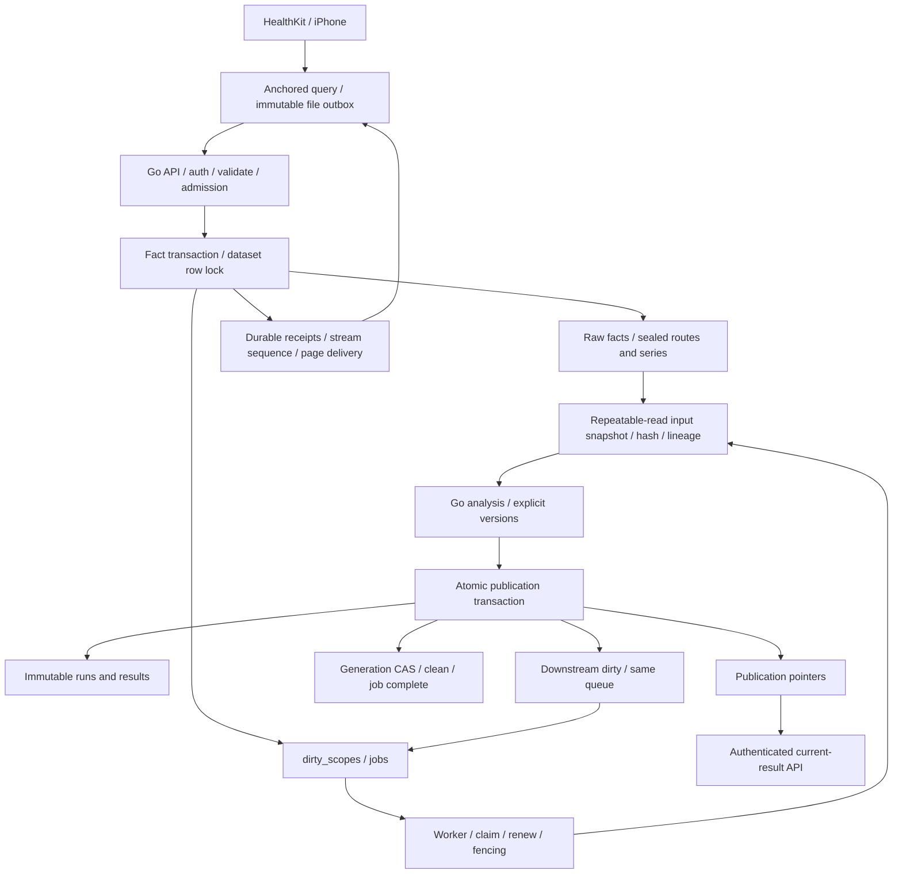

# RAI V2 — System Architecture

Current Implementation / As-Built Architecture，2026-10-28（Asia/Shanghai）。仓库 `/Users/ta/rai`；P6基线 `62511f9b3e5998ccad79396a7e14540074e506e5`，入口干净，P4/P5已在该提交中。P5实现见 [Coach Contract](P5_COACH_CONTRACT.md)，验收见 [P5 Result](V2_PHASE5_RESULT.md)。P4实现及验收分别见 [P4 Result](V2_PHASE4_RESULT.md) 与 [算法合同](P4_ALGORITHM_CONTRACT.md)。原始[架构方案](../RAI-Go-PostgreSQL架构重设计与实施方案.md)保留原文；历史阶段结果和 evidence 保留原口径。

**P3 REAL DEVICE ACCEPTANCE: DEFERRED BY USER / NOT VERIFIED。P4 DEVELOPMENT EXCEPTION: AUTHORIZED BY USER。** 这只改变开发入口，不把 P3.5 模拟器、macOS SIGKILL、合成网络或未签名编译变成真实 iPhone 验收。P5 后端闭环已实现；P6原生产品集成见第13节。

## 1. 产品、事实和运行边界

原生 iPhone SwiftUI，iOS 18+，只读 HealthKit；WorkoutKit 写排程需要独立授权，当前未实现。没有 Web、Watch 或桌面产品。Swift SyncProbe 是合成测试 harness。Go 1.27.3 模块化单体，PostgreSQL 18.6，pgx/v5，sqlc 1.31.1，goose 3.29.0；API 和 Worker 为同一个 `rai` 二进制/镜像的不同进程。没有生产 Node、SQLite、Python、ML/ONNX、Redis、消息队列、PostGIS 或 TimescaleDB。

目标 N100 → PVE → fnOS VM（4C/8G）→ Docker。已验收环境是 fnOS/N100 一次性隔离 PG 与开发 Compose，不表示生产上线、TLS、备份恢复或入口切换已验收。只用合成事实，不连接既有 `rai` 库，不迁移旧库，不访问 `../running`。采集历史来自手机当前可见 HealthKit，见 [ADR-002](adr/002-fresh-healthkit-dataset.md)。

系统单用户优先，但 dataset 是真实隔离边界：设备 token 对应 dataset，查询按 dataset，事实关系使用复合 FK。没有 SaaS 租户管理、RLS、OAuth、设备自助注册。CLI init 仍只创建首个 dataset。

## 2. 实际链路



上传 ACK 只等待事实事务，不等待分析。Raw 与 Derived 独立，Worker 数据库权限不能 UPDATE raw tables。分析不通过修改 Workout、sample、statistics、activities、route 或点投影保存结果。

## 3. 模块和 CLI

| 模块 | 实际职责 |
|---|---|
| `cmd/rai` | 组装 api/worker/migrate/migrate-down/migrate-status/init/probe/analysis |
| `internal/config` | DSN/秘密文件互斥、监听地址校验 |
| `internal/httpapi` | net/http 路由、Bearer、admission、明确 DTO、稳定错误响应；不导入 admin/goose |
| `internal/syncing` | P3 protocolVersion 2、canonical hash、单位和载荷白名单、Store 合同；无数据库连接 |
| `internal/analysis` | 输入模型、固定版本静态 registry、纯 Go features/TRIMP/state/recovery/readiness、DTO；不查询数据库、文件、网络或墙钟 |
| `internal/training` | versioned纯生成器、字段级override/effective合并、feedback、独立API DTO；无I/O或墙钟 |
| `internal/jobs` | 单 processing slot，claim/dispatch/renew，取消，结构化执行日志；只依赖 Queue 接口 |
| `internal/storage/postgres` | pgx 事务、sqlc/手写 SQL、快照构造、run、原子发布、current 查询、队列原语 |
| `internal/admin` | 显式 migration/受控 down/init、参数和有界 recompute CLI；在线依赖图不得到达 |
| `migrations` | 内嵌 forward-only 00001–00013 与 checksum；P5未修改00001–00012 |

真实 SQL 仍是 sqlc 与手写 pgx 混合，不能称全部 sqlc。关键实际分析 SQL 常量由 EXPLAIN 测试直接引用。依赖边界脚本检查在线图排除 admin/migrations/goose，并检查 analysis 核心不导入数据库、网络、文件。

API/Worker 默认连接池上限仍为 8/4，保留 URL `pool_*` 覆盖；UTC、连接超时 3s、session statement timeout 2s、lock timeout 500ms、事务 statement timeout 5s、idle transaction timeout 5s。P4 未扩大池。进程监听、HTTP 超时和 SIGTERM 10s shutdown 沿用 P3。

`GET /health`、`/livez` 只看进程；`/ready`、`/readyz` 检查关键表和 goose 最新 applied **恰为 13**。Worker 启动还检查 readiness，旧 schema 不消费任务。迁移为显式管理操作；无自动 migration/init。容器 probe 仍检查 liveness，生产编排必须使用 readiness。旧 binary 的 schema12 readiness 对 schema13 fail closed，不能混合滚动运行旧 Worker。

## 4. PostgreSQL 模型

P3 的 29 张应用表保持：dataset/device/collector；stream/batch/page；admission/upload slots；health_samples；workouts/statistics/events/activities；workout_samples；quantity series uploads/chunks；Workout packages/chunks；routes/chunks/points；enrichments；route_deletions；entity_tombstones；entity_changes/change_events；dirty_scopes；jobs/job_attempts。完整历史语义见 [P3 同步合同](V2_PHASE3_SYNC_CONTRACT.md)。

P4 migration **00012_analysis.sql** 新增四表，当时共 33 张应用表；P5新增11张后共44张（另有 goose 版本表）：

| 表 | 关键字段 / identity / lifecycle |
|---|---|
| `analysis_parameter_sets` | `(dataset_id,version)`；显式 resting/max HR、TRIMP A/B、provenance；append-only，无默认个人参数 |
| `analysis_runs` | `(dataset_id,id)`；dataset/job 复合 FK、scope/generation、algorithm/version、input version/hash/range/lineage、状态/稳定 error code、时间；RUNNING 只能转 terminal，terminal 不可修改/删除 |
| `analysis_results` | `(dataset_id,run_id,day,metric)`；run 复合 FK；算法版本、nullable float8、unit、quality、details、computed_at；不可 UPDATE/DELETE；CHECK 禁 NaN/Inf |
| `analysis_publications` | `(dataset_id,scope_key,metric_family,day)`；run FK、generation、published_at；正式结果 pointer，允许原子切换 |

完成结果的逻辑 identity 唯一：dataset/scope/algorithm/version/target_generation/input_hash（SUCCEEDED/SUPERSEDED partial unique index）；失败与崩溃尝试可保留独立 run。run scope/generation 索引支持 audit；results 主键服务 run 查询，load partial index 支持比较；publication 主键服务 current 查询。没有提前分区或自动 retention。历史 runs 和参数暂保留。

Workout bundle 数据库使用内部 sentinel date `0001-01-01`；HTTP Workout DTO 不暴露该 sentinel。state 每日真实 calendar date。metric/value/unit/quality/version 是独立列，复杂解释在 JSONB，不能把核心索引字段藏进 JSON。

P4 补上两个有证据的依赖 blocker：sample 删除的关联级联触发 Workout dirty；quantity series sealed 时标脏已关联 Workout。已有 Workout dirty 在 state scope 建立后，同事务传播到 state。新 helper 复用 dirty/jobs，不建立第二队列。

## 5. P3 同步不变量

HealthKit anchor 只在 iOS；clientSeq、dataset.commit_rev 和 anchor 是三个不同坐标。批次登记与事实提交是两个事务：registered 可保留重试，facts/tombstones/log/dirty/jobs/receipt/stream/page 进度必须一起提交。dataset 第一业务行锁保证 revision 与提交顺序，不使用 sequence 作为下载水位。

首次内容不可变，exact retry 原 receipt，不同内容冲突；永久墓碑优先，旧上传不能复活 UUID。未知删除只建屏障与实际日志，不伪造 Workout 分析范围。迟到补充通过 append-only enrichment；sample 关系显式、唯一，不根据时间重叠猜测。

route/series/package chunk 是 staging；只有 seal 后进入完整分析输入。route seal 和双 manifest、投影触发器、5000点/块、100万点/route、删除屏障保持 P3。大 Workout pending package 不是 Workout；seal 后正式父事实与 child projections 同事务。

唯一 P4 内部调度变化：同一 type/UTC 日的批量 sample 新增合并依赖 job，避免 1000 samples → 1000 jobs。`analysisJobIDs` 仍是实际耐久任务 ID，数量不固定，旧 receipt 不更新。anchor、outbox、batch identity、sequence、route seal 和 durable receipt 字段合同保持原样。

## 6. Worker 与快照

默认 1 processing slot；空闲 1s poll，15s 回收过期 lease 并有界维护已有 state scope 的 calendar day。Claim 复用 SKIP LOCKED、60s lease、递增 fencing、attempt；每 20s Renew。丢失 lease 立即取消计算，任何 publish 再验 token/lease。支持 context cancellation；不 busy loop、不扩大 lease。

kind：`analysis.workout`（features+TRIMP bundle）、`analysis.training_state`（日范围 bundle）、`analysis.sample`/`analysis.series`（真实依赖传播，无伪造样本评分）。优先 Workout，再依赖，随后 state，最后training.plan；优先最新 scope generation。旧 queued job 保留身份，publisher 将已过时代际标为 superseded，不重复计算。

输入由一个 REPEATABLE READ 事务构造，算法不自己查询 DB。Workout 读取 durable 原始 payload、statistics、effective enrichment、显式关联 quantity、sealed series 和 sealed routes；不用 pending 内容。series 使用一次批量查询，样本不逐点 SQL。输入总量上限为 250000 observations 和 250000 route points，超限稳定失败，绝不截断后假装完整。

input_hash 对 scope 的有效、稳定排序 JSON 输入计算 SHA-256；不含不相关的 dataset revision/generation，二者独立保存在 run/provenance。lineage 保存事实 UUID/hash、sealed manifest、参数版本、范围和上游 run；不复制整个 HealthKit 数据库。快照代际已变化时不执行旧算法，仅保存明确 superseded 尝试，不将新数据冒充历史快照。

算法无墙钟依赖，Worker 向 loader 传绝对 as-of；daily timezone 来自 dataset IANA 字段。scratch 镜像的 Go 二进制显式嵌入标准库 time/tzdata（镜像无 OS 时区库）。日序列使用 calendar AddDate，禁止 OS 或 PostgreSQL server local timezone 隐式归日。

## 7. 发布、失败与查询安全

发布锁序 dataset → job → dirty，校验 token、running、clock_timestamp 未过 lease。单事务包含 results、terminal run、publication pointers、generation CAS clean、job/attempt complete、下游 dirty；最后再检查墙钟 lease。任何失败整笔回滚。

若 generation10 计算时 facts 变成11，run10 可终态 SUPERSEDED，但不写 current pointer、不 clean11。旧 Worker 在恢复后即使继续执行也不能发布。租约过期恢复同时结束遗留 RUNNING run 为 FAILED/lease_expired，重新尝试不覆盖历史。

retryable DB/dependency errors 使用现有5s退避、最多8次；invalid raw、未知算法版本永久失败。不修 raw、不存 SQL/stack/健康序列到 error 字段。缺失必要输入是正常 nullable result，并非算法失败。

Workout 查询同时检查 raw 父存在、当前 clean generation 和参数版本，删除或 dirty 后立刻隐藏旧结果。state 查询仅当天的已发布结果，scope 有 dirty 时隐藏；历史日范围 explicit recompute 不必覆盖无变化的当天 pointer。历史 run 保留，不默认从公开 API 返回。

## 8. 已实现算法

| algorithm/version | 实现与真实限制 |
|---|---|
| workout.features/v1 | duration、distance、speed/pace、HR mean/max、真实 cadence/power、coverage、sealed route haversine/有精度条件的高差；缺失 null；不从 steps/pace 猜值 |
| training_load.trimp/v1 | D×r×A×exp(B×r)；参数显式、HR coverage≥0.9 且区间不歧义；没有隐式 sex、HRmax 或人口默认，缺失 unavailable |
| fitness_fatigue/v1 | dataset calendar daily load，180日有限指数核，tau42/7；任一必要 load unknown 则受影响结果 null；不是无限 EWMA checkpoint，也不声称生理状态已校准 |
| recovery/v1 | load-only fitness/fatigue 比例，0..1；不是完整身体恢复 |
| readiness/v1 | load-only 0..100；保存组成、版本、缺失 sleep/HRV/resting-HR trend 和 import coverage；不是医疗/训练处方或 Garmin 等价 |

bundle `workout.bundle/v1` 与 `training_state.bundle/v1` 固定组件版本，参数 provenance 进入 input hash。详细公式、精度、质量与缺失语义见 [冻结合同](P4_ALGORITHM_CONTRACT.md)。P4没有 HR zones（无配置）、splits 或ML。P5的训练计划与结构化建议见后文。

## 9. 重算与管理

正常路径 Workout dirty → 单 Workout publish → state dirty；T 的负荷只影响 T..T+179，截断至 as-of。输入范围再向前179日；首次历史导入不自动全历史回算。Worker 对已有 clean state scope 每天最多建立一个新 generation；后台失败靠现有队列恢复。

`rai analysis recompute --dataset <uuid> --scope workout:<uuid>|workouts|athlete/default --algorithm workout.bundle/v1|training_state.bundle/v1 --from YYYY-MM-DD --through YYYY-MM-DD [--dry-run]`。

必须明确范围，最多366输出日、1000 Workout；更长历史由操作者明确分段。无默认全库。state 有 pending dirty 时范围必须覆盖受影响输出日，禁止范围外待办被错误 clean。`--dry-run` 只列 scope，不改变 job/generation。参数命令要求 dataset、resting/max HR、A/B 和 provenance，追加参数版本并有界重新分析当前179日内 Workout；旧历史需要显式 recompute，不悄悄覆盖旧 run。

## 10. API 与客户端

新增 `GET /v2/analysis/workouts/{id}`、`GET /v2/analysis/state`，相同 Bearer/dataset/read budget；额外 query 参数拒绝，未准备好为404 analysis_not_ready。DTO 与 dbgen 模型分离；返回 published run、generation、算法/输入版本/hash、时间、nullable metrics、quality 和解释。handshake analysis=true；changefeed 仍 false（有限通知不是完整事实下载）。OpenAPI 1.0.0，wire protocolVersion 仍2。

P3 API、limits、鉴权、持久 admission 与上传租约沿用既有实现。稳定错误码，日志不含 payload/HR/GPS/token/DSN。Worker 日志记录 job_id/scope/generation/algorithm/version/run_id/duration/result_status。现有 roles.sql 扩展 API 只读 derived，Worker 可读输入、写 derived/dirty/jobs，不能修改 raw；owner 连接仍可绕过权限，不称生产安全验收。

P3同步语义保持：Swift actors、HealthKit anchored query、candidate/delivered anchor、backup-excluded immutable gzip 和 state.json 原子替换、严格回执校验、device-only Keychain、稳定后台 URLSession。当前P6产品集成见第13节。实际 HealthKit 授权、来源覆盖、background OS lifecycle、iPhone kill/GPS 和 iPhone→fnOS 仍 NOT VERIFIED。

## 11. 验证、风险与后续

真实结果与命令见 [P4 Result](V2_PHASE4_RESULT.md)、[IMPLEMENTATION](IMPLEMENTATION.md) 和 `docs/evidence/p4-*.json`。测试区分 deterministic/golden/property、真实隔离 PG 并发/代际/fencing/故障、migration空库/升级/重建、fnOS Go质量门禁、合成容量/默认 planner EXPLAIN、一次性 Compose；任一未完成项不得因为源码存在而记 PASS。

性能样本明确算法输入、race/non-race、样本数和环境；100次纯算法可给固定场景median/p95，单次状态/worker观测不能冒充P95。1/3/5年 fixture 证明有界查询与行数增长，不证明健康事实导入完整性、真实多年GPS容量、生产SLO或长期soak。

生产 TLS/ingress、LOGIN roles/secrets、备份恢复/RPO/RTO、断电、长期retention、设备测试属于仍未验收范围。迁移只前向，down白名单仍空；管理工具不进入同步。P4历史验收结论保持原样；P5见后文。P6产品实现与未完成验收见第13节；WorkoutKit、Watch与P7部署未实施。


## 12. P5 Training Plan / Coach Closed Loop

```
Published clean analysis → explicit TrainingContext → training_plan/v1
→ immutable Base + persistent field overrides → immutable Effective
→ frozen Execution → explicit Workout association → versioned Feedback
→ training.plan dirty / same queue → new Base + surviving overrides
```

00013新增 `training_parameter_sets`、`training_plans`、`training_configs`、`training_sessions`、`training_generation_runs`、`training_base_versions`、`training_overrides`、`training_effective_versions`、`training_executions`、`training_feedback`、`training_commands`。复合FK隔离dataset/plan/session；version number唯一，append-only trigger保护历史，current Base/Effective成对FK延迟至事务提交校验。训练execution trigger保护snapshot及合法状态迁移，禁止删除。

一个active Plan，替换时原子归档旧Plan，旧history/started execution仍可查询和完成。相同目标goal/schedule更新追加config；自动生成追加Base，slot UUID跨版本稳定，不用date+type拼identity。开始日和4–16周horizon固定；改变这两个需创建新Plan。timezone创建时冻结dataset IANA日历。

`coach_parameters/v1`记录5%周增长、80%卸载、35%长跑比例、30km自动单课/长跑上限、48小时hard spacing、每周最多一节hard和readiness/feedback调整。真实算法及限制以Coach Contract为准。readiness/recovery只作为load-only有质量标记的输入，无个人HR默认、无LLM、无目标时间优化或比赛taper。没有分析时使用明确baseline或已发布running距离，信息不足稳定失败 `insufficient_context`。

Override是immutable事件，edit/move/add/skip/delete/revoke；按revision确定先后，用户只控制所改字段。新Base撤去已编辑slot时保留anchor，暴露conflict。Effective物化保存baseID、overrideRevision、session prescriptions和reason codes；历史audit可重放。Base和Effective不接受UPDATE。

create/config/recalculate、completed/skipped/late association、Workout/state bundle正式发布时聚合 `training.plan`。同plan最多新增一个queued successor，1秒debounce；队列恢复可能留下的旧queued generation由publisher结束，不丢历史job identity。训练与P4共用单slot Worker、20秒续租和60秒lease，不开第二coach服务。

生成使用REPEATABLE READ快照，仅读clean publication与SUCCEEDED结果；raw仅过滤running身份/时间，不取raw健康测量。最近28天最多4096 Workout，记录run/generation、algorithm/version/quality/null值、参数/config和context hash。history/feedback不读未发布run。published Base + Effective + current pointers + feedback + generation clean + job/attempt complete同事务；发布在共享dataset/plan锁内读取最新override，旧generation/config/lease被拒绝或明确SUPERSEDED。

训练命令由稳定command UUID和request hash去重，成功receipt与业务同事务，重试返回原值。override乐观锁与config/execution revision分别防止两个客户端静默丢更新。训练HTTP使用现有Bearer、admission和超时；新增11个独立DTO接口，默认plan包含Effective。history每页≤50，单版本audit包含Base/context/overrides；execution查询保留feedback历史。

Execution scheduled/started/completed/skipped，start绑定current Effective/session并冻结完整prescription。Workout可晚到，仅用户显式关联，不做自动唯一时间匹配。feedback/v1保留duration/distance planned/actual/delta/ratio与actual load、source run和execution revision；新publication追加feedback并重算。没有Workout不自动推断missed，显式skip保留历史。

P5交付时是backend-only；P6 iOS产品集成见第13节。WorkoutKit mapping/授权/排程、Watch和生产部署均未开始。P3 REAL DEVICE ACCEPTANCE: DEFERRED / NOT VERIFIED。验证命令、性能样本、真实未验证项与P6 gate见P5 Result，不能由本节实现描述推导真机或部署PASS。

P5 STATUS: PASS WITH RISKS。P6 DEVELOPMENT READY: YES（仅后端闭环自动验收gate；未进入P6）。P3 REAL DEVICE ACCEPTANCE: DEFERRED / NOT VERIFIED。


## 13. P6 Native iOS Product Integration（2026-10-28）

P6_BASE_COMMIT=`62511f9b3e5998ccad79396a7e14540074e506e5`，入口工作区干净；已有P4/P5包含在该提交内。

SwiftUI五个原生Tab统一使用RAITheme/RAIGlassSurface、暖暗背景和系统字体。iOS26使用原生glassEffect，iOS18–25保留Material fallback；系统TabView/NavigationStack/Sheet，Reduce Motion/Transparency和Dynamic Type适配。视觉参考为用户本轮提供的Liquid Glass首页图；当前摄影素材使用可替换的原生抽象场景。

`ProductCore`作为Presentation/Interaction actor层复用RAIAPIClient，读取P4Published与P5Effective，不实现第二套分析或计划算法。MainActor ProductModel发布状态，产品命令journal在网络前原子持久化commandID/request并绑定dataset；409保留草稿，原命令重试恢复ACK；字段级override/revoke、snapshot execution、显式Workout关联与Feedback均走P5。P3HealthKit/outbox/后台传输仍是原同步路径，诊断移至“我的”。

新增只读product DTO和四个GET路由：Workout列表/详情、两周overview、published analysis history。服务端只提供耐久raw summary与clean publication，缺失不补零；dataset隔离、ReadLane和有界keyset分页。没有新migration、route read API、P3wire变更或全历史重算。

实际测试与风险见[P6 Result](V2_PHASE6_RESULT.md)、[Product Contract](P6_IOS_PRODUCT_CONTRACT.md)及[evidence](evidence/p6-ios-2026-10-28.json)。P3/P6 REAL DEVICE ACCEPTANCE: DEFERRED / NOT VERIFIED；WorkoutKit排程/Watch继续deferred，P7与生产发布未开始。
