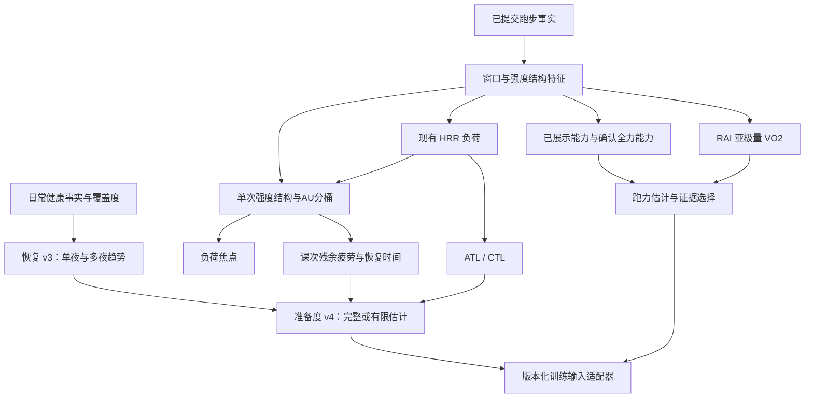

# 当前架构（以代码为准）

## 总览

| 层 | 内容 |
|---|---|
| iOS | SwiftUI，iOS 18，5 个 Tab（首页 / 运动 / 训练 / 统计 / 我的）；运动模型分析由首页与统计进入。`ios/RAI/App` 界面与同步编排；`Sources/SyncCore` 同步协议与本地状态；`Sources/ProductCore` 产品读取与展示模型。只读 HealthKit。 |
| 服务端 | Go 模块化单体（`apps/server`）。`api` 与 `worker` 同镜像。API 只做鉴权、原始字节入库和读取；Worker 解析原始载荷并运行分析任务。PostgreSQL 18，pgx/v5，sqlc。 |
| 部署 | `deploy/release/compose.yaml`：postgres + api + worker + admin。 |

### 跑步分析结果与模型任务（迁移 59，已于 2026-11-12 部署）

HealthKit 可以为每个样本生成独立的单点序列。序列容器数量按 `MaxPoints=250000` 预算检查，
不再套用事件／活动的 `MaxDetails=2000`；数量、总点数、元数据及产物大小分别受限，原始载荷不变。
单条输入失败随当天日模型发布事务写入 `model_workout_failures`（模型栈、Workout、事实代次、受限错误码），
列表与详情将当前 active 栈及当前事实代次的失败显示为 `failed`，优先于旧成功结果；成功发布新负荷时清除失败。
历史日的特征缓存填充不会清除当天失败，也不伪造成功结果。

只有 active／candidate 通道继续失效与排程；previous 保留冻结结果，回滚后重新作为 active 排程。
Worker 在锁定数据集和领取任务时只选择当前二进制支持且仍处于 active／candidate 的栈；滚动升级期间
不同版本的 active／candidate 任务留给相应版本处理，不能领走后判为算法不支持。
恢复循环每次最多结束一个数据集的 100 个已退出 active／candidate 的 queued 模型任务，标为
`failed/retired_model_stack`；过期租约仍先按原规则回收。已经 failed 的历史（含算法不支持）不删除、不改成成功，
它们不属于待执行队列；运维快照将已退出 live 通道的失败计入 `historical_failed_jobs`，而非 `failed_jobs_needing_action`。历史重建只等待同一栈的在途任务，不被另一个不兼容栈的任务阻塞。

应用修复后可由管理路径仅为目标数据集的 active 栈排一次当天发布，使用已有原始事实补出当前窗口内缺失的
单次分析，无需重新同步或重建全量日历史。迁移不自动重算用户数据；本次部署后已按该路径为 active 栈排了一次
当天发布（见文末部署记录）。

### 极简运动界面

- **首页**：本周跑量前置，随后是今日训练、最近运动与运动模型；同步状态保留为轻量入口。未连接服务器或未请求健康授权时，顶部显示「开始使用」引导卡（连接 → 授权 → 最大心率），未连接时不渲染空数据卡片。
- **运动**：按时间浏览跑步记录，点入查看配速、心率、路线和训练负荷。
- **训练**：保留计划、调整、执行与反馈流程，统一使用浅色卡片和明确的主操作。
- **统计**：自然周／自然月切换、历史周期浏览、每日跑量柱图；配速与心率分布以公里和跑量百分比呈现。
  运动模型分析作为独立详情入口保留。没有可用数据时显示空态，读取失败与没有跑步分开表达。
- **我的**：称呼、训练参数（静息与最大心率、睡眠目标与 VO₂ 来源）、数据与同步（「跑步记录同步」「服务器与健康授权」）；必要的权限和错误说明不因精简文案而删除。
- **界面文案约定**：面向跑者，不出现协议/会话/载荷/模型栈等实现术语，也不直接显示服务端原因码；未知原因码归并为通用说明。训练编辑以公里、分钟、分:秒/公里录入，提交时换算为服务端的米、秒、秒/公里。调试入口（导出证据、跑步结构检查、恢复会话导入、错误代码与模型版本）仅在 Debug 构建且打开「服务器与健康授权 → 开发者选项」后显示。
- **连接结果**：`rai://connect` 链接、粘贴链接与手动填写的结果统一以弹窗反馈；连接前等待正在进行的前台扫描结束，而不是直接报“同步进行中”。

视觉使用暖白背景、深色等宽数字、白色圆角卡片，浅青和柠檬黄用于重点区域；
标签只解释指标或操作，减少口号与重复说明，兼顾动态字号、VoiceOver 与减少动态效果设置。

## 一条跑步记录的路径

1. **发现**：App 启动、回前台、HealthKit 的 Workout 观察者唤醒时，`SyncModel.autoSyncWorkouts` 读取最近 30 条 Workout，
   用 `POST /v2/sync/workout-ingests/status` 与服务端对账，再按 `WorkoutAutoSyncPolicy` 选出要传的记录
   （跑完 ≥1 分钟、14 天内、未上传或早传过一次需补传、非服务端 rejected）。后台观察者唤醒不等这 1 分钟，
   直接上传当时可见的数据。跑完 30 分钟内传过的记录，在首传 30 分钟后再传一次以带上晚到的心率与路线
   （字节不同服务端才替换并重新解析；每次运行每条记录只补传一次）。还没到时间的记录由一次性定时器到点再查，
   不用等 15 分钟扫描。
   **跑步与日常健康是两条独立通道**：跑步批次用 `workoutScheduler`，日常健康用 `syncScheduler`，互不取消、互不等待；
   服务端同一设备有 2 个跑步槽和 1 个日常健康槽，进程总上限 3（`httpapi.acquireUpload`），握手公告各自额度。
   同一会话的状态查询、跑步与日常健康共享 60 秒内存握手缓存及在途请求；凭证/服务地址/会话变化隔离缓存，
   鉴权或身份冲突清除缓存，每次使用仍检查本地 active 状态。激活与恢复始终实时握手。
2. **构建**：`RawStreamSyncEngine.build` 一次读全 HealthKit，生成 protocol-6 JSON（顶层来源 + 流 + 路线）。
3. **上传**：最多 2 个 worker 各自读取、构建一条记录；旧服务端未公告 `workoutUploads` 时使用 1 个 worker。
   `WorkoutUploadJournal` 先原子保存 multipart 文件、边界、内容哈希和请求身份，`BackgroundTransfers` 再通过后台
   URLSession 的文件上传发 `POST /v2/sync/workout-ingests/{uuid}`。网络错误 / 408 / 429 / 5xx 按 1s、3s、8s 重试，
   更长 `Retry-After` 的单次等待上限 30 秒，所有尝试复用同一文件与身份。Workout 不占用 Daily/VO2 的 GCRA 节流器。
   挂起/取消进程内等待不会取消已交给系统的传输；回调原子落盘后验证 UUID/回执，再持久化 journal 中的 accepted
   回执并回收正文与传输结果。重启/回前台只消费已有回执；再次同步未完成项时接回原文件，不重新读取 HealthKit。
   选择列表不会全部预先生成文件；后台构建受 iOS 执行时间限制，尚未构建的历史在后续前台轮次继续。
4. **接收**：API 把原始字节原样写入 `workout_ingests`，返回回执（同一事务）。字节相同的重复提交重放原回执；
   被拒绝或字节不同的新快照会替换原文并重新解析。
5. **解析**：Worker 单槽领取 `accepted` 行，只投影已知字段为事实（样本、关联、序列、路线），
   在同一事务里写入事实、递增该训练的脏范围代数（`workout:HKWorkoutTypeIdentifier:<id>`，触发 v2 日模型栈失效）
   并把行标为 `committed`；不再排队任何旧分析任务；暂时性错误按指数退避（上限 10 分钟）重试，
   语义错误立即 `rejected`。
6. **分析**：Worker 只处理两种 job kind：`analysis.model_stack_v2`（日模型栈）与 `training.plan`。其余旧 kind 领取即以
   `analysis_unsupported_algorithm` 失败；迁移 53 把遗留的排队任务标为 `retired_pipeline`。每次领取任务和每 15 秒的日推进都重新读取时钟，
   所以跨午夜后“今天”会正常推进。
7. **展示**：App 读取 `/v2/product/overview`、`/v2/workouts`、`/v2/analysis/athlete` 等；首页并发读取 4 个接口，并缓存上一次快照。
   所有读取（运动列表与详情的单次负荷、首页周负荷、训练计划输入）都来自 active 通道的 v2 模型栈。

旧分析链路（`analysis.workout` / `training_state` TRIMP、v1 候选模型任务、`analysis.sample`/`series`）已在服务端删除
（迁移 53）；`trainingload`、`recovery`、`readiness`、`performance` 包内 v1 纯函数保留为冻结基线及其测试，不再被任何任务调用。

## 模型（v2 日模型栈，schema4 产物）

`analysis.model_stack_v2` 每个自然日一个任务（`storage/postgres/model_stack_inputs.go` `computeModelStackDay`），
读取近 186 天跑步与日健康事实，在同一事务里发布八项核心产物：负荷状态、跑力 v1（`running_fitness`）、
RAI VO2、外部 VO2、生理恢复 v4、训练准备度 v4、课次恢复 v1、负荷焦点 v1（后两项为 `model_product_v3/` 族），另发布研究产物。
源码在恢复 v4／准备度 v4.1 策略栈 `rai-v2-df81d988ae579587` 之上又加入单次训练效果 v1，两者合并为同一次发布，
当前构建为新栈 `rai-v2-69efefa730b47818`，已于 2026-11-12 部署（迁移 58）并激活（`Revision=7`，镜像 `36274b2`）；
被取代的 schema4 跑力栈 `rai-v2-c3441e6edc485d9e` 保留为 `previous`。真实数据集的日历史不能整体重建：
`admin analysis backfill` 只接受合成数据集（`CreateBackfillOperation` 要求 `synthetic_test`），
`rai_model_stack_rebuild_history` 只重新排队**曾发布过**且已失效的当前栈日期，从未发布过的日期不会被创建；
因此换栈后历史日、以及无氧训练效果所需的同栈跑前跑力参考，都从激活日起逐日累积。
当前构建为 schema4 栈（跑力 v1、恢复 v4，迁移 58）；旧 v60 跑力（`performance`、`runningability` 包、三分支、旧门槛、旧评分、iOS 本地推算）
已从运行链路删除，下文“跑力 v1”为现行规则。身份由 `modelmanifest.Current()` 的哈希（`StackID`）决定；
算法或策略变化即新 stack，需要用 `rai analysis model-stack` 的 `prepare-real` / `activate-real`
（回滚 `rollback-real`）切换，旧 stack 结果保留。当前构建的 schema4 栈
`rai-v2-69efefa730b47818` 已于 2026-11-12 部署（迁移 58）并以所有者授权在唯一数据集上激活：`active` 通道指向该栈，
跑力栈 `rai-v2-c3441e6edc485d9e` 保留为 `previous`，可 `rollback-real` 回退；计算顺序为负荷 → 强度结构 → 课次疲劳 → 准备度，
跑力估计只消费冻结的 performance/VO2 DTO，不反向参与负荷。下文关于 schema3 栈部署与激活的记录描述的是部署时的状态：
schema3 栈 `rai-v2-4b9264855a47255d` 于 2026-11-11 部署（迁移 56）并激活，其旧栈 `rai-v2-4a543690d2c37290`
当时保留为 `previous`（schema4 激活后已退出通道）。

- **单条训练隔离**：某条训练自身事实无法解析、或参考行无效时，只把这条记为未知负荷
  （`workout_invalid_input` / `reference_invalid`），当天其余产物照常发布。
- **来源身份**：v2 栈的训练与日健康来源 epoch 取 `HealthKitSource.StableIdentity()`（bundle、productType、
  硬件），不含 App/系统/固件版本与 HRV 样本时长，watchOS 升级不会重置基线或拆分跑力证据。
- **心率参考**：`hr_reference` 按修订视图生效——只要在计算时刻已录入，就覆盖其生效日期之后的历史训练。
  多条参考时生效日期最新的那条覆盖之前的（同一时刻值不同才算冲突）；最大心率不过期，测量超过 365 天只给
  `hrmax_review_due`。未填静息心率时，每条训练用其前 28 天的静息心率中位数（单独按训练窗口加载）。
- **负荷 v2（有界策略）**：HRR 截断到 [0,1]（超最大心率按 1 计、低于静息心率按 0 计并记原因码），
  质量分级 `qualityTier`：complete（覆盖 ≥0.98 且最长断点 ≤30 s）/ estimated（≥0.80 且 ≤180 s）/
  approximate（全程均值心率）/ unknown。负荷状态中未知日权重不超过 ATL 0.15、CTL 0.10 时按 180 天环内
  已知训练日均值插补（`imputed`），超过才为空。
- **准备度 v4**：`Readiness = min(Rphys, Csession, Cweekly)`，三个上限取最小，避免同一训练被重复乘罚。
  `Rphys` 为恢复 v4 的完整或估计分（保留旧栈消费恢复 v3）；`Csession = 100/(1+(残余疲劳/1.4)²)`，残余疲劳来自课次恢复 v1 的
  衰减脉冲和（高估参数给出范围上界）；`Cweekly = clamp(100-25×max(0,(ATL/CTL-1.1)/0.8), 40, 100)`，
  CTL 无有效基线时省略周上限并降级为 estimated。未知负荷沿用衰减后 ≤0.15 个典型训练日的边界，
  另按疲劳脉冲上下界计算准备度范围：宽度 ≤10 分才给点估计（取保守端），否则 `workout_only` +
  `load_sensitivity_wide`。模式：`complete` / `estimated`（不额外限制分数、支持 ≤0.40）/ `workout_only`（score=null，
  只展示训练负担）/ `pending`（同步未完、来源冲突）。日内投影 `FreshenV4` 只用发布时冻结的疲劳项随时间回落，
  到 `validBefore`（日界、恢复有效期或未来训练结束时间的最小值）停止；历史页冻结评估时刻。疲劳上下界衰减速度不同，
  范围可能在发布后变宽再收窄：投影每次都按 `quality`（证据支持的 complete/estimated）重新推导 `mode`、`status`
  和 `load_sensitivity_wide`，范围收窄后恢复出分，不会整天停在 `workout_only`。旧栈按其冻结策略保留 75 分封顶，
  当前策略取消此限制，模型版本仍为 v4，由新 policy/configHash/stack 身份区分。
- **课次恢复 v1（`session_recovery`）**：仅按已记录跑步估计“距下一次高强度训练的残余疲劳”。每次训练产生
  疲劳脉冲 `u = clamp((AU/B)^0.6 × (1+0.6×highShare+0.8×anaerobicShare+0.4×longExcess), 0, 4)`，
  `tau = clamp(18+18×highShare+30×anaerobicShare+12×longExcess, 18, 72)` 小时；`B` 为该次训练开始前
  28 天同来源已知训练日负荷中位数（≥5 天且跨度 ≥14 天），`longRef` 为同期可比时长中位数。
  前 28 天不足时回退到前 90 天（同来源、同样的 5 天/14 天跨度要求），标 `load_baseline_extended` 并降级为 estimated；
  仍无 B 且该次训练最坏残余（`4×exp(-age/72h)`）还高于 0.02 时不出结果（`load_baseline_insufficient`），约 16 天后
  不再阻断——首周或长休后的头几次训练不会让 180 天窗口内一直没有结果。无 longRef 省略长跑项并降级；未分类强度结构按
  宽参数区间计入上界并标 `session_intensity_unknown`；负荷未知的训练按 0.5–2 倍典型训练日、结构从全低强度到全未分类
  取界（tau 上界 48–60h），不再按脉冲 0–4、72h 计。降级原因只在该次训练的残余上界仍高于 0.02 时生效，
  几个月前一次没有心率的跑步不会让今天的结果变成 estimated。求残余 ≤0.25 的最小未来小时数，确定性二分精度 0.25h，
  上限 168h，超出输出 overflow 而不是冒充准确值。重复上传按 Workout 去重，未来结束的训练不提前参与，
  180 天窗口截断尾部给出可证明的残余上界（≤4096 条、单脉冲 ≤4、tau≤72h）。读取投影随墙钟倒计时，
  不依赖准备度，也不被睡眠缺失否决。现有 `load_settling/v1` 研究指标保留冻结读取。
- **恢复 v4（当前源码，未部署）**：夜间 HRV 保留 v3 的睡眠重叠、半小时区块和来源优先级；HRV、静息心率各取
  最近 7 个有效夜／日的**算术均值**（包含当天有效观测），不足 7 次用已有次数，不要求落在最近 7 个自然日。
  仅从近 180 天内选择同来源有效观测，不读取全库历史，不把单夜重复样本计成多次。睡眠有当晚有效值就用当晚值，
  缺失时取同来源最近 7 次有效睡眠的算术均值；没有历史时 HRV 使用 50 ms 中性基准、睡眠使用 8h，静息心率优先
  使用当前有效且未撤销的用户填写值，无填写值时使用 60 bpm 中性基准。替代值只存在于计算 DTO，不写入原始健康事实。
  心率偏离仍相对此前 28 天同来源稳健中位数/MAD（尺度下限 ln-HRV 0.1、RHR 3 bpm）；不足 7 次时改用 180 天窗口内
  最近 7 次历史观测建立参考，无历史则中性初始化（z=0）并标 `bootstrap`。睡眠目标优先用户设定，再用 28 天习惯中位数
  （至少 7 夜），仍无目标则 8h。评分为 `clamp(82-14g(zH)-8g(zR)-12dSleep-4dRegularity,0,100)`，
  `g(z)=clamp(2tanh(z/2),-0.5,2)`；`dSleep=clamp((目标-本次使用的睡眠小时)/1.5,0,2)`，不再混入历史欠缺项；
  取消每缺失一个组件扣 5 分；作息辅助项有成熟基线才参与。缺观测、少历史或同步尚未完成均可发布 `estimated`，
  分数仍按 0–100 公式计算，不再封顶 75；支持度最高 0.35（无心率历史最高 0.20），来源标注与缺失组件列表保留。
  缺测不再额外扣分，正常参考输入的冷启动分为 82；睡眠欠缺、心率不利偏离及训练疲劳仍照常影响分数。
  不再以 48h 或连续漏戴两晚阻断。冲突仍不伪造出分。原带封顶／缺测扣分策略的冻结产物继续按原配置读取。
  替代来源通过 `components.*.inputBasis` 区分 `recent_mean`、`observed`、`user_entered`、`default_baseline`，
  `meanSamples` 记录实际次数，原始实测值仍为 `observed`，无实测为 null；iOS 展示来源文字。
  墓碑仍排除事实、进入输入哈希和审计，仅评估日相关删除降低置信度。结果只在评估日内有效，次日重新发布，
  不因历史观测较旧就把今天的估计当成昨天的过期产物。准备度公式、未知训练负荷边界和课次基线门槛保持原规则；
  本次解除的是健康数据缺失门槛，首批跑步缺课次负荷基线时仍可能暂不出准备度。
- **恢复 v3（保留旧栈）**：来源优先级、夜间窗口（前晚 20:00 至当日 12:00）、睡眠重叠与语义去重保留。夜间 SDNN 先按
  相对睡眠开始的 30 分钟区块取对数中位数，再以区块聚合：≥2 区块为稀疏夜（权重 0.45），≥4 区块且跨度 ≥3h
  为完整夜；同一分钟重复样本不增加独立支持。近 7 夜形成质量加权趋势（≥4 有效夜启用，权重 `q×exp(-age/3)`，
  归一后单夜上限 0.35），HRV 在对数空间、RHR 在 bpm 空间聚合。基线仍为 D-28 至 D-1 稳健中位数/MAD：
  ≥14 夜且近 7 夜 ≥3 夜才完整，7–13 夜临时（支持上限 0.35），14–27 夜 provisional（上限 0.45），28 夜成熟；
  基线来源键由历史确定性选择，不因当日 epoch 为空重置成熟基线。组合 `z_used = 0.35×qNight×z_night + (1-λ)×z_trend`；
  质量足够的当夜不利 z≥2 且另一组件同向不利时保留急性值，不被七夜均值抹平。连续评分以 82 为常态中心：
  `R = clamp(82 - 14×g(zH) - 8×g(zR) - 12×dSleep - 4×dRegularity - 5×缺失组件数, 0, 100)`，
  `g(z)=clamp(2×tanh(z/2), -0.5, 2)`；只有高质量、同来源、无 context shift 才允许温和加分，HRV z≤-3 标
  `context_shift` 并取消加分。睡眠欠缺 = 0.65×当晚 + 0.35×近三个有效夜均值（最多回看五夜）；作息基线缺失
  只移除辅助项并降级，不否决总分。每个组件独立记录 `observed / sparse / missing_after_sync / sync_pending /
  source_changed / expired / conflict`；缺夜估计要求同步已完成、最近证据 ≤48h、前一晚有效，连续两晚缺主输入
  即停止；估计模式总分上限 75、支持上限 0.40、无正向奖励。三晚持续偏离用各晚当时基线记录，滚动基线适应
  不会立即消除提示。评估日墓碑仍乘 0.7 置信度并记 `input_deleted`；墓碑只排除被删事实，不阻断出分，
  全部进入 `TombstoneRefs` 与输入哈希。`deviationLevel` 三档保留（<70 轻度、<50 明显，持续偏离升档）。
- **跑力 v1（`internal/runfitness`，`running_fitness` 产物）**：按《RAI-跑力系统重设计方案-2026-11-12》实现的纯 Go 模块，只消费
  中性跑步特征（`workoutfeatures` 的 `runFitness`：适应期 120 秒／恢复后 90 秒之后确定性贪心切分的 180 秒片段，15 秒中位数心率、
  10 秒均值速度、速度 CV、心率趋势、Minetti 平地速度；≥3 个持续跑动快慢周期合计 ≥600 秒的 `cycle_averaged` 片段；
  60/90/120 秒（原生速度间隔 ≤5 秒）与 3–40 分钟最快窗口；连续 ≥60 分钟长跑的 15 分钟块；15 秒持续峰值心率），
  不读取 VO2、负荷或恢复结果，不读时钟。
  - **单次跑力**：每个合格片段 `r=(HR−静息)/(最大−静息)`，`A=v_flat×(0.70/r)`；核心域 0.50–0.85，0.40–0.50 低强度代理（×0.7）、
    0.85–0.92 高强度边缘（×0.6，最高 limited），>0.92 只作已展示下界，r>1 隔离并记 `hr_reference_exceeded`；速度 ≥1.4 m/s、
    覆盖 ≥90%（70–90% 仅诊断）、CV ≤8%、心率趋势 ≤2 bpm/min、坡度 ≤5%（5–8% 只作坡地表现）、距离交叉核对 ≤5%。
    权重 = 覆盖×来源×稳态×条件×漂移（累计跑动 60 分钟后 ×0.5）；对 ln A 取加权中位数。分数为马拉松等效刻度
    `100×ln(28800/T_M)/ln4`（rT=0.85、tT=2400 秒、bL=1.10 固定），并给出测量敏感性范围（静息 ±5、最大 ±10 bpm，年龄估计 ±12；
    速度 ±2%，坡度未知或跑步机 ±8%）与能力敏感性范围。≥180 秒合格净支持为 limited，≥600 秒且平路、距离核对、实测最大心率为 supported。
    确认比赛／阈值测试／速度测试按中性曲线折算 `race_equivalent`；冲刺测试提供 v90s。天气：<5℃ 或 >25℃ ×0.7、湿度 >85% ×0.8、
    缺天气 ×0.8；0℃ 以下、30℃ 以上不上调长期能力。跑步机 limited，长期权重 ×0.5。观测峰值高于最大心率只给 `hrMaxSuggestion`。
  - **长期跑力**：日常证据 42 个本地日（τ=21 天，末 7 天线性收尾），比赛／测试 90 天（τ=42 天，末 14 天收尾，预算 2）；同日训练按
    分钟分配“分钟加权质量×min(总分钟/20,1)”的日预算，拆成两条记录不增加支持；同一训练的心率与成绩证据各半共用预算。
    唯一估计器是 bL 网格（1.02–1.25，步长 0.001）上的有界 Huber IRLS 联合拟合（ln A、阈值关系偏差、短时形状偏差），
    阈值与短时形状、bL 先验始终作为惩罚项，比赛成绩连续收缩，无硬切换；无确认成绩时与 A 的 Huber 位置逐位一致。
    普通训练最快窗口只作单边下界。跑步机、坡度未知、极端天气证据只能建立值、不能抬高已有值。阶段：1 天 initial，
    ≥3 天跨 ≥7 天 preliminary，≥8 天跨 ≥21 天 established；时效 ≤14 天 fresh、≤28 aging、≤42 stale（停止自动配速）、只剩比赛
    `race_only`。established 时逐日留一，最近一天导致总分变动 >5 或锚点 >10% 且非可靠比赛时记 `change_unconfirmed` 并半权重。
  - **iOS 跑力详情**：总分用 0–100 半圆刻度展示；能力分析按有氧耐力／乳酸阈能力／速度耐力／冲刺能力逐行显示评分、
    服务端对应训练区间（Z2/Z4/Z5/Z6）和证据状态。区间与锚点配速分开，先验区间标仅参考；普通快跑仍只作冲刺下限。
    基础指标展示外部 VO₂ 估计（优先）或 RAI VO₂ 实验性估计，以及模型乳酸阈值配速。各指标独立遵循可展示状态和时效；
    当前没有乳酸阈心率模型或契约，页面保留该项并显示“暂未提供”，不以最大心率比例代替。
  - **四维与预测**：有氧耐力 A（附 retention、bL）、阈值 vT、速度 v6、冲刺 v90s，评分 `50+55×log2(x/x_ref)`，有氧评分恒等于
    `referenceDailyScore`；只有直接证据才给评分，先验与下限显示为待补充。两段曲线（6–40 分钟 v6↔vT 对数插值，>40 分钟
    `vT×(t/2400)^(1/bL−1)`）给 5K/10K/半马/全马（二分到 0.1 秒内，定义域外 unsupported），范围为 A、阈值、形状与 bL 的确定性角点；
    `predictionSupport` 为 direct/calibrated/prior_based/insufficient；全马建议目标需 56 天内 ≥2 次 ≥90 分钟长跑且有长距离校准。
  - **六区间**：B0–B2 为 `A×(r/0.70)` 在 0.40/0.55/0.70，B3/B4 为 0.95/1.03×vT，B5 为 3 分钟等效速度，B6 为 v90s；
    B3≤B2 时 Z3 返回 `zone_anchor_conflict` 留空；Z5 三级（直接证据+已识别形状 supported、直接证据+先验 estimated 取慢端、
    由 vT 先验推出 prior_based 不排课）；Z6 需直接冲刺证据且不用于自动排课。比赛配速参考取各距离预测，只有 direct/calibrated 可排课。
  - **发布**：单次结果、长期状态、四维、预测、区间写在同一 `running_fitness` 产物，与当天其他产物同一 generation。参数、窗口均为
    待验证的 RAI v1 设计参数，未经人体数据校准。
- **跑力 v2.2（已退出，仅审计）**：性能窗口用 Minetti 坡度代价换算为平地等效速度（坡度 ≤8%），不再要求 90% 平路；
  每个时长只取最快 3 条训练做中位数拟合，其余标为 `below_envelope`。读取投影 `Freshen` 只对曾有曲线的结果在证据满
  28 天时改为 `stale`、满 42 天时改为 `insufficient_data`；从未有曲线的 `insufficient_long_evidence` / `collecting`
  保持原状态，只更新 `freshness` 并追加 `stale` / `evidence_expired` 原因，产品状态显示“积累中”而不是“已过期”。
  运动详情的 `modelQualification` 给出每次跑步是否被采用为跑力证据和已知负荷及原因。
  产品同时展示精确积累进度：有效训练/5、跨度/14 天、短窗口/2、长窗口/2、目标日/3。
- **跑力估计 v1（`running_ability_estimate`，已退出，仅审计）**：纯模块 `internal/runningability` 独立保存三类证据分支
  （demonstrated / maximal_supported / submax_estimated），不导入 performance 或 VO2。亚极量分支只消费
  产品合格的 RAI VO2（非 CandidateOnly、LOO 支持、稳定、≥4 次证据、敏感性宽度 ≤30%、证据 ≤14 天），
  按 `v60 = (VO2-3.5)×f60/12` 推算；`f60` 未个体校准时取群体先验 0.85（范围 0.75–0.92，标 `population_prior`，
  支持上限 0.35），有 ≥3 次独立确认的一小时努力且与训练前 VO2 证据可比时稳健标定，越界判
  `ability_calibration_conflict`。VO2 敏感性与 f60 区间联合传播到 v60 范围，范围始终随值给出。
  单点（limited）的条件是 VO2 敏感性宽度 ≤20%，或联合宽度 ≤25%（已个体标定时）；群体先验自身就占 20% 宽度，
  是已知常数，由范围、支持上限 0.35 和 `population_prior` 表达，不再单独否决单点。联合宽度 ≤45% 但不满足单点条件时
  只展示实验性范围，>45% 不出值。亚极量分支不生成 gamma、耐力曲线或比赛预测。选择顺序：
  确认全力 > 亚极量估计 > 已展示；submax 上界明显低于同来源 60 分钟实测速度时标 `ability_source_disagreement`
  并保留冲突，不自动取高值。无心率负荷标定仍只用 demonstrated v60，估计跑力不回灌负荷。
- **负荷焦点 v1（`load_focus`）**：在与 AU 账本相同的规范化心率时间线上积分分桶，低有氧（HRR<0.70 代理界）、
  高有氧、无氧候选、未分类四桶守恒（误差 ≤1e-8×max(1,AU)）。无氧候选只识别可解释短重复：≥3 段 20–120s、
  速度 ≥训练前已发布跑力状态中有直接证据的 v6（速度维度 supported/estimated；缺 v6 时只记未分类）、段间有低于 0.78×v6 的低速低心率恢复，且来自 10 秒结构切片（原生 5s 分辨率、
  实测坡度 ≤3%）；持续高心率不判无氧。只有均值心率或配速估算的负荷进未分类；负荷未知时 AU 保持 null，
  独立报告未知训练数。7/28 天窗口按本地自然日汇总（跨午夜按训练时间切分），分母注明“已知负荷”，
  给出可分类覆盖率。第一阶段只作事实性描述，不给目标建议；与计划刺激标签解耦。单次分桶随
  `model_workout_results` 缓存并在运动详情 `loadFocus` 展示。
- **训练效果 v1（`trainingeffect`，`rai.training_effect/1`）**：每次跑步两个独立分数（有氧、无氧，各 0.0–5.0，一位小数），
  思路对齐 Firstbeat 的双训练效果，但常数全部是 RAI 自有、写进 `trainingeffect.Policy`（变更即换栈），分数与手表不保证一致。
  纯函数包，不导入 `trainingload`（后者内嵌其结果）；在日模型栈 `optimizedStackOutputs` 中紧随 `ClassifyLoad` 计算，结果写入
  `model_workout_results.load` 的 `trainingEffect` 键（`omitempty`，旧栈行字节不变），运动详情只读。缺数据时分数为 `null` 并带原因码，绝不为 0。
  - **有氧**：逐段 HRR 强度 `i`（%HRR 近似 %VO₂R），EPOC 代理值 `dE/dt = r(i)(1−E/900) − λ(i)E`，`r = 40·max(0,i−0.30)³`（每分钟），
    `λ = ln2/20min·max(0,(0.5−i)/0.5)`；段间空档按 `i=0` 衰减；积分按绝对整秒子步解析求解，按整秒切段结果不变。取峰值 `EPOCpeak`。
    映射：TE k 档阈值 `base_k·9^(γ_k(L−6)/9)`，`base = 8/35/90/180/320`、`γ = 1/1/.8/.6/.45`，档间线性插值，≥TE5 阈值封顶 5.0；
    TE2 在 L=1/L=10 约 10/93，与 Firstbeat 公开锚点吻合。准入：需事件时刻心率参考（否则 `hr_reference_missing`）、负荷质量档
    complete/estimated 且有心率分段（否则 `hr_exposure_insufficient`）；estimated 档或训练等级非实测时状态为 `estimated`。
  - **训练等级 L**：跑前同来源、非冲突跑步的周均活动分钟（28 天，训练日 <5 时回退 90 天并标 `estimated`，仍不足取默认 5），
    按档中点（7.5→2、22.5→3、45→4、90→5、150→6、240→7、360→7.5、480→8、600→8.5、720→9 分钟）线性插值；评分时限定 3–9。
    与设计稿不同：等级只看跑步时长、不要求已知负荷（冷启动无心率参考的跑步也计入时长）。只计跑步，交叉训练者等级偏低、分数偏高。
  - **无氧**：以速度为主信号，D′ 余额模型。参考取训练开始前 28 天内最近一次已发布、哈希校验通过、速度维度 supported/estimated 的
    跑力日状态中的 `vT`/`v6`/`v90s`（无则 `speed_reference_unavailable`）。边界 `v_b = 0.97·vT`，储备 `D′ = (v6−v_b)·360 m`；
    `z=(v−v_b)/(v6−v_b)`，`z<1` 时做功率 `(v6−v_b)·z²`（阈值附近几乎不计），`z≥1` 时 `v−v_b`；连续高强度段内按段内时刻乘时长权重
    （≤120s 为 1，线性降至 600s 的 0.4）；低于边界或空档按 τ=300s 指数恢复余额。
    `x = W/D′ + 0.6·min(1.5, B峰/D′)`，`TE = 5(1−e^{−x/x₀})`，`x₀ = 2(1+0.05(L−6))`。无硬上限：余额超过 1.5·D′ 累计 >30s 只加
    `ability_reference_exceeded`，不扣分、不回写跑力。
  - **抗噪**：只用连续活动段内、原生跨度与支持间隔均 ≤5s 的点，速度 ≤ min(12 m/s, 1.5·v90s 或 1.6·v6)；有实测坡度用坡度修正速度，
    下坡（<−3%）超阈速度不计分；≥20s 的段需心率在段内及其后 30s 内上升 ≥5 bpm 或达到 80% HRR，<20s（或无心率）的段需同期功率
    ≥1.25×全程中位功率或步频 ≥1.05×中位步频（否则 `short_sprint_uncorroborated`）；未通过佐证的秒数占高强度 >30% 时 `estimated`；
    室内跑标 `indoor_speed` 且为 `estimated`。
  - **特征输入**：特征新增 `effort` 块（`rai.workout_effort/1`）：原生速度跨度（Apple Watch 约 2.56s）逐点的速度、坡度、坡度修正速度、
    同期功率、步频、中点心率与支持标志，只保留 ≥0.9×中位速度的点及前后 30s 上下文（数值按 mm/s、0.01%、0.1 取整；4 小时匀速跑约 500 KB），
    另存中位速度/功率/步频；超过 20000 点或特征产物超过 1 MiB 时返回 `feature_artifact_limit`，不截断。10 秒结构切片保持不变。
  - **已知偏差**：连续阈值跑的无氧分有意低于 Firstbeat 白皮书（约 0.2–0.7 对 2.6）；长距离扩展间歇（15×200m）无氧分偏高；
    50 m 冲刺在 2.56s 粒度下约低估 15–20%。全部参数仅经合成课校准（六项行为要求固化为 `trainingeffect` 单测），真实间歇课尚未对照。
- **RAI VO2**：窗口平均坡度 ≤5% 时按同一坡度代价换算；0–30 °C 内保留证据，5–25 °C 外权重 ×0.7，湿度 >85% ×0.8。
- **Apple VO2**：来源选择按稳定来源身份匹配（`VO2Provenance.StableEpochID`），系统升级不需要重新选择；App 从
  `/v2/analysis/vo2max-sources` 列表中选择。
- **无心率负荷**：随旧跑力一起停用配速估算；心率缺失或覆盖不足的跑步负荷为未知，不用跑力反推负荷。
- **心率设置**：App 只在「我的 → 静息与最大心率」录入 `hr_reference`（默认生效日期为半年前以覆盖历史），负荷、准备度、
  VO2、训练详情心率区间共用；有观测最大心率高于设置时给出一键采用建议。
- **单次结果缓存（`model_workout_results`）**：每条跑步按 (数据集, stack, 训练) 存特征（含 `effort` 点序列）、心率暴露、最新 v2 负荷、
  负荷焦点分桶与训练效果，以该训练脏范围代数 `fact_generation` 为键。代数相同且特征 schema/StackID 匹配即直接复用，
  不再读原始采样；事实变化递增代数后下一次发布重算。负荷只在发布“今天”时写入。运动列表、详情、训练计划、
  观测最大心率读这张表。
- **负荷状态增量**：当天 `load_state` 产物带 `checkpoint`（ATL/CTL 核与前 7 天值、[D-185, D] 负荷账本哈希）。
  下一天若前一天 checkpoint 存在且账本哈希一致，只推进一天；否则按 186 天全量重建。两者结果一致（单测 1e-9）。
- **训练计划周量与课型**：周量每周递增 5%，每第 4 周为减量周（当前水平 ×0.8）。减量只是当周削减，不替换递增基数：
  减量后的一周回到减量前的水平，再继续递增，长距离同理。节奏跑为“10 分钟热身 + 节奏段 + 10 分钟放松”，
  节奏段首次 20 分钟，之后每次节奏课加 5 分钟，上限 40 分钟；配速与心率目标描述节奏段，`distanceM` 仍是当天的里程预算。
  间歇仍为 4×5 分钟。**赛前减量与比赛日**：目标日期所在周为比赛周，之前按目标距离减量——≥30 km 减两周
  （×0.80、×0.65），≥15 km 减一周（×0.75），更短只在比赛周减。减量周降跑量和长距离、保留每周一次强度课
  （`taper`）；比赛周只在赛前的可用日安排轻松跑（预算为当前水平 ×0.35，不含比赛本身），无长距离和强度课，
  赛前一天为恢复跑。比赛日排 `RACE` 课次（`goal_event`，距离为目标距离，不论当天是否为常规训练日）；
  只有填写了目标成绩才给配速（目标成绩 ÷ 距离），不给心率目标，低准备度的当日重排不会改动它。赛后一天休息，
  之后一周只排恢复跑（×0.5，`post_event_recovery`）。减量、比赛和赛后各周都不改变递增基数。尚无基础/提升/巅峰的阶段划分。
- **训练计划（`training_plan/v2`）**：只读模型栈信号，适配器按 active 发布的契约选择：schema2 栈用
  `schema2-v2`（complete 准备度，低分阈值取计划参数 `lowReadiness`，默认 50），schema3 栈用 `schema3-v1`（消费 v4 准备度的 complete 与
  estimated 模式，连续刻度低分阈值固定 60；estimated 只走保守下调，不增加里程或强度）。课次带配速目标
  （schema4 栈消费跑力 v1 的可排课区间：轻松/长跑→Z2、恢复→Z1、节奏→Z4、间歇→Z5，不可排课时只给心率目标并记
  `pace_zone_unavailable_hr_only`；旧栈不再给配速目标）与心率目标（心率储备比例）；急性/慢性 >1.3 时第二周不递增。**当日重排**：准备度低于
  阈值或急性/慢性 >1.5 时，若今天是 TEMPO/INTERVAL/LONG，今天改为 RECOVERY（距离取被替换的 EASY 日），
  原课次移到本周之后第一个“次日不是高强度”的 EASY 日；找不到则取消该强度课；两天都带
  `daily_readiness_reschedule`，其余日期不变。workout_only 不推断恢复正常，已知急性负担异常仍触发保守规则。
  active stack 每次发布今天的结果都会标记训练计划重算，所以早上恢复/准备度数据到达后课表随之调整。
- **日模型栈内存**：只保留近 76 天（VO2 窗口）训练的原始采样，且仅当该训练具备形成 VO2 窗口的必要条件
  （有效时长 ≥25 分钟、原生速度距离、坡度支持）才加载原始点；更早或不具备条件的训练算完特征即释放，
  2M 点上限只按保留部分计。
- **可用性统计**：`rai analysis model-stack health --dataset <id> [--days 90] [--channel active|candidate]`
  只输出各产物的发布天数、状态/原因码计数，以及按当前代码对窗口内训练和日健康的试算计数，不输出任何健康数值或标识。

### 模型发布兼容性

发布读取配置保存在 `internal/modelrelease/releases.json`，通过 `modelrelease.Lookup` 按完整 manifest 哈希与
StackID 匹配。当前注册范围如下；注册表之外的版本明确返回不支持，不会尝试套用最新配置。

| 来源提交 | StackID | 读取能力 |
|---|---|---|
| `caca7f4` | `rai-v2-e58051bacdee98c9` | 冻结配置读取 |
| `975b912` | `rai-v2-654b005210f66d0e` | 冻结配置读取 |
| `ccbe328` | `rai-v2-4a543690d2c37290` | 冻结配置读取 |
| 恢复 v2.3（评估日墓碑） | `rai-v2-b2d165ffd1b0254a` | 冻结配置读取 |
| 模型对照优化（schema3：恢复 v3 / 准备度 v4 / 课次恢复 / 跑力估计 / 负荷焦点） | `rai-v2-4b9264855a47255d` | 冻结配置读取（旧跑力不再提供） |
| 跑力 v1（schema4：`running_fitness`，负荷焦点 v6，取消配速负荷） | `rai-v2-c3441e6edc485d9e` | 冻结配置读取（2026-11-12 部署并激活，当前 active） |
| 恢复 v4 / 准备度 v4.1（schema4） | `rai-v2-df81d988ae579587` | 冻结配置读取（未部署，由下一行取代） |
| 恢复 v4 + 训练效果 v1（schema4，新增 `trainingEffect` 组件与特征 `effort` 块） | `rai-v2-69efefa730b47818`（`modelmanifest.StackID()`） | 冻结配置读取（未部署、未激活） |

产品当前值、历史和训练输入按 active stack 的 `model/<stack>/athlete/day/v2/<date>` 路径定位产物，校验
该发布的真实计算配置、manifest、dataset、generation 和内容哈希。只读取发布指针与脏范围代数一致的干净结果；
已失效的发布不能继续提供数值。当前值读取当天日发布，历史读取指定日期范围；当天产物缺失不会自动用前一天冒充。

**schema 协商**：`GET /v2/analysis/athlete` 缺省按 schema2 契约读取；显式 `schemaVersion=rai.athlete_model/4` 返回 schema4 快照
（新增 `runningFitness`，`runningAbility` 恒为 `model_update_required`）；active 栈新于请求时所有指标返回 `model_update_required`。
旧 v60 跑力产物在任何栈上都不再校验或展示；切回保留的旧发布（`rollback-real`）时其余指标照常，跑力即关闭。
显式 `schemaVersion=rai.athlete_model/3`
才返回 schema3 快照（新增 `sessionRecovery`、`loadFocus` 指标，`runningAbility` 携带三分支与积累进度，
envelope 增加 `mode` / `evidenceAt` / `validBefore`）。active 为 schema3 栈而客户端按 schema2 读取时，
恢复/准备度等无法按旧语义安全输出的指标返回既有可解码的 `model_update_required`，不把新 estimated 塞进旧
complete；active 为旧栈时 schema3 请求降级按 schema2 输出。历史接口新增 `sessionRecovery`、`loadFocus`、
`abilityEstimate` 三个 metric，旧栈不支持时返回 `409 model_version_unsupported`。上线顺序是先让客户端
支持新契约，再激活新栈。

**失效与历史重算（迁移 55）**：日常健康事实逐行写入，但失效按“数据集 + 事务”合并——行触发器只把时间范围并入
`model_stack_pending_invalidations`，提交时由延迟触发器在同一事务内执行一次 `rai_model_stack_invalidate`，所以一页
（最多 500 条）只产生一次失效和一个当天任务。覆盖度行（每页都会改写，含空页心跳）只重排当天，不再让过去 366 天失效。
晚到的事实（昨晚的睡眠、第二天才上传的跑步）仍会让已发布的历史日失效；Worker 每 15 秒的推进在该数据集没有排队或
运行中的日任务时，调用 `rai_model_stack_rebuild_history` 把最近 365 天内曾发布过、现已失效的日范围按从新到旧每次最多
10 个重新排队，算完后历史恢复可读。只重算当前构建的栈；从未发布过的日期不会被创建。
准备度投影使用对应版本的配置和有效期，旧结果不改标为新模型。注册表冻结的是读取契约，Worker 仍只计算当前构建的栈；
旧栈缺失或失效的产物提示 `model_update_required`，不能用新算法写回旧栈。

部署镜像不改变 active assignment。模型升级沿用以下管理路径，均不由 App 或 API 自动执行：

1. 用 `rai analysis model-stack identity` 获取当前构建的 StackID 与完整 manifest 哈希。
2. 经既有数据集、栈及 manifest 绑定的所有者授权，用 `prepare-real` 注册候选栈并排队当天日模型任务。
3. 等待负荷状态、跑力、RAI VO₂、外部 VO₂、生理恢复、训练准备度六项产物发布；即使某项证据不足，也必须有真实计算结果。
4. 用 `activate-real` 走现有授权与确认参数。事务内验证候选产物及重建状态，再原子切换 active 并保留 previous；
   未就绪或计算失败时拒绝切换，候选产物不能提前进入产品读取。
5. `rollback-real` 同样需要授权，并按目标旧版本校验当天干净产物。保留 previous 不代表它永远满足回滚条件。

候选计算独立于同步，不要求客户端重传已提交事实。新增配置必须增加新的不可变发布描述，保留已支持条目；
`modelrelease` 测试约束当前 manifest 与实际计算配置一致。旧提交生成的合成载荷夹具验证 JSONB 重排后的哈希兼容性；
真实隔离 PostgreSQL 回归覆盖候选隔离、未就绪拒绝激活、切换、旧栈回滚及训练输入读取。

已激活模型的缺失、失败与不支持状态见 [API 状态表](API.md#运动模型状态)。iOS 先展示缓存再刷新；
网络、解析或未知顶层 schema 导致的刷新失败保留上次成功结果，并显示该结果的时间和重试提示。
明确的 `not_product_activated` 会清除缓存模型，避免重启后恢复已撤销的展示。上述自动化回归不代替真机与线上验收。

### 跑力历史与重算

- **历史视图**：`revised`（缺省）读取各日当前干净发布，可包含后来补传、事件早于评估日的训练，不用评估日之后的训练；
  `published` 从不可变运行记录读取每天在当天结束前最后一次发布的结果（运行与产物不删除，迁移 57 的
  `run_fitness_day_runs` 视图只暴露 active 栈的跑力日运行）；`as_known` 明确返回 `historical_input_unavailable`：
  事实、标注与参数没有按 knownAt 保留的版本历史，不能凭当前行伪造过去状态。
- **有界影响**：日状态只由该日之前 90 天的单次结果重建（窗口外与未来证据不改变结果，有单测）；事实写入沿用既有失效
  （影响到事件日 +214 天，覆盖跑力需要的 +41/+89 天），比赛标注、心率参考按修订视图对整个有效期生效。静息心率参考取整到 1 bpm，
  未改变取整值的日常静息心率不会改变任何跑力输出；“按输出哈希截断失效传播”这一纯效率优化尚未实现，失效仍按输入范围排队。
- **显式重算**：`POST /v2/analysis/running-fitness/reanalyses`（单次或日期范围，幂等键，迁移 57 的 `rai_run_fitness_reanalysis`）
  在同一事务里记录请求并把起点到终点 +89 天内已发布的日发布代数加一；Worker 的历史回填按从新到旧重算，状态由各日 clean
  generation 与任务状态推导（queued/running/completed/failed）。每天的发布原子替换；跨多日的整段 manifest 原子切换尚未实现，
  重算进行中历史可能部分为新结果、部分为待重算（待重算日不可读，不会显示旧代数）。重算从不依赖备份、迁移或全量重算，
  同步正确性也不依赖重算完成。
- **算法升级**：新算法即新 StackID；升级须准备候选栈并按授权流程激活，旧栈历史不换算到新刻度。

## 日常健康与 VO2

HRV、静息心率、睡眠、VO2 走 HealthKit 锚点 + 本地 Outbox（`OutboxStore`）。启动、回前台、HealthKit 观察者唤醒时
扫描变化，有待交付记录就自动上传日常健康（后台 URLSession，见 `BackgroundTransfers`）；「同步日常健康」按钮仍可手动触发。

- **一轮交付**（`SyncCoordinator.syncDaily`）：按时间预算运行（前台 60 秒，观察者后台唤醒 20 秒），HRV、静息心率、睡眠、VO2
  轮流各交付一页，长时间的 HRV 补传不会饿死睡眠。每次上传前经 `UploadPacer`（与服务端相同的 GCRA，按握手
  `limits.requests.upload.device` 配置，留 5% 余量）；收到 429 时按 `Retry-After` 推后节流器，并在预算内原地等待后用同一
  batchID 和同一文件重试，超出预算才留到下一轮。
- **续传调度**（`RAIApp.scheduleDiscoveryScan`）：取各流 `nextOpportunity` 的最早时间——有待交付页就取其 `nextAttempt`
  （即 Retry-After），有到期发现就 2 秒后，否则 15 分钟兜底。限流、容量、超时、网络错误属于暂时性错误
  （`DailyHealth.isTransient`），只推迟该页、不阻断快速续传；其他错误仍等 15 分钟扫描。
- **分页**：页大小取握手 `dailyMaxChanges` 并持久化（服务端 500，未握手按 128）。500 条睡眠页约 257 KB，本机 PG 18 上
  500 条新增约 0.6 秒、500 条删除约 0.5 秒提交，远低于 5 秒事务预算（`integration/daily_test.go`）；已启用模型栈且存在
  120 天日范围时，跨 90 天的 500 条历史页约 0.5 秒、只排一个日任务（`integration/model_stack_invalidation_test.go`）。迁移 54 把
  `daily_health_coverage` 的计数约束放宽到 500。
- **空页心跳**：已完成 bootstrap、没有新增或删除的查询，距上次服务端 ACK 不足 6 小时就只在本地记录发现时间、不上传；
  到 6 小时才上传空页刷新覆盖度（恢复要求覆盖度在 24 小时内）。锚点不前移，下次从同一锚点继续查。
- **回溯**：仍为 90 天。恢复窗口只要 30 天，但恢复历史和较早跑步的静息心率回退（训练前 28 天中位数）需要更早的数据。
- **进度**：同步页按类型显示“历史补传中/等待交付/已同步”和最近一页时间；暂时性错误显示“稍后自动继续”。

## 服务端目录

- `cmd/rai`：入口与运行模式；`internal/httpapi`：路由；`internal/syncing`：协议、校验、限额（内存令牌桶 `Limiter`）；
  `internal/storage/postgres`：事务与查询；`internal/jobs`：Worker；其余为分析算法与训练计划（`trainingload`、`recovery`、`readiness`、`vo2max`、`training` …）。
- 管理工具（迁移、新建数据集、运维）只在 `internal/admin`，不得被 `application/httpapi` 导入（`scripts/check-boundaries.py` 检查）。

## 约束

- 原始载荷落库、服务端只解释已知字段、未知字段保留不丢。
- 不做删除同步：v4+ 客户端不上传删除，服务端不根据快照缺席推断删除。例外：日常健康 `daily-facts`（HRV、静息心率、睡眠）
  继续上传 HealthKit 锚点查询返回的删除，服务端写墓碑并隐藏对应事实；恢复模型对墓碑的处理见上文“恢复 v3”。
- 同步不依赖备份、恢复、迁移、全库摘要或全量重算。
- 个人自用：单用户、单服务器；请求限额只在进程内存里，重启即重置。

## 模型对照核查与优化实施方案（已实施）

以下保留原 schema3 实施方案。恢复 v4／准备度 v4.1 的现行策略见上方“模型”：最近有效观测替代日历门槛，
并取消估计 75 分封顶及缺测扣分；下文旧门槛和评分限制仅用于理解旧发布版本。

核查日期：2026-11-11。代码基线：`0414bb8`。本方案全部工作包（P0-A 至 P2-B）已于 2026-11-11 实施并通过本机验证，
同日后端上线并激活新栈：镜像 `rai-coach:20261111-2cbc7f8`、迁移 56、`active` 通道由 `rai-v2-4a543690d2c37290`
切到 `rai-v2-4b9264855a47255d`（`prepare-real` + `activate-real`，所有者授权 `ownerAuthorized=true`、
`standardGatesVerified=false`、`syntheticDataset=false`）。上文「模型」一节是当前行为的
权威描述；本节保留核查结论与设计规则，规则已按实施结果转为已实现说明。仅 P2-B 的可选结构目标（§8.3 第二阶段）
仍为待实施。按工程约定，方案收录在本文件，不另建阶段方案或证据文件；不修改 `../running`、归档资料或真实数据。

阅读顺序：先看「1. 核查结论」（对基线 `0414bb8` 的审计记录），再看「3. 目标和依赖」；算法、接口和验收细节分别在
第 4–9、11 节，实施状态见「10. 实施顺序与完成条件」，验证结果见「12. 本次交付的验证范围」。

### 1. 核查结论

核查沿 Worker → 纯算法 → 发布产物 → 产品投影 → 训练计划读取展开，不把保留的 v1 纯函数视为当前线上计算链。
以下结论针对基线 `0414bb8`：当时构建实际调用 `performance.CalculateV2`、`vo2max.Aggregate`、`recovery.CalculateV2` 和
`readiness.CalculateV3`；当前构建已切换为恢复 v3、准备度 v4、课次恢复、跑力估计与负荷焦点（见上文「模型」一节）。
本次未读取任何生产数据库，因此确认的是**实现机制及其可构造后果**，不是实际用户的满分率、漏分率或生理准确性。

| 原判断 | 核查结果 | 准确表述及影响 | 优先级 |
|---|---|---|---|
| 准备度 = 恢复分 × 负荷乘数 | 成立 | `evaluateV3` 直接相乘；恢复必须有完整、可用、未过期的总分 | P0 |
| 任何输入缺失都整体不出分 | 部分成立 | 恢复缺主输入会阻断准备度；负荷已经支持任意已知质量等级和衰减后 ≤0.15 个典型训练日的未知负荷，不能说完全无降级 | P0 |
| 一晚没戴表，当天就没有准备度 | 在导致当晚恢复事实缺失时成立 | 没有当日 HRV/RHR、睡眠或足够作息基线会使恢复无完整分；没有利用过去数晚维持有限估计。服务端只能识别数据缺失，不能断言用户没戴表 | P0 |
| 恢复只扣分，1 个标准差内都是 100 | 主要成立，需限定 | HRV/RHR 的不利偏离 ≤1 时贡献为 0；这里的尺度是 `max(1.4826×MAD, floor)`，并非普通样本标准差。还需睡眠无欠缺、作息偏移不超过 1 小时才是 100 | P0 |
| 规律训练者大多数日子恢复和准备度满分 | 机制支持，频率未验证 | 恢复有平台区，负荷不超过习惯时乘数又恰为 1；没有真实分布证据支持“大多数”这个比例 | P0 |
| 恢复用单晚 SDNN，容易受稀疏采样影响 | 成立，但不是单个样本 | 当晚至少 2 个去重样本，取 `exp(median(log(SDNN)))`，已有稳健聚合；缺少跨夜平滑，以及样本时段分布、有效独立样本数量的质量权重 | P0 |
| 完全没有恢复时间，也不看单次强度 | 部分不成立 | 已有研究指标“负荷回落小时”；HRR 负荷积分也已经非线性计入强度。但没有独立、按课次强度结构建模且进入准备度的恢复时间 | P1 |
| 跑力要求 14 天内 5 次训练且长短各两条近全力证据 | 门槛描述有误 | 是 90 天池中 ≥5 次独立训练、跨度 ≥14 天、短窗口训练 ≥2、长窗口训练 ≥2；普通 demonstrated 模式不要求全力标注，还要求至少 3 个有效目标日 | P1 |
| 只慢跑的人一定长期积累中 | 不必然，但确有产品缺口 | 足够长且可拟合的慢跑也能产生 demonstrated 跑力，只是反映已展示速度；只跑不足 40 分钟等情况会长期缺长窗口。当前没有亚极量潜在能力分支 | P1 |
| RAI VO₂ 可直接在无全力证据时推 v60 | 可以作为候选路径，不能直接等同 | 已有心率—速度估计，但 VO₂ 不能唯一决定一小时能力；还缺一小时可持续比例、跑步经济性假设及误差传播，当前 VO₂ 自身也有严格出值门槛 | P1 |
| 负荷只有 ATL/CTL，完全没有强度分布 | 部分成立 | 已有单次心率分区、配速分区及依赖计划上下文的刺激标签；缺少独立于计划的负荷归类和 7/28 天低有氧、高有氧、无氧结构汇总 | P1/P2 |

#### 1.1 代码证据索引

以下位置以核查基线为准；后续行号可能变化，函数名是稳定定位入口。

| 主题 | 证据位置 | 关键内容 |
|---|---|---|
| 实际日模型编排 | `apps/server/internal/storage/postgres/model_stack_inputs.go`，`computeModelStackDay`，约 455–598 行 | 默认 demonstrated、另算 maximal；恢复总分进入准备度；统一发布 |
| 准备度公式与门控 | `internal/readiness/v3.go`，`evaluateV3` / `CalculateV3`，52–58、250–291 行 | `recovery.Score × max(0.35, 2^-max(0,D/H-1))`；拒绝 partial 恢复 |
| 未知负荷降级 | 同文件，203–245 行 | 按典型负荷插补，衰减后超过 0.15 才阻断 |
| 夜间 SDNN | `internal/recovery/v2.go`，`nightSDNN`，91–163 行 | 前晚 20:00 至当天 12:00、睡眠重叠、去重、至少 2 样本、对数中位数 |
| 恢复平台与睡眠门控 | 同文件，`CalculateV2`，501–558 行 | HRV/RHR 缺失不算；作息完整与覆盖度完整才给总分；`100×exp(-burden)` |
| 稳健基线 | `internal/recovery/calculate.go`，`baseline`；`model.go`，`DefaultConfig` | 前 28 天、至少 14 天且近 7 天 ≥3 天；HRV 对数尺度下限 0.10、RHR 下限 3 bpm |
| 跑力证据池与门槛 | `internal/performance/evidence.go`，`pool`；`calculate.go`，121–168 行 | 90 天池、5 次、跨度 14 天、长短各 2、至少 3 个目标日 |
| 全力分支 | `internal/performance/v2.go`，`CalculateV2` / `calculateMaximal` | 普通分支不查全力标注；maximal 分支才查确认，至少 3 次及持续时间覆盖 |
| 亚极量模型 | `internal/vo2max/calculate.go`，`EvaluateWorkout` / `supportedTarget` / `Aggregate` | HRR—速度公式、窗口筛选、聚合、敏感性与留一检查 |
| VO₂ 产品门槛 | `internal/athletemodel/schema2.go`，`ProjectRAIVO2` | `!CandidateOnly`、数值存在、敏感性宽度 ≤30% 才展示 |
| 已有回落小时 | `internal/diagnostics/settling.go`，`SettlingWindow`；`storage/postgres/model_stack_research.go`，`loadSettling` | 函数为 `36×max(0,ln(D/(0.25B)))`；调用处传的是当日 RecordedLoad 与 CTL，并非准备度中的课次残余负担 |
| 单次强度已经计入 | `internal/trainingload/integral.go`，`Intensity` / `LinearIntegral` | `I(r)=r/0.65×exp(1.92×(r-0.65))`，按时间积分为 AU |
| 已有区间与标签 | `internal/workoutdetail/calc.go`，`BuildHRZones` / `ApplyStimulusScores` | HRR 五区；刺激标签需匹配计划，不是独立负荷焦点 |
| 下游计划限制 | `internal/training/generator.go`，约 67–95 行；`storage/postgres/training_input.go` | 当前只消费指定适配器、版本、complete 准备度；仅让 API 展示 estimated 不会自动改善计划 |
| iOS 现有展示 | `ios/RAI/App/ProductViews.swift`、`WorkoutDetailView.swift` | 已展示负荷回落、单次区间；跑力派生区间和预测会消费 v60/曲线，需同步审查 |

表中 `internal/` 均相对 `apps/server/`。

#### 1.2 可由公式直接复现的现象

假定已满足所有来源、基线、覆盖度和新鲜度门槛，RHR 正常、睡眠达标、作息稳定，仅改变 HRV 的不利稳健 z 值：

| HRV 不利 z | 当前恢复分 | 当前负荷比 D/H=1 时的准备度 |
|---|---:|---:|
| -1、0、0.5、1 | 100.00 | 100.00 |
| 1.5 | 93.94 | 93.94 |
| 2 | 88.25 | 88.25 |
| 3 | 77.88 | 77.88 |

这是代数示例，不是用户健康数据。`TestV2NightSDNNAndFormula` 已断言正常日 100、z=2 时约 88.25；
`TestV3HabitualBurdenCalibration` 已断言规律日跑不被持续扣分。两者设计叠加产生了较宽的高分平台。
合理优化目标是提高同一人的信息量，而不是为了“分数好看”强行让稳定状态每天波动。

另一个伴随问题：v2 恢复把总 `BaselineState` 初始化为 `established`，只向下传播 `collecting`，没有传播分项的 `provisional`。
因此分项处于 14–27 天临时基线时，总状态可能仍显示成熟，`ProvisionalCap` 分支也无法按预期生效。
此项应先修正并补回归，再调整新模型评分，以免用错误置信度评价方案。

### 2. 对照佳明／高驰：哪些已确认，哪些不能当作前提

1. 佳明公开列出准备度的六类输入：昨夜睡眠、恢复时间、HRV 状态、急性负荷、近三晚睡眠历史、近三天压力历史；会在日内更新。
   公开资料没有给出各项准确权重，不能把“恢复时间权重很大”写成已知公式。[Garmin Training Readiness 手册](https://www8.garmin.com/manuals/webhelp/GUID-25E3235D-44D2-4384-A591-DD1D71BEBCB1/EN-US/GUID-C21BE0C8-A08E-4DA1-B6C6-2E0E2DDDB372.html)
2. 佳明 HRV 状态使用七天平均与个人基线比较，建立基线需要持续夜间记录；过高也可能被判为失衡。因此 RAI 不能简单改成“HRV 越高越加分”。
   [Garmin HRV Status 官方说明](https://www.garmin.com/en-CA/blog/fitness/understanding-the-hrv-status-on-your-garmin-smartwatch/)
3. “佳明任何型号一晚不戴都照样给准备度”未从本次查到的官方说明中得到通用保证；缺失策略和权重属于未知。
   RAI 的有限降级应作为自己的产品设计，不以未经确认的厂商行为作为验收标准。
4. 高驰明确有有效跑步门槛：初次需要连续至少 25 分钟的户外 Run/Track Run，达到规定心率；后续使用滚动 90 天数据。
   “每次跑步都一定更新分数”并不成立，是否更新和数值是否改变是两件事。
   [COROS 跑力获取与更新条件](https://support.coros.com/hc/en-us/articles/360061448611-How-to-Receive-and-Update-Running-Fitness-Metrics)
5. 高驰公开说明跑步 VO₂ 利用近期户外跑心率与配速。佳明同样要求符合活动、GPS 和持续心率等条件；具体要求随设备／说明版本而异。
   可以借鉴亚极量证据路径，不能据此宣称复现其算法或准确性。
   [COROS 指标说明](https://support.coros.com/hc/en-us/articles/360061452651-COROS-Fitness-Metrics-Explained)、[Garmin VO₂ 条件](https://support.garmin.com/en-US/?faq=lWqSVlq3w76z5WoihLy5f8)
6. 佳明负荷焦点确实区分低有氧、高有氧、无氧，并提供历史结构和目标；这不是把五个心率区间简单换三个名字。
   [Garmin Training Load Focus 手册](https://www8.garmin.com/manuals/webhelp/GUID-91BDFC0A-876D-451A-AF8E-8DD63A4D6B85/EN-US/GUID-C3205D96-DAB6-4C93-A225-5B8D7B5A5621.html)
7. RAI 当前导入的 HealthKit 类型是 SDNN，Apple 官方说明它是离散样本、Apple Watch 自动记录。该说明未保证固定采样间隔；
   本方案按实际样本覆盖与质量处理，不能假定所有设备、系统版本都同样稀疏，也不能直接套用其他 HRV 指标的阈值。
   [Apple HealthKit SDNN 定义](https://developer.apple.com/documentation/healthkit/hkquantitytypeidentifier/heartratevariabilitysdnn.md)

以下新增公式、门槛与权重均为 **RAI 工程候选参数**，不是厂商参数或经过生理验证的常数。
首轮合成测试只能检验方向、边界、稳定性与数据一致性，不能证明医学准确性或优于佳明／高驰。

### 3. 目标和依赖

目标分成四个产品问题：今天的状态是否偏离个人常态；最近训练留下多少负担；当前能力如何；近期训练结构如何。
分别由恢复、课次疲劳、跑力、负荷焦点回答，准备度再组合前两者与负荷趋势。



约束：

- 保留原生 iOS、只读 HealthKit，沿用 Go 模块化单体、PostgreSQL 18、pgx/v5、sqlc、API/Worker 同镜像。
- 当前仍只代表**已记录跑步**，没有导入的骑行、力量训练或生活压力不被假定为 0，也不伪装成全身恢复。
- 不增加猜测的全天压力输入，不要求新的 Watch 客户端；WorkoutKit 写排程保持独立授权。
- 缺失值不能变成“正常实测”；旧数据只能形成明确标注、期限有限的估计。置信度表示证据支持，不能叫准确概率。
- 原始载荷、删除屏障、提交日志、分析待办、回执的现有事务约束不变；未知字段继续原样保留。
- `daily-facts` 墓碑继续排除被删事实、进入输入哈希和审计；不因历史墓碑让整个恢复停算，不复用被删除的数据作为“昨日估计”。
- 新计算必须产生新 manifest/StackID 和真实产物；不重标旧结果，不由产品读取路径临时补算，不由 API 激活模型。

### 4. 恢复 v3：先改善输入，再改变评分

#### 4.1 将“没有数据”和“同步尚未完成”分开

每个组件分别记录以下状态，而不是只用一个总 `complete`：

| 组件状态 | 含义 | 可否使用历史估计 |
|---|---|---|
| `observed` | 当前评估窗口有效事实，来源、覆盖度、质量合格 | 无需 |
| `sparse` | 有事实，但样本数量／分布不足 | 可以与历史趋势结合，降置信度 |
| `missing_after_sync` | 相关流已同步到所需截止时间，但没有有效事实 | 可以，按明确时限和最少历史门槛 |
| `sync_pending` | 分页、覆盖度过旧、删除改写尚未完成 | 不把当前半包数据用于新生理分；只显示有时间标记的缓存或等待状态 |
| `source_changed` | 设备／来源语义改变，缺少可比基线 | 单独积累该来源；不跨设备填充 |
| `expired` / `conflict` | 超过估计期限或来源不可解析 | 不输出该组件的可用数值 |

一个流正在补传不应取消其他已完整组件的独立展示；但准备度不能绕开未完成删除事务的覆盖度检查。
HealthKit 没有返回样本不能证明未授权或未佩戴，原因文案使用“昨夜数据不足”。

需要拆开当前 `baseline(history, today, ...)` 对 `today.Epoch` 的依赖：由确定性来源选择器提供基线来源键。
当夜缺失时，也可按最近有效且仍被选择的稳定来源读取基线；不得因为今日 epoch 为空就把已经成熟的历史基线重置为冷启动。

#### 4.2 夜间聚合与跨夜趋势

保留现有夜间窗口、睡眠上下文、语义去重、对数变换与来源优先级。在此基础上增加：

1. 把样本按相对睡眠开始时间的 30 分钟区块归组，每块先取对数中位数，再以区块为单位聚合。
   同一分钟的多个样本不会伪装成整晚多个独立观测；记录样本数量、区块数、时间跨度、睡眠重叠情况。
2. 首轮质量候选：至少 2 个有效区块可贡献低质量夜值；≥4 个区块且跨越 ≥3 小时才达到较高支持。
   阈值影响权重，不一刀切否决所有稀疏夜；单个样本仅展示，不单独决定当夜恢复。
3. 近 7 个本地自然夜形成短期趋势，至少 4 个有效夜才启用；权重为夜质量乘 `exp(-ageDays/3)`，单夜归一权重上限 0.35。
   输出是对数空间加权均值，经指数变回 SDNN；不声称与佳明的七天 HRV 数值可互换。
   RHR 同样计算七日质量加权趋势，但直接在 bpm 空间聚合，不取对数；每日本身仍只保留确定性选择的有效来源值。
4. 对比基线仍先使用 D-28 至 D-1 的稳健中位数/MAD，排除当日，保留尺度下限。
   14 个有效夜且近 7 夜 ≥3 夜才可进入完整模式；7–13 夜只能是临时估计，置信度上限 0.35，<7 夜不估计恢复总分。
   28 夜标记成熟；正确传播临时状态。这样不把新算法冷启动偷偷延长到 35 天。
5. 当夜与趋势组合：`z_used = λ×z_night + (1-λ)×z_trend`，`λ=0.35×qNight`，`qNight∈[0,1]`。
   当趋势不足但当夜与基线充分时可走单夜有限模式，标记 `trend_insufficient`；缺当夜时使用趋势估计，不生成当夜实测值。
6. 保留急性异常通道：质量足够的当夜不利偏离 ≥2，且另一生理组件也出现不利变化时，不能被七夜均值抹平。
   首轮取相应组件当夜不利值与组合值的较大值；单一稀疏异常先降置信度，等待更多证据。

短期趋势与 28 夜基线存在样本重叠，不把两者当成独立证据累加置信度。持续偏离的提示用当时基线记录，
防止随着滚动基线适应而立即消失；长期基线冻结／双窗口策略留待单独验证，不在第一版引入无限历史。
所有窗口用显式本地日历，覆盖 DST、跨午夜、跨时区、晚睡与睡眠未结束等情况。

#### 4.3 连续评分

不再把正常常态映射为 100，先试验以 82 为常态中心的连续映射。定义不利方向为正：

```text
zH = (baselineLogSDNN - currentLogSDNN) / robustScaleH
zR = (currentRHR - baselineRHR) / robustScaleR
g(z) = clamp(2 × tanh(z / 2), -0.5, 2)

dSleep = 0.65 × clamp((targetHours - lastNightHours) / 1.5, 0, 2)
       + 0.35 × mean(最近三个有效夜的同定义欠缺，最多回看五夜)
dRegularity = clamp(max(0, midpointDeviationHours - 0.5), 0, 2)
R = clamp(82 - 14×g(zH_used) - 8×g(zR_used)
             - 12×dSleep - 4×dRegularity, 0, 100)
```

上述数字是首轮冻结配置（schema3），完整模式中 z 均为 0、睡眠达标且作息稳定时为 82；轻微不利变化连续扣分，温和改善可增加有限分数。
只有高质量、同来源、无 context shift 的温和改善才允许负的 `g`。HRV 异常升高（如 zH≤-3）时取消该组件加分、标记来源／上下文疑问，
不把所有高 HRV 判为更好；RHR 也不因极低值无限加分。

睡眠目标优先用户明确目标；没有目标时继续允许个人习惯，但 UI 必须写“相对个人习惯”，不能把长期睡得短解释成充分恢复。
睡眠时长、规律性、分期质量分开；作息基线缺失只移除这一辅助项并降低支持，不再否决已有 HRV/RHR/睡眠总分。
近期睡眠欠缺保留有限记忆，不让一晚补觉自动清除此前影响。

展示分档与自动计划阈值已随版本重新验证：schema3 训练适配器（`schema3-v1`）的低准备度重排阈值固定 60 分，
schema2 适配器沿用计划参数 `lowReadiness`；不直接把旧模型阈值套到新尺度。
以连续分数、组件变化、正常／轻度／明显偏离共同展示，保留 `deviationLevel` 的解释价值。

#### 4.4 缺失恢复组件的有限估计

- 基线可用且近 7 夜 ≥4 个有效夜，允许单晚缺失时估计；最近生理证据到评估时刻最多 48 小时。
  48 小时是硬上限，不等于可连续填补两晚：连续两晚缺少主要生理输入即停止恢复总分估计。
- 有一个主组件缺失时优先保留其他实测组件；缺失组件用同来源最近趋势推算、记录估计来源，不以 0 偏离代替。
  缺失睡眠不能把欠缺量填 0；用最近三个有效夜的欠缺与前次仍有效估计的欠缺较大者，均不可得则无恢复总分。
- 每个估计主组件另加 5 分不确定性扣减，估计恢复总分上限 75，置信度上限 0.40，取消该组件所有正向奖励。
  三个主组件同晚都缺失，仅在前一晚完整、历史趋势充分、同步已完成且无冲突时允许一次延续估计。
- 已删除样本、冲突来源、未完成同步均不能用于延续；这些原因不会被“估计”覆盖。剩余合法事实可重新形成更低支持的估计。
- 估计是模型产物，保存输入依据、截止时间、缺失原因与配置版本；不会写回日健康原始事实，不污染后续实测基线。
- 置信度由有效夜数、夜质量、新鲜度、来源连续性、估计占比决定；初版完整模式不超过现有 0.60，评估日墓碑继续乘 0.7。
  14–27夜临时基线保留0.45上限，7–13夜为0.35；多个上限取最小，不能让缺失估计的0.40反而抬高冷启动支持度。

### 5. 准备度 v4：允许有限降级，明确训练负担约束

#### 5.1 可用性决策表

| 条件 | 准备度模式 | 分数与限制 | 产品行为 |
|---|---|---|---|
| 恢复完整，课次疲劳和负荷支持充分 | `complete` | 输出新版完整分数 | 正常展示、可进入已验证的新计划适配器 |
| 少一个恢复组件，或单晚缺失但满足 4.4 | `estimated` | 输出估计分；最多 75；支持≤0.40 | 标“估计”，列缺失组件及最近证据时间 |
| 作息规律性不足，其他主输入完整 | `estimated` | 不因辅助项整体空白；先沿用估计限制 | 显示“作息基线积累中” |
| 已知负荷质量较低、旧未知负荷影响很小 | `estimated` 或完整计算但降低支持 | 沿用原未知衰减边界，新增区间敏感性检查 | 列出 `load_estimated` |
| 最新训练负荷未知且影响无法界定 | `workout_only` / `unavailable` | 不编造完整准备度 | 展示已知训练负担及缺失原因 |
| 连续两晚主要恢复数据缺失、证据>48小时 | `workout_only` | 准备度 score=null，疲劳／负荷可独立展示 | “仅有训练负担信息” |
| 分页未完、有效发布已失效、源冲突、版本不支持、读取失败 | `pending` 或现有技术状态 | 不通过估计伪装成功 | 保持现有状态优先级和缓存时间说明 |

“整项无分”改为“能独立提供的分项仍提供”；并不承诺完全没有生理输入时也能判断当天准备程度。
`workout_only` 不能把负荷分挂在准备度标题下，也不能供训练计划误认为生理恢复良好。

#### 5.2 组合方式与重复计分

采用“恢复上限 + 训练约束”（`readiness.CalculateV4`），而不是多个高度相关指标连续相乘：

```text
Rphys = 完整或有限估计的恢复分
Csession = 100 / (1 + (residualFatigue / 1.4)^2)
Cweekly = clamp(100 - 25×max(0, (ATL/CTL - 1.1)/0.8), 40, 100)
Readiness = min(Rphys, Csession, Cweekly)
```

`Csession` 的残余疲劳定义见第 6 节；三个 cap 取最小，避免同一训练的 AU、急性负荷和恢复小时被重复乘罚。
若 CTL 无有效基线，不除以接近 0 的值，省略周负荷 cap 并降级；已有明确不利信息始终保留。
ATL/CTL 在此仅作负担变化提示，不是伤病概率或诊断阈值。常数已与既有乘数方案做合成轨迹比较；激活仍需所有者授权，不能未经验证替换 active。

未知课次除了沿用 ≤0.15 个典型训练日的边界，还计算合理负荷范围下的准备度上下界：
要求区间宽度≤10分才提供点估计，否则只展示范围或 unavailable；点估计取保守端。
未知的强度结构单独计入恢复时间不确定性，不能因为 AU 有近似值就把其疲劳判成轻松跑。

日内投影仅使用发布时冻结的课次、衰减参数和生理输入。没有新训练时疲劳随时间回落；恢复的新鲜度下降不能被伪装成生理改善。
到当地日界、恢复有效期、下一已知事件或新 generation 到达时停止旧投影。历史页冻结评估时刻，不能随着今天时钟改变旧日分数。

#### 5.3 训练计划消费

新增版本化训练适配器，信号携带 mode、证据时间、有效期、支持度、估计范围与来源模式：

- 完整模式先用合成场景重新标定低准备度重排阈值，并覆盖“连续规律训练不被永久降级”。
- 估计模式不自动增加里程、提高强度或把休息改强度；明确不利信号可用于保守下调，规则单独测试。
- workout_only 模式不推断恢复正常；原计划与缺失提示保留，已知急性负担异常仍可触发既有保守规则。
- 硬课重排继续避免连续强度日，不越过用户已经确认的执行记录；发布结果只标记计划重算，不能直接写 WorkoutKit。

### 6. 课次恢复时间：升级已有“负荷回落”能力

#### 6.1 新指标的语义

新增 `session_recovery/v1`，中文先称“距下一次高强度训练的估计恢复时间”，限定在已记录跑步的模型范围。
0 小时只表示模型中的训练残余低于阈值，不保证全身完全恢复，也不表示必须等到 0 才能散步或轻松运动。
现有 `load_settling/v1` 保留冻结读取；其输入是当日负荷与 CTL，不能直接改名成新版恢复时间。

恢复时间必须先于准备度计算，且不依赖准备度分数，从而移除现有诊断“准备度≥85才能给桶”的依赖方向。
首版仅按训练事实计算；睡眠／HRV通过准备度另一通道影响训练建议，暂不反过来调整疲劳时钟，避免循环与双重扣分。

#### 6.2 每次训练的疲劳脉冲

除现有 AU 外，从同一规范化时间线提取高强度负荷占比、短间歇结构、有效持续时间；不只依赖全程均值。
定义 `B` 为该课次开始前可知的典型训练日负荷，`longRef` 为此前 28 天可比训练持续时间中位数：

```text
u = clamp((AU/B)^0.6 × (1 + 0.6×highShare + 0.8×anaerobicShare
                         + 0.4×longExcess), 0, 4)
longExcess = clamp(activeMinutes/longRef - 1.5, 0, 1)
tauHours = clamp(18 + 18×highShare + 30×anaerobicShare
                   + 12×longExcess, 18, 72)
residualFatigue(t) = Σ u_i × exp(-(t-end_i)/tauHours_i)
```

`highShare` 与 `anaerobicShare` 是第 8 节互斥归类后的 AU 占比；高强度 HRR 已影响 AU，额外系数只表达结构差异，
已用相同 AU 的长慢跑／短高强度合成对照验证，防止不合理双重惩罚。
无分类结果时按 HRR 暴露与时长给较宽参数区间；只有均值心率或纯配速估计时标为 estimated，不生成精确无氧比例。
无可用 B 时不使用人口默认值补成完整结果，显示基线积累中；无 longRef 时可省略长跑额外项但降低支持度。

求最小未来 h，使 `residualFatigue(t+h) ≤0.25`。多时间常数用确定性二分求解，精度 0.25 小时；
搜索上限 168 小时，仍未低于阈值就输出 `>168h` 和 overflow，而不是把 168 冒充准确小时数。
零负荷贡献 0；重复上传不重复累加；同日多次训练可叠加但重叠训练按现有决议去重；未来结束的训练不提前参与。

历史窗口沿用日栈的有界输入。对截断尾部给出最大可能残余与时间误差；最大训练数量、单次 u 上限、最长 tau 必须进入该界的证明与测试。
不用 sequence 当时间顺序，不靠“每天保存上次剩余小时”作为唯一真相；迟到训练、参数修订与管理删除应能从有界事实重建。

#### 6.3 展示与验收方向

首页显示范围或整数小时，如“约 18–26 小时”，详情解释最近影响最大的课次、强度结构与数据支持。
没有额外事件时，增加 6 小时墙钟时间，倒计时应下降约 6 小时并截到 0；如果有新训练则可增加。
相同 AU、同一基线和结束时间下，带高强度重复片段的训练应比稳定低强度训练有更慢的候选衰减。
睡眠缺失不应使此训练指标消失，准备度仍按自己的生理证据门槛处理。

### 7. 跑力：增加亚极量估计，保留证据含义

> 已被跑力 v1（`internal/runfitness`，见上文“模型”）完整替换；本节保留为当时的实施记录。

#### 7.1 先修正文案与进度

保持“已展示能力”可独立读取；同时展示实际缺口：有效训练数／5、历史跨度／14天、短窗口训练数／2、
长窗口训练数／2、有效目标日数／3。短为 20/30 分钟，长为 40/60/90 分钟；同一训练可以分别提供长短窗口，
但每个池都按 Workout UUID 计独立次数。不要提示“必须全力跑”才能解锁普通 demonstrated 模式。
短跑用户即使无法形成耐力曲线，也应能看到已展示窗口和有氧效率，而非只显示一个“积累中”。

#### 7.2 三类能力分开保存

| 证据模式 | 回答的问题 | 数值可用范围 |
|---|---|---|
| `demonstrated` | 最近实际展示过什么速度—时长能力 | 保留当前曲线、v60、gamma、耐力保持 |
| `maximal_supported` | 有确认的高努力证据支持什么能力 | 保留当前独立分支与验证条件，不覆盖 demonstrated |
| `submax_estimated` | 心率—速度关系支持怎样的能力估计 | 新增 v60 区间及候选分数，不能虚构 gamma、耐力保持或全马预测 |

新增纯模块 `internal/runningability` 做估计和选择，输入为冻结的类型化证据摘要。
**不在 `internal/performance` 中导入 VO₂**：现有依赖边界明确要求 performance 只消费 workoutfeatures。
编排层将两个模型结果映射为新模块自己的 DTO；新模块不得读原始数据库、系统时钟或产品状态。
评分刻度复用现有 `100×ln(v60/1.5)/ln(4)` 的定义及饱和标记，可在新模块显式实现并用一致性测试约束，
不要为共享一个公式而放宽整个 performance 边界。

#### 7.3 复用 VO₂ 的实际门槛

当前 RAI VO₂ 已要求：户外跑≥25分钟，去掉前10分钟后至少3个合格5分钟窗口；共同心率／速度覆盖≥95%；
HRR 在0.55–0.85、速度在134–300m/min（约7分28秒至3分20秒/km）；暂停、漂移、坡度、距离误差与环境也参与筛选。
所以“轻松跑能估计”不等于“任何慢跑都能估计”，很慢、频繁停走或路线不足的跑步仍可能不合格。

聚合使用42天证据，至少3次且跨度≥7天、最近证据≤14天，以及≥3个有效目标日；5次且跨度≥14天才标 established。
**恰好3次仍会被留一支持规则标为 CandidateOnly，不能当成产品可用值。** 首版新跑力分支只消费：

- `Value != nil`、`!CandidateOnly`、`LOO.SupportOK`、敏感性范围存在且相对宽度≤30%；通常至少4次独立证据。
- `preliminary` 或 `established`，来源及心率参考一致，稳定性可接受，证据年龄≤14天。
- 初步结果仅有限展示；15–28天只保留有时间标记的老估计，不更新训练目标；超过28天不作为当前跑力选择。

不能绕过 VO₂ 的 nil、候选限制或宽敏感性门槛来“提高出分率”。后续如扩展速度域或缩短窗口，作为独立 VO₂ 新版本验证；
先统计合成轨迹在各门槛的损失，再决定改哪一项，不一次性放开所有门槛。

#### 7.4 从有氧能力推到 v60 的估计模型

沿用当前模型的单位与氧储备假设：

```text
VO2max_est = 3.5 + 0.2 × speed_m_per_min × gradeCost / HRR
v60_est_m_per_s = (VO2max_est - 3.5) × f60 / (0.2 × 60)
```

`f60` 表示一小时可持续的氧储备比例，不是心率占最大心率的比例，也不能由一次慢跑唯一确定。
首轮冻结配置取中心0.85、敏感性范围0.75–0.92；未个体校准时必须标 `population_prior`，支持度上限0.35。
有≥3次独立确认努力、覆盖不同日期且与亚极量证据时期可比时，可用
`f60 = 12×v60_confirmed/(VO2max_est-3.5)` 稳健标定；越出允许域则判为模型冲突，不能硬截断后称为成功校准。
标定参数只用于其后评估，避免把同一场表现既用作训练样本又用作验证答案。

把 VO₂ 敏感性范围、心率参考误差、f60 区间共同传播到 v60 范围；这只是敏感性区间，不称95%置信区间。
注意 VO₂ 与速度反推使用相同运动经济性系数时存在相关性，联合扰动同一个系数，不能重复当两个独立误差放大或抵消后隐藏不确定性。
先输出范围。单点条件已于实施后放宽（见上文「跑力估计 v1」）：VO₂ 敏感性宽度≤20%，或联合宽度≤25%，才产生单点跑力；
原方案的“联合宽度>25%不出单点”在群体先验下几乎无人能满足。其余在联合宽度≤45%时只展示明确标注的实验性范围，
>45%仅留研究详情；单点始终带范围和 `population_prior`，不能把宽范围藏起来换成一个看似精确的跑力分。

仅有 submax 时不生成 gamma，不解锁需要耐力曲线的比赛预测；不能让 iOS 的默认 gamma 把缺少证据变成全套预测。
训练配速只可在专门验证后用于保守轻松跑区间；阈值／间歇／全马目标继续要求适当证据。

#### 7.5 选择、分歧与防止循环

初版不自动把不同语义的结果平均成“更准的分数”。首页明确区分“已展示”与“估计”，允许切换：

1. 有当前确认全力能力时，能力估计视图优先采用该分支；已展示曲线原样保留。
2. 没有确认全力但亚极量估计满足门槛时，展示 submax 及范围；即使已有慢跑 demonstrated，也允许并列，避免仍被慢跑速度锁住。
3. 只有 demonstrated 时继续展示已有结果；两者都没有时显示精确积累进度。
4. submax 上界明显低于当前高质量的60分钟实测速度，或与可比 maximal 范围不相交且差异>10%时，保留两个来源和冲突原因。
   submax 高于慢跑 demonstrated 是允许的；外推的 demonstrated v60 也不能一概当作严格下界。
   不自动取高值、不把冲突当进步；换源重置趋势比较点。10%是首轮候选差异，需用敏感性区间共同判断。

现有无心率负荷标定暂时继续使用 demonstrated v60。新 submax 分支只依赖原始可用 HR/速度与有效心率参考，
不能把由该跑力估出的负荷再用于证明该跑力或放大其置信度。后续若让估计跑力参与配速负荷，必须保留依赖 DAG 和来源标记。

### 8. 负荷焦点：先做可信分布，再做目标建议

#### 8.1 分配单位与守恒

新增 `load_focus/v1`，输出每次训练和7/28天窗口中的低有氧、高有氧、无氧候选、未分类 AU；另给区间时间占比。
两种占比明确分开：负荷占比不是训练分钟占比，不直接套用“80/20时间分布”。
优先在现有心率暴露时间线积分时同时分桶，不在 HTTP 详情里另算一套模型。

```text
knownWorkoutAU = lowAerobicAU + highAerobicAU + anaerobicProxyAU + unclassifiedAU
```

每个时间段只能归一桶。`estimated` 的插补部分若缺强度结构，进入 unclassified；只有全程平均心率或配速推算的 AU 也不强行分桶。
负荷完全未知时 AU 仍为 null，额外报告未知训练数／已知时长；不得把 null 变0后宣称百分比覆盖完整。
窗口分母注明“已知负荷”，同时显示可分类比例和未知训练数量。

#### 8.2 归类策略

| 可用证据 | 策略 | 重要边界 |
|---|---|---|
| 有经过确认的有氧阈值LT1 | 用LT1辅助分低／高有氧，再联合强度结构 | 只有乳酸阈值LT2时不能把它当LT1；参考值必须有来源、有效期、已知时间 |
| 只有有效 HRR 参考 | 先以 HRR<0.70 为低有氧、其余为高有氧候选 | 0.70是工程代理界，不是每个人的乳酸阈值；标 `hrr_proxy` |
| 高质量短间歇、可信速度与有效参照 | 识别无氧候选片段，再从原有桶移动该段负荷 | 高心率本身不能证明无氧；5分钟VO₂间歇不能整段自动变无氧 |
| 心率缺失、仅有平均值、环境／坡度不可靠 | 部分或全部 unclassified | 不因缺数据把结构画成100%低有氧 |

无氧候选只识别可解释的短重复结构：至少3段、每段20–120秒的快速片段，之间有明确低强度恢复；
相对速度阈值为有效的训练前 v60 的1.15倍，并联合速度连续性、坡度质量、恢复段与可用心率响应检查。
速度数据必须在该时间尺度上有足够分辨率（原生 5 秒采样、实测坡度≤3%）；依赖未经验证的 submax 先验时不给正式无氧占比。
连续高速、短冲刺、长间歇分别保留原因码。孤立冲刺或心率滞后可能造成漏计，明确为 `anaerobic_proxy`，不伪装成 EPOC 或实测能量系统比例。
上述阈值已由合成轨迹验证可辨识性；不使用“心率第5区=无氧”。

与当前 `ApplyStimulusScores` 解耦：计划用于对比目标与完成情况，真实分桶由观测决定。休息课误标成间歇课不会改变实际负荷分布。
`BuildHRZones` 的旧区间保持历史语义；新焦点不改写旧心率区间名称来凑出三分类。

#### 8.3 窗口与建议

按本地自然日累计7天和28天，以训练时间切分跨午夜 AU，和现有负荷日账本一致。
少于7天只展示已记录分布与覆盖情况；足够历史后才能给结构描述。
已实施的第一阶段只给“近期以低有氧为主”等事实性描述。缺少训练目标或可比周期时不说“无氧不足”，也不自动加高强度课。
第二阶段（待实施）再把用户目标、周期阶段和已确认计划关联到目标范围（28天并且可分类覆盖≥80%时才考虑目标比较）；
训练计划只消费经过验证的结构信号，不按固定三等分去凑平衡。

### 9. 工程落地、契约与版本管理

#### 9.1 模块改动地图

| 模块／位置 | 改动（已实施） | 不可破坏的边界 |
|---|---|---|
| `internal/recovery` | 新v3输入、夜质量、7夜趋势、分项状态、估计和评分；修复临时基线传播 | 纯函数，不导入负荷／跑力／准备度，不调用时钟或数据库 |
| `internal/workoutfeatures` | 可缓存的强度结构摘要与时间线资格 | 来源、暂停、重叠、坡度质量沿用规范化事实；新特征schema明确 |
| `internal/trainingload` | 同时间线AU分桶及有界焦点聚合 | ATL/CTL与旧AU不因新增展示悄悄变值 |
| 新 `internal/sessionrecovery` | 疲劳脉冲、衰减、小时范围及投影 | 自有DTO，输入显式传入，不依赖准备度 |
| 新 `internal/runningability` | VO₂→v60候选、来源选择、区间与冲突 | 不修改performance的既有证据语义，不读Apple VO₂充当RAI观测 |
| `internal/readiness` | 新v4组合、模式、范围、有效期和新Freshen | 只消费类型化摘要，不直接import其他模型包，不读raw |
| `storage/postgres/model_stack_inputs.go` | 顺序编排上述组件，扩大合法产物集合与输入哈希 | 同日同generation一致发布，单次异常隔离，不产生循环 |
| `storage/postgres/model_stack_worker.go` | 校验新产物、失败重试、原子发布／失效 | 缺组件计算失败不得假装全栈成功 |
| `internal/modelmanifest`、`modelrelease` | 新schema、配置、读取描述、保留冻结旧发布 | 不能覆盖旧manifest或让旧StackID承载新公式 |
| `internal/athletemodel`、产品读取层 | 类型化新契约、source/mode/uncertainty映射 | 只验证、Freshen、映射，不临时算生理模型 |
| `training_input.go`、`internal/training` | 新适配器及保守消费策略 | 不把estimated伪装complete，不用API展示对象作为算法输入 |
| iOS ProductCore／App | 完整／估计／仅负荷分开；跑力模式、范围、恢复小时与结构卡片 | 不在Swift重新推导服务端评分，不用缺失gamma制造预测 |
| `scripts/check-boundaries.py` | 为两个新纯模块补边界检查 | 保持performance仅依赖特征、recovery/readiness纯函数约束 |

#### 9.2 产物与缓存

产物：沿用 `physiological_recovery`（v3）、`training_readiness`（v4）两个既有 key，新增 `session_recovery`、
`running_ability_estimate`、`load_focus`，全部纳入 manifest，与另外四项核心产物共九项同日发布。
三个新产物写入 `model_product_v3/<key>` metric family；恢复 v3 与准备度 v4 沿用既有 key 和 `model_product_v2/<key>`
family，载荷 schema 升级为 v3/v4，发布与读取按发布的真实 schema 校验。
没有为新指标启动与日栈竞争的独立发布任务。
沿用日栈产物存储与 `model_workout_results`；结构迁移为新增迁移 56（产物 CHECK 约束、触发器版本、发布视图），不改冻结历史迁移。

每个结果记录 dataset、stack、generation、事实/参数引用、输入哈希、计算配置、评估日历、evidenceAt、computedAt、validBefore。
缓存键除训练事实代数外还要包含特征版本、HR参考哈希、分类策略，以及任何用于分类的**训练前**能力参照；
不能在依赖能力参照变化后继续复用旧负荷分桶。避免每日最新跑力让所有历史训练结构无条件抖动。

只对有界受影响日期失效：日健康影响恢复/准备度及其后续趋势窗口；课次及参数变化影响负荷、疲劳、焦点和相关日栈；
睡眠目标修改只影响其生效范围内的合法结果。覆盖度心跳仍只推进当日，不扩成全库失效。
模型升级的候选计算与同步分离，客户端无需重传原始事实；旧缺失产物保持明确状态，不能为升级强制全量重算才能同步。

#### 9.3 API 契约（已实现）

采用新 `rai.athlete_model/3`，保留现有模型读取路径；`GET /v2/analysis/athlete` 仅接受唯一查询参数
`schemaVersion=rai.athlete_model/3`，未传按既有 schema2 契约处理，其他取值、重复参数或多余参数返回 `422 invalid_athlete_query`。
旧栈继续按冻结 schema2 读取（schema3 请求降级按 schema2 输出）；新栈若无法按旧语义安全输出，旧客户端收到既有可解码的
`model_update_required` 状态，不能把新 estimated 塞进旧 complete。上线顺序是先让客户端支持新契约，再激活新栈；iOS 已按 schema3 请求。
首页 overview 只承载训练日历；iOS 首页模型卡片与分析页共用同一 schema3 快照，模式与版本一致，训练详情携带单次负荷焦点。

新增字段：

| 对象 | 字段 | 语义 |
|---|---|---|
| 各指标 envelope | `mode`、`evidenceAt`、`computedAt`、`validBefore`、`reasonCodes` | 数值性质、来源时间、计算时间、失效边界；沿用已有时间字段命名规范 |
| recovery.value | `score`、`components`、`trendNights`、`baselineNights`、`missingComponents` | 实测与估计逐组件列明；不能只给一句“数据不足” |
| readiness.value | `score`、`range`、`physiologicalCap`、`sessionCap`、`weeklyCap` | 缺值为null；范围是敏感性范围；原因能对应约束项 |
| sessionRecovery.value | `remainingHours`、`range`、`readyAfter`、`overflow`、`scope` | 是否溢出、相对何种训练与哪些记录 |
| runningAbility.value | `demonstrated`、`maximalSupported`、`submaxEstimated`、`selectedMode`、`progress` | 独立证据分支与积累进度；估计分支没有gamma |
| loadFocus.value | `windowDays`、三桶AU、`unclassifiedAU`、`unknownWorkouts`、`classifiedCoverage`、`classificationMethod` | 明确分母、覆盖与代理规则 |

模式与技术状态正交：一个计算成功的产物可以因证据不足没有数值；读失败不能叫estimated。
新增原因码包括 `night_data_missing`、`night_sparse`、`recent_trend_used`、`estimate_expired`、`regularity_collecting`、
`session_intensity_unknown`、`submax_prior_used`、`ability_source_disagreement`、`load_baseline_insufficient`、
`short_repetition_unsupported` 等，保留在 envelope
`reasonCodes` 供审计；`MapReasons` 将其映射到冻结的产品原因码（如 `recovery_data_incomplete`、`source_conflict`、
`not_enough_history`），iOS 用既有 `ProductText` 文案本地化，不在 Swift 重新推导评分。接口细节见 `docs/API.md`。

#### 9.4 发布与回滚

按现有 candidate → 验证 → 所有者授权激活流程推进，不自动部署或激活；每个阶段算法策略变化都生成新的冻结发布描述。
新组件的 `insufficient_data` 是真实计算产物，发布校验接受；计算未执行、错误或schema不匹配不能用空JSON占位。
保留旧栈读取配置；回滚依旧要求目标栈当天干净产物，不能保证新事实到达后旧栈永远可直接回滚。
历史绑定 active assignment：不同代际的点不会进入同一视图，切换 assignment 使旧游标失效（`409 history_cursor_mismatch`），
旧100与新82不会画成同一刻度下的“突然变差”。

### 10. 实施顺序与完成条件

以下工作包已于 2026-11-11 全部完成（基线 `0414bb8`），不另建阶段证据文档。完成条件由对应合成单测与真实隔离
PostgreSQL 集成测试验证（见第 11、12 节）；新栈 `rai-v2-4b9264855a47255d` 已于同日上线并激活（见第 12 节）。

| 工作包 | 内容 | 依赖 | 完成条件 | 状态 |
|---|---|---|---|---|
| P0-A：现状准确性 | 临时基线状态修正；真实缺失原因与跑力积累进度；合成轨迹基线 | 无 | 旧算法机制有回归，正常／缺失／冲突原因不混淆；不改变其他评分 | 已完成 |
| P0-B：恢复输入 | 夜质量、多夜趋势、来源基线解耦、分项可用性、一次缺夜估计 | P0-A | 稀疏噪声降低、持续异常保留、删除不复活、缺夜与同步未完严格区分 | 已完成 |
| P0-C：恢复与准备度 | 连续恢复分、estimated模式、v4组合与契约、iOS解释 | P0-B；session cap未就绪时采用明确版本的旧负担约束 | 正常不再大片100；单晚缺失可有限估计；新旧尺度不混用；计划不因估计升级训练 | 已完成 |
| P1-A：训练结构 | 同时间线AU分桶、可信短间歇特征、未分类覆盖 | P0-A | 单次分桶守恒；相同事实无计划时也能分；高心率不被一律判无氧 | 已完成 |
| P1-B：课次恢复 | 残余疲劳、小时范围、日内投影，替换P0-C临时负担约束 | P1-A、P0-C | 同AU不同结构能区分；无事件倒计时正确；跨日、晚到和重放一致 | 已完成 |
| P1-C：亚极量跑力 | 独立估计模块、f60先验/标定、来源选择、iOS分支 | P0-A；复用当前VO₂ | 无长全力证据但亚极量合格可展示有限估计；慢速域外不伪装成功；无gamma不产全马预测 | 已完成 |
| P2-A：焦点汇总 | 7/28天结构、覆盖说明、历史展示 | P1-A | 日账本与分桶一致，未知不被当低强度；先只描述结构 | 已完成 |
| P2-B：训练联动 | 新计划适配器、保守估计策略、可选结构目标 | 前述可用指标与阈值验证 | 估计不自动增加强度；无目标不喊无氧不足；WorkoutKit保持单独授权 | 已完成（可选结构目标待实施） |

实现落点：P0-A/B/C 在 `internal/recovery`（v3）、`internal/readiness`（v4）、`internal/athletemodel`（schema3 投影与
原因映射）及 iOS ProductCore/ProductViews；P1-A/P2-A 在 `internal/workoutfeatures`（强度结构）与 `internal/trainingload`
（focus 分桶与窗口）；P1-B 在 `internal/sessionrecovery`；P1-C 在 `internal/runningability`；P2-B 在 `training_input.go`
与 `internal/training` 的 `schema3-v1` 适配器。编排、发布与读取在 `storage/postgres`（model_stack_inputs、
model_stack_optimized、model_stack_worker、athlete_product_v2/v3、model_promotion），迁移 56，契约
`contracts/openapi-v2.yaml`；集成测试 `TestModelOptimizationV3HTTPNegotiationAndPublication` 等覆盖协商、候选隔离与失效。

P0-C 的过渡要求（课次恢复完成前使用独立manifest并显示实际负担项）已随 P1-B 完成而结束：当前 v4 直接使用课次残余疲劳 cap。
P1-C不依赖负荷焦点，所有工作沿当前日栈串行依赖计算。
本节规则已转为已实现说明并同步 API/README；仅 §8.3 第二阶段的结构目标建议保留“待实施”。

### 11. 测试、验收与优化效果判定

#### 11.1 必须覆盖的合成场景

| 场景 | 验证重点 |
|---|---|
| 规律稳定28夜+规律轻松跑 | 常态为明确基准附近，非强制100；没有新增证据不随机抖动 |
| 在同一真实潜变量上加入少量夜间离群值 | 新趋势对离群扰动的敏感度低于旧单夜；不能以全部变常数来通过 |
| 三夜连续不利HRV/RHR、或连续睡眠欠缺 | 方向一致、持续提示保留；良好历史不能掩盖急性多指标变化 |
| HRV异常升高、来源变化或样本集中同一分钟 | 不无限加分、不虚增样本支持、不跨来源拼基线 |
| 缺HRV、缺RHR、缺睡眠、缺作息基线、整晚缺失 | 按决策表逐项验证；分数、mode、原因与置信度一致 |
| 连缺两晚、年龄恰到48h、分页中途、覆盖心跳过期 | 精确失效边界；历史估计不会无限续命 |
| 评估日墓碑、历史墓碑、删除后补传旧UUID | 已删事实不能参加当前/历史估计；仅评估日墓碑降支持；不全窗否决 |
| 7/13/14/27/28个有效基线夜 | 临时与成熟状态正确，置信度上限真实生效 |
| 同AU低强度、阈值、短间歇、长慢跑 | 结构差异能影响疲劳；负荷分桶守恒，稳定高心率不全算无氧 |
| 双跑、跨午夜、DST、暂停、重复与重叠训练 | 不重复计负荷；时间投影、日桶与冷重建一致 |
| 昨天高负荷但今天无训练 | 恢复时间由昨日残余延续，不因当日RecordedLoad为0就归零 |
| ≥4次合格亚极量但无40分钟窗口 | 可以形成满足门槛的估计分支；demonstrated不足状态原样保留 |
| 恰好3次VO₂、敏感性宽度20%/30%边界、v60范围25%/45%边界 | 不绕过CandidateOnly/LOO；边界选择固定并测试 |
| 很慢跑、停走、热湿、无坡度、最大心率填写错误 | 精确指出不合格原因；不保证每次跑步都改变跑力 |
| 同一训练拆成多个片段、多个重叠5分钟窗口 | 独立证据仍按Workout计数，不放大置信度 |
| 估计与展示能力冲突、来源切换、过期 | 不自动取大，不制造训练提升或趋势跳跃 |
| 缺gamma但有估计v60 | App不派生未获支持的耐力、长距离预测和强度课目标 |
| 没有匹配训练计划、错误计划类型 | 负荷结构依旧由观测决定，不被标签控制 |
| 分桶未知、负荷未知、仅有全程平均HR | 区间时间与AU占比分开，未知不会消失或归零 |
| 发布竞态、计算失败、激活与回滚、旧客户端 | 不混generation、不显示候选、不把技术失败包装成估计成功 |

连续参数扫描覆盖 NaN/Inf、零分母、极值、时间边界与顺序打乱；哈希、数值和原因码必须确定性稳定。
长期趋势与预测用按时间切分的合成训练／验证轨迹；不能用同一条曲线生成样本、再只证明算法能拟合自己。
加入与候选假设不一致的轨迹（心率漂移、经济性变化、阈值变化、设备偏差），评估模型何时应拒绝出值。

#### 11.2 量化判据

- **可用性**：在成熟历史、同步已完成的单晚缺失夹具中，预期进入estimated而非空白；连续两晚缺失必须停止该延续模式。
- **区分度**：完整合成状态从轻微到明显不利变化时分数连续下降；报告满分比例、分位数、日间变化及排序，
  不把某个真实用户必须有多少低分作为目标。新基准与旧满分的区别是刻度设计，必须说明。
- **抗噪声与反应速度**：对固定潜在状态、多种采样稀疏程度和离群率比较均方扰动及一天／三天阶跃响应；
  同时满足降噪与异常可见，不能只展示一条漂亮曲线。
- **估计诚实性**：缺数据不会提高支持度；估计组件没有正向奖励；宽范围、冲突、超龄时按规则停用；
  删除已知事实后只由剩余合法事实和公开缺失策略重算，不暗藏被删健康值。
- **恢复时间**：同一冻结输入下单调倒计时；确定性二分满足阈值和精度；重放与有界冷重建数值一致。
- **跑力**：同等有效速度下合理的心率改善可提高有氧估计；区间覆盖合成设定的一小时能力；不把区间覆盖率当真实人体准确率。
- **守恒**：四桶和与已知AU的误差≤`1e-8×max(1,AU)`；7/28天汇总与逐日求和一致；未知课次独立计数。
- **资源**：本机相同数据集、冷/热缓存各测新旧日栈耗时和峰值内存。初始预算为p95增幅≤20%、无新的无界扫描，
  同步事务现有5秒预算不回退；预算失守先优化特征缓存，不把分析搬进上传事务。

这些是工程验收目标，实施时先固定合成输入与测量方法，再调参数，避免用同一批结果反复调到“通过”。

#### 11.3 本机命令与验证层次

当前相关单测（新模块包路径已纳入）：

```bash
scripts/local/test.sh unit ./internal/readiness ./internal/recovery ./internal/sessionrecovery ./internal/runningability ./internal/performance ./internal/vo2max ./internal/trainingload ./internal/workoutfeatures ./internal/athletemodel ./internal/modelmanifest ./internal/modelrelease ./internal/training ./internal/diagnostics
```

涉及SQL、事务、发布、失效或缓存的改动必须运行真实隔离PostgreSQL 18：

```bash
scripts/local/test.sh integration -run '^Test(ModelRelease|ModelStackDay|DailyPageInvalidates|DailyHistoryPage|ModelOptimization)' ./integration
scripts/local/test.sh swift --filter 'AthleteRefreshTests|AthleteModel|RunningAbilityDerived|WorkoutDetail'
scripts/local/test.sh gate
```

新场景的集成测试名已纳入对应过滤式，检查实际运行了测试，不能让空匹配冒充成功。
资源基准测试带 `integration,modelperf` 双标签（`TestModelOptimizationResources`），单独运行，不进入常规过滤式。
`gate`包含 `go test -race ./...`、`go vet ./...`、依赖边界和真实隔离PG admin迁移；不能被quick或mock替代。
必要时运行full做完整集成回归；UI变更再跑受影响Swift测试与专用模拟器，不在每轮纯算法迭代重跑全量真机历史。

真机验收留在本机后端、独立状态，以合成夹具核对状态、文字、时间、模式和同步行为；
未来如要验证个人实际使用体验或生理效度，需另行明确授权与研究设计，不作为本轮测试数据来源。
不迁移或清除云端验收数据，不使用fnOS/N100、SSH或远程数据库。

### 12. 本次交付的验证范围

2026-11-11 完成实施：第 10 节全部工作包、迁移 56、schema3 契约与 iOS 消费点；新栈 `rai-v2-4b9264855a47255d`
已登记进冻结发布注册表并作为候选计算。**同日上线并激活**（用户明确授权后执行）：后端镜像
`rai-coach:20261111-eed6e73`（`source_commit=eed6e73`）部署，数据库 53 → 56；随后 `prepare-real`
（job `a26b8989-6e41-43d1-89af-1cf6eeca725d`，worker `status=SUCCEEDED`）与 `activate-real`
（revision 3，`FromStack rai-v2-4a543690d2c37290` → `ToStack rai-v2-4b9264855a47255d`）把 `active` 通道切到 schema3 栈，
旧栈留作 `previous`。激活事务要求 schema3 的九个 family 全部就绪，否则拒绝切换。部署后 `probe --ready`、
`worker-ready`、公网 `/health`、`/ready` 均通过；`model-stack health --channel active` 显示 `channelStackIsCurrentCode=true`，
九族各有当日发布（数据集仅 5 次 Workout，多为 `collecting`/`insufficient_data` 类状态）。随后修正
`model-stack health` 只统计六个 v2 family 的缺口（镜像 `rai-coach:20261111-2cbc7f8`），health 现覆盖九族。

本机验证（Mac、隔离 PostgreSQL 18.6，全部合成数据）：

- 定向单测：`recovery`、`readiness`、`sessionrecovery`、`runningability`、`trainingload`、`workoutfeatures`、
  `athletemodel`、`modelmanifest`、`modelrelease`、`training` 等全部通过。
- 真实隔离 PG 集成：`-run '^Test(ModelRelease|ModelStackDay|DailyPageInvalidates|DailyHistoryPage|ModelOptimization)'`
  共 9 个测试通过（已用 `-list` 核对非空匹配），覆盖候选隔离、schema 协商、旧客户端 `model_update_required`、
  脏 generation 整日失效、发布与回滚。
- Swift：`AthleteRefreshTests|AthleteModel|RunningAbilityDerived|WorkoutDetail` 共 20 个测试（7 个套件）通过。
- `scripts/local/test.sh gate` 通过：`go test -race ./...`、`go vet ./...`、依赖边界检查（含两个新纯模块）与
  admin 迁移集成。期间修复 `model_stack_reference_test.go` 缺失的 `workoutfeatures` 导入。
- `contracts/openapi-v2.yaml` 通过 redocly lint（0 错误）；修复 schema2 required 列表误含 schema3 字段的问题。
- 资源对比（§11.2；基线 `0414bb8` 临时 worktree 与当前树，`integration,modelperf` 标签、无 race，各 30 次）：
  热缓存 p50 474.3→48.6 ms、p95 605.4→58.6 ms；冷缓存 p95 778.9→690.0 ms；采样峰值堆热 5.22→3.87 MB、
  冷 12.31→5.67 MB。满足 p95 增幅≤20% 预算（实际改善），同步事务 5 秒预算不回退。

未进行：真机验收、生理效度实验、生产数据库读取与真实数据迁移。上线与 `active` 栈切换已按用户授权执行，
但授权记录本身标注 `standardGatesVerified=false`：设备、校准与 UX 门禁未验证，schema2 旧客户端读取 schema3 栈时
恢复/准备度返回 `model_update_required`，需安装本次 iOS 构建后恢复。上线后数据集样本极少（5 次 Workout、1 天发布），
`collecting`/`insufficient_data` 是预期状态，不代表模型无效也不代表已验证。
以上结果只证明工程正确性与合成场景行为，不构成医学准确性或优于佳明／高驰的证据。
临时测试库、集群与基线 worktree 已清理。

### 部署记录 — rai-coach-20261108（2026-11-11，镜像 6badbc3）

用户要求“提交所有改动到远程仓库，不要进行任何测试，然后部署到远程服务器，激活所有功能”。按此执行，未运行任何
Go/Swift/集成测试。

- 源码与提交：工作树 23 项改动（运动详情 `distanceDistribution`（`distance-zones/v1`）、iOS 统计 Tab 与极简界面、
  合同与文档）提交为 `6badbc3` 并推送 `28a4a8d..6badbc3`。
- 构建：Go 1.27.3 `CGO_ENABLED=0 GOOS=linux GOARCH=amd64`，`-trimpath -buildvcs=false -ldflags='-s -w -X main.sourceCommit=6badbc3'`，
  二进制 SHA-256 `acceffa478f8a1ea94004db72d2e25e190c8983764daa6262dd5e225e48d786f`（16,629,920 B），
  上传后服务器 `sha256sum` 一致。镜像 `rai-coach:20261111-6badbc3`（scratch 构建，ID `6bbbdf17d304`）。
- 备份：部署前 `pg_dump -Fc` 到 `/opt/rai-coach-20261108/backup-before-6badbc3-20261111-220808.dump`（85,102,248 B，
  640 个 TOC 项，容器内 `pg_restore -l` 校验通过）；保留 `rai.bak-2cbc7f8` 与 `environment.bak-2cbc7f8`。
- 迁移：无新 migration（仍到 `00056_model_optimization_v3.sql`，`RequiredSchemaVersion=56`）；`admin migrate` 无变更，
  `migrate-status` 56 份全部 `applied`。
- 运行态：`environment` 的 `RAI_RELEASE_IMAGE` 改为 `rai-coach:20261111-6badbc3`，`./dc up -d --wait api worker` 后
  api/worker 均 healthy；容器内 `probe --ready`、`worker-ready` 退出码 0；`rai version` 报告 `schema=56`、
  `source_commit=6badbc3`、`openapi=1.13.3`、`sync_protocol=3`、`model_stack=rai-v2-4b9264855a47255d`。
  公网 `GET https://www.tpandmr.xyz/ready` 200、`/health` 200；重启窗口内 API/Worker 日志无 WARN/ERROR。
- 功能激活：本次未改动 `modelmanifest`，stack 与 manifest 哈希不变（`rai-v2-4b9264855a47255d`），因此无需新栈切换；
  `analysis model-stack health --channel active` 显示 `channelStackIsCurrentCode=true`，九个 family（load_focus、load_state、
  performance_state_v2、physiological_recovery、running_ability_estimate、session_recovery、training_readiness、
  vo2max_external_projection、vo2max_submax）各有当日发布。`distanceDistribution` 为读取侧投影，随镜像自动生效。
- 未验证：按用户要求未运行任何测试；未用真实 iPhone 验证统计页、分区距离或详情渲染；未重建或安装 iOS 包（由用户自行安装）；
  未读取或改动真实数据。部署与激活不代表真机、模型或产品验收。

### 部署记录 — rai-coach-20261108（2026-11-12，镜像 1eb8c5d，schema4 栈激活）

用户要求“提交所有改动到远程仓库，不要进行任何测试，然后部署到远程服务器，激活所有功能，我自己安装app”。按此执行，
未运行任何 Go/Swift/集成测试。

- 源码与提交：跑力 v1（schema4 栈）相关 113 个路径提交为 `1eb8c5d` 并推送 `271c880..1eb8c5d`（新增 `internal/runfitness`、
  schema4 契约 `rai.athlete_model/4`、迁移 57、`/v2/analysis/running-fitness/{current,history,evidence}` 与
  `POST /v2/analysis/running-fitness/reanalyses`；删除 v60 链路 `internal/performance`、`internal/runningability`、
  `trainingload/pace.go` 与 iOS `RunningAbilityDerived.swift`）。
- 构建：Go 1.27.3 `CGO_ENABLED=0 GOOS=linux GOARCH=amd64`，`-trimpath -buildvcs=false -ldflags='-s -w -X main.sourceCommit=1eb8c5d'`，
  二进制 SHA-256 `bde1893c1f7d5cb4a9328ee8b2485d5962a88dff2ca1bbdcf2306a8ae47a45d4`（16,834,720 B），上传后服务器
  `sha256sum` 一致。镜像 `rai-coach:20261112-1eb8c5d`（ID `78238c9a29d8`）。新栈身份 `rai-v2-c3441e6edc485d9e`，
  manifest `c3441e6edc485d9e4b12a115904f97593e499c3a444efecceccb037aa29d0329`。
- 备份：部署前 `pg_dump -Fc` 到 `/opt/rai-coach-20261108/backup-before-1eb8c5d-20261112-105300.dump`（85,575,924 B，
  625 个 TOC 项，`pg_restore -l` 校验通过）；`environment` 保留为 `environment.bak-1eb8c5d`。
- 迁移：`admin migrate` 退出码 0，数据库 56 → 57（`00057_running_fitness_v1.sql`），`migrate-status` 57 份全部 `applied`。
- 运行态：`environment` 的 `RAI_RELEASE_IMAGE` 改为 `rai-coach:20261112-1eb8c5d`，`./dc up -d --wait api worker` 后
  api/worker 均 healthy；容器内 `probe --ready`、`worker-ready` 退出码 0；`rai version` 报告 `schema=57`、
  `source_commit=1eb8c5d`、`model_stack=rai-v2-c3441e6edc485d9e`、`training=training_plan/v3`、`openapi=1.13.3`、
  `sync_protocol=3`。公网 `GET https://www.tpandmr.xyz/ready` 200、`/health` 200；重启窗口内 API/Worker 日志无 WARN/ERROR。
- 功能激活：以所有者授权（`authorization/owner-activation-schema4-20261112.json`，绑定数据集、栈与 manifest，
  有效期至 2026-11-19）执行 `prepare-real`（job `8c3fbeaf-3ee8-498d-8731-32d6f4c385f0`，当日日模型任务 `succeeded`）与
  `activate-real`（`Revision=4`、`promote`、`FromStack=rai-v2-4b9264855a47255d` → `ToStack=rai-v2-c3441e6edc485d9e`，
  `ownerAuthorized=true`、`standardGatesVerified=false`、`syntheticDataset=false`）。激活后 `active` 通道指向 schema4 栈
  （assignment_version 4），schema3 栈保留为 `previous` 可回退；`analysis model-stack health --channel active` 显示
  `channelStackIsCurrentCode=true`，八个 family（load_focus、load_state、physiological_recovery、running_fitness、
  session_recovery、training_readiness、vo2max_external_projection、vo2max_submax）各有当日发布，跑力状态为 `preliminary`。
  `modelrelease.Lookup` 对该栈在 `UTC`/`Asia/Shanghai` 均返回 `rai.athlete_model/4`，历史与当前读取可用。
- 未验证：按用户要求未运行任何测试；未用真实 iPhone 验证跑力页、历史曲线或 schema4 快照渲染（iOS 包由用户自行安装）；
  未读取或改动真实健康数据（产品接口仅确认未鉴权时返回 401）。`prepare-real` 只排队当天日任务，新栈历史日不会自动回填，
  历史曲线从激活日起逐日累积。jobs 表 34 个 `failed` 均为旧栈 `rai-v2-4a543690d2c37290` 的既有
  `analysis_unsupported_algorithm` 记录（最后 `run_after` 2026-11-11 23:27Z），非本次引入。部署与激活不代表真机、
  模型或产品验收。

### 部署记录 — rai-coach-20261108（2026-11-12，镜像 36274b2，训练效果 v1 + 恢复 v4 激活）

用户要求“提交所有改动到远程仓库，不要进行任何测试，然后部署到远程服务器，激活所有功能，我自己安装app”。按此执行，
未运行任何 Go/Swift/集成测试。

- 源码与提交：单次训练效果 v1 与恢复 v4／准备度 v4.1 策略栈合并提交为 `36274b2`
  （`feat(model,ios): per-run aerobic/anaerobic training effect v1`）并推送 `e0a44d2..36274b2`：新增
  `internal/trainingeffect`（`rai.training_effect/1`，纯函数，不导入 `trainingload`）、`workoutfeatures/effort.go`
  （`rai.workout_effort/1` 原生速度／坡度／功率／步频点序列）、迁移 58、`WorkoutDetail.trainingEffect` 契约与 iOS 双仪表卡。
  新栈身份 `rai-v2-69efefa730b47818`，manifest
  `69efefa730b47818ba73acad203f3b42ceb9df0874a64d8ce352bd5e01e55312`；`modelrelease.Lookup` 在 `UTC`/`Asia/Shanghai`
  均返回 `rai.athlete_model/4`（运动员产品契约不变，训练效果只在运动详情）。
- 构建：Go 1.27.3 `CGO_ENABLED=0 GOOS=linux GOARCH=amd64`，`-trimpath -buildvcs=false -ldflags='-s -w -X main.sourceCommit=36274b2'`，
  二进制 SHA-256 `f1bb1794320edafbd7bd9cb38aed5d68d8c9954ee89f318a8abb5607832f86af`（16,941,216 B），上传后服务器
  `sha256sum` 一致。镜像 `rai-coach:20261112-36274b2`（ID `b4f43f6668d8`）。
- 备份：部署前 `pg_dump -Fc` 到 `/opt/rai-coach-20261108/backup-before-36274b2-20261112-163613.dump`（96,088,136 B，
  651 个 TOC 项，`pg_restore -l` 校验通过）；`environment` 保留为 `environment.bak-36274b2`。
- 迁移：`admin migrate` 退出码 0，数据库 57 → 58（`00058_recovery_v4.sql`），`migrate-status` 58 份全部 `applied`。
- 运行态：`environment` 的 `RAI_RELEASE_IMAGE` 改为 `rai-coach:20261112-36274b2`，`./dc up -d --wait api worker` 后
  api/worker 均 healthy；容器内 `probe --ready`、`worker-ready` 退出码 0；`rai version` 报告 `schema=58`、
  `source_commit=36274b2`、`model_stack=rai-v2-69efefa730b47818`、`training=training_plan/v3`、`openapi=1.13.3`、
  `sync_protocol=3`。公网 `/ready` 200、`/health` 200；重启窗口内 API/Worker 日志无 WARN/ERROR。
- 功能激活：以所有者授权（`authorization/owner-activation-te-20261112.json`，绑定数据集、栈与 manifest，有效期至
  2026-11-19）执行 `prepare-real`（job `165d5f16-7afd-444b-b4ef-dddb626aaf33`，当日日模型任务 `succeeded`，候选通道八个
  family 均有当日发布，`physiological_recovery` 由 `sync_incomplete` 变为 `available`）与 `activate-real`
  （`Revision=5`、`promote`、`FromStack=rai-v2-c3441e6edc485d9e` → `ToStack=rai-v2-69efefa730b47818`）。
  用户随后要求重建最近 366 天历史；`admin analysis backfill plan` 可算出 366 天／12 块计划，但 `execute` 被
  `backfill_operation_conflict` 拒绝——`CreateBackfillOperation` 的 `eligible` 要求 `datasets.synthetic_test`
  且该栈处于 `candidate` 通道，真实数据集没有可用回填路径（`rai_model_stack_rebuild_history` 只重排曾发布过且失效的
  当前栈日期）。为把候选态留给可能的重建路径，先执行 `rollback-real`（`Revision=6`、`rollback`，
  `active=rai-v2-c3441e6edc485d9e`、`candidate=rai-v2-69efefa730b47818`），确认回填仍被拒后再次 `activate-real`
  （`Revision=7`、`promote`）。当前 `active` 通道指向 `rai-v2-69efefa730b47818`（assignment_version 7），
  `previous` 为 `rai-v2-c3441e6edc485d9e`；`analysis_assignment_audit` 记录 5→6→7 三次动作。
- 训练效果结果：`model_workout_results` 中新栈 17 条当日缓存全部带 `trainingEffect`，旧栈 17 条字节未变（仍无该字段）。
  有氧 8 条 `estimated`、9 条 `unavailable`（原因码 `hr_exposure_estimated`、`hr_reference_missing`、
  `hr_exposure_insufficient`、`training_level_default`）；无氧 17 条全部 `unavailable`、原因码均为
  `speed_reference_unavailable`——新栈只有激活日一天发布，缺少跑前已发布跑力参考，符合设计。
- 未验证：按用户要求未运行任何测试；未用真实 iPhone 验证详情页双仪表、历史曲线与训练效果文案（iOS 包由用户自行安装）；
  未读取或改动真实健康数据（产品接口仅确认未鉴权时返回 401）。真实数据集无法整体重建历史：换栈后历史日在 active 栈下
  没有发布，无氧训练效果需等激活日之后的日发布积累出跑前参考；这一限制已写入上文“模型”小节。部署与激活不代表真机、
  模型或产品验收。

### 部署记录 — rai-coach-20261108（2026-11-12，镜像 dc7a0e7，迁移 59 部署）

用户要求“提交所有改动到远程仓库，不要进行任何测试，然后部署到远程服务器，激活所有功能，我自己安装app”。按此执行，
未运行任何 Go/Swift/集成测试。

- 源码与提交：单条分析失败结果、序列容器点数预算、详情心率/配速连续支持与 iOS 结构诊断合并提交为 `dc7a0e7`
  （`fix(model,workout): per-workout analysis failures, series limits and HR support (migration 59)`）并推送
  `ed5d81b..dc7a0e7`：新增迁移 59（`model_workout_failures`）、`rai_model_stack_invalidate`/`rai_model_stack_tick`
  改为只对 active／candidate 通道失效与排程、Worker 只领取当前二进制支持且仍 live 的栈、运维快照拆分
  `historical_failed_jobs`、`workoutdetail` 心率/配速连续支持与旧分区插值、`workoutfeatures` 序列点数预算、iOS
  `heartRateTiming` 结构诊断。`RequiredSchemaVersion` 58 → 59。未改动 `modelmanifest`，StackID/manifest 哈希不变
  （`rai-v2-69efefa730b47818` / `69efefa730b47818ba73acad203f3b42ceb9df0874a64d8ce352bd5e01e55312`）。
- 构建：Go 1.27.3 `CGO_ENABLED=0 GOOS=linux GOARCH=amd64`，`-trimpath -buildvcs=false -ldflags='-s -w -X main.sourceCommit=dc7a0e7'`，
  二进制 SHA-256 `148ecb9ce564893fa588e2fda177ffc1316c754076d03035cdd28ca2f553b5db`（16,965,792 B），上传后服务器
  `sha256sum` 一致。镜像 `rai-coach:20261112-dc7a0e7`（ID `bdab1dc1a876`）。
- 备份：部署前 `pg_dump -Fc` 到 `/opt/rai-coach-20261108/backup-before-dc7a0e7-20261112-173520.dump`（97,825,808 B，
  651 个 TOC 项，`pg_restore -l` 校验通过）；`environment` 保留为 `environment.bak-dc7a0e7`。
- 迁移：`admin migrate` 退出码 0，数据库 58 → 59（`00059_workout_analysis_outcomes.sql`），`migrate-status` 59 份全部 `applied`。
- 运行态：`environment` 的 `RAI_RELEASE_IMAGE` 改为 `rai-coach:20261112-dc7a0e7`，`./dc up -d --wait api worker` 后
  api/worker 均 healthy；容器内 `probe --ready`、`worker-ready` 退出码 0；`rai version` 报告 `schema=59`、
  `source_commit=dc7a0e7`、`model_stack=rai-v2-69efefa730b47818`、`training=training_plan/v3`、`openapi=1.13.3`、
  `sync_protocol=3`。公网 `/ready` 200、`/health` 200；重启窗口内 API/Worker 日志仅有 `GET /ready` 的 INFO 记录，
  无 WARN/ERROR/panic。
- 功能激活：本次未改动 `modelmanifest`，active 栈已是当前构建（`analysis model-stack health --channel active`
  报告 `channelStackIsCurrentCode=true`；`active=rai-v2-69efefa730b47818`（assignment_version 7）、
  `previous=rai-v2-c3441e6edc485d9e`），八个 family 均有当日发布。按文档的管理路径仅为该数据集 active 栈排一次
  当天发布（`rai_schedule_model_day`，job `4af0cc63-7bf6-4c36-a12b-a6306476a6a2`，首次尝试 `succeeded`）：当天
  scope generation 9 → 10 且 `clean_generation=10`，当天 12 条发布记录，`model_workout_failures` 为空（当前窗口无
  失效单条输入）。jobs 表 65 个 `failed` 全部来自旧栈（`4a543690d2c37290` 34 条、`4b9264855a47255d` 23 条、
  `c3441e6edc485d9e` 8 条），active 栈 `69efefa730b47818` 无失败，按规则保留为历史审计，不删除、不改为成功。
- 未验证：按用户要求未运行任何测试；未用真实 iPhone 验证详情页心率/配速覆盖、列表 `failed` 展示或训练效果文案
  （iOS 包由用户自行安装）；未读取或改动真实健康数据。部署与激活不代表真机、模型或产品验收。
