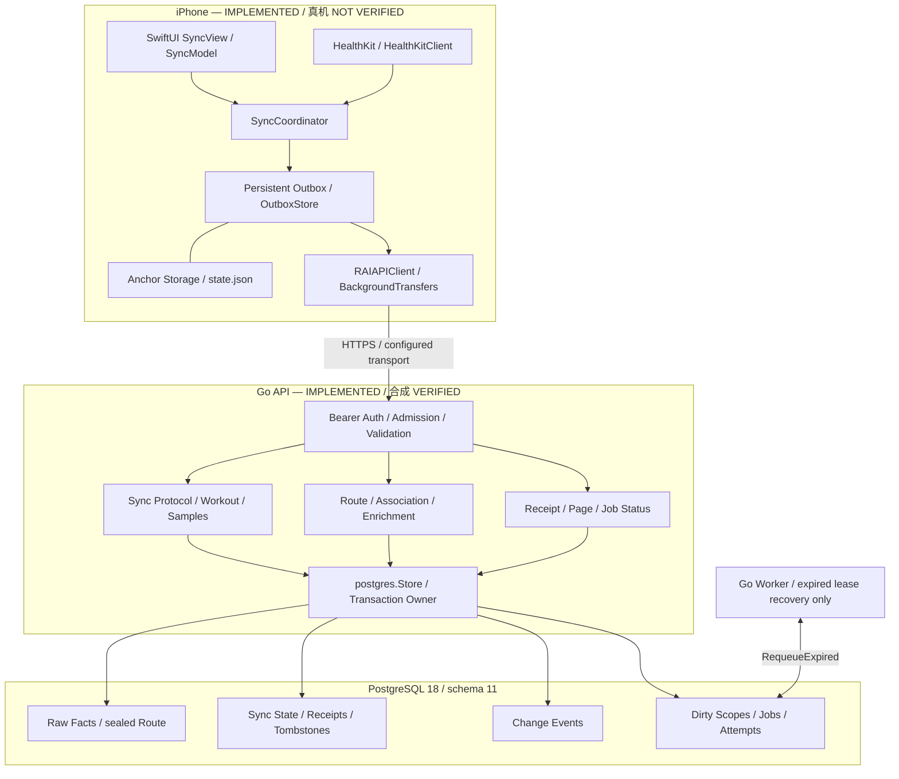
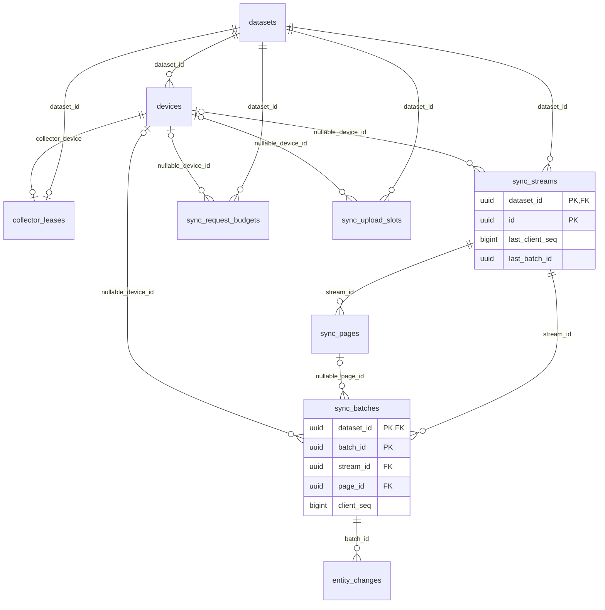
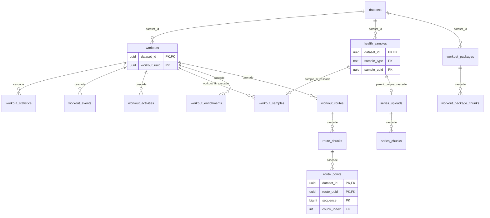
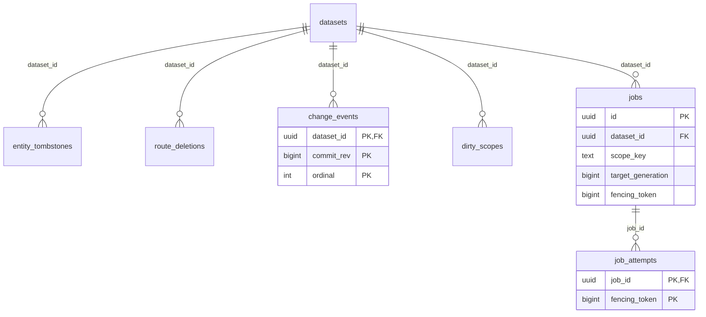
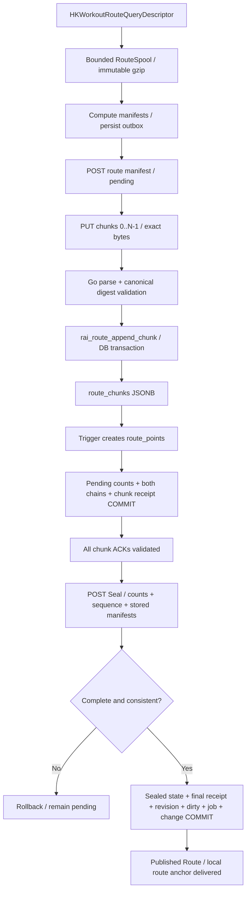
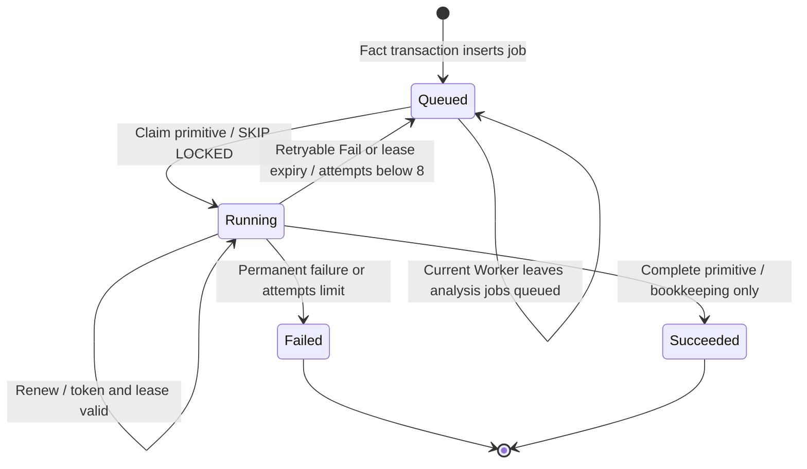
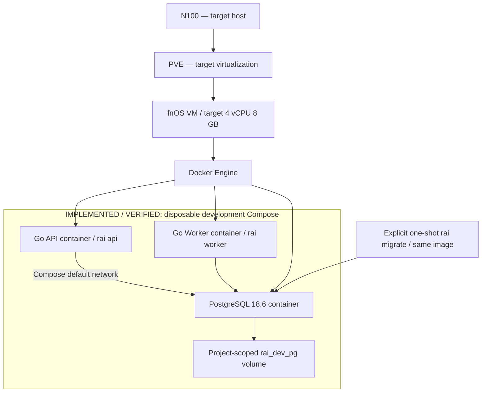
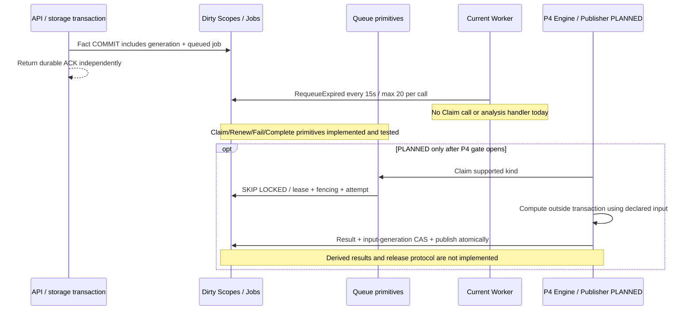
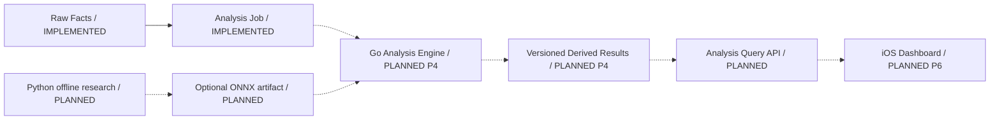
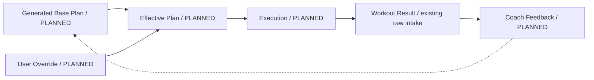

# RAI V2 — System Architecture

**Current Implementation / As-Built Architecture**

```text
Document: RAI V2 Architecture
Type: As-Built Architecture
Repository: /Users/ta/rai
Maintained at: 2026-10-27 (Asia/Shanghai)
Source Commit: 537b526561d8d9667c0ccafb91928bafd573f25e
Status: P3 Server implemented / P3.5 Client Closure BLOCKED / P4 READY: NO
```

本文记录上述 HEAD **加读取时工作区**的实际架构。开始时已有 5 个 tracked 修改：`docs/IMPLEMENTATION.md`、`docs/V2_PHASE3_RESULT.md`、`ios/RAI/Sources/SyncCore/Wire.swift` 及 `ios/RAI/Tests/SyncCoreTests/{APITests,SyncCoreTests}.swift`。其中客户端回执校验修复已经在工作区，不能只用 HEAD 重现本文全部描述。本次只新增本文件，不提交、不部署、不连接数据库、不运行 migration。

状态约定：**IMPLEMENTED** 表示源码已实现；**VERIFIED** 表示有明确自动化或验收记录，须同时读其环境和范围；**PLANNED** 表示仅为冻结方向。代码存在、测试存在和验收通过是三种不同证据。本文的 VERIFIED 引用既有证据，**不表示本次重新执行测试**。事实依据依次为当前源码、migrations、API 实现与 OpenAPI、测试、验收证据、阶段结果、未来计划。

## 1. 项目概述

RAI Running V2 面向个人跑者，以 iPhone 当前可见的 Apple HealthKit 运动和健康事实为输入，建设可恢复的增量同步、运动分析及训练执行闭环。当前实际可用的开发切片是事实同步与任务持久化，iPhone UI 仅有同步调试界面，尚无分析 Dashboard 或训练产品。

产品不是多租户 SaaS。服务端仍有真实的 **dataset 隔离边界**：设备凭证绑定 dataset，事实、同步身份、墓碑和任务按 dataset 定位；复合键及 FK 防止跨 dataset 关联。`admin.Init` 目前只允许数据库初始化第一个 dataset，不能据 schema 推断已有多用户注册、租户管理或设备自助加入流程。

核心职责如下：

| 组件 | 已实现职责 | 边界 |
|---|---|---|
| iOS / SwiftUI / HealthKit | 请求只读授权、增量读取、规范化、不可变文件 outbox、anchor、回执校验与重试 | 不计算服务端评分；WorkoutKit 排程尚未实现且需独立授权 |
| Go API | Bearer 设备鉴权、协议验证、幂等、事务事实提交、恢复查询和状态查询 | ACK 不等待分析；不提供完整事实下载或训练 API |
| PostgreSQL | 原始事实、同步状态、永久删除屏障、提交日志、dirty generation、jobs 和回执 | 唯一服务端主要事实数据库；没有 SQLite 服务端 |
| Go Worker | 定期回收过期 job lease | 尚无分析 handler，不领取并假装完成分析 |
| Python / ONNX | PLANNED：离线研究、训练；必要时 Go 推理 | 当前没有 `ml/`、模型或推理服务 |

系统优先保证不可变事实、删除优先、同事务待办和可恢复 ACK；日常同步不依赖备份、迁移、全库摘要或全量重算。无旧 Node / SQLite 兼容层，无 Web、独立 Watch 或桌面产品。原始[架构方案](../RAI-Go-PostgreSQL架构重设计与实施方案.md)保留历史设计，阶段定义以[实施合同](IMPLEMENTATION.md)为准。

## 2. 当前阶段状态与证据口径

| 阶段 / 模块 | 当前状态 | 可确认的验证及边界 |
|---|---|---|
| P0 | 冻结完成 | [P0 基线](V2_PHASE0_BASELINE.md)与[P1 计划](V2_PHASE1_PLAN.md)；是设计冻结，不是运行验收 |
| P1 | IMPLEMENTED + VERIFIED，PASS WITH RISKS | [P1 Result](V2_PHASE1_RESULT.md)：fnOS 隔离 PG、Compose、健康、停止、受控迁移；生产未验收 |
| P2 | IMPLEMENTED + VERIFIED，PASS WITH RISKS | [P2 Result](V2_PHASE2_RESULT.md)：核心模型、事务、队列基础；其 Route 仅暂存的历史描述已被 P3 实现扩展 |
| P3 Server | IMPLEMENTED + VERIFIED，PASS WITH RISKS | schema 11、Route Seal、关联、补充事实、故障注入及合成 Compose E2E；[P3 fnOS JSON](evidence/p3-fnos-2026-10-27.json) |
| P3.5 iOS | IMPLEMENTED + 部分 VERIFIED；Client Closure **BLOCKED** | Swift 核心、模拟器合成测试、未签名 iPhone 编译及 Swift/fnOS 合成恢复；[P3.5 JSON](evidence/p35-ios-2026-10-27.json) |
| P3 真机 E2E | NOT VERIFIED / 未执行 | 无可用真实 iPhone；授权、实际 anchored query、GPS、后台与设备强杀恢复均未验收 |
| P4 Analysis Engine | PLANNED，未进入正式实施 | 没有分析包、算法结果表或分析 handler；**P4 READY: NO** |
| P5 Training Plan | PLANNED，未实现 | 没有计划、override、effective plan、执行或反馈服务 |
| P6 | PLANNED，未实现 | 正式范围为 iOS API、同步、分析查询、训练与执行集成；不能将 P3.5 同步 UI 当作 P6 完成 |
| P7 | PLANNED，未验收 | fnOS 正式部署、安全、备份恢复、容量、可观测性和授权发布 |

最新状态见 [P3 Result 的 Client Closure 与末尾复核](V2_PHASE3_RESULT.md)。仓库 `README.md` 仍称没有 iOS 工程，P0 中还记录旧 schema 和当时无 HEAD；这些均为较早快照，本文按当前源码记录。

**证据缺口**：工作区 `IMPLEMENTATION.md` 和 `V2_PHASE3_RESULT.md` 的最新复核报告 Swift 核心 **27 项**通过；现存 P3.5 JSON 的 `quality_gates.swift_core.passed` 仍为 **25**，且没有两份文档引用的 `latest_revalidation` 字段。当前代码确有强化后的 `Envelope.validateReceipt` 和回归用例；27 项复核及其耗时只能归因于结果文档报告，不能声称已有对应机器可读记录。本次不补写或改动原证据。

## 3. 系统整体架构



API 和 Worker 是同一 Go 模块、同一镜像的不同进程，使用同一 PostgreSQL。图中没有分析结果生产路径：jobs 已落库，但当前 Worker 只恢复过期租约。HTTPS 是 Release 客户端要求；仓库服务端与开发 Compose 提供 HTTP，不能据箭头推断已有 TLS 入口。

## 4. 技术栈与运行环境

| 项目 | 当前配置 / 已有证据 | 来源 |
|---|---|---|
| Go | 模块 `rai/server`，`go 1.27.3` | [go.mod](../apps/server/go.mod)、`.go-version`、Docker 构建镜像 |
| PostgreSQL | 18.6；开发镜像 `postgres:18.6-bookworm` 固定摘要 | [Compose](../deploy/dev/compose.yaml)；fnOS JSON 报告 PG 18.6 |
| pgx | `github.com/jackc/pgx/v5 v5.11.0`，pgxpool | go.mod、`postgres.Open` |
| goose | `v3.29.0`，SQL 嵌入二进制，显式 CLI 迁移 | go.mod、[admin.go](../apps/server/internal/admin/admin.go) |
| sqlc | 1.31.1；生成包 `dbgen`、`sql_package: pgx/v5` | [sqlc.yaml](../apps/server/sqlc.yaml)、[server workflow](../.github/workflows/server.yml) |
| Swift | tools 最低 6.0、语言模式 6；App `SWIFT_VERSION=6.0`、complete concurrency | [Package.swift](../ios/RAI/Package.swift)、[project.yml](../ios/RAI/project.yml)；已有验收工具链 Swift 6.3.2 |
| iOS | deployment target 18.0，仅 iPhone，版本 0.3.5 (1) | project.yml、`RAI.xcodeproj/project.pbxproj` |
| Apple frameworks | SwiftUI、UIKit、HealthKit、CoreLocation、Foundation、CryptoKit、Security、Synchronization、OSLog | `ios/RAI/App`、`Sources/SyncCore` imports |
| Swift 第三方依赖 | 无；C target `RAICompression` 链接系统 zlib | Package.swift、`Sources/RAICompression/gzip.c` |
| Xcode / XcodeGen | 验收记录 Xcode 26.5 (17F42)，XcodeGen 2.46 | P3.5 JSON、iOS README；不是本次探测值 |
| Docker / Compose | Dockerfile 多阶段构建、scratch runtime、Compose V2 命令 | fnOS 历史记录 Docker 28.5.2；**未记录 Compose 精确版本** |
| API 文档 | OpenAPI 3.1.0，`info.version=0.9.0` | [openapi-v2.yaml](../contracts/openapi-v2.yaml)；不等于 wire protocol version |

当前存储同时使用 sqlc 生成查询和手写 pgx SQL，不能称所有 SQL 已由 sqlc 管理。Go 标准库提供 HTTP、路由、JSON 与 `slog`，没有第三方 HTTP framework。

| 环境 | 责任与已知边界 |
|---|---|
| macOS | 编辑、Git/Gitee 工作流、Xcode/iOS 编译、模拟器、Swift 单元测试；`SyncProbe` 是合成命令行测试工具，非桌面客户端。历史早期 Go/PG 本地测试存在，不冒充 fnOS 最终验收 |
| fnOS / N100 | 隔离 Go build/test/race/vet、PostgreSQL 集成、显式 migration、一次性 Compose 和服务端合成验收。证据机器为 4 CPU、约 7.8 GiB 内存；不证明生产配置已部署 |
| iPhone | 实际 HealthKit、系统后台生命周期、签名安装和设备 E2E 的必要环境；截至当前阶段未验收 |
| 目标基础设施 | N100 → PVE → fnOS VM（4 vCPU / 8 GB）→ Docker；目标层次来自合同，不是本次核验过的 PVE 现场配置 |

## 5. 仓库目录结构

以下是架构相关的真实目录，省略单文件测试和构建缓存：

```text
/Users/ta/rai
├── AGENTS.md / README.md / RAI-Go-PostgreSQL架构重设计与实施方案.md
├── apps/server
│   ├── cmd/rai/main.go                 # 唯一 Go CLI / API / Worker 入口
│   ├── internal
│   │   ├── config                     # 环境配置校验
│   │   ├── httpapi                    # net/http handlers、鉴权、上传限流
│   │   ├── syncing                    # DTO、协议验证、Store 接口、哈希
│   │   ├── storage/postgres           # 事务、事实与状态 SQL
│   │   │   └── dbgen                  # sqlc 生成查询与模型
│   │   ├── jobs                       # Worker 恢复循环
│   │   └── admin                      # 显式迁移、状态、受控 down、初始化
│   ├── migrations                     # 00001–00011、embed、checksums
│   ├── queries/core.sql / sqlc.yaml
│   ├── integration                    # 真实隔离 PG、故障与规模测试
│   └── Dockerfile / go.mod / go.sum
├── ios/RAI
│   ├── RAI.xcodeproj / project.yml     # 已提交工程及 XcodeGen 输入
│   ├── App                            # SwiftUI、HealthKit、协调器、后台传输
│   ├── Config                         # entitlement、Info、xcconfig 模板
│   ├── Sources/SyncCore               # 无 HealthKit 依赖的同步核心
│   ├── Sources/RAICompression          # C / zlib gzip
│   ├── Tests/SyncCoreTests/Fixtures
│   ├── AppTests                       # iOS 合成转换测试
│   └── Tools/SyncProbe                # macOS 合成恢复 harness
├── contracts                          # OpenAPI、sync-v2、changelog、fixtures
├── deploy/dev                         # 三服务开发 Compose 与操作说明
├── deploy/postgres/roles.sql           # 显式安装的 NOLOGIN 权限组
├── scripts                            # 隔离测试、依赖边界、P3/P3.5 harness
├── .github/workflows                  # server.yml / contracts.yml
└── docs
    ├── IMPLEMENTATION.md              # 实施主合同与阶段出口
    ├── V2_PHASE*.md / adr             # 冻结合同、结果与决策
    ├── evidence                       # 脱敏 JSON 验收记录
    └── ARCHITECTURE.md                # 本文：当前架构
```

不存在 `internal/analysis`、`internal/training`、`ml/` 或另一个 `application` / `service` 目录。P3.5 Client Closure 记录位于 `V2_PHASE3_RESULT.md`，未发现独立 Client Closure Result 文件。`docs/evidence` 的 P0 legacy 清单只作历史来源说明，不能证明 V2 已有旧系统算法；本次不访问 `../running`。

## 6. Go 后端架构

### 6.1 API Entry、启动与停止

[cmd/rai/main.go](../apps/server/cmd/rai/main.go) 的 `run` 分派 `api`、`worker`、`migrate`、`migrate-down`、`migrate-status`、`init`、`probe`。API/Worker 使用 `postgres.Open` 建池，并以 5 秒 context Ping，连接失败非零退出。启动只检查连接，**没有启动时自动迁移、自动 init 或全局 schema 拦截器**。

API 用 `net.Listen` / `http.Server` 和 `http.NewServeMux` 的 method/path pattern。中间层设置 `Cache-Control: no-store`、`X-Content-Type-Options: nosniff`，生成/验证 UUID `X-Request-ID`，记录 method、path、status 和耗时。`/v2` 经过 `auth`：鉴权 → 写权限检查 → 持久 admission budget → handler。没有虚构的 Service/Repository 调用层。

默认监听 `127.0.0.1:8080`，`RAI_LISTEN_ADDR` 可配置；容器监听 `0.0.0.0:8080`。HTTP 超时为 header 5 秒、read 15 秒、write 25 秒、idle 60 秒、header 上限 16 KiB；鉴权后的业务 context 上限 20 秒。SIGINT/SIGTERM 取消根 context；API 用独立 10 秒 context `Shutdown`，超时则 `Close` 并报错；Worker 循环退出后关闭池。

`GET /health`、`/livez` 只检查进程并返回 200 alive；`/ready`、`/readyz` 用 1 秒 context 调 `Store.Ready`，检查关键表及 goose 最新 applied schema **恰为 11**，失败返回 503 `not_ready`。容器 `rai probe` 调 `/health`，所以其健康不等于数据库 ready。API 普通路由不会先自动调用 Ready；运维必须正确使用 readiness。

### 6.2 Internal Modules 与实际依赖

| 包 | 输入 → 输出 / 职责 | 依赖与数据库边界 |
|---|---|---|
| `internal/config` | 环境变量/秘密文件 → 已校验 DSN、listen address | 标准库；不执行 SQL |
| `internal/httpapi` | HTTP → DTO、状态 JSON、原回执字节 | 依赖 `syncing.Store` 与 `slog`；不导入 pgx、admin、goose |
| `internal/syncing` | DTO/字节 → 白名单验证、canonical hash、错误、Store 合同 | 协议和领域校验，无数据库连接；含 Workout、route、series、package、association、enrichment、changes |
| `internal/storage/postgres` | Principal + DTO → 事务结果/回执 | 实现 `syncing.Store`；拥有 pgxpool、业务 SQL、锁顺序和提交边界，也提供 jobs 的 Claim/Renew/Fail/Complete |
| `internal/storage/postgres/dbgen` | 查询参数 → 有类型结果 | 由 `queries/core.sql` 生成；不自行控制上层事务 |
| `internal/jobs` | context + `Recovery` → 租约恢复循环 | 仅依赖 `RequeueExpired` 小接口；不含算法注册或 HTTP |
| `internal/admin` | CLI → migration、状态、受控 down、初始 enrollment | `database/sql` + pgx stdlib/goose、嵌入 migrations；Init 用 pgxpool；在线包不可导入 |
| `migrations` | 内嵌 SQL/校验清单 | 只经管理路径加载，不进入在线依赖图 |

真实调用链为 `httpapi.handler → syncing.Store 方法 → postgres.Store → pgx / dbgen / 受控数据库函数`。事务业务逻辑主要在 PostgreSQL storage 包中，`syncing` 不等同独立 application service。管理与在线包共同由 CLI 入口组装，不代表在线请求能运行迁移；[check-boundaries.py](../scripts/check-boundaries.py)检查实际 Go 依赖图。

### 6.3 连接池、错误与恢复

API/Worker 默认最大连接分别 8/4，最小值沿 pgx 默认 0；可用 URL 的 `pool_*` 选项覆盖，生命周期默认 30 分钟。连接超时 3 秒、UTC、`synchronous_commit=on`、session statement timeout 2 秒、lock timeout 500 ms、idle-in-transaction timeout 5 秒。`begin` 使用 `Pool.Begin`，不显式指定隔离级别，并设置事务内 statement timeout 5 秒；普通事实提交及 series/package/Route chunk 另外有 5 秒 Go context，不能把两者都概括成所有事务的总时限。

`syncing.Error` 携带稳定 `code`、HTTP status 及可选 expectedSeq/index/retry 信息。已知错误直接输出；未知 storage 错误变为 503 `temporarily_unavailable`、`Retry-After: 2`，不暴露 SQL/DSN/健康值。数据库失败不改造成成功回执；COMMIT 已成功而响应写出失败时保留成功事实，客户端恢复原 receipt。

| HTTP | 典型实际 code | 语义 |
|---|---|---|
| 400 / 415 | `body_read_failed`、`unsupported_media_type`、`unsupported_content_encoding` | 请求/传输错误；只接受声明的 JSON 或 gzip NDJSON |
| 401 / 403 | `unauthorized`、`read_only_device`、`dataset_forbidden` | 凭证、角色或 dataset 不符 |
| 404 | `batch_not_found`、`stream_not_found`、`route_not_found` | 对象/注册不存在，不能据此推进 anchor |
| 409 | `sequence_gap`、`batch_identity_conflict`、`sample_identity_conflict`、`collector_fenced`、`upload_lease_lost` | 顺序、不可变身份或 fencing 冲突 |
| 413 / 422 | `batch_too_large`、`event_too_large`、`unsupported_payload`、`unsupported_unit`、`unsupported_protocol` | 超限或不支持；当前 `ParseBody` 的 `payload_hash_mismatch` 为 **422** |
| 429 | `*_rate_exceeded`、`*_capacity_exceeded` | Retry-After 后复用原身份；不丢弃本地文件 |
| 503 | `temporarily_unavailable`、健康接口的 `not_ready` | 服务暂不可用；提交结果可能未知，先恢复查询 |

重要源码差异：普通 Workout 与 sample 共用 `applyEvent` / `Collapse`，相同 UUID 不同内容实际可能返回 **`sample_identity_conflict`**，不能只按合同示例期待 `workout_identity_conflict`。enrichment 同 source 的非递增版本实际返回 `workout_enrichment_stale`。本次仅记录。

## 7. PostgreSQL 数据库架构

### 7.1 Schema 来源、类型与迁移

已读取 [migrations](../apps/server/migrations) 的全部 00001–00011。最终有 **29 张应用表**，另有 goose 管理的 `goose_db_version`。没有 `analysis_runs`、分析结果或训练计划表。

| Migration | 当前结构来源 |
|---|---|
| 00001 | dataset/device/collector、stream/batch、sample、墓碑、两类日志、dirty、jobs/attempts |
| 00002 | dirty scope 增加 `clean_generation`，清理后仍保留 generation 历史 |
| 00003 | Workout、statistics/events 投影 |
| 00004 | sync pages、batch 页关联与封口回执 |
| 00005–00006 | 持久 request budgets、两格 upload slots |
| 00007 | 多活动 Workout activities 投影 |
| 00008 | quantity series uploads/chunks |
| 00009 | 大 Workout packages/chunks 及删除触发器 |
| 00010 | 新采集设备 FK/绑定触发器、sample 关联、Route/chunks/points 基础 |
| 00011 | Route manifest/Seal/删除/投影函数、enrichments、route deletion receipts、关联回执 |

UUID 是身份，不是排序；微秒 Unix 时间在 API 中用整数 `*Us`，绝对时间入 PG `timestamptz`，Workout duration 用 `duration_us bigint`。数值使用 float8 及有限值/范围检查；低频结构用 JSONB，回执用 `bytea` 保存序列化字节。没有 PostGIS、TimescaleDB、分区或独立消息队列。

下表为最终 schema。为减少重复，**D = dataset_id，T = sample_type，U = sample_uuid，W = workout_uuid，R = route_uuid**。PK 全部列出；未另外列出索引时，关键定位由 PK/UNIQUE 的 B-tree 支持。Raw 指来源事实或其投影，State 指同步/分析状态，Infrastructure 指运行控制；当前没有已投入使用的分析 Derived 表。

### 7.2 身份与同步状态

| 表 / 性质 / 职责 | Primary Key | Foreign Keys | Unique / 关键索引 | 写入者与生命周期 |
|---|---|---|---|---|
| `datasets` / State：隔离根、epoch/service/timezone/commit_rev | `id` | 无 | PK | CLI init 创建；API 在事实事务更新 commit_rev；Worker Complete 锁定；无自动删除 |
| `devices` / State：token hash、can_collect、revoked_at | `(D,id)` | D → datasets | `token_sha256` 全局 UNIQUE | CLI init；鉴权只读；撤销字段存在，无自助管理 API |
| `collector_leases` / State：当前提交设备及 collector epoch | D | D → datasets；`(D,device_id)` → devices | `(D,collector_epoch)` UNIQUE | CLI init；业务事务重新检查当前 collector；不是 Worker lease |
| `sync_streams` / State：type/query/连续提交水位 | `(D,id)` | D → datasets；`(D,device_id)` → devices | `(D,collector_epoch,T,query_fingerprint)` UNIQUE | API 登记；触发器绑定新设备；batch COMMIT 才更新 last_client_seq/last_batch_id；旧 device 可 NULL |
| `sync_batches` / State：不可变 envelope/hash、最终 receipt | `(D,batch_id)` | `(D,stream_id)` → streams；`(D,page_id)` → pages；`(D,device_id)` → devices | `(D,stream_id,client_seq)` UNIQUE；`sync_batches_page_fragment` 唯一；legacy page 表达式索引 | API；registered 保留重试；committed 回执不可重写；无自动过期删除 |
| `sync_pages` / State：页片进度、manifest、sealed receipt | `(D,page_id)` | `(D,stream_id)` → streams | `sync_pages_open`：每 stream 最多一个 receipt NULL 的页 | API 注册页/最终片事务；CHECK 绑定完整片数、receipt、sealed_at；旧批次不猜测页完整性 |
| `sync_request_budgets` / Infrastructure：read/write/upload 准入 | 无显式 PK | D → datasets；`(D,device_id)` → devices | `UNIQUE NULLS NOT DISTINCT(D,lane,device_id)` | API 独立 operational 事务；NULL device 为 dataset 桶，固定 lane 行复用，不分配 revision |
| `sync_upload_slots` / Infrastructure：跨进程上传限额与 fencing | `(D,slot)` | D → datasets；`(D,device_id)` → devices | PK；slot CHECK 为 0/1 | API acquire/release；两格复用，30 秒 TTL + 随机 token；不随请求追加历史 |

### 7.3 原始事实、关联与补充

| 表 / 性质 / 职责 | Primary Key | Foreign Keys | Unique / 关键索引 | 写入者与生命周期 |
|---|---|---|---|---|
| `health_samples` / Raw：数量或睡眠类别样本 | `(D,T,U)` | D → datasets；`(D,ingest_device_id)` → devices | `health_samples_type_time(D,T,event_start,U) INCLUDE(event_end,value_numeric,unit)` | API；不可变、删除建立墓碑；新行绑定提交设备；可独立于 Workout |
| `workouts` / Raw：首次完整 Workout payload 与 identity hash | `(D,W)` | D → datasets；`(D,ingest_device_id)` → devices | `workouts_time(D,event_start DESC,W DESC)` | API 普通 batch 或 package Seal；主体不 UPDATE；删除清理子对象 |
| `workout_statistics` / Raw projection：按 type 的统计 | `(D,W,T)` | `(D,W)` → workouts，CASCADE | PK | API 与 Workout 同事务；随父删除 |
| `workout_events` / Raw projection：来源顺序事件 | `(D,W,ordinal)` | `(D,W)` → workouts，CASCADE | PK，ordinal 0..255 | API 与父同事务；不重新排序或伪造事件 |
| `workout_activities` / Raw projection：多活动及嵌套 payload | `(D,W,ordinal)` | `(D,W)` → workouts，CASCADE | `(D,W,activity_uuid)` UNIQUE；ordinal 0..127 | API；有界来源事实；旧 v1 不伪造回填 activities |
| `workout_samples` / Raw relation：每 sample 至多一个 Workout | `(D,T,U)` | `(D,T,U)` → samples；`(D,W)` → workouts，均 CASCADE | `workout_samples_workout`；非 NULL `(D,association_id)` 唯一索引 | P3 API；存 source、association receipt、commit_rev；任一父删除只清理关系，不删除另一父事实 |
| `workout_enrichments` / Raw：append-only 补充事实 | `(D,enrichment_id)` | D → datasets；`(D,W)` → workouts，CASCADE | `(D,W,source_bundle_id,source_version)` UNIQUE；`workout_enrichments_workout(D,W,observed_at_us DESC,source_version DESC)` | API；nil→value/同值确认；stale/覆盖冲突拒绝；父删除清理 |

### 7.4 分块对象与 Route

| 表 / 性质 / 职责 | Primary Key | Foreign Keys | Unique / 关键索引 | 写入者与生命周期 |
|---|---|---|---|---|
| `series_uploads` / State + sealed Raw completeness：数量序列 | `(D,series_id)` | `(D,T,U)` → health_samples，CASCADE | `(D,T,U)` UNIQUE | API；父样本先存在；pending→sealed，保存 counts/manifest/receipt；随 sample 删除 |
| `series_chunks` / Raw staging：数量点数组 | `(D,series_id,chunk_index)` | `(D,series_id)` → series_uploads，CASCADE | PK；index 0..999、每块 1..5000 点 | API；JSONB points、wire/points hash 与 chunk receipt；不可变重试 |
| `workout_packages` / State + Raw staging：未发布大 Workout core | `(D,W)` | D → datasets；**没有到 workouts 的 FK** | PK；最大 100 chunks / 20000 details | API；Seal 前 Workout 尚不存在；Seal 插入事实并留 receipt；Workout 删除由触发器清理 package |
| `workout_package_chunks` / Raw staging：canonical detail bytes | `(D,W,chunk_index)` | `(D,W)` → workout_packages，CASCADE | PK；index 0..99、每块 1..1000 detail 项 | API；保存 details `bytea`、digest、原回执；随 package 删除 |
| `workout_routes` / State + sealed Raw：Route manifest 与发布标志 | `(D,R)` | `(D,W)` → workouts，CASCADE | `workout_routes_workout(D,W,R)` | API 登记；受控函数累计 chunk、Seal 或删除；pending 不可当完整路线 |
| `route_chunks` / Raw staging：canonical point JSONB | `(D,R,chunk_index)` | `(D,R)` → workout_routes，CASCADE | PK；index 0..999、每块 1..5000 点；JSON 长度=point_count | 受控 `rai_route_append_chunk`；不可变、保存双链和 receipt；触发器生成 projection |
| `route_points` / Raw projection：顺序/时间/坐标查询投影 | `(D,R,sequence)` | `(D,R,chunk_index)` → route_chunks，CASCADE | `route_points_time(D,R,recorded_at,sequence)` | DB trigger；API role 不能直接写；父删除级联 |
| `route_deletions` / State：路线消失后仍保存删除回执 | `(D,R)` | D → datasets；可空 W **无 Workout FK** | PK | API DeleteRoute 事务；独立保存原 receipt，不能随已删除 Route 消失；无自动 GC |

`workout_routes` 的 expected counts、committed counts、chunk_count/total_points、sealed_rev 与 receipt 有 CHECK；Seal 是受控发布转换，不是普通 UPDATE。P2 旧 pending 行缺少新 epoch/manifest 信息，不能自动当作 P3 已发布路线。

### 7.5 删除、日志与分析待办

| 表 / 性质 / 职责 | Primary Key | Foreign Keys | Unique / 关键索引 | 写入者与生命周期 |
|---|---|---|---|---|
| `entity_tombstones` / State：永久 delete-wins 屏障 | `(D,T,U)` | D → datasets；不依赖事实 FK | PK | API/受控 route delete；未知删除也保留；不自动过期，防止旧 UUID 复活 |
| `entity_changes` / State：普通 batch 的实体变化明细 | `(D,batch_id,ordinal)` | `(D,batch_id)` → sync_batches | PK | API 普通事实事务；保留原/新时间范围；不是所有独立补充路径的统一审计表 |
| `change_events` / State：提交有序通知日志 | `(D,commit_rev,ordinal)` | D → datasets | `event_id` 全局 UNIQUE | API 事实/独立 Seal 等事务；无 entity 多态 FK；按 revision+ordinal 增量分页；长期保留策略未实现 |
| `dirty_scopes` / State：待分析范围与 generation | `(D,scope_key)` | D → datasets | PK；`0 <= clean_generation <= generation` | API 累加 generation、扩大时间范围；Worker Complete CAS 标 clean；行不删除，防 generation 复用 |
| `jobs` / State：持久队列 | `id` | D → datasets | `(D,kind,scope_key,target_generation)` UNIQUE；`jobs_ready(run_after,id) WHERE queued`；`jobs_expired(lease_until,id) WHERE running` | API 入队；队列存储方法领取/续租/结束；当前 Worker 只回收；历史无自动清理 |
| `job_attempts` / State：每次 fencing 尝试 | `(job_id,fencing_token)` | job_id → jobs，默认 NO ACTION | PK | Claim 写 started、Fail/Complete/Recovery 写 finished/result；不含任意健康错误文本 |

`jobs.scope_key` 与 `dirty_scopes.scope_key` 是**逻辑对应**，没有 FK；entity key、墓碑 UUID、route deletion W、stream.last_batch_id 和各种 commit_rev 也不能绘成不存在的物理 FK。数据库 owner/管理路径拥有更高权限；表约束不能替代所有应用协议校验。

## 8. 数据库 ER 图

所有 ER 连线均为实际 FK；为可读性拆成三张，部分可空设备 FK 和 dataset 祖先关系仅在第 7 章列出。`o|` 表示可选一方；图中未将逻辑 scope 或多态实体引用当作 FK。



此图解释同步登记与页片的物理父关系。`last_batch_id` 是受事务控制的指针，但没有独立 FK；collector_epoch 的校验由协议和 collector 查询完成，不能据同名列额外画 FK。



sample 可以没有 Workout 关联；Route 需要已存在的 Workout，但可延迟提交。Workout package 为解决“父事实 Seal 前尚不存在”，只 FK 到 dataset；Workout 删除清理 package 是 trigger，**未画成 FK**。



墓碑必须能先于事实存在，deletion receipt 必须能活过父对象删除；两者不能 FK 到被删除事实。dirty scope 与 job 的代际关系由 storage SQL/CAS 保证，图中不画逻辑连线。

## 9. HealthKit 增量同步架构

### 9.1 身份、水位与持久化

HealthKit anchor 是 `HKQueryAnchor` 的 secure archive `Data`，只存在客户端 `state.json`，从不上传。当前 logical stream 是固定 type 和 query fingerprint；服务端保存 collector epoch、client sequence、last batch 和页交付状态。**HealthKit anchor、clientSeq、dataset.commit_rev 是三个不同坐标**。

| 坐标 / 身份 | 保存处与推进条件 |
|---|---|
| candidate anchor | `PendingPage.candidateAnchor`；规范化、保存所有引用文件并 stage 页面后持久化 |
| delivered anchor | `Stream.deliveredAnchor`；页面全部 operations 成功，含补充操作与 sealed page 校验后，和本地状态原子替换 |
| server committed sequence | `sync_streams.last_client_seq`；对应 batch 事实/receipt 事务 COMMIT 才推进 |
| local nextSequence / lastBatchID | 每个已验证 batch ACK 后原子推进，页尚未交付时仍可能已前移 |
| batch UUID / exact body | 生成一次，envelope canonical 与 gzip 文件固定；任何重试不重压缩、不换 ID |
| dataset revision | dataset 行锁内为实际新变更分配；不使用 PostgreSQL sequence 作为下载水位 |

### 9.2 HealthKit Sync Sequence

```mermaid
sequenceDiagram
    participant HK as HealthKit
    participant C as SyncCoordinator
    participant O as OutboxStore / state.json
    participant A as Go API
    participant D as PostgreSQL
    C->>HK: Anchored query(delivered anchor A)
    HK-->>C: added / deleted / candidate anchor B
    C->>C: Normalize supported DTO / split page
    C->>O: Write immutable gzip files
    C->>O: Atomically stage page + B + identities
    C->>A: Register stream / batch envelope
    A->>D: Registration transaction / registered
    D-->>A: COMMIT registration
    loop Page fragments in sequence
        C->>A: PUT exact gzip body
        A->>D: Lock dataset / stream; facts + barriers + logs + jobs + receipt + seq
        Note over D: Final fragment also seals page in same transaction
        D-->>A: COMMIT
        A-->>C: Durable batch receipt
        C->>O: Validate receipt; persist nextSequence + cursor
    end
    C->>A: GET page after supplement operations
    A-->>C: Sealed page receipt / canonical manifest
    C->>O: Validate identity/counts/manifest; atomically deliver anchor B
```

服务端页回执证明声明的片全部交付，**不证明 HealthKit 查询覆盖完整历史**；查询范围和 anchor 的正确性仍属于客户端。即使空 HealthKit 主 stream 页，`BatchBuilder.page` 也生成一个零事件 batch 并校验页回执；无操作的 route/关联本地查询页可通过 `finishEmptyPage` 直接保存本地 anchor，不能泛化为所有页都需服务端 batch。

### 9.3 失败恢复

| 故障点 | 当前恢复路径 |
|---|---|
| 写文件/写 state 失败 | `OutboxStore.commit` 写成功才替换内存；anchor 不前移。可能遗留未引用文件，无自动 GC |
| 注册后 body 失败 | 服务端 registered 保留，原 gzip/identity 重试；stream 未推进 |
| COMMIT 后 ACK 丢失 | Pipeline 先 GET 原 batch，匹配原 envelope/receipt；已 committed 不重新生成批次 |
| 部分片已 ACK / App 重开 | 从持久 cursor/sequence 恢复剩余片；重启不信任 `uploading=true` |
| 错误 receipt | 抛 `receiptMismatch`，保留候选 anchor、原文件和 sequence/cursor；不能以 HTTP 200 当成功 |
| 429 / 408 / 5xx / 网络错误 | 持久 retryCount/nextAttempt；指数退避上限 60 秒并取更大的 Retry-After；重试沿用原请求 |
| 身份、授权、协议冲突 | 保留待办、停止该项自动重试，显式 `Retry Saved Work` 可重新尝试；不跳过失败批次 |
| 关联父事实未到达 | `waitingForFactGeneration` 记录本地代际，新 durable fact 后唤醒原关联；不换绑 |
| dataset / collector 改变 | `OutboxStore.bind` 拒绝静默换域；没有自动跨 dataset 状态迁移 |

源码：[HealthKitClient.swift](../ios/RAI/App/HealthKitClient.swift)、[BatchBuilder.swift](../ios/RAI/Sources/SyncCore/BatchBuilder.swift)、[OutboxStore.swift](../ios/RAI/Sources/SyncCore/OutboxStore.swift)、[RAIAPIClient.swift](../ios/RAI/Sources/SyncCore/RAIAPIClient.swift)。合成恢复见 P3.5 evidence；iPhone 上的这些场景尚未 VERIFIED。

## 10. iOS 客户端架构

### 10.1 模块与 Swift Concurrency

| 模块 / 类型 | 实际职责与并发边界 |
|---|---|
| `RAIApp` / `SyncView` / `SyncModel` | SwiftUI 入口；`@MainActor @Observable` 状态，拥有前台 `task` 与退避 `retryTask`；显示 pending/ACK/error，提供授权、同步和重试按钮 |
| `AppDelegate` | 接回稳定后台 session completion；保存响应后调用 `run(readHealth:false)`，不在后台重读 HealthKit |
| `HealthKitReading` / `HealthKitClient` | Sendable mock 边界与 actor；封装授权、anchored query、Workout 定位、route/series 异步读取 |
| `Normalizer` | HealthKit → Canonical DTO：单位、微秒时间、来源、受支持 Workout activities/statistics/events；失败保留受影响 stream anchor |
| `SyncCoordinator` actor | handshake/bind、先 drain 再读、按 type 有界读取、迟到维护；`running` 防重入 |
| `OutboxStore` actor | 单一 LocalState，文件与原子状态转换；内置 anchor storage，**没有独立 AnchorStore 类/SQLite 数据库** |
| `OutboxPipeline` actor | facts 优先、按页面 cursor 执行、查询未知结果、校验回执、记录重试；`draining` 防重复 drain |
| `Wire` / `Envelope` / `BatchBuilder` | 稳定 JSON/浮点、SHA-256、gzip、页 manifest、普通批次分片与回执校验 |
| `RouteSpool` / `DetailSpool` / `Supplements` | Route/series/大 Workout 有界分块落文件；RouteSpool 用 `Mutex` 保护 Sendable 状态 |
| `RAIAPIClient` | Sendable value、URLSession / FileUploader；Bearer、1 MiB response 检查、错误转换 |
| `BackgroundTransfers` | Sendable URLSession delegate，`Mutex` 保护 session/buffer/continuation；稳定 taskDescription 对应 page:cursor |
| `ClientConfiguration` | baseURL/collector/token 校验与 device-only Keychain 保存 |

没有使用 `Task.detached` 构造不受控同步工作。场景进入 active 只恢复 saved work；`Sync Now` 才请求本轮 HealthKit 读取。进入 background 取消前台等待与重试 Task，系统文件上传继续；这不等于 iOS 保证长时间后台采集。

### 10.2 HealthKit 当前读取子集

`requestAuthorization(toShare: [], read: ...)` 请求 Workout、heartRate、distanceWalkingRunning、activeEnergyBurned、runningSpeed、runningPower、stepCount 和 workoutRoute。主 stream 不加时间过滤，query 文本固定为 `rai-v2:all-visible:unfiltered:<type>`。每次 query 上限 25 Workout / 250 quantity changes / 1 route；前台每 type 最多 8 页，随后维护最多 8 个已知 Workout 的补充、Route 与实际 sample 关系查询。

样本/Workout 删除来自 `HKDeletedObject`，本地 tombstone 与 `deletedWorkouts` 防旧缓存重放。授权状态不公开读取许可，UI 只称“已请求读取”。不从空查询推断删除，不伪造 cadence；服务端支持睡眠等更大白名单，不代表 iOS 当前采集它们。

`Normalizer.metadata` 目前仅映射 `HKMetadataKeyTimeZone`、`HKMetadataKeyIndoorWorkout`。这是客户端明示的子集，**不是任意 HealthKit metadata 全量保真**。Workout `allStatistics` 遇未支持 quantity type 会失败并保留 anchor，真实来源覆盖尚未验收。其他未知本机 metadata 没有通用归档通道；不能将“服务端拒绝未知 wire 字段”扩大为“客户端保留所有 HealthKit 字段”。

### 10.3 本地状态、后台与恢复边界

`Application Support/RAIV2Sync/` 排除备份；不可变 `.gz`、请求 JSON、`.transfer.json` 与 `state.json` 留在 sandbox。iOS 写入使用 `.atomic + completeFileProtectionUntilFirstUserAuthentication`，Keychain 为 `AfterFirstUnlockThisDeviceOnly`。state 含 scope、streams、pending pages、候选/已交付 anchor、workout refs、墓碑、read errors、receipts、维护 cursor 和 factGeneration。文件先写再引用，崩溃可能留 orphan，不能留下“anchor 已推进但 body 不存在”的正常提交路径。

后台 session identifier 为 `com.rai.v2.sync.uploads.v1`，`sessionSendsLaunchEvents=true`、`isDiscretionary=false`、单 host 一连接、resource timeout 3600 秒。使用 uploadTask(fromFile:)，按 page:cursor 寻找已有任务；成功响应先落盘再恢复等待者。前台取消只取消 continuation，用户强退后的继续需重新打开 App，不能承诺自动唤醒。没有 BGProcessingTask，也没有 HealthKit observer/background delivery 注册。

IMPLEMENTED + 合成部分 VERIFIED：原子写失败、超时/冲突/错误 receipt、合成进程重开、跨语言哈希和 Swift/fnOS 恢复。**未 VERIFIED**：真机读取、受保护文件在实际设备生命周期中的可用性、background URLSession OS relaunch、iPhone force quit、真实网络和内存。`.atomic` 代码及 macOS SIGKILL 不构成 iPhone 断电耐久证明。终态 payload/receipt/transfer 文件暂保留，长期增长没有清理协议。

## 11. Workout 数据生命周期

```mermaid
sequenceDiagram
    participant H as HealthKit Workout
    participant I as Incremental Reader / Outbox
    participant A as Go API
    participant P as PostgreSQL
    participant W as Worker
    H-->>I: UUID + immutable first body
    I->>A: Workout stream batch register / PUT gzip
    A->>P: Lock dataset; insert Workout + child projections
    A->>P: Changes + dirty generation + job + receipt + stream/page
    P-->>A: COMMIT
    A-->>I: Durable receipt
    Note over P,W: Async job is queued; current Worker does not analyze
    H-->>I: Late supported totals / metadata
    I->>A: Append enrichment with stable ID / sourceVersion
    A->>P: Enrichment + revision + dirty + job + event + receipt COMMIT
    H-->>I: Explicit deleted object
    I->>A: Delete event in same logical stream
    A->>P: Tombstones; cascade children/routes; logs + job + receipt COMMIT
```

Workout identity 是 `(dataset_id, workout_uuid)`，UUID 来自 HealthKit。首次完整主体包括时间、活动类型、duration、来源、totals/metadata/activities/statistics/events；`workouts.payload` 与 child projections 同事务。内容摘要相同幂等，不同内容拒绝，不能用后来的读数覆盖原始 body。

迟到距离、能量、首次 metadata key 与 routeAvailable 通过独立 `workout_enrichments` 追加；相同 enrichment ID 相同 canonical digest 返回原 receipt。storage 按 `observed_at_us DESC,source_version DESC,created_at DESC` 读取已有补充，拒绝更早 observation、同 source 非递增版本或已有不同值，接受 nil→value/同值确认。当前合并用于写前冲突检查，**还没有对外 effective Workout 查询或分析消费方**。iOS 当前生成 totals/metadata 的补充；不应据服务端字段推断客户端已自动提交所有 routeAvailable 更新。

普通 inline Workout 单行受 64 KiB、活动最多 128、顶层 statistics 最多 128、events 最多 256、普通 batch 聚合 detail 最多 2000 约束。超大对象走 `workout_packages`：登记 core → 固定 detail gzip chunks → Seal；Seal 才插入 Workout 和投影，并写 revision/job/change/receipt，pending package 不是 Workout 事实。包最多 100 chunks / 20000 details，单活动仍有有界限制。

删除先写 Workout 墓碑，并为其现存 route UUID 建立 route 墓碑，再级联子投影、关联、enrichment、route/chunks/points；package 由明确删除路径及 trigger 清理。旧 Workout/route/关联不能复活父对象；晚到 sample 仍可作为独立事实保存。

实现：[workouts.go](../apps/server/internal/storage/postgres/workouts.go)、[store.go](../apps/server/internal/storage/postgres/store.go) 的 `applyEvent`、[enrichments.go](../apps/server/internal/storage/postgres/enrichments.go)、[workout_packages.go](../apps/server/internal/storage/postgres/workout_packages.go)。验证：`integration/{workout_test,workout_activities_test,workout_package_test,p3_sync_test}.go` 及 P3 evidence。

## 12. Health Samples 数据模型

sample identity 为 `(dataset_id,sample_type,HealthKit UUID)`，不是时间/数值 hash。`health_samples` 同时支持 quantity 和 SleepAnalysis category，数值/类别恰有一种；数量须有限，时间有序，source bundle 必填。睡眠类别当前接受 0..5。无稳定 UUID 的来源不支持。

| 代表 type / 分组 | 服务端 canonical unit | 当前 iOS 主采集 |
|---|---|---|
| heartRate；resting/walking HR | `count/min` | 仅 heartRate |
| HRV SDNN | `ms` | 未请求 |
| stepCount；distanceWalkingRunning | `count`；`m` | 是 |
| activeEnergyBurned；basalEnergyBurned | `kcal` | 仅 active |
| runningSpeed / walkingSpeed；runningPower | `m/s`；`W` | runningSpeed / runningPower |
| VO2Max；bodyMass；respiratoryRate；oxygenSaturation | `mL/kg/min`；`kg`；`count/min`；`1` | 未请求 |
| running/cycling/walking cadence | `count/min` | 当前 SDK 采集器不提供，不从步数伪造 |
| SleepAnalysis | category，无 quantity unit | 未请求 |

完整白名单以 [protocol.go 的 Units](../apps/server/internal/syncing/protocol.go) 为准。iOS 用 HKUnit 做已知转换；服务端只接受 canonical unit，不自动猜测或转换未知单位。协议 shape 未声明的字段、类型、显式不允许的 null、重复键/大小写别名均拒绝。

sample 无 Workout 也合法：日常活动、迟到心率和先到样本不能被父 Workout 到达顺序阻塞。`workout_samples` 将关系独立保存，P3 `POST /v2/sync/associations` 需两个父已存在且无墓碑；缺父返回 `association_unavailable`，由客户端持久等待。相同关系可用另一 associationID 重试并返回既有关系回执；不能将同 sample 静默换绑另一 Workout。不是任意 Workout/sample 混合 batch：每个普通 stream 只有一种 type，一个同步周期内可分两个 stream 到达后关联。

纯 sample upserts 在 `applySampleUpsertsBatch` 以 `pgx.Batch` 流水化身份检查和 CTE 写入，仍处于同一个事实事务；有删除或 Workout 使用 `applyEvent` 路径。重复事件先 `Collapse`，delete-wins，回执 counts 可少于输入 eventCount。删除显式建墓碑，迟到 upsert suppressed；sample 删除清理关联及 series，不删除 Workout。

数量多点明细走 `series_uploads/series_chunks`，父 sample 先提交；最多 1000 chunks / 1000000 points / 5000 points per chunk，Seal 才生成 `analysis.series` job 与完整 receipt。chunk durable 仍只是 staging。没有完整 series 下载 API。

实现：[sample_batch.go](../apps/server/internal/storage/postgres/sample_batch.go)、[associations.go](../apps/server/internal/storage/postgres/associations.go)、[series.go](../apps/server/internal/storage/postgres/series.go)。验证：`integration/{sample_batch_test,series_test,p3_sync_test}.go`。

## 13. GPS Route 架构

### 13.1 Identity、分块与双摘要链

Route 以 `(dataset_id,route_uuid)` 标识，route UUID 来自 `HKWorkoutRoute`，另有不可变 parent Workout 和 source。无 GPS 的 Workout 合法；Route 可晚于 Workout 上传，注册时 parent 必须 durable。route 不占普通 stream sequence，使用自己的 register/chunk/Seal receipt。

HealthKit route async descriptor 输出 location，`RouteSpool` 默认 **1000 点**或约 1 MiB decoded 刷块，保持来源顺序、全局 sequence 从 0 开始；不存在完整长路线内存数组。负 accuracy/speed/course sentinel 映射为缺失，不能补零；高度只在 verticalAccuracy 可用时保留。空 Route 不支持登记；已 sealed 同 UUID 没有 replacement/generation 协议。

服务端每块上限 5000 点 / 2 MiB wire / 8 MiB decoded / 64 KiB line；每路线最多 1000 chunks / 1000000 points。chunk index 从 0 连续，point sequence 也全局连续，时间必须在声明首末范围内，首末注册范围又须在 Workout 时间内。坐标用度，高度/精度用米，speed 米/秒，course 度；可选字段省略，显式 null 不接受。

```text
chunkSHA256[i] = SHA256(Go canonical JSON point array[i])
wireSHA256[i]  = SHA256(exact gzip bytes[i])
pointsManifest[0] = payloadManifest[0] = 32 zero bytes
pointsManifest[i+1]  = SHA256(pointsManifest[i]  || chunkSHA256[i])
payloadManifest[i+1] = SHA256(payloadManifest[i] || wireSHA256[i])
```

Swift `Wire.goNumber`、声明字段顺序、字符串转义与 Go `RoutePointsCanonical` 对齐；108 个实际 Go 生成向量及 Swift/fnOS 合成 Seal 有验证记录。JSONB 保存结构化 canonical 内容，**不保存原 gzip 字节**；exact wire digest 和原 chunk receipt 用于重试识别，客户端必须保存 gzip 文件。

### 13.2 Route Seal Flow



**Pending route 不等于 Published route。** chunk 回执确认该 staging 块已耐久；完整可用路线的发布点是 Seal 事务 COMMIT。GET route 返回状态/回执，尚无路线点分页回放 API，不能把数据库投影可查询等同客户端已能下载地图。

### 13.3 Projection、Seal 与权限保证

[routes.go](../apps/server/internal/storage/postgres/routes.go) 的 `CommitRouteChunk` 重新计算 Go canonical points hash；migration 00011 的 `rai_route_append_chunk` 锁 Route，检查块/点连续、计数、时间范围，追加双链与 receipt。`route_chunk_project` trigger 在相同事务从 `NEW.points` 构造 `route_points`；任何投影冲突使整块回滚。P2 仅靠 Go 同时写两份的做法已被此数据库路径替代。

Seal 在 Go/SQL 中核对登记数、已提交数、0..N-1 块号、投影点数及全局 sequence、服务器累计双链和可选 expected payload manifest，然后写 sealed 状态/receipt；Go 在**同一事务**分配 dataset revision、dirty generation、`analysis.workout` job 和 change event。失败没有部分发布。Seal 使用 append 时验证并保存的摘要链，**不在 Seal 时重新读取全部 JSONB/gzip 重算每块 SHA-256**。

[roles.sql](../deploy/postgres/roles.sql) 的 API role 无直接 chunk/point 写入、route delete、sealed 状态或 receipt UPDATE 权限，只获登记列 INSERT 和受控函数 EXECUTE。函数 `SECURITY DEFINER` 固定 search_path，PUBLIC EXECUTE 已撤销。此保证以正确安装权限组为前提；开发 Compose 的 owner 连接与数据库 owner 可绕过，不能当防恶意 owner 的密码学证明。

### 13.4 重试、迟到与删除

相同 `(routeID,index)` + exact wire hash 返回原 chunk receipt；pending 冲突为 `route_chunk_conflict`，gap 带 expectedChunkIndex。sealed 后已存在块的 exact retry 可成功，新块/不同内容拒绝。相同 Seal 返回原 final receipt，不重复 job/revision。

`DeleteRoute` 通过 `rai_route_delete` 同事务建 route type 墓碑、删除 Route/chunks/points、保存 `route_deletions.receipt`；已知父 Workout 产生 dirty/job。**源码对首次未知 route 删除也增加 revision 和 delete change event，但不生成虚构 Workout job**；不是“未知删除没有日志/revision”。重复删除返回原回执。Workout 删除给其所有现存 Route 建屏障；迟到 register/chunk/Seal 不恢复旧对象。

验证：`integration/routes_foundation_test.go` 的 `TestRouteChunkRetryConflictGapAndSeal` / `TestRouteProjectionAndWorkoutCascade`；`p3_sync_test.go` 的并发、删除、失响应恢复；`p3_faults_test.go` 的 Seal job 失败及删除 receipt 失败原子回滚；受限角色测试覆盖绕过写入被拒绝。

## 14. 数据一致性与事务边界

### 14.1 Raw Fact Durability 与提交顺序

事实成功以 PostgreSQL COMMIT 为界，回执只能在 COMMIT 后输出。`postgres.Open` 设置 `synchronous_commit=on`；已有隔离 PG evidence 检查 fsync/full_page_writes/checksums。此为数据库耐久机制与合成恢复证据，不能替代生产磁盘、断电或备份恢复验收。

`lockDatasetRow` 对 `datasets` 行 `SELECT ... FOR UPDATE`，然后检查 epoch、设备/collector；普通批次再锁 stream。业务变更持锁至提交，revision 取锁内旧值加一，防止较大 revision 越过未提交较小 revision。没有新增事实的重放/空批可推进 stream/page 但沿用当前业务 revision。admission/上传租约不分配业务 revision。

### 14.2 实际事务清单

| 边界 | 同事务写入 | 成功后/失败后语义 |
|---|---|---|
| Batch registration | 锁 dataset/stream、页声明/预留、不可变 registered batch | 无事实/最终 ACK；此事务失败 batch 与页预留一起回滚 |
| 普通 fact/receipt | facts、Workout 子投影、墓碑、entity_changes、change_events、dirty/jobs、batch receipt、stream sequence、page 进度/最终页 receipt | 任一步失败全部回滚；**先前独立提交的 registered batch 保留** |
| Series / Workout package chunk | staging chunk、counts/manifest、chunk receipt | 不增加发布 revision/job；不是完整对象 |
| Workout package Seal | 完整 Workout/子投影、revision、dirty/job/change、package sealed receipt | Seal 前无 Workout；失败保留 pending staging |
| Series Seal | sealed 状态/receipt、revision、dirty/job/change | 父 sample 原事实已 durable；失败不发布 series |
| Route register | 固定 manifest、pending Route | 无发布 receipt/job |
| Route chunk | canonical JSONB、trigger projection、pending counts/双链/chunk receipt | 不分业务 revision；投影失败整块回滚 |
| Route Seal | sealed 状态/receipt、revision、dirty scope、job、change event | 唯一发布事务；job 失败仍 pending |
| Route delete | 墓碑、物理删除、删除 receipt、适用的 revision/event/dirty/job | receipt 失败时删除和墓碑都回滚 |
| Association / enrichment | 关系/补充事实、原 receipt、revision、Workout dirty/job/change | 失败不留下半条事实/任务 |
| Job Claim / Fail / Recovery | job 状态/token/attempt 与对应 attempt 开始/结束 | 旧 token 或过期租约不能完成当前尝试 |

独立 Seal/补充接口写 `change_events`，并不伪造普通 batch 的 `entity_changes`。最终回执可以与当前对象生命周期不同：已提交 batch 后对象又被删除，重放旧 batch 仍返回原 receipt，**不会重新执行插入**。

### 14.3 幂等、冲突与删除屏障

普通 batch canonical envelope 固定所有语义字段，包括显式 null previousBatchID；body SHA-256 针对 exact gzip bytes。注册同 batch 不同 envelope 为冲突；HTTP body 先核 hash/字节/decoded count，不能变更已登记内容。`Collapse` 先消解同批 delete-wins，同 key 不同 upsert 内容冲突。数据库事实 content hash 再保证跨批不可覆盖。

墓碑按 dataset/type/UUID 永久存在，与事实 FK 分离；未知删除也建屏障而不伪造分析时间范围。同一批出现 delete/upsert 以 delete 优先，后续旧 upsert suppressed。服务端不会从权限下降或空查询删除数据。Route、关系、补充与大对象在其各自写路径检查父对象/屏障，不能借子对象复活 Workout。

### 14.4 原子待办、generation 与通知游标

API 在事实事务里更新 `dirty_scopes` 和插入唯一 `(dataset,kind,scope,generation)` job，payload 带 inputRevision；没有 COMMIT 后再内存 enqueue 的丢失窗口。`clean_generation` 保留已清理代际，不能删 scope 后重用 generation 1；新变更使 generation 增加，旧 Complete 仅在 generation 相等时标 clean。

通知接口基于 `change_events` 的 `(commit_rev,ordinal)`，cursor 为 `dataset:epoch:revision:ordinal`，初始值 `0`；验证 cursor 对应实际行、dataset/epoch，按复合主键分页，默认 50、上限 100、limit+1 判断 hasMore。通知不含 payload，也没有完整 raw/derived 下载恢复合同，握手仍 `changefeed=false`。客户端不能把 clientSeq 或 PostgreSQL sequence 用作下载水位。

关键证据：`integration/sync_test.go` 的 `TestDatasetLockOrdersCommitAndTimeout`、`TestCommitRevisionCannotOvertakeUncommittedWrite`、`TestQueueLeaseAndDirtyGeneration`；`transaction_failures_test.go`、`page_test.go`、`p3_faults_test.go`、`changes_test.go`。这些是合成隔离 PG 测试，不证明所有生产并发组合。

## 15. Worker 与异步任务架构

### 15.1 已实现的队列原语

`queries/core.sql: ClaimJob` 按 kind 白名单、queued、run_after 到期筛选，`FOR UPDATE SKIP LOCKED LIMIT 1`，同事务置 running、lease 60 秒、fencing_token 和 attempts 加一，并插入 job_attempt。Renew/Fail/Complete 校验 dataset、running、token 和 lease 尚有效。

`Fail(retryable=true)` 在 attempts < 8 时回 queued，固定退避 5 秒；否则 failed。不可重试直接 failed。错误只记固定 `handler_retryable/handler_failed`。Recovery 每次最多锁 20 个过期 job，attempts >= 8 则 failed，否则 5 秒后重排，并结束旧 attempt。`repair_required` 是 schema 允许状态，当前没有自动进入/修复流程。

`Complete` 目前只有队列 bookkeeping：锁 dataset、置 succeeded、CAS clean_generation、结束 attempt；**不写分析结果、版本、谱系或发布 change event**。这些必须由 P4 的真实 publisher 在事务中补足；不能直接把调用 Complete 当成算法发布。

### 15.2 Worker Job Lifecycle



图中 Claim/Fail/Complete 是已实现且通过合成 PG 测试的存储原语，**当前 `jobs.Run` 不执行这些分析转换**；真实 Worker 启动即记录 `analysis_handlers=0`，调用 RequeueExpired 后每 15 秒循环。`Recovery` 小接口使生命周期测试不需伪造算法。

验证：[jobs_foundation_test.go](../apps/server/integration/jobs_foundation_test.go)覆盖两个并发 claim 恰一成功、重领 token fencing、8 次上限、永久失败与 attempt 原子性；`sync_test.go` 覆盖 generation CAS；[worker_test.go](../apps/server/internal/jobs/worker_test.go)覆盖退出和恢复循环。**当前实现任务调度基础，不代表 P4 算法引擎已经完成。**

## 16. API 架构与合同

规范：[OpenAPI](../contracts/openapi-v2.yaml)、[sync-v2](../contracts/sync-v2.md)、[P3 合同](V2_PHASE3_SYNC_CONTRACT.md)、[CHANGELOG](../contracts/CHANGELOG.md)；路由事实源为 `httpapi.New`。当前 wire **protocolVersion=2**，不是 OpenAPI info.version 0.9.0，也没有 `protocol_version:1` 平行协议。新 P3 JSON 显式携带 2；既有 stream/series/package 注册和 Seal 按冻结旧 DTO，有些没有该字段，不能自行添加未知字段。

除四个 health/ready GET 外，以下 `/v2` 全部需要设备 Bearer；写操作还需 can_collect 和事务内 collector/epoch 校验。路径参数使用实际路由名 `{id}`。

| 分类 / 实际路由 | 输入 → 输出 | 幂等、事务与失败语义 |
|---|---|---|
| Health：`GET /health`、`/livez`；`GET /ready`、`/readyz` | 无业务 body → alive / ready / not_ready | 无业务写；ready 查 DB/schema，503；liveness 不查 DB |
| Handshake：`GET /v2/handshake` | 凭证 → dataset/service/epoch/timezone/revision、limits/capabilities | 只读；声明 workouts/activities/packages/series/routes/association/enrichment/pageReceipts=true；analysis/changefeed=false |
| Stream：`POST /v2/sync/streams`；`GET /v2/sync/streams/{id}` | stream/type/query/epochs → committed stream position | POST 登记事务；身份相同幂等，冲突/collector fenced 拒绝；GET 不返回 anchor |
| Batch：`POST /v2/sync/batches`；`PUT /v2/sync/batches/{id}/body`；`GET /v2/sync/batches/{id}` | envelope / gzip delta NDJSON → registered state / durable receipt / 原状态 | 两个事务边界见第 14 章；GET 恢复；身份冲突、gap、hash mismatch、超限显式失败 |
| Page：`GET /v2/sync/pages/{id}` | pageID → pending/sealed、counts、原页 receipt | 只读恢复；无独立 POST Seal；最终 batch 自动封页，不能把 pending 当交付成功 |
| Quantity series：`POST /v2/sync/series`；`GET /v2/sync/series/{id}`；`PUT .../{id}/chunks/{index}`；`POST .../{id}/seal` | 父 sample / gzip series / manifest → state / chunk receipt / final receipt | 父需存在；staging 与 Seal 分开；缺块、身份、hash、父删除失败；exact retry 原回执 |
| Workout package：`POST /v2/sync/workout-packages`；`GET /v2/sync/workout-packages/{id}`；`PUT .../{id}/chunks/{index}`；`POST .../{id}/seal` | core / gzip detail / manifest → package state / receipt | pending 无 Workout；Seal 插入完整事实与任务；序号/预算/墓碑/inline 身份冲突失败 |
| Association：`POST /v2/sync/associations` | identity、sample、Workout、source → committed receipt | 关系+job 同事务；相同关系原回执，父缺失或换绑 409；无 association GET 路由 |
| Enrichment：`POST /v2/sync/workout-enrichments`；`GET /v2/sync/workout-enrichments/{id}` | versioned 补充 → 原 receipt | append-only 事实事务；覆盖/旧版本拒绝；GET 返回回执，不是完整合并 Workout |
| Route：`POST /v2/routes`；`GET /v2/routes/{id}`；`PUT /v2/routes/{id}/chunks/{index}`；`POST /v2/routes/{id}/seal`；`POST /v2/routes/{id}/delete` | manifest / gzip points / Seal / delete → state / 各类 receipt | register/chunk/Seal/delete 分事务；发布/删除原子；GET 为状态，非 points 下载 |
| Notifications：`GET /v2/sync/changes?after=...&limit=...` | epoch-bound cursor → identifiers/operations、nextCursor、hasMore | 只读；422 拒绝额外/重复 query、坏 cursor/limit；不是握手开放的完整 changefeed |
| Jobs：`GET /v2/jobs/{id}` | jobID → kind/scope/targetGeneration/state/attempts/lastErrorCode | dataset 限定；404 不存在；不含计算结果，无公开 claim/complete/retry API |

上传 media type 分别为 `application/x-rai-health-delta+ndjson`、`...-series+ndjson`、`...-workout-detail+ndjson`、`...-route+ndjson`，全部 gzip；普通注册 JSON 限 16 KiB，不接受 Content-Encoding。普通 batch 上限 1000 events，2000 样本必须至少两批。

当前没有 Workout 列表/详情、sample 检索、Route points 下载、analysis Dashboard、训练、备份或迁移 HTTP API。数据库可查询并不等于有公开查询能力。OpenAPI/阶段合同中的错误示例与当前实现差异按第 6、24 章记录，本次不修改合同。

## 17. 安全架构

### 17.1 已实现机制与适用范围

| 机制 | 实际实现 | 限制 |
|---|---|---|
| 设备身份 | init 用 32 随机字节生成一次性 token，仅 SHA-256 入 devices；撤销状态参与 Authenticate | 静态高熵 Bearer；没有 JWT、OAuth、账户登录或自动轮转 API |
| dataset isolation | Principal 来自 token，SQL 以 dataset 限定；写事务拒绝 body 的其他 dataset；复合 FK | 没有 RLS；不防持有相同数据库权限的直接 SQL 客户端跨 dataset 访问 |
| collector fencing | 当前 collector_leases + can_collect + revoked_at 在写事务重查 | 只记录提交设备；不是 HealthKit 原始物理设备证明 |
| PG least privilege | 显式 `roles.sql` 建 `rai_api/rai_worker` NOLOGIN 权限组；API 无 DDL、维护权限；Route 走受控函数 | LOGIN 凭证需单独配置；脚本不是自动 migration，也未由开发 Compose 安装 |
| Payload validation | exact JSON fields、duplicate keys、UTF-8、null/有限值、单位/type、gzip/字节/行数/detail 限额 | 当前是明示支持子集，不能宣称覆盖所有 HealthKit 类型 |
| 上传资源 | 进程最多 2 uploads、每 device 1；PG dataset 2 slots / device 1、30 秒 token；持久 lanes | 未鉴权入口网络/连接带宽与跨 dataset 物理总量防护未验收 |
| Secrets | DSN 环境或挂载文件二选一；iOS Keychain、Developer 私有配置忽略 | 开发 Compose 使用明文开发凭证/sslmode=disable；非生产安全配置 |
| 隐私日志 | slog 与 iOS metrics 记 ID/count/bytes/time、固定错误码，不记录健康值/payload/DSN/token | 请求路径含对象 UUID，仍需生产日志访问与保留策略；无完整生产审计验收 |
| HealthKit | `toShare: []`、只读 entitlement、无 save/delete | 不等于已获读取许可；未实现 WorkoutKit 写排程授权 |
| iOS transport | Release 配置要求 HTTPS；Debug 限定配置 host，ATS 作用域例外，无全局任意加载 | Go API 未启 TLS，需 P7 建真实安全入口；Debug Info 另有 local networking 配置 |

准入预算来自 `syncing.RequestBudgets`，是保护参数，不是生产吞吐承诺：

| Lane | Device requests/min，burst | Dataset requests/min，burst |
|---|---|---|
| read | 120，30 | 240，60 |
| write | 60，10 | 120，20 |
| upload | 30，2 | 60，4 |

鉴权先于 admission；upload 在读 body 前预占最坏 wire 工作量，读网络 body 时不持数据库事务。普通事实提交锁顺序为 dataset → stream → operational slot；释放失败靠 TTL 恢复。上传 token fencing 与 Worker fencing 是两个不同机制。

### 17.2 尚无生产证据的边界

仓库没有 TLS termination、VPN 或 reverse proxy 的已实施生产配置，不推断现场已有这些防护。角色函数与 API 共享受信边界，函数参数不是登录用户级 RLS；数据库 owner 可绕过。生产 ingress、独立 LOGIN roles、secret 轮转、审计、日志保留、存储加密与备份恢复均待 P7 现场验收。

## 18. Docker / fnOS 部署架构



顶层是合同的目标部署层次；实际已有验证是 fnOS/N100 上的一次性隔离 Compose，测试完成已清理，不能称正式生产在线。

[Dockerfile](../apps/server/Dockerfile) 用固定 Go 1.27.3 alpine 构建静态二进制，scratch runtime 只包含二进制与 CA，UID/GID 65532，`GOMEMLIMIT=384MiB`。同一镜像以 api/worker/migrate 等模式运行。Worker 继承相同 GOMEMLIMIT，不能把 1 GiB 容器内存上限误写为 Go 内存目标。

| 服务 | 实际开发配置 |
|---|---|
| postgres | PG 18.6 固定摘要、UTF-8/checksums、UTC；命名卷挂 `/var/lib/postgresql`；host 默认回环 55432；pg_isready TCP healthcheck；2 CPU / 2 GiB；stop grace 60 秒 |
| api | 同镜像 build 入口；HTTP 0.0.0.0:8080、host 默认回环 8080；DSN 指 Compose `postgres` 服务，禁用 PG TLS；1 CPU / 512 MiB；`/rai probe` liveness；stop grace 15 秒 |
| worker | 同一 image，command worker、同一开发 DSN；1 CPU / 1 GiB；无 healthcheck、无 host port；stop grace 15 秒 |
| network / logs | 隐式 Compose default network；各服务 json-file 日志 10m × 3；没有自定义 ingress/TLS 网络 |
| restart | **未设置 restart policy**；不能声称容器异常会自动拉起；depends_on 只等待 PG healthy，不保证 migration 已完成 |

配置变量包括 `RAI_DEV_IMAGE`、`RAI_DEV_GO_IMAGE`、`RAI_DEV_POSTGRES_IMAGE`、`RAI_DEV_GOPROXY`、API/DB 回环端口；应用使用 `RAI_DATABASE_URL` 或 `RAI_DATABASE_URL_FILE` 与 `RAI_LISTEN_ADDR`。不在本文复制凭证。

操作顺序为 build → 独立 PG healthy → 同镜像显式 `rai migrate` / `migrate-status` → API/Worker → 单独 readiness 检查。`init` 是独立管理行为，不应在基础设施探针或自动启动运行。迁移管理不属于 API：00001–00011 无可执行 Down、审核白名单为空，`migrate-down` 拒绝；前向修复追加 migration。up/down 经 advisory lock 串行化，外部工具不参与该锁。

fnOS 测试脚本创建唯一目录/容器、`rai_test` 根库及随机 case DB，不使用既有 `rai` 库；Compose E2E 使用独立项目/卷，实际验证 API/PG restart、Worker offline 和清理。[开发部署说明](../deploy/dev/README.md)、[FNOS-ACCESS](FNOS-ACCESS.md)是运行入口，本文不执行其中命令。生产 Compose、授权入口切换、持续 restart 策略、备份/RPO/RTO 和真实设备连接均未验收。

## 19. 数据流总览

组件图见第 3 章，HealthKit Anchor → Outbox → Receipt 时序见第 9 章，Workout 生命周期见第 11 章，Chunk → Manifest → Seal 图见第 13 章。下面补充 Dirty Scope → Job → Worker → Result 的界线，避免把 queued 当作 READY。



当前在线闭环终点是事实/回执 durable 和 job queued；完整分析结果 → API → iOS 尚不存在。服务端已有通知日志与有限通知读取，不能依靠它重建完整客户端事实缓存。

## 20. 性能与容量基线

### 20.1 已有测量及口径

以下来自 [P3 fnOS evidence](evidence/p3-fnos-2026-10-27.json) 的 `performance_synthetic`，测试源码为 [p3_performance_test.go](../apps/server/integration/p3_performance_test.go)。环境 fnOS/N100、Go 1.27.3、PostgreSQL 18.6、隔离合成数据；除注明 8 次外均为单次观测。sample total = 测试端编码/gzip + 注册事务 + ParseBody + Commit，**不含 HTTP、真实网络、iPhone 编码或 HealthKit read**；不是纯 DB ACK latency。

| 场景 | wire / decoded bytes | 观测 |
|---|---|---|
| 250 samples | 6335 / 63910 | total 131.911 ms |
| 500 samples | 12278 / 127820 | total 221.482 ms |
| 1000 samples | 24137 / 255660 | total 361.828 ms |
| 1000 samples，8 次 | 此组未另列 bytes | commit p95 900.5 ms；total p95 945.869 ms |
| 2000 samples，连续 2×1000 | 48214 / JSON 未列 decoded 总数 | 两批 commit 合计 740.931 ms；total 合计 831.293 ms |
| Route 500 points | 2804 / 44390 | chunk 51.247 ms；Seal 13.124 ms |
| Route 1000 points | 5621 / 88890 | chunk 69.493 ms；Seal 12.266 ms |
| Route 5000 points | 28342 / 448890 | chunk 199.251 ms；Seal 13.737 ms |

8 次 p95 用 nearest-rank `ceil(n×0.95)-1` 索引，n=8 时实际上取本组最大值；不能称生产稳定 P95 或大样本 SLO。Route 的 `uploadTestRouteChunk` 直接调用 storage，chunk 计时包括租约 acquire/release、canonical 编码/哈希、事务和回执解码，**没有经过 HTTP 或 `ParseRouteChunk` 的 gzip 解码**。此 helper 还以 canonical bytes 的摘要作为合成 wire hash；表中的 wire/decoded bytes 则由测试另外构造 gzip/NDJSON 计算，不是该 storage 调用实际收取的网络载荷。真实 HTTP/gzip 正确性由独立 HTTP/Compose 测试覆盖，不能合并为这一计时已包含的工作量。2000 decoded bytes 的阶段报告为 511320，JSON 未存该字段；不把它冒充机器可读测量。

[P2 Result](V2_PHASE2_RESULT.md)还报告单次 1000 样本完整提交约 0.92 秒、五批累计 5000 约 5.02 秒、5000 Route 点 staging 约 352 ms、一次 job claim 约 11 ms。均为历史结果文档口径，非当前 Worker 算法处理耗时，不能与 P3 不同工作量相减或推导吞吐。

P3.5 Swift/fnOS 运行穿过 macOS → SSH loopback → fnOS HTTP/PG；6 块/5001 点、抑制响应后重试与 Seal 已验证。harness 步骤墙钟包含 429、退避和 SIGKILL 恢复，不是 Route 纯网络时长。`route_upload_ms` 代码度量从耐久 staging 至 Seal，包含排队/挂起/重试；真实 iPhone 的 read/encode/compression/network/ACK/DB/峰值内存均未测量。

### 20.2 规模与容量限制

已有合成覆盖 20/45 分钟、4 小时的 1 Hz 路线 1200/2700/14400 点；10000 片 page 恢复；每表 1万/10万行部分 sqlc 查询计划；大 Workout 20000 details 和 series 100 万点历史 scale。fnOS scale 记录见 [fnos-remote-tests JSON](evidence/fnos-remote-tests-2026-10-27.json)；P3.5 没有重跑 scale。早期 series JSON 仍记“百万点未验证”，后来 fnOS scale 扩展了证据，不能反过来改写早期记录。首次全量 series 读取曾 timeout，逐块核验通过不等于全量流式读取已达标。

Route 同时存 JSONB 与数值投影，日志、jobs、receipts、WAL 和索引会增加容量；原始事实、回执和任务历史无自动 retention/分区。本地 payload、receipt 与 transfer result 也持续保留。P2 “每天5000样本约183万条/年、200–600字节约0.36–1.10GB/年”仅是粗估，未覆盖全部任务/日志/路线/WAL/备份，不能当容量验收。没有生产长时间 soak、冷盘、实际历史导入、备份干扰或多副本压力证据。

## 21. 测试与验证体系

### 21.1 已有测试、证据及边界

| 类型 | 真实入口与覆盖 | 已有证据 / 限制 |
|---|---|---|
| Go unit | `internal/syncing/*_test.go`：严格 JSON、单位、预算、canonical、hash、delete-wins；config/httpapi/jobs/storage unit | P3.5 JSON 普通 149、race 149；数字包含测试 case/子测试口径，非149个顶层函数 |
| 真实 PG integration | `apps/server/integration`；每例随机 DB、显式 migration/初始化、合成数据 | integration build tag；URL 缺失或根库名非 rai_test 直接 fail，不静默 skip；P3.5 JSON 279 pass |
| 事务与故障注入 | `transaction_failures_test.go`、`p3_faults_test.go`、page/series/package 测试 | 触发器注入 fact/tombstone/log/job/receipt 失败、快照/回滚、原身份重试；不等同真实断电 |
| 删除/并发/恢复 | `sync_test.go`、`p3_sync_test.go`、jobs/admission/upload suites | 并发同批/Route、delete-wins、collector/upload/job fencing、COMMIT 失响应恢复；并非生产多主机验收 |
| Migration | `internal/admin/{migrations,down,down_integration}_test.go`、`schema_rebuild_test.go`、升级测试 | checksums、空库、重复迁移、旧事实/receipt 保留、未知/不批准 down 拒绝；合成 down 可逆不代表历史 schema 可逆 |
| Docker Compose E2E | `scripts/test-p1-compose.sh`、`test-p3-e2e.sh`、`p3-e2e-client.py` | fnOS 一次性卷；同镜像、健康、SIGTERM、API/PG restart、Worker offline、Route/关联/enrichment |
| scale / query plans | `scale_test.go`、`series_scale_test.go`、`workout_package_scale_test.go`、`p3_performance_test.go` | 需 integration,scale；P2 部分 EXPLAIN 禁 seqscan 仅证明索引可用，独立大表 sqlc 测试保留默认 planner |
| Swift core | `ios/RAI/Tests/SyncCoreTests` | JSON 记录25项，最新结果文档报告27项；计数证据缺口见第2章；mock/文件失败/回执/重试不是 HealthKit 真机读取 |
| iOS simulator / build | `ios/RAI/AppTests/NormalizerTests.swift`、RAI scheme | JSON 8项合成测试、Debug/Release iPhone target 未签名编译；不证明设备 provisioning/安装 |
| Swift / Go vectors | contracts fixtures、Swift Fixtures、`scripts/p35-route-vectors.sh` | 108个 Route Go canonical 向量；另有 envelope/page/series/package fixtures；有限向量不是所有浮点输入的形式化证明 |
| Swift/fnOS recovery | `p35-client-host.sh`、`test-p35-client.py`、`SyncProbe` | 两次 macOS SIGKILL，batch 和 Route 第3块提交后抑制成功响应，原文件恢复；不是 iPhone kill 或真实网络丢包 |
| 依赖边界 / CI | `check-boundaries.py`、`.github/workflows` | 已有 fnOS 246包报告；远端 GitHub CI 未运行/未配置不作为本阶段 gate；Node 仅独立 OpenAPI lint |

P3.5 JSON 的明确环境为 macOS 26.6.2、Xcode 26.5、Swift 6.3.2，服务端 GOMAXPROCS=2、integration package parallelism=1。最新结果文档报告复核仍为 Go 149/149/279、integration 包170.311秒；JSON 首次记录 integration package elapsed sum170.542秒，两次记录不合并、不互相替代。历史 P3 158.534秒为另一轮。

### 21.2 主要命令与执行环境

以下供后续维护，**本次文档任务未执行**，不应在已有生产库上运行：

```bash
# fnOS 隔离 checkout；apps/server 内：非数据库质量门禁
go test ./...
go test -race ./...
go vet ./...
go build ./...

# 仓库根：实际 Go 在线依赖图
python3 scripts/check-boundaries.py

# fnOS 隔离 PostgreSQL；RAI_TEST_DATABASE_URL 只指 rai_test 测试根库
# 每 case 另建并删除随机数据库，切勿使用真实健康库
go test -race -count=1 -tags=integration -p 1 -timeout=30m ./...
go vet -tags=integration,scale ./...
go test -race -count=1 -tags=integration,scale -run '^TestScale' -timeout=30m ./integration

# macOS；ios/RAI 内
swift test
xcodebuild -project RAI.xcodeproj -scheme RAI -destination 'generic/platform=iOS' CODE_SIGNING_ALLOWED=NO build
xcodebuild -project RAI.xcodeproj -scheme RAI -destination 'platform=iOS Simulator,id=<available UUID>' test
```

Go 集成命令的工作目录仍为 `apps/server`；根目录 `scripts/test-remote.sh` / `remote-test.sh` 负责远端一次性隔离执行，`scripts/test-postgres.sh` 是本地临时 PG cluster 选项。具体前置、权限和清理见 README/FNOS-ACCESS，不能为生成本文重启服务或新建验收。

### 21.3 尚未完成的设备与生产门禁

真实 iPhone 的 HealthKit authorization、Workout/sample/deletedObject 读取、跨启动真实 anchor、重复增量零新事实、真实 GPS Seal、20/45分钟记录、网络在提交前中后中断、background URLSession 系统恢复、App 强杀和内存/延迟均未验收。手机与 API/PG restart 的组合也未验证。不得删除私人 HealthKit 数据制造测试；设备删除验收应使用明确授权的可丢弃/模拟事实。

生产 TLS、权限/secret、上线网络、断电恢复、PG 备份恢复/RPO/RTO、长期容量与监控没有正式验收证据。本次仅静态阅读与文档校验；按专项范围不重跑 Go/PG/Swift/Compose，也不将先前测试写为本次新结果。

## 22. 算法架构现状

**Analysis Engine 尚未进入正式实施阶段。** 当前只有不可变 raw facts、dirty generation、inputRevision、`analysis.sample` / `analysis.workout` / `analysis.series` jobs 与队列 fencing 原语。没有 TRIMP、fitness、fatigue、recovery、readiness、running ability、recommendation 的 V2 计算或结果发布，没有分析版本/输入谱系结果表和查询接口。

未来扩展方向仅为 **PLANNED**，不表示现有组件：



P4 应在现有事实/队列边界上定义算法、缺失输入语义、版本、谱系、可重算结果及原子发布。Python 只作离线研究/训练，ONNX 仅在确有模型收益与验收需求后引入；没有空模型基础设施。本轮不制定新算法或进入 P4。

## 23. 训练计划架构现状

**P5 尚未实施。** 没有训练计划表、Go training/coach 包、计划生成、override 命令、effective 查询、执行记录、反馈或 WorkoutKit 排程。`docs/P0-TRAINING-PLAN-INTERFACES.md` 和 P0 legacy 清单是既有研究/合同资产，不是当前 V2 服务。

冻结的产品关系为 **PLANNED**：



一份有效计划由自动 base 与有来源/历史的用户修改合成，不建立平行手动计划；自动重算不能静默覆盖 override。执行和反馈关联当时 effective 版本，WorkoutKit 写排程需独立授权。此处只保留实施合同的边界，不宣称计划服务、UI 或 Watch App 已存在。

## 24. 已知限制、架构发现与风险

| 风险 / 发现 | 当前事实与影响 | 后续归属 |
|---|---|---|
| P3 真机出口未完成 | 无可用 iPhone；真实 HealthKit → fnOS → ACK、生命周期与恢复无证据，阻塞 P4 | P3.5 设备验收；保持 P4 READY: NO |
| HealthKit 来源覆盖有界 | 客户端只采6种 quantity + Workout/route；metadata仅两键，unsupported statistics会停 stream；不能声称任意来源全量保真 | P3.5 真机覆盖核验；扩合同需另行实施 |
| 后台可靠性未验收 | stable URLSession 已实现；无 observer/background delivery/BGProcessingTask；用户强退需重开 | P3.5 / P6 设备生命周期验证 |
| 队列尚无处理器 | 每新 sample 等会生成持久 job，Worker 不消费；queued 与 dirty 会增长，无分析结果 | P4 真实 handler/publisher；长期容量在P7验证 |
| 本地状态和文件长期增长 | payload/receipt/transfer result保留；state.json每次整体替换，workout refs/receipts常驻；大历史性能未测 | P3.5/后续客户端维护；P7容量 |
| 服务端 retention/容量未定 | 原始事实、墓碑、批页回执、日志、jobs长期保留，Route双份存储；没有分区/GC/容量验收 | P7；不得清墓碑破坏旧重放屏障 |
| 采集设备不等于来源硬件 | ingest_device_id表示提交者，历史可NULL；source只保留已支持bundle语义，无源硬件全模型 | 后续来源模型/分析输入核验，禁止猜测回填 |
| GPS 长路线与重读限制 | 每route100万点，默认1000点块；sealed UUID无replacement；无points下载API；大真实GPS未测 | P3.5真实输入、P6查询、P7容量 |
| 未完成结果下载 | changes只通知标识，changefeed=false；无raw/derived全量恢复API | P4/P6按合同扩展 |
| sqlc覆盖不完整 | 核心point/job/admission查询有生成代码；大量事务SQL仍手写pgx | 后续受影响模块维护；本次不重构 |
| 迁移只前向 | 00001–00011不可逆且down白名单为空；新binary只在ready判断schema11 | 后续schema变更与P7停机/恢复验收 |
| Ready与进程/业务路由不同 | 启动只Ping；probe只liveness，普通路由无Ready中间件；监控仅看healthy会漏schema问题 | P7部署编排；本文不改行为 |
| 权限配置尚非生产状态 | roles有合成测试；开发Compose使用owner/共享开发账号；owner可绕过Route函数保护，无RLS | P7独立LOGIN角色与秘密/入口验收 |
| 网络与安全边界未封口 | server HTTP、无正式TLS/ingress证据、未鉴权带宽保护未验收；Release客户端要求HTTPS | P7生产入口；P3.5需可用测试transport |
| 哈希/Seal信任边界 | Go入块校canonical，DB累链并投影；Seal不重hash所有内容，受信owner可直接改数据 | P7权限审计；不把存储链称恶意owner防篡改 |
| 错误合同细节差异 | 普通Workout冲突返回sample_identity_conflict；payload_hash_mismatch实际422；非递增enrichment版本实际stale | 后续协议维护统一，当前客户端按真实code处理；本次只记录 |
| 证据记录不完全对齐 | 最新结果称27 Swift测试且链接latest_revalidation；JSON仍25且无该字段。README无iOS的说法过时 | 后续证据维护；本文件明确来源，不改原记录 |
| 性能样本有限 | P3 p95只有8次、主要storage口径；无蜂窝/真实手机/冷盘/并发soak | P3.5设备测量、P7性能验收 |
| 备份与正式部署未验收 | Compose重启成功不等于断电恢复；无正式备份恢复/RPO/RTO/上线证据 | P7；同步不得依赖管理恢复流程 |

这些发现不构成本轮修复授权；原 Go/Swift/SQL/OpenAPI/Docker/阶段文档均保持原样。没有把“未验证”推断为“运行必然失败”。

## 25. P4–P7 后续架构演进

以下严格采用 [IMPLEMENTATION.md 的阶段路线](IMPLEMENTATION.md)，只说明在现有边界上扩展什么，不另制实施计划。全部为 **PLANNED**，必须先满足前序 gate。

| 阶段 | 既定能力 | 复用边界与待增加模块 |
|---|---|---|
| P4 | Go异步分析、可重算结果、算法与输入版本 | 复用raw/dirty/jobs/fencing；增加真正handler、计算与有版本结果/谱系/发布；ACK保持独立。Complete bookkeeping不能直接代替publisher |
| P5 | 训练base、override、effective、执行与反馈闭环 | 消费已验收分析结果，建立训练事实和派生边界；保留用户修改历史，不能静默覆盖 |
| P6 | iOS API、同步、分析查询、训练与执行集成 | 复用P3.5 outbox与transport；增加查询与产品UI/执行流程；WorkoutKit独立授权，不新增Web/Watch/桌面客户端 |
| P7 | fnOS Docker、TLS、资源、观测、PG备份恢复、性能及用户明确授权发布 | 复用单镜像API/Worker+PG；核验生产角色/secret/入口、容量、恢复、资源与运行门禁；管理工具继续隔离于在线依赖 |

不迁移旧库，不建立旧Node/SQLite兼容，不将备份、全库摘要或全量重算插入正常同步链路。阶段编号不能从旧 running 或原方案的历史编号推断。

## 26. Architecture Invariants

| 不变量 | 当前状态 | 实现与验证依据 |
|---|---|---|
| HealthKit anchor只在客户端管理 | IMPLEMENTED + 合成VERIFIED；真机未验 | HealthKitClient archive、OutboxStore；服务端DTO无anchor |
| 服务端stream sequence与HealthKit anchor独立 | IMPLEMENTED + 合成VERIFIED | sync_streams、batch事务、Swift Stream；本地batch ACK与page交付分开 |
| Raw Facts与Derived Data分离 | Raw IMPLEMENTED；Derived PLANNED | 当前raw schema、独立jobs；未来结果尚未建表 |
| Durable ACK不依赖分析完成 | IMPLEMENTED + VERIFIED | fact事务写jobs/receipt，Compose/Swift测试Worker离线仍ACK |
| 同batch重试幂等、原回执可恢复 | IMPLEMENTED + VERIFIED | RegisterBatch/commit、envelope/hash、GET；失响应/重启测试 |
| 同identity不同内容按当前合同拒绝 | IMPLEMENTED + VERIFIED，错误码差异已记录 | canonical/hash、Collapse、sample/workout/package/route冲突测试；不能任意upsert |
| 删除屏障不能被旧事实绕过 | IMPLEMENTED + VERIFIED | entity_tombstones、delete-wins、父删除与Route屏障、迟到测试 |
| stream位置不能领先于对应事实/receipt提交 | IMPLEMENTED + VERIFIED | 同事务更新sync_streams；故障与取消/并发测试 |
| 分析待办不使用COMMIT后内存入队 | IMPLEMENTED + VERIFIED | dirty+jobs在事实/Seal事务；job故障回滚测试 |
| Route正式Seal后才能作为完整事实发布 | IMPLEMENTED + VERIFIED | migration11受控Seal、pending/sealed、投影与job失败测试 |
| Workout与Route可以独立到达 | IMPLEMENTED + VERIFIED | 独立Route协议；Route需父Workout先durable，可迟到，无路线Workout合法 |
| sample可独立于Workout | IMPLEMENTED + VERIFIED | health_samples无Workout FK，迟到workout_samples关系与冲突测试 |
| Worker领取须lease/fencing | 存储原语IMPLEMENTED + VERIFIED；真实分析消费PLANNED | Claim/Renew/Fail/Complete、60秒lease、8次上限；jobs.Run不claim |
| PostgreSQL为服务端主要事实库 | IMPLEMENTED + 隔离VERIFIED；生产未验 | pgx+schema、Docker PG；无服务端SQLite |
| 不建立旧Node/SQLite兼容系统 | 当前依赖/源码符合；持续设计约束 | 在线边界检查；Node仅合同lint，SyncProbe仅测试 |
| 未支持载荷不能静默作为成功提交 | wire验证IMPLEMENTED + VERIFIED；HealthKit全覆盖未验 | exact字段/单位/预算拒绝；客户端有明示metadata子集，不能夸大为任意源字段归档 |
| 管理迁移不进入在线同步依赖 | IMPLEMENTED + VERIFIED | CLI模式、边界脚本排除admin/migrations/goose；备份恢复不参与同步 |
| 旧generation任务不能清掉新dirty代际 | 队列CAS IMPLEMENTED + VERIFIED；结果发布PLANNED | Complete仅generation相等时clean；P4仍需结果与发布CAS同事务 |

## 27. Documentation Maintenance

本文是当前架构入口，`IMPLEMENTATION.md` 负责实施合同、验收门槛与阶段出口，两者不能互相替代。未来维护遵循以下触发规则：

| 变更 | 必须同步核对的章节 |
|---|---|
| Schema / migration / role / trigger | 第7–8、13–14、17–18、26章；由全部追加migration还原最终schema，复核真实FK与权限，保留原方案 |
| API / wire DTO / error / capability | 第6、9、12–14、16–17章；同时核对OpenAPI与router，区分版本号、支持范围和实现差异 |
| iOS query / anchor / outbox / background | 第9–13、20–21、24、26章；区分合成、模拟器与设备证据，不用macOS kill代替iPhone验收 |
| Worker / jobs | 第7–8、14–15、19、22、26章；明确真实handler是否启用、成功是否真正发布结果 |
| P4实施 | 更新算法、版本/谱系、结果表、事务与查询边界；通过真实测试后才移除PLANNED |
| P5实施 | 更新训练模型、override保留、effective版本、执行与反馈；不能提前画当前服务 |
| P6产品集成 | 更新iOS模块、实际查询、训练/执行UI与独立WorkoutKit授权证据 |
| P7正式部署 | 更新网络、TLS、角色、secret、volume、restart、资源、监控、备份恢复与性能；记录环境/时间/授权和真实验收 |

每次更新写维护日期、实际HEAD、工作区差异范围及证据出处；行号引用需重新核对，优先长期稳定的文件/类型/函数名。旧evidence保留测试时环境、schema与失败边界，不能因新测试通过篡改旧记录。性能必须记录样本量、统计方法、网络边界和合成/真机来源；阶段report与JSON不符时显式保留缺口，不能虚构字段或补造PASS。

### 关键证据索引

| 判断 | 实现 / schema | 验证来源 |
|---|---|---|
| Batch持久化、顺序与页交付 | `postgres/store.go` 的RegisterBatch/commit、pages.go；00001/00004/00010 | `integration/{sync,page,transaction_failures}_test.go`；P3 evidence |
| Workout/sample identity与迟到 | `syncing/protocol.go`、workouts.go、sample_batch.go、associations.go、enrichments.go；00003/00007/00010/00011 | `workout*_test.go`、p3_sync_test.go、p3_faults_test.go |
| Route projection与发布 | `syncing/route.go`、postgres/routes.go；00010/00011；roles.sql | routes_foundation_test.go、p3_sync_test.go、p3_faults_test.go、受限API角色测试 |
| Queue lease与generation | queries/core.sql、postgres/jobs.go、internal/jobs/worker.go；00001/00002 | jobs_foundation_test.go、sync_test.go、worker_test.go |
| iOS文件/anchor/receipt | OutboxStore、BatchBuilder、Wire、RAIAPIClient、BackgroundTransfers | Swift tests、AppTests、P3.5 JSON及P3 Result末尾复核；计数缺口见第2章 |
| fnOS隔离运行 | Dockerfile、deploy/dev/compose.yaml、scripts | P1/P2/P3 Result、p3-fnos JSON、fnos-remote-tests JSON、P3.5 JSON |

表中 `postgres/` 文件均位于 `apps/server/internal/storage/postgres/`，Swift类型位于第5/10章列出的真实目录。所有必读文件均存在；独立P3.5结果文件不存在，其内容嵌在P3结果中。既有evidence中的旧系统清单仅为静态来源资产，未将其算法、API或表带入V2当前架构。

本次交付校验仅针对文档结构、源码路径、schema/API清单、状态边界、Mermaid及工作区保护。没有执行新的Go/Swift/数据库/Compose验收；引用历史PASS时保留其范围。除本文件外的初始189个仓库文件按内容摘要核对，不归因或覆盖用户既有修改。
