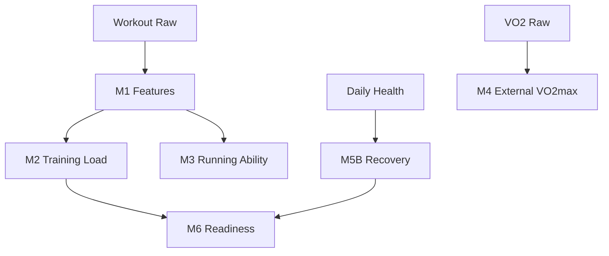

# M7 Result

**M7 RESULT: PASS WITH RISKS** — 2026-11-04。只在 synthetic / 隔离 PostgreSQL 18 / iOS Simulator 环境完成 Product Contract engineering。全部新模型继续 candidate-only。未执行 promotion、产品激活、部署、真实数据迁移、commit 或 push。冻结合同见 [Athlete Model Product Contract](ATHLETE_MODEL_PRODUCT_CONTRACT.md)，证据索引见 [M7 evidence](evidence/m7/README.md)。

## 1. Git Baseline

**M7 BASELINE**：`main`，HEAD `380a6fe96d13d1e57f69ceac50e52e72908af2b8`。入口已有 M4/M5B/M6 未提交实现和证据：18 个 tracked 文件、460 insertions / 31 deletions，另有 untracked 阶段成果。四项原始 Git 命令完整保存在 [baseline.json](evidence/m7/baseline.json)。最高 migration 为 **00027**；本轮不新增 migration、assignment 表或 mutable summary table。

79 个冻结文件（原方案、M2–M6 领域模型、全部 migration/checksum、现有 App 与关键 product/training 代码）逐文件 SHA 未变；见 [frozen-check](evidence/m7/frozen-check.json)。原方案原文和 `../running` 未修改。没有运行 reset/restore/clean/stash/rebase/commit/push/deploy；既有未提交成果保留。

## 2. Model Stack

| 阶段 | 当前身份 | 状态 / channel |
| --- | --- | --- |
| M1 | Workout Features | PASS WITH RISKS；candidate substrate |
| M2 | `rai.training_load.hrr_integral/v1`，`rai.load_state.exp_finite/v1` | PASS WITH RISKS；candidate |
| M3 | `rai.running_ability/v1` | PASS WITH RISKS；candidate |
| M4 | `rai.vo2max.external_projection/v1` | engineering CLOSED / B4 PASS WITH RISKS；candidate |
| M5B | `rai.recovery.physiological/v1` | PASS WITH RISKS；candidate |
| M6 | `rai.readiness.training/v1` | PASS WITH RISKS；candidate |
| M7 | `rai.athlete_model/1` + `rai.product_metric_mapping/1` | integration / DTO / read projection，非模型 |

active 仍为 legacy。未新增 Recovery、Readiness、Training Load、Ability、RAI VO₂max 或综合 Fitness/Health/Athlete/RAI Score 公式。

## 3. Dependency DAG

实际数值模型 DAG：



完整存储失效传播图另含既有模型内部和控制节点：M2 workout→M2 load state；Daily raw→daily features→daily baseline，daily features/baseline→M5B；load coverage→M6；VO₂ source selection→M4。M1→未来 athlete/vo2/ability/endurance、M5B→daily/readiness 是 **pre-M7 dormant placeholders**，不代表已注册计算 handler 或产品输入；M3 内部 ability/endurance 已由同一 performance artifact 定义，未从这些占位 scope 读取。没有 Running Ability→Readiness、VO₂→Recovery、Recovery→Ability。

M7 专项测试实际读取 `analysis_model_dependencies`、验证所有 edge 属于冻结允许类别并对完整 scope 图做 cycle detection。纯模型 DAG 有正向/负向环测试；依赖边界脚本验证领域纯函数、reader 不调用 Calculate/raw input loaders、现有 consumer 不导入 M7。未添加任何 DB graph edge。

## 4. Unified Product Contract

实现 Go typed `AthleteModelSnapshot`、独立 `AthleteModelCandidateSnapshot` 和 Swift 五种 typed metric。root 包含 schemaVersion、asOf、evaluationAt、datasetRevision、timezone、calendarDate、assignment、固定 presentationOrder。

每项独立 envelope 保留完整 modelVersion / payloadVersion、mappingVersion、state、modelStatus、quality、confidence/support label、asOf、evaluationAt、freshness、updatedAt、原/product reasons、简化来源和 technical error。value 按模型独立类型；没有统一 float64 value。全部时间为 epoch microseconds，模型生成/证据时间不会伪装成 snapshot 时间。

Reader 为 `REPEATABLE READ READ ONLY`，显式 evaluationAt，六个 current slots、批量 bounded refs。source of truth 仍是 publication + immutable artifacts；没有缓存、history scan、summary source of truth 或新模型计算。

## 5. Metric State / Missingness

产品状态冻结为 available / limited / collecting / unavailable / stale。纯函数 versioned mapping 保留 modelStatus 与原 reasonCodes。区分 baseline collecting、sync incomplete、source selection、source conflict、insufficient evidence、unsupported、deleted、stale/expired；nil 不补 0/100。

新用户 VO₂ 未投影时是 sync_incomplete，不能称已查询无样本。已 enrolled 而 current publication 缺失也保留同步/待发布语义。原 reason 与 ProductReasonCode 字典序去重；missing_hr、recent_load_unknown、daily_coverage_incomplete 等实际模型代码已映射并测试。

业务缺失正常 complete_response；hash/run/schema/generation failure 是 technical error，candidate snapshot partial_response 保留其他独立 metric。Readiness 的受损上游不能被有效引用集合中的其他项掩盖。没有整体健康 overallStatus。

## 6. Training Load Contract

已记录跑步训练刺激；typed latestWorkoutLoad / latestWorkoutAsOf、acute、chronic、balance、trend7、knownness。Workout AU、state AU/day、trend AU/day² 分开声明。直接读取 M2 state，不在产品端计算。

若最新 recorded workout 还没有 published load，不能将较旧 analysed workout 冒充 latest。current-day state 缺失不推断 fresh，unknown 不补 0；partial quality 映射 limited。真实 PG 专项覆盖该 pending-latest 边界。没有 total body load / overtraining 解释。

## 7. Running Ability Contract

近期实际表现支持的持续跑能力；score、v60、gamma、retention、evidence mode/count、stability typed。保留 `rai.running_ability/v1`。M3 没有独立 input quality 字段，envelope 标记 not_provided，避免把 stability/confidence 冒充 quality。

趋势 eligibility 拒绝跨 modelVersion / config / evidenceMode / view、不完整或不新鲜结果。当前 bounded reader 不加载历史，trend=null。不会称为 VO₂max、乳酸阈值或泛化 Fitness。

## 8. External VO₂max Contract

明确 externalEstimate=true，保留 value、provider、origin、sampleDate、unit。固定解释为 **Apple Health estimate**，confidence=null；不声称 RAI measured、Apple Watch measured 或实验室 ground truth。

沿用 M4 Freshen 与 evaluation-time source selection；source value history 和 RAI improvement 分离。本轮 current contract 不增加历史 endpoint。Simulator live 回归覆盖 fresh/empty/stale/expired、third-party/manual/unclassified、source conflict/equivalence、coverage、最大 refs/epochs/ties 等原有合成场景。

## 9. Recovery Contract

score、baselineState、component availability 与相对个人基线状态；保留原 quality、confidence、model identity。没有 raw HRV/RHR/sleep 时间戳、MAD、sigma、raw z-score 或内部 config。

解释直接消费 M5B 的已计算 deviation **Burden**：HRV/Sleep adverse 表示低于基线，RHR adverse 表示高于基线；无 adverse burden 使用 no_adverse_deviation，不新增产品阈值。此方向有回归测试。部分结果不能当 complete daily result 做趋势；本轮无 history comparison。

## 10. Readiness Contract

score、recoveryScore、loadMultiplier、recentRecordedLoad，明确 **running-focused**。读取 M6 Freshen，不重新计算 D/B、baseline 或模型公式；不依赖 M3/M4。

V1 无长期趋势，只给 instant current state。到 model evidence/coverage/day boundary 后遵守 M6 null/stale 行为。解释是信息而非“今天必须休息”等强制指令。

## 11. Explanation Contract

纯 `BuildMetricExplanation` 返回 headline key / typed supporting facts / limitation keys。事实来自已有模型投影，无 raw 查询或第二套模型逻辑。Load=recorded running；Ability=v60/evidence；VO₂=external Apple Health estimate；Recovery=组件相对基线状态；Readiness=Recovery/load/multiplier。

quality 与 evidence confidence 分离。V1 只提供 limited/moderate/stronger evidence 标签，不生成 Confidence 72% 或准确概率文案。notice 支持 informational fitness metrics / not medical diagnosis。UI 实际翻译和产品文案验收留给独立 activation acceptance。

## 12. API / OpenAPI

只增加 internal schemas 和独立 [JSON Schema](../contracts/athlete-model.schema.json)，**没有新增或启用正式 HTTP endpoint**。`/v2/athlete-model`、candidate/admin 路由及 channel query 均在真实 handler 下验证 404。CLI-only `analysis model-stack inspect --dataset --evaluation-at` 默认脱敏，测试数值需明确 `--synthetic-test-values`；promotion-plan 只输出计划。

固定 Redocly **2.71.1** / Node **22.23.2**：0 errors、33 warnings。旧 baseline 31 warnings 单独保存；新增 2 个是 CLI-only CandidateSnapshot/PromotionGate 的 no-unused-components，未为消 warning 编造 endpoint。新增 schemas 与 standalone schema 一致；旧 paths、旧 schema 内容逐项不变。11 golden 经 Draft 2020-12 validation 并与 Swift fixtures byte-identical。没有旧版 generated DTO，因此不存在覆盖旧生成文件的 diff。

## 13. Swift / Simulator

定位完整 Xcode：`/Users/ta/Downloads/Xcode.app`。仅本阶段命令设置 DEVELOPER_DIR；系统 xcode-select 保持 CommandLineTools。实际 **Xcode 26.6 (17F113)、Swift 6.3.3、iOS/Simulator SDK 26.5、iOS runtime 26.5 (23F77)**。

`swift test --package-path ios/RAI`：**132 tests / 17 suites PASS**，包含 Daily、Workout、VO₂、existing SyncCore、ProductCore、11 golden decode/semantic round-trip、unknown enums/reasons/model/value shape、null-state 和 unsupported presentation。

正式 Simulator App XCTest：**41 passed / 2 skipped / 0 failed**；M7 shared golden 明确 Passed。常规 runner 跳过的 B4 full external closure、B2 HTTP/PG E2E 需要专用 host；本轮另行运行 `test-m4b4-simulator.sh` 的两个 B4 groups（9+8 cases）及 B2 lost-ACK App→HTTP→isolated PG18→Worker，全部 PASS，因此没有把 skipped 冒充通过。

可记录 **M7 full Swift regression now PASS**，关闭 M5B/M6 CLT Testing-module 工程缺口；不改其历史结论。未新增 UI，**UI NOT IN SCOPE**；没有宣称本轮全首页重验、真机 UI 或新增 UI accessibility acceptance。

## 14. Candidate / Active Isolation

active service 仅读取 active assignment，当前只允许 legacy；五种新语义返回 not_product_activated，不把旧数值改名。candidate reader 要求实际 DB owner/admin；rai_api 和 rai_worker 都被拒绝 preview。API 无 artifact SELECT / assignment mutation 权限。

| Consumer | 实际当前来源 / 证据 |
| --- | --- |
| Home | legacy overview、`/v2/analysis/state`、legacy workouts；ProductAPI.load / product_read.go |
| Coach | training domain / legacy parameter+workout/state inputs；没有独立 candidate Coach UI/endpoint |
| Training | legacy current plan + legacy state；Product.swift / TrainingViews |
| Training Plan | legacy workout/state projections、既有 immutable plan/version；training_input/read |
| Workout / Detail | raw 用户自身 workout summary + legacy workout metric_family；workout_detail.go |
| Metrics / History | legacy state/history filters；product_read / analysis_query |

现有 product DTO、HTTP handler、App 主导航、training generator 源码未被 M7 改写。真实 PG 比较 preview 调用前后的 legacy overview/history/workouts byte-identical，并检查无五个 candidate identities；全量 training/detail/state 回归与冻结 SHA 支持消费者不变。没有授权产品 cutover。

## 15. Promotion Gates

五个统一 gate 全部 **promotable=false**。realDeviceAccepted、physiologicalValidated、productContractAccepted、rollbackReady 均未声称完成。

M2 要求真实 HR coverage / parameter validity；M3 要求 real-performance eligibility 和 prediction/calibration；M4 要求 real-device source/metadata，外部 estimate 不冒充 RAI 生理模型验证；M5B/M6 要求纵向 calibration/validation，M6 还需真实 recorded running-load completeness。Engineering complete ≠ activated。

## 16. Cutover / Rollback Plan

合同冻结 A internal preview→B real-device/data acceptance→C calibration→D shadow read→E limited activation→F full activation。这里只交付计划。shadow 不得影响用户可见决策。

未来 reviewed assignment revision 可选择 previous-active 回滚；保留 candidate/history/raw。现行 active CHECK=legacy 没有放开；未来版本/schema/handler 需独立 additive 变更与授权，不能就地更改 v1 公式。回滚不删除健康事实，不反向 raw migration；rollback exercise 本轮未执行。

## 17. PostgreSQL / Roles

真实 PostgreSQL **18.6**，隔离 Unix-socket cluster，fsync / full_page_writes / synchronous_commit / checksums 开启。无生产 DSN、无生产数据库访问。

本轮无 migration，highest=27；原 migration1–27/checksum 不变。全量集成覆盖 fresh migration、incremental migration、角色、所有既有发布/事务/fault 测试；M7 专项覆盖 RR、assignment/revision/pointer race、corruption、missing refs、受限 API/Worker、admin、candidate route isolation。角色来自真实 roles.sql 的隔离同权限 suffix roles，非 mock。所有作为最终通过证据的隔离测试记录 leftover databases=0 / cluster removed=1。

## 18. Performance

真实 1 athlete / 5 metrics / full bounded lineage validation，四种场景每种 10 次 reader+serialization 观测，另以 AllocsPerRun 测量 reader+JSON。详见 [最终专项输出](evidence/m7/pg-final.txt)。DBReads 为应用 SELECT 次数，不含 BEGIN/COMMIT；all available/mixed freshness 最多 5，3 unavailable=4，all unavailable=3；没有 per-metric N+1。

| Scenario | SELECTs | Read ms | Freshen µs | Map ms | JSON ms | Bytes | Reader+JSON allocs |
| --- | ---: | ---: | ---: | ---: | ---: | ---: | ---: |
| all_available | 5 | 30.799 | 17.176 | 1.821 | 0.443 | 7,043 | 2,150 |
| mixed_freshness | 5 | 14.310 | 9.273 | 1.847 | 0.405 | 6,160 | 1,209 |
| three_unavailable | 4 | 19.232 | 3.124 | 1.804 | 0.342 | 5,313 | 1,419 |
| all_unavailable | 3 | 1.038 | 0.270 | 0.022 | 0.270 | 4,152 | 312 |

本机并发全量回归且带 race detector，数字不是生产 SLO。独立纯 Go benchmark 重复 3 次，记录 projection 与 full/mixed/new-user/stale JSON 的 ns/op、B/op、allocs/op，见 [benchmarks](evidence/m7/benchmarks.txt)。缺少生产 dense/multi-user/WAN 容量验收，不能用本机结果放行 activation。

## 19. Regression

全量 `go test -race -count=1 -timeout=40m -tags=integration ./...`：**PASS**，integration **1018.755s**，覆盖 Workout Sync、Daily、VO₂ raw、M1–M6、training、migration/roles。见 [PG full](evidence/m7/pg-full-race.txt)。此全量 run 后增加的最终 reader 验证边界，另运行最终 Go all / race / vet 和 M7 PG/race 专项，不将旧 full-run 误称精确包含之后的每项改动。

最终 `go test ./...`、`go test -race ./...`、`go vet ./...`、integration vet、dependency boundary、sqlc **1.31.1** regeneration、OpenAPI lint/schema compatibility、11 golden、property/determinism、candidate leakage、assignment race、missing dependency、corruption、privacy、`git diff --check` 均按 evidence/validation.json 核对。Go/Swift shared fixture JSON 同源，unknown model value shape 可保留 opaque typed JSON 并拒绝展示。

## 20. Privacy

仅 synthetic fixtures。产品 DTO 只给产品需要的 score/load/performance 和简化来源，没有 dataset/run/workout/sample full UUID、device name、source bundle、raw HRV/RHR/sleep timestamp、config internals、parameter hashes。普通 server/worker 日志未新增 metric value；默认 admin CLI 仅 redacted metadata。explicit synthetic flag 才输出测试数值，已真实验证。

新证据 full UUID scan 为 0；没有凭证输出、提交或生产读取。Simulator identifier 已从公开 summary 中移除，本地 xcresult 保持 Xcode 原始证据。

## 21. Risks

- **P0：** 无已知未解决项。candidate→active、legacy leakage、identity 丢失、nil→0、混代 snapshot、unknown enum/model crash、新模型计算依赖均有代码边界/回归。
- **P1：** 无已知未解决项。Recovery/Readiness、VO₂ external estimate、Ability、recorded-running load、confidence、freshness 等语义冻结；Recovery adverse direction、partial load、pending latest Workout、缺失单个 dependency 已专项验证。
- **P2：** 无真实设备与模型生理验收；真实 Workout all-stream catch-up transport 仍缺，M6 真实普通 candidate 可因 sync_incomplete 无值。M3/M5B 当前 snapshot 不加载历史趋势；新增 UI/localization/accessibility/产品 acceptance 不在本轮。未来 activation/version2/rollback 执行器未交付，不能把计划当已可发布能力。
- **P3：** 本机合成观测不代表容量/SLO/WAN；最大 bounded refs 的密集多用户压力还需专门研究。两个新增 internal-schema unused warning 明确保留，旧 warnings 未顺带修订。

## 22. Not Verified

```text
REAL DEVICE ACCEPTANCE: DEFERRED
PHYSIOLOGICAL VALIDATION: NOT VERIFIED

real metric availability: NOT VERIFIED
real source behavior: NOT VERIFIED
real load completeness: NOT VERIFIED
real Running Ability calibration: NOT VERIFIED
real Recovery validity: NOT VERIFIED
real Readiness validity: NOT VERIFIED
production: NOT VERIFIED
WAN: NOT VERIFIED
product activation: NOT AUTHORIZED / NOT VERIFIED
new UI/accessibility acceptance: NOT IN SCOPE
```

统一真机验收计划覆盖 Workout、Daily HRV/RHR/Sleep、External VO₂max、background sync、delete/update、offline/retry、app kill/relaunch、source provenance。Calibration 独立覆盖 Load、Ability、Recovery、Readiness；产品 activation acceptance 独立覆盖 semantics、missing UX、accessibility、performance、privacy 和 rollback。

## 23. Decision

```text
M7 RESULT: PASS WITH RISKS

MODEL ENGINEERING STACK:
CLOSED FOR CANDIDATE DEVELOPMENT

PRODUCT ACTIVATION:
NOT AUTHORIZED

Recommended Next Phase:
Unified Real-Device & Calibration Acceptance
```

M7 到此停止。下一阶段只是建议，没有自动启动。最终不变量：Raw Facts → Independent Models → Candidate Publications → Typed Product Contract；每项值/缺失/状态/版本/channel 均可解释，不生成大综合分。
