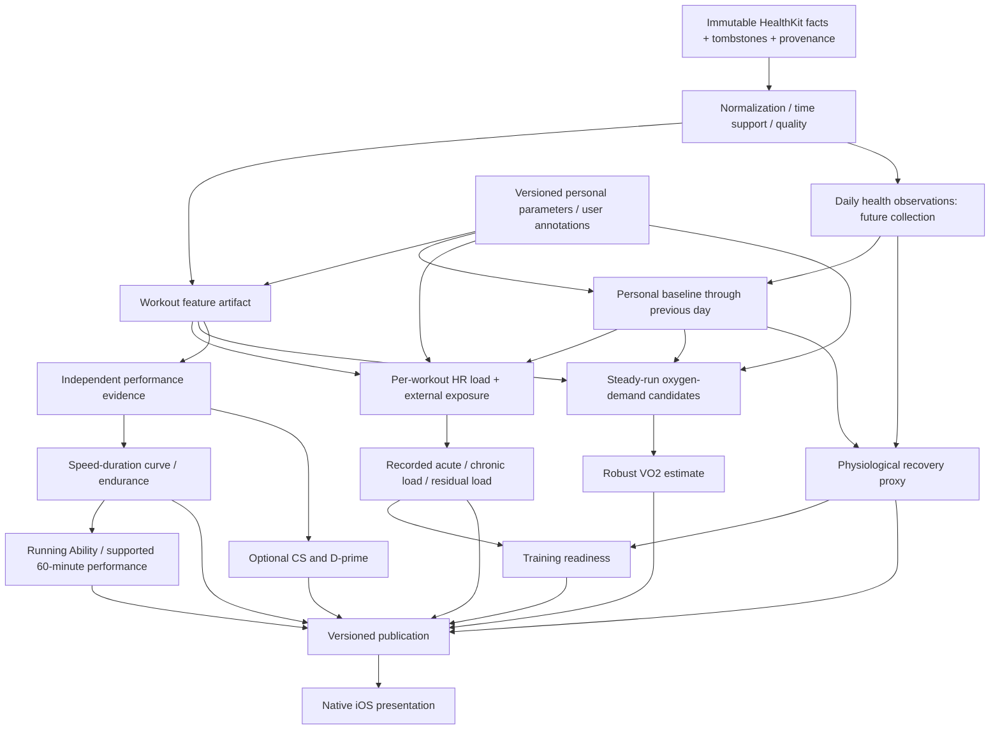

# RAI V2 — 运动能力模型架构与实施设计

日期：2026-11-02（Asia/Shanghai）。设计版本：`rai-model-design/1.0.0-rc1`。

**RAI MODEL DESIGN RESULT: READY WITH RISKS**

本文件是下一阶段的实施规格，不是已上线算法说明。此次只审查工作区源码、合同、migration、测试和公开资料；**未连接生产或云端数据库，未读取个人健康值，未修改同步协议或业务代码，未执行 migration、部署或 push**。服务器“有数据”在本文严格分成：存储结构支持、当前客户端会采集并上传、此次确认存在的真实记录。第三项本轮一律 **NOT VERIFIED**，不能由前两项推出。

审查基线为 HEAD `6e5451c974a6284cf4aab2e6baf856eee63ac218` 加当前未提交工作区；入口已有 iOS 调度修复、`docs/IMPLEMENTATION.md` 和云端测试目录改动，本轮保留。原《RAI-Go-PostgreSQL架构重设计与实施方案》不改写；原文 SHA-256：`6951b1d938133a964cb06d28c3aa744ad05121f25da770e184041211df53e3de`。本设计中的 V1 指**新的自有模型栈第一版**，不等于现有 P4 的 `recovery/v1`、`training_load.trimp/v1`，不得覆盖其语义。

## 1. Executive Summary

### 1.1 推荐决策

| 层 | 推荐 | 当前开发/发布边界 |
|---|---|---|
| 输入 | 原样保存 HealthKit 事实和来源；另建标准化派生表示 | 复用 protocol 3 单 Workout bundle；这轮不扩展采集 |
| Features | 一次构建时间支持、暂停、距离、HR、稳定段、速度—时间片段及逐模型资格 | 先统一 `analysis` 与 `workoutdetail` 的重复算法；展示降采样不能作为分析输入 |
| Training Load | 时间积分的、统一尺度的 HR-reserve exponential impulse；距离/分钟是独立外部暴露 | 无 HR/个人参数则 AU 为空；不以计划强度、功率或分钟偷偷补 AU |
| Load state | 7/42 日时间常数、180 日有限指数核；已记录负荷与实际全运动负荷分开 | 保留当前可增量/有界重算优势；更名并升级，不能把 chronic load 当跑力 |
| VO₂max | 稳态跑速度氧耗近似 + HR reserve，跨 Workout 鲁棒汇总 | `RAI Estimated VO₂max` 为待验证估计；缺可信 HRmax/RHR 时不可用；Apple VO₂max 独立 |
| Running Ability | 在平路可比条件下，速度—持续时间曲线所支持的 **60 分钟持续跑表现**，映射到固定 0–100 标尺 | 首先是已展示能力；自动识别不能证明最大努力；不把 VO₂max、负荷、跑姿再加权一遍 |
| Endurance | 曲线斜率、`v60/v20`；长跑耐久性单列 HR drift/pace decay | 缺长时证据为空；不能把 5K 按统一指数外推半马 |
| CS / D′ | 3–15 分钟不同努力的可选模型与一致性诊断 | 不作为 V1 必需根节点；CS 不等于乳酸阈；D′ 保留研究态 |
| Recovery | 个体 HRV/RHR 基线偏离形成 physiological proxy；结合负荷残余形成 readiness | 当前缺日常数据链路；只可提供明确命名的 load context，不能发布完整恢复分 |
| Persistence | 复用 jobs / dirty_scopes / runs / results / publications | 只补通用结构化 artifact、模型通道和版本化外部输入，见 §13 |
| UI | 跑力 + 恢复（训练参考）；VO₂max 来源对照放详情；负荷作为辅助 | 缺失、过期、研究态有独立状态；不堆满阈值/耐力/功率仪表 |

以下分清三种依据：**[S]** 公开研究/官方定义；**[E]** RAI 可复现的工程选择；**[V]** 尚待真实数据验证。所有质量阈值、分数锚点、平滑窗口和恢复系数，除明确注明外均为 **[E,V]**，不是论文已经证明的普适生理常数。可以开始编码、写合成回归和影子计算；不能因此宣布生理效度验收。

### 1.2 三个关键取舍

1. 日常手表数据不能独立识别 VO₂max、跑步经济性、乳酸阈和最大努力程度。增加潜变量数量并不会增加信息。V1 只拟合有观测支撑的量，其他维度保留 `insufficient_data`。
2. 跑力不依赖 VO₂max，VO₂max 不依赖跑力。二者共享速度等证据，属于相关输出，不能当两份独立证据叠加信心。负荷不会直接“奖励”跑力上涨；疲劳也不直接扣跑力。
3. 用户可以只上传所选跑步，服务端不能观察所有运动或休息。`没有上传`、`查询无可见记录`、`明确无运动`是三个状态；更不能用 HealthKit 读取结果推断授权成功。

## 2. Current Data Audit

### 2.1 已核对的真实入口

以下路径相对于仓库根目录；符号名是审计定位依据，行号会随未提交工作区变化。

| 编号 | 文件/符号 | 核实结论 |
|---|---|---|
| C01 | `ios/RAI/App/HealthKitClient.swift`：`identifiers`、`authorize`、`bundleSamples`、`captureSeries`、`captureRoutes` | 只读授权；Workout + 10 类 quantity + route；样本查询显式按 Workout 关联 |
| C02 | 同文件 `Normalizer.units/event/statistics/workoutMetadata/integrityEvent/source` | 单位映射大于实际采集集合；unsupported metadata 会阻止上传，不可静默丢弃 |
| C03 | `ios/RAI/App/SyncCoordinator.swift`：`discoverChanges`、bundle 构建循环 | 当前发现/上传围绕 running Workout 与关联 children；无独立日常 HRV/RHR/sleep 上传流 |
| C04 | `contracts/sync-v3.md`；`internal/httpapi/server.go` | 当前写入口为 bundle；旧逐 sample/page/series 写路由未注册。旧 protocol 2 文档不是当前能力证明 |
| C05 | `internal/syncing/protocol.go`、`bundle_observation.go` | Units 有 HRV/RHR/VO₂/睡眠等；只说明载荷注册，不说明当前客户端会发；来源与 coverage 单独保存 |
| C06 | migrations `00001/00003/00007/00008/00010/00011/00014/00015` | facts、统计、events、activities、关联、series、routes、enrichments、import history 可用结构 |
| C07 | `internal/storage/postgres/analysis_input.go` | 当前分析输入加载 HR/其他 quantity、统计均值/最大值和 route；**没有**将 events、activities、环境、完整来源结构交给 domain |
| C08 | `internal/analysis/{input,model,workout,state}.go` | features/v2、平均 HR TRIMP/v1、有限核 state/v2、load-only recovery/readiness；没有自有 VO₂max/跑力/CS 模型 |
| C09 | `internal/storage/postgres/{analysis_publish,analysis_query}.go`；migration `00012_analysis.sql` | append-only run/result、可切换 publication、generation/fencing、原子下游 dirty 已存在 |
| C10 | `internal/jobs/worker.go` | 实际执行、续租、失败处理、daily advance；不是空 Worker；当前 registry 只有既定 handler |
| C11 | `internal/workoutdetail/{model,calc}.go`；`storage/postgres/workout_detail.go` | 请求时另算速度展示、分段、步数推步频、坡度修正、环境修正、HR zones、跑姿动态 |
| C12 | `internal/analysis/query.go`、`internal/httpapi/analysis.go`、`internal/product/model.go`、OpenAPI | 当前公开 `metrics[]`，value 可空、quality 三态、algorithm/version/details；不是示意的 runningAbility DTO |
| C13 | `ios/RAI/Sources/ProductCore/{Product,WorkoutDetail}.swift` | ProductCore 只认部分 v1/v2 算法；新标签需显式适配；无新跑力/VO₂ DTO |
| C14 | `internal/training/generator.go` | 计划生成消费旧 fitness/fatigue/readiness 版本；更换模型必须显式升级消费者 |
| C15 | `internal/analysis/*test.go`、`integration/analysis*_test.go`、`docs/P4_ALGORITHM_CONTRACT.md` | 有旧算法数值、缺失、generation、lease、publication、删除、回算测试；不等于新模型或生理学已验证 |
| C16 | `internal/admin/analysis.go`；`scripts/check-boundaries.py` | 现有参数和限定范围 recompute CLI；在线图不得导入 admin；不能假设已有多版本影子发布功能 |

当前源码 migration 到 19，Go 模块要求 1.27.3，PostgreSQL 目标 18；此次没有用数据库 introspection 声称线上 schema 状态。未读取 `../running`，不以旧系统公式为依据。

### 2.2 数据层定义

`storage_layer=source_fact` 表示 RAI 收到的原始外部事实，不表示传感器物理原始信号。另设 `origin_method`：`sensor_observation`、`apple_derived`、`third_party_derived`、`user_reported`、`unknown`。Apple 的结果也必须原样保存为 source fact；RAI 派生在另一层。

例如 PPG 产生的 BPM 已经经过设备处理，但可作为 HR 观测；RAI 没有 PPG 波形、逐搏 NN 间隔、原始加速度。RunningPower 不是腕表直接测得的机械功率计输出；RunningSpeed、distance、energy、跑姿和睡眠分期也包含传感器融合/算法。类型名本身不能证明来源：第三方也能写 HealthKit，最终 `source=apple` 必须由 provenance 支持。[Apple RunningPower](https://developer.apple.com/documentation/healthkit/hkquantitytypeidentifier/runningpower)、[Apple RunningSpeed](https://developer.apple.com/documentation/healthkit/hkquantitytypeidentifier/runningspeed)。

### 2.3 数据矩阵

表中 `Q` 指当前客户端确实请求且有 bundle 通路；`S` 指 Workout 自带摘要/metadata 可选保留；`N` 指 **NOT AVAILABLE（当前正常采集链路）**。Q/S 均不保证某台设备、某次 Workout 有值。本轮所有实际样本数量、覆盖率、采样间隔、个人参数存在性均 **NOT VERIFIED**。采样频率不硬编码为 1 Hz：必须从 timestamps/series 计算实际间隔与缺口；HealthKit 可能合并样本。

| 数据 | HealthKit 类型/来源 | Workout 内/外 | Raw / Apple-derived / RAI-derived | 单位 | 频率/支持 | 当前同步 | 模型用途 |
|---|---|---|---|---|---|---|---|
| 开始/结束/运动时长 | HKWorkout.start/end/duration | 内 | Raw source event；duration 是源语义 | UTC μs、s | 每 Workout | Q | 全部；区分 elapsed/active |
| 距离 | totalDistance；DistanceWalkingRunning | 内；外未读 | Apple-derived/source-dependent 距离观测 | m | 摘要 + 不规则累计样本/series | Q/S | 速度、表现、外部暴露 |
| 速度 | RunningSpeed | 内 | Apple-derived 传感器融合观测 | m/s | 不规则，可能 condensed | Q | 稳态、曲线；不能当 GPS 原始速度 |
| 配速 | duration/distance、1/speed | 内 | **RAI-derived**，展示还会舍入 | s/m；新特征 s/km | 每 Workout/区间 | 非独立通道 | 表现/解释；勿重复证据 |
| 心率 | HeartRate | 内；日常未读 | Raw HR observation（不是原始 PPG/ECG） | count/min | 不规则点/区间/series | Q | load、VO₂、drift |
| HRV | HeartRateVariabilitySDNN | 主要外 | Apple-derived SDNN；不是 RMSSD | ms | 稀疏、不固定 | **N**；映射有、采集无 | 未来 baseline/recovery |
| 静息 HR | RestingHeartRate | 外 | Apple-derived 全天静息估计 | count/min | 可日内修订/删除重写 | **N** | 未来 baseline；不是运动最低 HR |
| 步行平均 HR | WalkingHeartRateAverage | 外 | Apple-derived 汇总 | count/min | 来源不定 | **N** | V1 不用 |
| 步数 | StepCount | 内 | Apple/source 步数检测 | count | 累计区间/series | Q | 步频 proxy、异常辅助 |
| 步频 | 当前 SDK 无 RunningCadence identifier | 内 | **RAI-derived**：step count/支持秒数×60 | steps/min | 取决于步数时间支持 | 直接值 **N**；详情页已有 proxy | 质量/跑姿；不独立测量经济性 |
| 跑步功率 | RunningPower | 内 | Apple-derived 估计；来源需核实 | W | 不规则/series | Q | 可选诊断；不跨设备转换 load |
| 触地时间 | RunningGroundContactTime | 内 | Apple-derived 跑姿估计 | ms | 不规则/series | Q | 可选质量/动态 |
| 步幅 | RunningStrideLength | 内 | Apple-derived 跑姿估计 | m | 不规则/series | Q | 同上 |
| 垂直振幅 | RunningVerticalOscillation | 内 | Apple-derived 跑姿估计 | m（展示 cm） | 不规则/series | Q | 同上 |
| 路线 | HKWorkoutRoute / CLLocation | 内 | Raw location observation（不是原始卫星信号） | lat/lon、UTC μs、精度 m；可选speed m/s、course ° | 不规则 points；sealed 后分析 | Q | GPS 质量、地形、交叉检查；当前analysis loader未取speed/course |
| 海拔/爬升 | route.altitude；ElevationAscended/Descended | 内 | 海拔为源观测；源爬升 Apple-derived；RAI 积分另存 | m | 每点/可选摘要 | Q/S | 平路门槛、耐久性；非地图高程 |
| 活动/基础能量 | ActiveEnergyBurned / BasalEnergyBurned | 内；外未读 | Apple/source-derived | kcal | 累计区间和摘要 | Q | 展示；V1 不反推 VO₂max |
| 睡眠 | SleepAnalysis category | 外 | Apple/source-derived 分期/区间 | category、s | 不规则阶段区间 | **N**；category 在服务端白名单，客户端 event 不编码 category | 未来时长/规律/recovery |
| 呼吸频率 | RespiratoryRate | 主要外 | sensor-derived 呼吸估计 | count/min | 不固定 | **N** | V1 不依赖 |
| 血氧 | OxygenSaturation | 外 | sensor-derived SpO₂ | 1（0–1） | 不固定 | **N** | V1 不依赖，不据此诊断 |
| Apple VO₂max | VO2Max | 常为独立样本 | **Apple-derived**（来源明确时） | mL/kg/min | 每次估计而非连续 | **N**；不能把单位表当已同步 | 未来独立对照；不是训练标签 |
| 一分钟 HR recovery | HeartRateRecoveryOneMinute | 运动后 | source/Apple-derived 差值 | 本 SDK/映射 count/min | 每次估计 | **N** | 未来单独指标，不能替代 readiness |
| 体重 | BodyMass | 外 | 设备/用户观测，来源决定 | kg | 不固定 | **N** | 可选研究；相对 VO₂公式不必假设体重 |
| 身高 | Height | 外 | 用户/设备观测 | m | 不固定 | **N**；当前单位表也没有 | V1 不依赖 |
| 年龄/出生日期 | dateOfBirthComponents characteristic | 外 | 用户资料 | 日期/年 | 非 sample | **N**；无资料采集模型 | 不用年龄预测 HRmax |
| 生理性别 | biologicalSex characteristic | 外 | 用户资料 | enum | 非 sample | **N** | 不推断，不默设男性 TRIMP |
| 最大 HR/负荷参数 | analysis_parameter_sets | 外部配置 | operator-entered，非 HealthKit 原始值 | bpm、无量纲 A/B | 版本化人工参数 | 表/CLI 有；个人记录 **NOT VERIFIED** | 目前 TRIMP 的前置输入 |
| 温度/湿度 | HKWeatherTemperature/Humidity metadata | 内 | source context，不能确定气象测量方式 | °C、1 | 每 Workout 可选 | **S** | 可选筛选，不能依赖必有天气或外部天气 API |
| 暂停/恢复/圈/段 | workout_events；activity.events | 内 | Raw source event | enum、UTC μs | 事件发生时 | Q/S | 暂停重建、区段；现 analysis loader 未用 |
| activities/config | HKWorkoutActivity/configuration | 内 | Raw source structure | 时长、activity/location enum | 每活动 | Q/S | 室内/室外、分段；不是最大努力证明 |
| Workout metadata | 严格 allowlist：时区/室内/METs/爬升/天气/速度 | 内 | mixed，逐字段分类 | 各自单位 | 每对象 | S；未知字段阻断 | 条件与来源，不能自动得到比赛/主观 RPE |
| device/source | sourceRevision + device allowlist、BundleObservation | 内 | Raw provenance；classification 是 RAI-derived | 描述/版本 | 每对象/观察 | Q/S | 设备变更、来源隔离；不是准确率数值 |
| 真实 RPE/最大努力/症状 | 无独立 Workout annotation | 内/外 | 若未来采集为 user-reported | CR10 / enum | 每次自报 | **N**；计划 Effort 不等于实际 RPE | 后续自报可提高证据等级 |

额外核对：本机 iPhoneOS SDK 26.5 `HKTypeIdentifiers.h` 只有 CyclingCadence，没有 RunningCadence；后端字符串和合成测试并不改变这一事实。HR recovery 的 Apple 网页正文写 count，而本机 header 写 count/min；未来启用时以实际 HKQuantity compatibility 和跨端 fixture 冻结单位，不能从网页差异私改既有 wire。

Apple VO₂max 是由心率/运动等推得的估计，需单独标来源。[Apple 官方说明](https://support.apple.com/en-au/108790)。HRV 是 SDNN；RHR 会随全天信息改进并可能删除旧样本，因此未来 baseline 必须处理删除/替换，而不是只追加数值。[Apple SDNN](https://developer.apple.com/documentation/healthkit/hkquantitytypeidentifier/heartratevariabilitysdnn)、[Apple RHR](https://developer.apple.com/documentation/healthkit/hkquantitytypeidentifier/restingheartrate)。

### 2.4 当前算法的保留与替换点

- `workout.features/v2`：平均速度/配速、HR/功率/步频摘要与 coverage、route haversine/粗高差。瞬时 HR 点 coverage 为 0；重叠区间可能 ambiguous；没有稳定段、最佳持续段或暂停对齐。
- `training_load.trimp/v1`：`minutes × r × A × exp(B r)`，r 来自**整场平均 HR**；要求参数存在、HR coverage≥0.9、active=elapsed。有暂停或常见离散点会返回 insufficient，这是当前行为，不应在设计里假定已解决。
- `fitness_fatigue/v2`：7/42 日有限 180 日指数核；按 Workout start 日归属；任一已知 Workout 缺 load 会使相应状态窗 unavailable。`recovery/v1=F/max(F,A)`，`readiness/v1=100×recovery`，仅是负荷比例。
- `workoutdetail`：已有 StepCount 步频、分段、Minetti 等强配速、环境惩罚和计划强度 load fallback。其质量分/品牌 confidence 是展示规则；**不能复用作生理 confidence**。`planned_effort_fallback`、`session_type_fallback` 不进入新 load ledger。
- 当前 provenance validator 对 bundle Workout 及关联源要求 Apple Watch/associated Apple Watch；第三方胸带/足部传感器不保证能进分析。新设计不能只改模型就宣称支持所有来源。
- 当前 run 的 source lineage 保存 hash，但 domain Observation 缺来源/representation；参数加载“最新版本”而非训练时有效版本。统一特征和 as-of 参数解析是 M1 必做项。

## 3. Model DAG



`B→L/V` 只使用 **Workout 开始前已经生效的稳定 RHR 参数**，不把当天低 HRV 或 readiness 改写成强度系数。恢复值不反向调整 load；跑力和 VO₂无相互输入；CS/Endurance 不都加到已经体现它们的 performance score。训练计划在 publication 之后消费显式支持的指标，计划执行回来的**新事实**是下一时刻输入，不把计划目标当已完成训练。

同一天的 schema/作业 DAG 也是有向的：features → workout load / performance candidates；baseline 独立；候选 → daily states；load + baseline → readiness；publication 只能引用已完成的上游 run。禁止为摆脱依赖等待读取未发布的半成品。

## 4. Workout Feature Model

### 4.1 统一输入与单位

加载器在同一 REPEATABLE READ 快照中按 dataset/Workout 读取当前有效 facts、全部明确关联 children、sealed series/routes、events/activities、metadata、provenance、适用参数版本、删除状态及 dirty generation。当前每通道有界读取仍保留，超过限制报 `input_limit`，不能截断后计算。

标准单位：秒、米、m/s、s/km、count/min、W、kg、ms、0–1 ratio；原始 μs 整数边界保留。区间一律 `[start,end)`，不跨 Workout/route/source 拼接。存储原值与转换依据；同一变量不同时消费总距离、速度积分和 GPS 积分作为三份独立证据。明确 `preferred_distance` 与 `independent_check_distance`。

特征提取分五步：

1. **暂停时间轴**：合并完全相同的父/活动事件，按时间、类型、ordinal 稳定排序。SDK 中 pause=1 / resume=2、motionPaused=5 / motionResumed=6；分别维护 manual/motion 两个 pause 状态，active 为二者均 false。pauseOrResumeRequest=8 只是请求，不直接改变状态；lap=3/segment=7 不暂停。重复无冲突状态幂等；首个 resume、矛盾同刻事件、越界、未闭合事件标 `active_time_uncertain`。active 秒数与 durationUs 容差 `max(2s,0.5%)`；缺事件且 active≠elapsed 时，不猜暂停在哪。
2. **来源选择**：现支持集合内每通道只选一条可解释来源轨迹。完全相同重复去重；同源冲突区间排除；不同源不可无条件平均。保留选择原因和未选 UUID/hash。更换 device/OS 源分段做漂移监控；品牌不等于 100% 可信。未来胸带优先级必须另有明确支持和测试。
3. **时间支持**：`instant_point`、`interval_observation`、`condensed_parent_summary` 分开。sealed series 替代父摘要，绝不双算；无法获得 series 的 condensed parent 只可作摘要。有效区间按其支持时间积分；对 HR/速度瞬时点，只在同源、相邻≤15s、无暂停/冲突的点间作线性插值，不在首尾或大缺口外推。同时输出 observed coverage、reconstructed coverage、interpolated fraction 和最大 gap。插值是新版本的 RAI 假设，不修改旧 coverage 定义。
4. **质量分段**：HR 刺点、时序回退、速度跳变、低精度 route 只使对应派生片段不合格；原始 facts 不删改。HR 序列对齐速度，不用展示采样点。GPS 连接要求时间递增、gap≤15s、两端 horizontalAccuracy≤20m；海拔需 verticalAccuracy≤10m。对每个完整100m距离邻域，取前25m和后25m各自的高度中位数及距离中位数，坡度=(后高度−前高度)/(后距离−前距离)；两组均至少5个有效点、距离中位数之差≥50m，边界不外推。地形无法可靠估计则 `grade_unknown`；高度噪声造成的误拒绝要在M7记录，不能宣称10m垂直精度等于精确1%坡度。
5. **特征计算**：速度轨迹积分建立累计距离，生成 1s 分析网格以检索固定持续时间窗口；每个窗口起点取整秒、终点=start+T，端部原生时间线积分，禁止跨 gap/pause 拼出持续努力。复杂度 O(N log N + 8T_seconds)，不对每窗口重扫原始点。全程积分与源 totalDistance 差≤5% 才可进入能力估计；**不把整条速度线强制缩放成官方距离**。来源不同误差只作为筛选依据，不宣称独立验证 GPS。

实测采样间隔决定可重建 coverage；不能用“sealed/complete”冒充生理信号连续。持续窗口用 elapsed 时间，不能把间歇休息摘掉拼成 20 分钟 PB；负荷则按可靠 active 时间积分，间歇慢跑仍是 active。

### 4.2 值得持久化的特征

| 组 | 字段/单位 | 生命周期与用途 |
|---|---|---|
| 基础 | elapsed_s、source_duration_s、active_s、pause_s/ratio、distance_m、mean_speed_mps、pace_s_per_km | 每 Workout；active 不确定可空；不是 moving duration 的同义词 |
| 覆盖 | 各通道 observed/reconstructed/ambiguous coverage、最大 gap、排除秒数、source key | 每 Workout/候选片段；质量门槛必须可回溯 |
| HR/负荷支持 | 有效 HR 加权均值、稳健最大值（30s rolling median 最大）、HRR 暴露秒数、按日积分贡献 | 非默认 HRmax；保存同参数版本的积分，避免下一层再读 samples |
| 表现窗口 | 3/5/10/20/30/40/60/90min 最佳连续距离、边界、速度、质量、同 Workout ID | 每时长最多 1 个最佳和 1 个不重叠备选；不足时长为空；不是比赛成绩 |
| 稳态 | 每 5min 非重叠片段 speed/HR、CV、漂移、grade、有效秒数 | 用于 VO₂；每 Workout 归并一个候选，不按片段增加独立样本数 |
| 长跑 | 可比前后半段 speed/HR、aerobic decoupling、pace decay、最长连续时长 | 只在合格连续≥60min且排除热身后计算；气象/强度变化会混杂 |
| 辅助 | StepCount cadence proxy、功率均值/覆盖、跑姿均值与同配速漂移、过滤爬升 | 用于解释/排除；不做经济性测量 |
| 资格 | 每模型 eligible/conditional/ineligible、reason_codes、evidence IDs、阈值版本 | 不使用一个全局 valid；传感器缺失不让其他独立模型一并失败 |

不持久化第二份全量采样线、UI 500/600 点、所有可能 PB、全部滑动窗、重复原始 metadata。结构化 feature artifact 建议≤128KiB，超限显式失败；摘要标量继续进入 `analysis_results`。UI 纯舍入/单位转换留在 presentation 层；计算特征来自同一发布 artifact。

### 4.3 逐模型 qualification（候选默认阈值）

| 模型 | 必需门槛 | 可以缺什么 |
|---|---|---|
| HR load | active 时间可定位、HR 参数有效、HR reconstructed≥95%、无连续缺口>30s、异常排除≤1% active | GPS、功率、cadence、天气 |
| summary HR load | 摘要 averageHR 与 active 统计窗一致；无未定位暂停；同样参数 | HR trace；输出 partial，方法不可伪装成积分 |
| VO₂ | 户外平路、≥25min Workout，热身后≥15min稳态；片段 HR/speed≥95%；至少3片段；r=0.55–0.85，v=134–300m/min；CV_speed≤5%，片段 HR trend≤1bpm/min，前后效率漂移≤5%；90%距离的绝对grade≤1%；暂停≤2%且不在候选段 | 功率/cadence/体重；天气未知需降级；grade未知不合格 |
| performance curve | 连续20–90min片段；speed≥98%，gap≤5s；distance cross-check≤5%；平路门槛同上；片段无暂停；无疑似交通/误标 | HR可以缺；努力程度另有等级；不能因 HR 缺失否认可信比赛成绩 |
| CS | 满足表现质量，3–15min内不同持续时间努力，≥3独立Workout、最长/最短≥2.5 | HR可以缺；最大努力无法确认则只研究态 |
| endurance diagnostics | ≥60min连续段，热身后可比前后半，HR/speed≥90%，速度CV≤10%，稳定地形/来源 | 缺HR可算pace decay，不能算decoupling；缺最大努力不拟合最大耐力 |

VO₂/表现平路 gate 可由经确认的准确平路跑道距离证据替代 GPS，但当前没有这种独立 annotation 链路；不因为 `locationType=outdoor` 或活动名“操场”就自动通过。

## 5. Training Load V1

### 5.1 方法比较

| 方法 | 优点 | 本项目局限 | 决策 |
|---|---|---|---|
| 整场平均 HR TRIMP | 简单，已有实现 | 平均后取指数低估波动强度；暂停/点样本问题；参数缺失 | 冻结旧版，仅作基准 |
| HR-zone weighted | 可解释；积分避免平均抹平间歇 | zone 边界造成跳变；%HRmax不等于阈值；当前 zones 名称不是实测 LT | 留作解释，非核心公式 |
| pace/threshold load | HR 缺失时有外部强度 | 阈值未知；坡度/GPS/跑步机影响；若用本次跑力更新阈值再回算本次 load 会反馈 | V1 不与 HR load 混合 |
| power load | 部分坡地表现好、时间分辨较高 | Apple 估计、跨设备不可比、CP/体重常缺、跑姿及算法变化 | 外部诊断；未来单独校准 |
| hybrid | 按质量选择证据可扩大覆盖 | 加总 HR+power+pace 会重复计算同一工作；方法切换改变单位语义 | **选分层输出，不做数值混合** |

TRIMP 的公开形式体现持续时间与非线性 HR 强度，但人群常数不等于个人乳酸曲线。[原始训练干预中的 TRIMP 定义](https://journals.physiology.org/doi/full/10.1152/japplphysiol.00482.2003)。V1 使用其思想构造统一 RAI AU，不声称等同 Banister 原量纲或 Garmin/Strava load。

### 5.2 完整公式与参数

`rai.training_load.hrr_integral/v1` 输入为 W 的可靠 active 支持、HR、训练开始前有效的 `HRrest_ref` 和 `HRmax_ref`（bpm）。RHR 是稳定参考，不是当天恢复偏差。HRmax 只取带日期/来源的测量或明确自报参数；观察到的最高 HR 只是下界，不自动当最大 HR；不使用 `220-age`。参数时效沿用§6的HRmax≤365日、显式RHR≤90日或合格前28日baseline；无有效参数返回 `insufficient_data`。

```text
r(t) = (HR(t) - HRrest_ref) / (HRmax_ref - HRrest_ref)
f(r) = (r / 0.65) × exp[1.92 × (r - 0.65)]       for 0 < r ≤ 1
f(r) = 0                                        for r ≤ 0, HR otherwise plausible
L_observed = ∫valid_active f(r(t)) dt / 60          [RAI_AU]
```

采用固定形状 1.92、参考 HRR 0.65 是 **RAI 刻度选择**；不根据性别切换系数，也不宣称统一曲线对每人准确。1 AU 是在参考 HRR 下 1 分钟的模型剂量。固定 r 的训练时长翻倍，load 翻倍；同样均值下强度波动因 f 的凸性产生较高积分，这比先平均 HR 更适合间歇，但 HR 对极短冲刺滞后仍不能表示完整无氧/肌肉负担。

积分对已确定的分段线性HR作解析积分，不让采样分块方式改变剂量。令k=1.92、c=exp(-k×0.65)/0.65、`F(r)=c exp(kr)(r/k-1/k²)`；r从a线性变到b、持续Δt秒时，贡献为`Δt/60×(F(b)-F(a))/(b-a)`；a=b时用`Δt/60×f(a)`。接近相等的情形使用expm1稳定计算/连续极限，阈值及实现用独立高精度oracle验证。跨r=0、valid支持边界、active边界及当地午夜额外切分。HR>HRmax 不夹到 1：该片段无效并输出 `max_hr_parameter_conflict`，超出1% active 则完整 load 不可用；用户更正参数产生新版本。低于参考 RHR 的合理正值记0强度，不据此删 raw；极低/极高和突变先经过 §12 质量规则。

数值分支冻结为：Δ=b−a、z=kΔ，若`abs(z)<1e-4`，平均f使用`c×exp(ka)×Σ[n=0..6] z^n/n! × (a/(n+1)+Δ/(n+2))`；否则使用上述原函数差或等价expm1表达式。该小量展开也涵盖a=b，避免“几乎相等”时相消，必须与高精度积分对照后实施。

缺口≤5%、每 gap≤30s 时可输出 `L_est=L_observed×active_s/valid_s`，方法 `hrr_integral_gap_scaled`、quality=partial，并保留 `L_observed`、补齐比例及“缺口强度与已见强度相同”的假设。无缺口才为 `hrr_integral`。大缺口只输出 `observed_load_lower_bound`，`workout_load=null`；不得用0补完整 load。

只有摘要时允许 `L_summary=active_minutes×f(r(meanHR))`，前提是摘要覆盖同一 active 窗；标 `summary_hr_approximation`，confidence≤0.4。它不包含强度波动，不能根据摘要宣称间歇质量高。整场 summary 与 raw trace 不加总；有效 trace 优先。

每 Workout 都产生 `LoadResult`，但 value 可以空：

```text
status, load?, unit=RAI_AU, method,
observedLoad?, activeMinutes, distanceMeters?,
coverage, missingReasons, parameterID, featureRunID, modelVersion
```

无 HR/无参数/仅时长：保存 `duration_exposure_minutes`、距离等外部暴露，AU 空。未来真实 sRPE 是另一种 unit/method，不等同计划 Effort；无验证映射不混入 HR 时间序列。功率质量好或差均不替换 HR AU。极短 Workout 不硬置0，可信 active/HR 可积累小剂量，但 `<3min` 标 `short_session_hr_lag`；能力估计不采用。低 HR 长跑仍随时长增加剂量。

### 5.3 Acute / chronic / balance / trend

按 dataset IANA 时区，把积分区间切到实际当地日，不把跨午夜长跑全部归起始日。summary 按已知 active 秒数比例分配并标 partial。夏令日可以23/25小时，不能用 UTC+24h 替代 `AddDate`；day assignment 是相对旧版的语义升级。

对每日已同步跑步 load `L_d`：

```text
aτ = exp(-1/τ),  τ ∈ {7,42} days, H=180
Eτ(d) = (1-aτ) Σ[k=0..179] aτ^k L(d-k)
acute=E7, chronic=E42                         [RAI_AU/day]
balance=chronic-acute                         [RAI_AU/day]
ratio=acute/chronic                           [1], only chronic>1 AU/day
trend7=(E42(d)-E42(d-7))/7                     [RAI_AU/day²]
```

这不是滚动7/28日平均，也不是完整 Banister 生理适应模型。指数权重相邻日比值恒定，没有某一天训练在第8/29日突然全部消失；可递推：

`Eτ(d)=aτ Eτ(d-1)+(1-aτ)L_d-(1-aτ)aτ^180 L_(d-180)`。

需要180日 ring buffer；每新日 O(1)，回补/删除只影响 d..d+179。有限核是**模型定义**；不能默默换成无限 EWMA。τ7/42 为工程初值，不来自个体拟合；180日外尾权重不重归一化。EMA 与 EWMA 通常是同类名称，`α=2/(N+1)` 与 `α=1-exp(-1/τ)` 参数意义不同，不能把 N=7 当 τ=7。[Williams 等的方法讨论](https://pubmed.ncbi.nlm.nih.gov/27650255/)。

当前 scope 只包括已同步的 running Workouts：空日是 `zero_recorded_load`，不是“已证实休息”；有 Workout 但 load 缺失是 unknown。另算 `known_contribution` 与 `unknown_weight_mass`：后者把 unknown 日的核权重相加，只描述支持度，**不是未知负荷的数值上界**。完整 daily/acute/chronic 在对应窗口含未知 load 时为空；已知贡献可以展示为“已记录部分”。不要让一条缺 HR 的跑步变成0负荷，也不要强迫 VO₂/跑力跟随负荷缺失一起为空。

冷启动给出 `history_days_observed`、`initial_state=zero_before_recorded_history`，前42天为 partial。ratio/monotony 不作为伤病概率或通用安全区间。Monotony 可在7个完整日用 mean/std（总体标准差），std=0 时 null，不返回 Infinity；V1 仅 debug，避免和 acute 重复扣恢复。

## 6. VO₂max V1

### 6.1 三条路线与识别边界

| 路线 | 实际估计对象 | 适合当前数据的程度 | V1 决策 |
|---|---|---|---|
| A 比赛/最佳表现，Daniels/VDOT 类 | 表现等效有氧指数，混合氧耗、经济性、耐力、努力程度 | 距离/时间有；真实比赛/最大努力标签没有；普通训练不是全力 | 为跑力提供表现证据；不能重命名成生理 VO₂max |
| B 稳态速度↔HR | 假定经济性与 HRR—VO₂reserve 关系下的 VO₂max estimate | 有 HR/速度；HRmax、RHR、地形质量和环境可能缺 | **推荐 RAI VO₂ V1 的有条件研究态实现** |
| C 跨 Workout Bayesian latent VO₂ | 结合多次观测、误差/状态模型 | 可处理噪声；但 VO₂/经济性/HRmax/努力若都未知，先验会决定答案 | V1 采用可解释鲁棒统计汇总；暂不同时拟合多个生理潜变量 |

VDOT 官方明确区分 VDOT 与 VO₂max；本文不复制其商用算法/数据表。原书系数本轮未逐项核验，不把网上转载的小数系数作为实施依赖。[V.O2 官方说明](https://support.vdoto2.com/v-o2-faq/)。

### 6.2 输入、候选与完整计算

输入：§4 合格稳态窗口的平均速度 v（m/min）、HR（bpm）、as-of 参数 HRmax/RHR、来源/气象/地形质量；不消费 Apple VO₂max、跑力、训练计划、active energy、功率、性别或隐含体重。

平地跑步氧耗近似 `O(v)=3.5+0.2v` mL/kg/min，假设稳定跑步代谢、正常跑姿与近似平地。以 HRR 近似 VO₂reserve fraction，而不是 VO₂max fraction：

```text
r = (HR-HRrest_ref)/(HRmax_ref-HRrest_ref)
O ≈ 3.5 + r(V-3.5)
V_candidate = 3.5 + (O(v)-3.5)/r = 3.5 + 0.2v/r
```

ACSM 氧耗公式可在公开原始验证研究的公式表核对；其患者/跑台验证并不证明腕表野外精度。[ACSM/FRIEND 原始比较研究](https://pmc.ncbi.nlm.nih.gov/articles/PMC7356312/)。HRR 与 VO₂reserve 的关系也不是个人精确恒等式，跑台研究显示仍存在偏差。[Swain 等，1998](https://pubmed.ncbi.nlm.nih.gov/9502363/)。这些限制直接决定 VO₂ 不能一开始给 high confidence。

算法步骤：

1. Workout 前10min排除；暂停/重新开始后3min不取；按原始 Workout 时间网格取连续不重叠5min窗口，满足 §4.3。有意义的候选速度范围限定为134–300m/min，慢于跑步公式适用范围的走跑不硬套。
2. 窗口 HR/speed 分别在共同有效支持上加权，不能分别来自不重叠时间。每 Workout 至少3窗口且合计15min；取窗口 `V_candidate` 的中位数为一次 observation。再多窗口也只贡献一次独立训练证据。
3. 已知温度不在5–25°C、湿度>85%、明显坡度/强风自报时不用于 VO₂；温湿度缺失不补“标准天气”，标 `environment_unknown`、置信度上限0.5。不接天气服务，不调用现详情页环境惩罚纠正 VO₂。
4. HRmax 要有≤365日内、具来源的有效测量/确认；当前 Workout 若持续超过其值则参数冲突。RHR 为训练日前28日同上下文中位数、至少14日，或≤90日内显式参考参数。不同参考参数 epoch 的候选不在同一窗口混合；新版参数需有界重算或重新开始证据窗。
5. 候选若不在15–90mL/kg/min，只记 `outside_validated_domain`，不夹值。区间是本算法的研究范围，不是人的生理绝对上下限。
6. 最近42日有效 Workout，至少3次、跨≥7日，且至少一次在最近14日。令 `y_i=ln(V_i)`，`m=weightedMedian(y_i)`，权重初值 `a_i=q_i exp(-age_i/28)`；`s=max(1.4826×weightedMedian(|y_i-m|),0.04)`。同一天多个 Workout 总初始权重≤1；再用 water-filling 归一化限制单 Workout 权重≤1/3。相同 raw 重试永远不多算一次。
7. `y*_i=m+clamp(y_i-m,-2s,2s)`，`target=Σw_i y*_i`。若相对其他独立 evidence 的中位候选偏离>20%，先隔离；需要14日内另一次独立合格 Workout 在该候选±10%内才重新纳入。这个确认只使用 as-of 时已经发生的证据。
8. 平滑：在**最新合格 evidence 日 h**，为 h-6..h 各日按相同42日规则算 target；有效 target 的 `exp(-k/7)` 加权均值为 `ln(V_est)`。至少3个有效 target 日才公开数值；只有一次估计时只保存候选。各日复用证据不能增加 n_eff。没有新 evidence 时冻结数值，只降低 freshness；不能通过每天重算同一训练虚增信心。
9. 同时输出 leave-one-Workout-out 的估计范围和 `sensitivityInterval`：对 HRrest±5bpm、HRmax±10bpm、氧耗系数0.18/0.22的8个角点重算，取最小/最大。它是**模型假设敏感性范围，不是95%置信区间**；范围过宽（相对全宽>30%）只留候选、不公开精确值。

§10 定义 q/n_eff/confidence。3–4次通常 preliminary；≥5次、≥14日才 established；≥10次不自动 high，因为模型偏差不会因重复更多而消失。未经代谢仪外部验证，V1 confidence≤0.6、`validationStatus=experimental`。UI 最多1位小数，研究阶段优先显示整数或范围；confidence不是“准确概率”。

这里epoch表示HRmax依据、RHR定义/来源或设备上下文改变，不是每天RHR中位数正常滚动就新建epoch。允许同一政策/来源下使用各Workout日前的不同RHR baseline快照，逐条记录其artifact ID；不得把所有Workout改用今天RHR。VO₂样本筛选无论是否已有load都独立执行，缺load不代表VO₂必缺，反之亦然。

敏感性角点只改变声明的模型假设，仍需保持HRmax>HRrest、r>0及所有值finite；任何角点无定义则`sensitivity_unbounded`、当前VO₂不公开数值，不删掉不利角点后报告狭窄范围。目标日计算仅包含`end≤min(dayEnd,asOf)`的证据，不能因为某Workout后来上传就把其后的训练塞进早先目标日。

### 6.3 fallback、变化与异常

缺 RHR/HRmax/地形/稳定段时 `value=null`，可单独输出同上下文 `aerobic_efficiency=v/HR`（m/beat）用于个体趋势，不能把它换算成 VO₂。没有 body mass 也不填70kg；相对氧耗模型无需该假值。Apple估计未来只独立存 `apple_vo2max`，按真实源标签展示，不作为 RAI 的填补值、训练标签或约束。

温度、疲劳、药物/疾病、海拔、风和经济性变化都可能改变 HR↔速度。日常VO₂的短期下降可以是混杂，不能立刻解释为能力退化；需多次同条件证据，单次 candidate 不改跑力。连续训练4周而证据不变，模型必须保持；不能预设“训练了就提升”。

## 7. Running Ability V1

### 7.1 定义与可识别维度

**RAI 跑力：在可比的平路连续跑条件下，近期证据支持的60分钟持续跑表现能力。** 它是表现指标，不是健康评级、最大摄氧量、全能运动天赋或完赛概率。自动训练数据给出的是已展示能力的估计，可能低于用户全力能力；产品文案必须保留这个解释。

| 候选维度 | 能否独立识别 | V1 表达 |
|---|---|---|
| Aerobic capacity | 只能有条件估计 VO₂ | 旁路指标，不加到跑力中 |
| Threshold | 未采血/气体测试，普通 HR zone 不能证明 | 可选 CS/实测阈值；缺失不补 |
| Speed | 可观察持续片段速度；最高瞬时速度容易污染 | 20/30min表现锚点；短程曲线另作诊断 |
| Endurance | 有不同持续时间可比努力时可拟合 | 曲线斜率 + v60/v20；长跑耐久性另列 |
| Running economy | 无实测耗氧；功率/HR/跑姿无法分离经济性 | **future_model**；效率 proxy 不叫经济性 |
| Recent performance | 上述曲线的观测来源 | 不再额外加一次分 |

### 7.2 速度—持续时间曲线

借鉴幂律的结构，但每人拟合，不套统一 Riegel 1.06 指数：

```text
D(t) = D30 × (t/1800)^γ                 D in m, t in s
v(t) = D(t)/t                          m/s
Riegel form: t ∝ D^b, b=1/γ
```

Riegel 研究是群体纪录/耐力关系依据，不是普通训练都是极限表现的证明。[Riegel 原始文献记录](https://pubmed.ncbi.nlm.nih.gov/7235349/)。本文采用的拟合窗口、约束和评分是 RAI 自有定义。

输入为最近90日 §4 的20/30/40/60/90min持续窗口（3/5/10min仅用于CS/速度诊断）。每 Workout 每时长最多一个候选，同一 Workout 总权重≤1，按候选数平分；初始权重为 `q_i exp(-age/45)`。重叠片段的相关性不能作为更多独立训练。

两种证据模式不混成一个“最大能力”：

- `demonstrated`（默认）：无需复杂测试。至少5次合格Workout、跨≥14日，20–30min段与40–90min段各来自≥2次独立Workout，至少一个≥40min段，最近14日有新证据。对 `x=ln(t/1800), y=ln(D)` 用80%分位回归拟合上部已展示曲线；confidence≤0.55。普通慢跑的长段不能证明最大耐力，因此这种结果只标“已展示跑力”。
- `maximal_supported`（未来可选）：≥3次独立、明确确认比赛/接近最大努力的表现，覆盖相差≥2倍时长，包含≥40min；采用50%稳健分位回归。确认来自版本化用户 annotation 或核验结果，不能由 `HKWorkoutActivityType.running`、高 HR 或计划课型代替。当前链路缺该 annotation，**不会自动获得该等级**。

确定性求解无需通用优化器：枚举 γ=0.700..1.000、步长0.001；每个 γ 取 `α=weightedQuantile(y-γx,p)`，最小化 `Σw ρ_p(y-α-γx)`，`ρ_p(u)=u(p-I[u<0])`；最优相同则取较大的 γ，再取较小 α。`D30=exp(α)`。最优位于0.700下边界或残差中位绝对值>0.06 log distance 则 `curve_not_identified`，不把越界结果夹成正常耐力。γ=1可表示近似平坦曲线，但自动模式必须标努力强度不足/斜率不明确。不能从这种曲线报告精确 b。

拟合后执行留一 Workout 敏感性检查：任意删除一个 Workout 导致 v60变化>5%，或候选残差/来源冲突不能解释，则数值暂缓发布；单次速度较其他可比 evidence 高>10%必须等另一次独立 evidence在±5%内确认。窗口达到40min才允许外推至60min，最长外推比例1.5；没有长证据时只显示已完成短段，**不填默认耐力指数**。

合格新证据日 h 的目标为 `ln(v60)`；对 h-13..h 每日目标用 `exp(-k/14)` 平滑（有效日归一化），至少3个有效 target 日。无新证据时保持原数值；如因删除、参数或特征版本变化而失效，则立即隐藏旧值，不等待平滑。定义有限的90日特征窗+13日平滑历史，避免每次扫描全部历史 raw。

### 7.3 评分尺度与解释

```text
abilityScore = clamp(100 × ln(v60/1.5) / ln(6.0/1.5), 0, 100)
```

1.5m/s（5.4km/h）与6.0m/s（21.6km/h）是固定产品锚点，不是人群百分位、世界纪录或生理界限。0不代表没有能力，100也不是人体上限；原始 v60 和是否饱和保留。对数标尺使相同比例的速度改善对应相同分数变化，避免更换用户群后分数漂移；不按性别/年龄分组改尺度。不同跑者只有在证据模式、地形、有效范围相同时可大致比较。

| v60（m/s） | 60min距离 | 分数（约） |
|---:|---:|---:|
| 2.0 | 7.2km | 21 |
| 2.5 | 9.0km | 37 |
| 3.0 | 10.8km | 50 |
| 3.5 | 12.6km | 61 |
| 4.0 | 14.4km | 71 |
| 5.0 | 18.0km | 87 |

UI 显示整数；内部保留 float64；trend 为同版本同证据模式下最近28日分数差，任一日缺可比有效结果则 null。不能为整洁把每日上涨固定为1分；对异常的控制应在数据/证据层。

数学解释无需伪造加分项：`ln(v60)=ln(D30/1800)+(γ-1)ln2`。同版本两次结果的变化可精确拆成“30min速度锚点变化”和“60min耐力延伸变化”，再乘 `100/ln4`。平滑在这两个 log 分量上用相同权重，因此可加和；score clipping产生的残差单列。VO₂或cadence不虚构“+3”。

### 7.4 Endurance 与 Running Economy

`endurance_retention_60_20=v60/v20=3^(γ-1)`，仅在可识别曲线下报告；自动模式标 demonstrated，不等同生理耐力。相同 v20=4.0m/s，v60分别3.2与3.8，对应不同耐力与约55/67分；二者不应因某个相同 VO₂就拿相同跑力。20km掉速还须看更长证据，V1 20–90min曲线不承诺马拉松预测。

长跑诊断定义：热身10min后、地形/配速可比的两个等有效时长半段，`EF_j=mean(v_j)/mean(HR_j)`；`decoupling=1-EF_2/EF_1`，`pace_decay=1-v_2/v_1`。同配速要求两半均速差≤5%，不满足则不解读 HR drift。风、温度、补给、强度策略、传感器漂移均可能影响，不能直接称“耐力差”。保留最近42日≥3次同类长跑的中位趋势，不能将一条高漂移转为能力扣分。

duration tolerance 只记录已完成的最长连续时长（90日内），不是“还能跑多久”。没有长跑不等于低耐力。Running Economy 需要速度对应的代谢耗氧，当前没有；Apple power/cadence/VO/GCT 是辅助 proxy，且相互相关。V1 不单独给 economy score，也不作为跑力低权重装饰。

### 7.5 Threshold / CS / D′ / CP

CS 值得预留，但不是当前必需基础：从日常训练估计有公开小样本支持，且所用足部传感器与当前 Apple Watch 输入不同；D′的可互换性更差。[Hunter 等，2023](https://pubmed.ncbi.nlm.nih.gov/37888148/)。

研究实现 `rai.critical_speed/v1`：近42日3–15min合格片段（3/5/10min，允许真实12min事件段），≥3独立Workout、至少3持续时长、最长/最短≥2.5。每Workout总权重≤1，对 `D=CS×t+D′` 加权最小二乘；按Workout留一验证，CS变化≤5%、距离相对RMSE≤3%、CS>0且小于各观测平均速度、D′>0，否则insufficient。自动未确认最大努力的结果上限low；不能因R²很高就通过（距离和时间天然高度相关）。3/5/10min须不同努力，不能从一次10min匀速跑截三段冒充三次极限测试；20min用于外部校验，不强迫短时双参数模型拟合。

CS是重/严重强度边界的模型参数，不直接叫乳酸阈配速；`threshold_pace`、`threshold_hr` 在无独立确认前为空。CP要求同一已验证功率来源和不同持续时间最大功率，当前Apple功率不作为跨设备标准，V1留 future_model。D′不转成“剩余无氧电量”。

### 7.6 Ability / fitness / form / detraining

- ability：上述稳定表现曲线；更新尺度为多次训练/数周。
- load-derived fitness：现有名称实质是chronic recorded load，描述负荷历史而非已证明的身体能力。新DTO叫`chronicLoad`，不以其上涨自动推断VO₂上涨。
- form/readiness：小时至数日的当前训练承受参考，与慢变能力分开。

休息4日不使跑力上涨；25km后只改变load/readiness，不直接扣跑力。长期停止训练可能丧失适应，但个体比例不能由“没上传”推算。[Coyle 等原始停训研究](https://pubmed.ncbi.nlm.nih.gov/6511559/)。confidence随年龄连续下降；V1无新证据14日标aging，28日标stale且当前value为空，42日转`insufficient_data/evidence_expired`、历史值仍可查看。**不伪造每天衰减X%**。若停训6周后新的可比表现下降，曲线随新证据下降；若只有失联，输出过期，不声称已证明退化。未来有明确运动覆盖/停训日记时才能研究独立detraining prior，且须另立版本。

## 8. Recovery V1

### 8.1 两个内部指标值得分开

`physiologicalRecovery` 是个人常态偏离的**生理恢复 proxy**，不表示身体组织已修复百分比；`trainingReadiness` 是结合近期已知训练负荷的高强度训练参考。HRV正常不证明腿部肌肉完全恢复；休息也不保证睡眠/状态良好。二者都不是诊断模型。

当前正常采集链路缺 HRV/RHR/sleep，且只有选择上传的跑步；因此当前新 `recovery/readiness` 必须 `insufficient_data`。旧 load-only 指标可继续以旧算法名提供，但不得映射成新生理指标。原生UI未来可用“恢复（训练参考）”展示readiness；详情明确它的含义，同时保留physiological proxy及缺失项。

### 8.2 生理 proxy（需 §9 日常链路）

对当天最近可用且不晚于asOf的观测：

```text
zH = (baseline_logSDNN - today_logSDNN) / sigma_logSDNN
zR = (today_RHR - baseline_RHR) / sigma_RHR
aH = clamp((zH-1)/2, 0, 3)
aR = clamp((zR-1)/2, 0, 3)
aS = clamp(max(0, sleepTargetHours-sleepHours)/1.5
           + 0.25×max(0, sleepMidpointDeviationHours-1), 0, 2)
Baut = 0.25×max(aH,aR) + 0.10×min(aH,aR)
Bsleep = 0.15×aS
P = 100 × exp[-(Baut+Bsleep)]
```

指数函数保证有界、连续，并提供log分解；max主导+小幅第二信号，避免高度相关的HRV/RHR被完全双扣。所有系数均 **[E,V]**，不是恢复生理定律。对高HRV不加奖励；极高偏离同样标 context shift，不能认为越高越好。当前H与R两者都需fresh且各有baseline；只有一个时只输出该信号，P为空。sleep可缺，但必须标partial、confidence上限0.5，禁止当0小时或当正常睡眠。

缺sleep时只计算`P_autonomic=100×exp(-Baut)`，保存`componentsPresent=[HRV,RHR]`、`interpretation=autonomic_only`，不生成aS/Bsleep数值。它可以作为带缺失标签的局部参考，不与完整P同名连成趋势；默认完整readiness仍要求睡眠支持，若后续产品要用该局部参考则必须另行启用明确partial策略。睡眠观测需最近主睡眠结束≤24h；缺失不能被“昨天睡得不错”填补。

睡眠target有明确自报目标则采用，否则用个人28日中位时长并注明“相对习惯”，不能把惯常短睡眠解释为充分睡眠。单晚少1小时、规律不变时睡眠项最多使P乘exp(-0.1)，不会机械扣30分。单晚睡眠不能独占恢复判断。

### 8.3 负荷残余与readiness

在asOf时刻t，对最近14日每个已完成Workout（绝对秒）计算：

```text
D(t) = Σ L_i × exp[-(t-end_i)/(36h)]       [RAI_AU]
B = median(nonzero complete daily loads)   [RAI_AU]
Readiness = P × exp[-ln(2) × D(t)/B]
```

B在当地周一00:00冻结，使用此前第8..49日（42日）完整非零日，至少10个训练日；本周内固定，避免刚增加负荷同时抬高分母。参数、负荷单位和方法版本一致；冷启动缺B则readiness为空，P仍可报告。36h与半剂量刻度为 **[E,V]**，只描述模型残余，不能称乳酸清除/肌肉修复时间。14日之外按模型定义为0，不作无限尾部续算。

数据条件：最近14日已知Workout负荷不得unknown；训练覆盖范围要显式声明。当前只选择性上传时只能算 `recorded_load_residual`，**readiness不发布完整分数**。未来可在“已记录跑步范围”提供限定版建议，但必须单列`scope=recorded_running_only`、confidence低；默认不启用。confirmed rest也不能推断其他运动/压力为0。

固定P/B/asOf及同一模型版本时增加任一非负load，readiness不能增加；未来正常基线变化或B跨周变化不适用这个单调性。间歇/长跑通过真实load增加负担，V1不再叠加一次“强度惩罚”；跑姿/酸痛/肌肉负担未建模明确列缺失。Monotony/training balance仅解释，不重复扣分。

显示区间建议：≥85“接近个人常态”、60–84“部分恢复”、<60“恢复偏低”；是产品分桶，不是训练医学门槛，也不自动修改WorkoutKit排程。新生成课表必须显式支持新版本并把不确定性传入，不能把null解释成100。

### 8.4 Estimated Recovery Hours

**V1不面向用户给出18h/32h等单点恢复时间**。可在研究态计算“若未来不增加运动负荷，模型负荷残余回到参考值的时间”：令 `D(t+h)/B≤0.25`，`h=36h×max(0,ln[D(t)/(0.25B)])`；P、睡眠、肌肉状态不预测。返回 `<12h / 12–24h / 24–36h / 36–48h / >48h`，名称 `load_settling_window`，不能称完全身体恢复。P异常、覆盖不足或B缺失则不输出。没有新Workout也由daily/定时refresh更新，见§15。

## 9. Baseline Model

### 9.1 不混淆统计量与采样上下文

HRV采用 **ln(SDNN_ms)**；不是lnRMSSD。多数HRV指导训练研究的采样方法不同，不能直接移植阈值。[Nuuttila 等的原始个体化训练研究](https://pubmed.ncbi.nlm.nih.gov/35975912/)仅支持多信号个体化的研究方向，不验证本文评分。

未来日常采集先明确数据权利和内容：HRV、RHR、sleep的独立只读anchor/delete流、完整source、可用的algorithmVersion/motion context、样本时间与睡眠stage；不能挂在伪Workout上传，也不能恢复旧禁用sample路由绕过protocol 3。本轮没有实施该扩展。HRV特有algorithmVersion目前不在sample metadata allowlist，启用前必须专项明确支持，不能抛弃它继续传。

HRV默认取同源夜间00:00–06:00且属于可识别睡眠/静息上下文的SDNN，至少2次有效观测，正值取log后中位；若有睡眠区间优先其交集。无法区分日间呼吸练习/夜间静息时不能混成同一baseline。HRV长度不同、设备换代或上下文变化分新baseline epoch；不按所有样本个数加权，避免某晚测得多就支配个人基线。

RHR取同源最新有效日估计，不用运动最低HR、晨间一条HR或Workout统计替代。Apple删除并新增RHR时按当前事实重建该日。当天估计可能修订，标provisional；readiness允许最近36h的有效RHR，但保留observation day/age。HRV最近夜晚结束距asOf≤24h；过时不沿用为“今天”。

睡眠：选择明确优先源；同一源/夜晚对 asleep/REM/core/deep/generic-asleep做区间并集，awake/inBed不计入asleep；generic和stage重叠只算一次，冲突片段单列。跨源不直接相加。主睡眠按结束日归属，午睡独立保存且V1不补入主睡眠目标；午夜/夏令时用真实timestamps算秒，规律性用当地睡眠中点圆周时间差（最短24h差），不能把23:50与00:10看作相差23h40min。缺记录表示未知而非0睡眠。

### 9.2 baseline算法与方法比较

| 方法 | 特点 | 用法 |
|---|---|---|
| rolling mean/std | 简单、可受单次异常污染，窗口过期跳动 | 非默认 |
| rolling median/MAD | 对异常稳健、解释直接、有限依赖窗 | **V1** |
| EWMA mean/variance | 平滑、便宜，但异常/上下文切换会污染且有无限尾依赖 | 日后比较，不替代V1个人分布 |
| z-score | 是归一化结果，必须先定义baseline与scale | 用robust z，不用全人群HRV阈值 |

对d日只取 `[d-28,d-1]` 同epoch有效日，至少14日且最近7日至少3日。`baseline=median(x)`，`sigma=max(1.4826 MAD(x), floor)`；偶数中位为中间两数平均，weighted quantile规则见§10。floor分别为logSDNN 0.10、RHR 3bpm、睡眠时长0.5h（睡眠分数实际使用固定1.5h刻度，scale只作诊断）。floor是防近乎零MAD的工程选择，不能说3bpm适合所有人。

今日数据不进入今日baseline，避免异常被自己的baseline吸收；连续偏离的第3日开始报告`persistent_deviation`，不自动贴疾病/过度训练标签，也不永久冻结基线造成无法适应。28日滚动仍更新；保留旧epoch对照和连续偏离标记。可选自报疾病/旅行仅作解释或排除**未来新版本**，不得静默删除原始天数。

baseline输入与输出都保存source/context、支持日数、统计窗、有效样本/日、排除原因、参数与算法版本。更新触发包括日常新增、显式删除、迟到、source变更、daily refresh；单条d日baseline事实变动影响d日signal及d+1..d+28基线，不能只重算Workout日。

## 10. Confidence Model

### 10.1 值、可用性、质量、效度分开

每个结果保存：`value?`、`unit`、`status`、`quality`、`confidence`、`evidence`、`observedThrough`、`asOf`、`computedAt`、`publishedAt`、`modelVersion`、`inputHash`、`parameterID`、`coldStartState`、`validationStatus`。`updatedAt`可以作为API别名，但不能代替观测时刻；重新执行不代表新生理证据。

`status`：`available / preliminary / insufficient_data / stale / outside_domain / quarantined`；管线状态另外是`pending/failed/superseded`。缺失数据是正常可解释结果；实现缺失/存储错误是失败，不可通过输出insufficient伪装完成未实现算法。`quality`可适配现表available/partial/insufficient；stale的当前value为空，历史lastKnown显式可查。

### 10.2 可编码的证据分

硬gate未过则confidence=0、value=null，原因保持。过gate后：

```text
q_channel = observedCoverage + 0.5 × interpolatedCoverage   (≤1)
q_workout = min(required channel q, sourceQuality, contextQuality)
n_eff = (Σw_i)^2 / Σ(w_i²)       independent Workout/day blocks only
C = min(modelCap, q_aggregate × min(1,n_eff/n_ref) × exp(-ageDays/tauFresh))
```

参数：sourceQuality=1仅表示现支持且provenance完整，unknown不通过，并非传感器准确率；contextQuality已知合格=1，环境未知=0.7（允许的模型）；q_aggregate按独立块权重加权。VO₂/ability `n_ref=10,tauFresh=28`；baseline/recovery以独立日 `n_ref=21,tauFresh=3`，load单Workout不乘长期n项、freshness不衰减其历史剂量。weight归一化/截顶只影响汇总，不把低quality变成高quality。

`none=0`，`low=(0,0.4)`，`moderate=[0.4,0.75)`，`high≥0.75`；阈值为工程分级。VO₂实验态cap0.6，自动已展示跑力cap0.55，summary load cap0.4；睡眠缺失恢复cap0.5。maximal_supported跑力未外部校准cap0.7。即使n很大，也不能跨越模型效度cap。置信度含义是**证据支持指数**，不是“82%概率正确”；统计区间/假设敏感范围另有字段和kind。

排序与数值规则：先按value后按稳定evidence ID排序；weighted quantile取累计权重首次≥p×total的值，恰好等于边界取该值（不随机）；water-filling将超过cap的权重锁定并把剩余按原比例分配，迭代至无人超限。相同事实拆成更多series/sample不能改变n_eff；UI rounding不进入模型hash或下一轮计算。

### 10.3 可解释证据

证据包括正向支持与排除：`featureRunID`、Workout/窗口ID、parameters、reason code、支持日数、source epoch、quality、对应贡献。只在授权详情读取证据数值；Worker日志只写算法版本/状态/耗时/计数/稳定错误码，不写HR、VO₂、位置、睡眠值。

跑力说明应是“60min可持续表现由30min速度证据与耐力斜率支持；近期有N次独立训练，自动模式未证实最大努力”，不是“有氧+3、经济性+2”的任意归因。恢复说明来自z/负荷残余分量：低于个人HRV常态、RHR偏高、主睡眠略短、近期负荷较高；正向正常信号不会无限抵消异常。同源速度/功率/Apple VO₂不得重复计票。

## 11. Cold Start

`coldStartState` 每个模型独立，不能用一个“已跑10次”解锁全部。高质量数据少不等于能力差；低confidence不乘到能力数值上（否则新用户被人为扣分）。

| 证据 | load | VO₂ | 跑力 | physiological/readiness |
|---|---|---|---|---|
| 0次跑步 | 单次无；累计无记录 | none | none | 未来即使0次跑步也可建立生理baseline；readiness缺负荷参考仍为空 |
| 1次合格跑步 | 有HR/参数可出单次load；无则仅外部暴露 | candidate_only；不公开精确值 | 展示该次持续片段；不公开完整60min评分 | 不以“跑后X小时”造分 |
| 3–4次、跨7日 | observed_history；chronic初始partial | 符合稳态/参数且3个target日才preliminary | 若短/长覆盖不足仍collecting | HRV/RHR至少14个独立日与baseline；readiness另需B |
| ≥5次、跨14日 | 继续建立42日负荷历史 | established（质量合格） | 短长覆盖合格、3target日后demonstrated | 不是5次跑步自动拥有HRV/睡眠 |
| ≥10次 | 不因次数证明全运动覆盖 | evidence_rich，实验态cap仍生效 | 满足跨度/曲线才evidence_rich；自动模式cap不变 | B需42日参考中的10个有效训练日；生理baseline独立 |
| 设备/参数epoch变化 | 新版本/必要回算 | 重新累积同epoch证据 | 来源变化先降级/独立验证 | 新上下文重建；旧历史可查 |
| 14/28/42日无能力证据 | 历史load不消失；当前load按核变化 | aging / stale / current unavailable | 同左，不因休息自动上涨 | 每天需新鲜生理信号，不能跟随42日宽限 |

状态枚举建议：`none / collecting / preliminary / established / evidence_rich / stale / context_reset`。candidate可内部保存但不能仅为“看起来有数据”公开小数；缺什么、需要哪类自然训练证据由reason code解释，不要求用户进行危险或复杂的最大测试。

## 12. Outlier Handling

所有排除只作用于派生支持，不更改事实。按独立通道和模型给出qualification；同一个Workout可以给load、不能给VO₂，或无HR仍能贡献可信表现。数据质量异常和生理异常分开，算法不能诊断疾病。

| 情况 | 特征/模型动作 | 不能做的事 |
|---|---|---|
| 忘记结束 | source duration/elapsed/长时间零速度不一致；无法可靠定位active则load只部分、能力拒绝 | 自动裁掉末尾后声称原Workout正确 |
| GPS漂移/配速瞬移 | 单连接>12m/s或5s内跃变>3m/s²标可疑；结合精度、速度通道、route一致性排除连接；排除>1%能力段则拒绝 | 把阈值当人体极限或把整Workout全部判无效 |
| 坐车/骑行误标跑步 | 持续高速度+低跑步步数支持/路线跳变/源冲突标`activity_mismatch_suspected`；表现拒绝，load是否可用另判 | 改raw activity type、把不存在cadence当0证明坐车 |
| HR断连 | 有界插值≤15s，保留缺口；长缺口load不足；有可信速度仍可用于performance | 持有最后HR直到Workout结束 |
| HR突然220 | 单点相对局部±30s中位偏离>max(30bpm,6MAD)且前后恢复则疑似刺点；持续220则参数/适用范围检查 | 仅因220就认定生理不可能或给医疗结论 |
| HR硬范围 | ≤0无效；30–240以外标outside_default_domain、需来源复核；不是人群诊断阈值 | 自动clip进30–240后继续算 |
| 距离0 | 距离/配速/能力为空；duration和可信HR仍可有load | 除零、用默认距离补齐 |
| 大量暂停 | 用events重建active；不能跨暂停拼PB；pause_ratio>2%排除VO₂候选整场资格，load独立 | 把active pace作为无停顿比赛pace |
| 室内/跑步机 | 可信HR可load；无独立距离/坡度校准的表现/VO₂不入主模型 | 把腕表室内估计距离当精确传送带距离 |
| 操场 | GPS弯道/多圈需质量检查；经确认的跑道距离可未来替代 | 仅看到圆形路线就假设400m精确 |
| 越野/山地 | HR load可用；坡地能力/VO₂拒绝；保留地形/耐久诊断 | 用现Minetti修正或环境惩罚把所有越野变成等价平路成绩 |
| 热、心率漂移 | load反映心血管应激，不自动“降温扣除”；VO₂拒绝不稳定段 | 因速度不变就认定VO₂下降 |
| 极短/冲刺间歇 | load保留HR滞后标记；CS须不同持续时间/独立努力；VO₂稳定gate拒绝 | 用5s最高功率/速度外推最大摄氧 |
| 重复UUID/不同bundle | 已有同步幂等保持；分析按事实身份及run引用去重 | 同一个训练重复更新信心/负荷 |
| 同时间重叠Workout | 来源/UUID不等于同训练；标possible duplicate，聚合load暂停该重叠部分并请求明确证据 | 静默把两份全加或删除一份raw |
| 来源/OS算法变化 | source epoch及残差监控、置信度降级/重建baseline | 把设备升级造成的跳变当训练进步 |

段级异常占比均以对应模型支持秒数/距离为分母，计数记录在evidence。可疑跨Workout偏移由§6/7的隔离/重复支持和leave-one-out限制；一条异常不允许同时拉高表现、降低HR代价、再通过VO₂拉高跑力。

## 13. Persistence Design

### 13.1 复用现有基础设施

保留 `workouts`、`health_samples`、`workout_samples`、`series_uploads/chunks`、`workout_routes/points`、`workout_enrichments`、`workout_imports`、tombstones/change log/receipts。raw允许通过既有删除语义消失；“不可变”不等于永远存在，更不授权模型从旧bundle把已删除事实复活。

继续使用 `jobs/job_attempts`、`dirty_scopes`、`analysis_runs/results/publications`。每个新模型结果仍属于一个run，有input版本/hash、lineage、generation和fencing。标量训练负荷、VO₂、跑力、recovery分别为metrics；**不建立八套独立 run/result/publication 表**。

当前不足有三项：结果表面向标量（null必须insufficient），没有合适的强类型结构化feature/state容器；publication主键没有并行版本通道；参数表固定A/B、没有有效期和用户证据。建议三张通用辅助表，DDL如下是设计草案，**本轮未创建migration、未执行SQL**。

```sql
-- 结构化结果，和既有run共用生命周期，不是第二套分析基础设施。
CREATE TABLE analysis_artifacts (
  dataset_id uuid NOT NULL,
  run_id uuid NOT NULL,
  artifact_key text NOT NULL,        -- workout_features / baseline / curve / evidence / state
  schema_version text NOT NULL,
  content_sha256 bytea NOT NULL CHECK (octet_length(content_sha256)=32),
  payload jsonb NOT NULL CHECK (jsonb_typeof(payload)='object'),
  PRIMARY KEY (dataset_id, run_id, artifact_key),
  FOREIGN KEY (dataset_id, run_id) REFERENCES analysis_runs(dataset_id, id)
);

-- active/candidate 分开；旧P4栈作为legacy标识，不修改其历史语义。
CREATE TABLE analysis_model_channels (
  dataset_id uuid NOT NULL REFERENCES datasets(id),
  channel text NOT NULL CHECK (channel IN ('active','candidate')),
  stack_id text NOT NULL,
  config_sha256 bytea NOT NULL CHECK (octet_length(config_sha256)=32),
  assignment_version bigint NOT NULL CHECK (assignment_version>0),
  activated_at timestamptz NOT NULL,
  PRIMARY KEY (dataset_id, channel)
);

-- 原始HealthKit之外的明确输入，不把用户说明伪装成HK事实。
CREATE TABLE athlete_model_inputs (
  dataset_id uuid NOT NULL REFERENCES datasets(id),
  id uuid NOT NULL,
  kind text NOT NULL,                -- hr_reference / effort_annotation / coverage_assertion
  subject_key text NOT NULL,         -- athlete or workout/<uuid>; explicit indexed scope
  effective_from timestamptz NOT NULL,
  effective_through timestamptz,
  supersedes_id uuid,
  schema_version text NOT NULL,
  content_sha256 bytea NOT NULL CHECK (octet_length(content_sha256)=32),
  payload jsonb NOT NULL CHECK (jsonb_typeof(payload)='object'),
  provenance text NOT NULL,
  created_at timestamptz NOT NULL,
  PRIMARY KEY (dataset_id,id),
  FOREIGN KEY (dataset_id,supersedes_id) REFERENCES athlete_model_inputs(dataset_id,id),
  CHECK (effective_through IS NULL OR effective_through>effective_from)
);
CREATE INDEX athlete_model_inputs_effective
  ON athlete_model_inputs(dataset_id,kind,subject_key,effective_from,id);
```

实施时必须补：artifacts/inputs append-only trigger与角色授权；artifact引用RUNNING run期间可插入但terminal后禁止追加；hash由canonical应用编码计算，不以JSONB磁盘序列化作hash；payload大小/schema/有限数验证；annotation同dataset Workout引用在事务中校验，不用级联删改历史input；inputs追加取代/撤销事件，旧记录不UPDATE。`kind`使用显式版本注册表与约束，不能成为随意JSON口袋。通道变更在同事务写 `admin_operations` 审计（需扩展其允许类型），未验证新通道不激活。旧parameter set可以显式导入为新input并保留原ID/provenance；不能自动把当前最新值追溯套给所有历史训练。

参数解析以`dataset/kind/subject_key/effective range`和明确supersedes链选择唯一有效input；同一范围出现未建立取代关系的冲突时返回`parameter_conflict`，不得按created_at或UUID任取最大者。supersedes必须同dataset/kind/subject且无环；写入由dataset锁串行验证，生效期与撤销目标加入lineage。配置变更不反写历史input的effective_through。

初期不另加model_evidence表：引用列表、聚合窗口、剔除原因放typed artifact；run索引和时间范围选取已足够。只有实测bounded查询/反查删除成本超预算才增加通用依赖边表，禁止每算法新建专用队列。baseline/load/curve checkpoint也放artifact，和结果同事务，不能成为另一个事实源。检查点损坏/缺失时按**对应有限窗的派生输入**重建，不读全库。

### 13.2 scope、版本与查询

新栈scope采用 `model/<stackID>/workout/<uuid>`、`model/<stackID>/athlete/{load,vo2,ability,recovery}`；stackID包含不可变配置摘要的短标识。旧 `workout:HKWorkoutTypeIdentifier:<uuid>` 与 `athlete/default` 保留。不同栈不能共用dirty generation；仅换`metric_family`不足以避免旧/新版本抢同一clean generation。每dataset最多active+candidate两条通道，旧栈退役后不自动继续回算。

`metric_family`明确为`workout_model / load_state / vo2_state / ability_state / recovery_state`；scope已带版本。artifact schema不是算法版本，二者分别管理。bundle manifest列出每个component/version/configHash，不能修改内部算法却沿用bundle version。

一个state作业可合并输出日范围；发布前必须覆盖**该generation全部dirty输出日和当前日**，否则只能留中间run，不clean。超预算分段计算的中间结果不切pointer，等全部范围就绪再一次受控发布；不把每sample变成独立能力job。当前日publication要求匹配当前generation；未受影响的历史日可保留旧pointer，但只有scope clean且该轮受影响范围完整处理后可读。这个validity规则和断点恢复需真实PG测试，不能沿用当前SQL就宣称已实现。

## 14. Go Domain Design

### 14.1 包边界

在现 `internal/analysis` 下分成小的纯计算包或同包文件：`features`、`baseline`、`load`、`performance`、`vo2`、`recovery`、`quality`、`model`。最终是否拆子包以避免循环import为准；没有新服务。`workoutdetail`逐步消费发布结果/共享feature数值函数，只保留展示序列降采样、格式化和UI DTO；不要让其请求时临时结果成为Worker输入。

`internal/storage/postgres`构造输入快照/写publication；`internal/jobs`做调度/超时/取消；`internal/httpapi`只读DTO；`internal/admin`管显式回算/切通道。新增查询优先sqlc，锁/批处理需要手写SQL时也以真实integration验证。纯domain不得访问PG/HTTP/iOS/文件、调用time.Now、用全局可变参数或随机数；config/时间均传入。

日历转换由adapter用固定tzdata版本产生UTC日边界，连同IANA zone/tzdata version交给domain；纯计算不调用可能依赖宿主时区文件的`time.LoadLocation`。这是比当前TrainingState更严格的新边界。现boundary脚本只直接检查analysis/training顶层imports；M1若拆子包，须扩展到全部子包及传递依赖，并检查墙钟/随机调用，不能因旧脚本通过就假定新子包纯净。

### 14.2 核心类型与函数草案

以下是接口规格，**不是本轮已编译实现**。不得为满足接口先返回success占位。

```go
type ModelID struct {
    Name, Version, ConfigHash string
}
type EvidenceRef struct {
    Kind, ID, RunID, Hash string
    StartUs, EndUs int64
}
type Qualification struct {
    State string // eligible / conditional / ineligible
    Reasons []string
    Quality float64
}
type Estimate struct {
    Value *float64
    Unit, Status, Quality, ColdStartState, ValidationStatus string
    Confidence float64
    Model ModelID
    AsOfUs, ObservedThroughUs int64
    Evidence []EvidenceRef
    ReasonCodes []string
}
type TimeSupport struct {
    Active []Interval // sorted, disjoint, half-open integer microseconds
    ObservedFraction, InterpolatedFraction, AmbiguousFraction float64
}
type WorkoutFeatures struct {
    WorkoutID, FeatureSchema, SourceEpoch string
    StartUs, EndUs int64
    ActiveSeconds *float64
    DistanceMeters *float64
    Support TimeSupport
    HRExposure []HRBin
    DailyContributions []DailyFeature
    SteadyWindows []SteadyWindow
    Performances []PerformanceWindow
    Qualifications map[string]Qualification
    Evidence []EvidenceRef
}
type EvalContext struct {
    AsOfUs int64
    Timezone string
    TZDataVersion string
    Calendar []DayBoundary // explicit local day -> [UTC start,end), supplied by adapter
    Policy ModelPolicy // immutable explicit values, including all thresholds
}

func ExtractWorkoutFeatures(RawWorkoutSnapshot, FeaturePolicy) (WorkoutFeatures, error)
func BuildBaseline(BaselineInput, EvalContext) (BaselineResult, error)
func CalculateTrainingLoad(WorkoutFeatures, HRReference, EvalContext) (LoadResult, error)
func UpdateLoadWindow(LoadWindowInput, EvalContext) (LoadState, error)
func EstimateVO2Max(VO2Input, EvalContext) (VO2Result, error)
func FitPerformanceCurve(PerformanceInput, EvalContext) (CurveResult, error)
func EstimateCriticalSpeed(CSInput, EvalContext) (CSResult, error)
func EstimateRunningAbility(AbilityInput, EvalContext) (AbilityResult, error)
func EstimateRecovery(RecoveryInput, EvalContext) (RecoveryResult, error)
```

具体struct中的HRBin/Window至少有start/end、valid秒数、值及单位、source epoch、qualification/evidence；这些由M1冻结typed JSON schema，不得解析任意`map[string]any`当模型输入。结果缺失通过Estimate.Status和nil表达；结构非法/不支持版本返回error。结果不使用0表示缺失；float64禁止NaN/Inf，时间加减检查溢出。

上下文取消可由adapter在批次/循环边界检查，或传入只用于取消的context；不能把deadline/wall clock影响模型数值。输入按fact type/UUID/原sequence稳定排序；metadata键canonical排序；负零标准化；统计tie-break固定；Go/架构差异用≤1e-9数值容差验证，不承诺不同数学库二进制浮点位模式完全一致。对外舍入单独且不反哺计算。

### 14.3 时间序列方案选择

| 方法 | 代价/风险 | 本设计用途 |
|---|---|---|
| simple rolling mean | 窗边跳变，单次异常影响均值 | 不作能力默认；用于对照 |
| EMA/EWMA | 一阶平滑、可解释；无限记忆使历史删除影响无界 | load使用有限指数核；能力使用有限target平滑 |
| Kalman filter | 需测量/过程噪声、状态转移，参数可制造过度自信 | V2只有在纵向验证显示收益时再加入 |
| Bayesian update | 可表达先验/不确定性，但不可识别问题仍在 | V1不拟合经济性/HRmax/VO₂多个latent；只留接口 |
| state-space | 适合适应/疲劳演化，但模型失配成本高 | 不把当前chronic直接变成生理fitness |
| deterministic + robust statistics | 可重放、有界依赖、易审计 | **V1** |

Banister impulse-response给出fitness/fatigue两种响应的思想，但需要个体性能数据校准，不能把任意τ与系数视为实际生理恢复。[Morton/Fitz-Clarke/Banister，1990](https://pubmed.ncbi.nlm.nih.gov/2246166/)。本设计只借助时间尺度分离，不直接用`chronic-acute`预测跑力。

## 15. Analysis Pipeline

### 15.1 当前链路与所需增量

当前事实提交和P4 job已原子化。新模型需要新增registry/调度/读取/发布适配，不需要第二镜像、消息队列、Redis或Python服务。普通上传ACK仍只说明durable+queued，不等待模型。

```text
fact transaction (dataset lock first)
  facts / tombstones / commit log / existing receipt
  + dirty active/candidate model scopes and durable jobs
COMMIT → immutable receipt

Worker claim / lease / fence
  → repeatable-read snapshot + exact generation + parameter IDs + asOf
  → immutable run identity
  → feature artifact / per-workout load / performance candidates
  → atomic result + artifact + run terminal + publication + clean + job + downstream dirty
  → bounded athlete states
  → active channel API projection
```

必须保留dataset→job→dirty的锁顺序，最终publication前用wall-clock再次验租约/fencing。不同generation的快照不能混用；过期run可终态SUPERSEDED但不发布、不clean新代际。新事实删除与所有依赖结果失效必须在原事实事务标脏，而不是等慢Worker算完才隐藏旧值。

当前trigger只认识旧Workout scope/state，当前`Algorithm`/`BundleVersion`与Worker kinds是静态的；M1/M6必须逐项适配、添迁移和integration，不能仅增加纯函数后宣布接通。新handler未注册时明确unsupported；不足证据可以成功发布null/原因，但未实现算法必须failed，不能fake success。

### 15.2 事件表

| 事件 | 触发与输入 | 范围/输出 |
|---|---|---|
| new_workout / late_child / explicit_delete | 现bundle事实事务；新/旧source、时间范围、tombstone | 该Workout features/load/candidates；对应有限窗state依赖 |
| new_health_baseline_data | **未来独立日常事实提交路径**；不是Workout hook | 对应日health aggregate → baseline → physiological/readiness；必要时未来Workout RHR参考 |
| daily_refresh | scheduler按dataset timezone生成唯一日key，显式asOf | 今日load状态、能力aging、最新睡眠/HRV/RHR；即使没有Workout |
| intraday_refresh | 有新Workout/健康信号立即；已有load residual每小时最多一次 | 同日readiness；没有新观测不能虚增confidence |
| parameter_change | append-only effective input，明确生效/追溯范围 | 特征无需重读不相关raw；受影响load/VO₂重新算；参数不同的候选不混算 |
| model_version_change | operator新candidate channel与manifest | 有界构建新栈，验证后显式激活 |
| backfill / manual_rebuild | admin显式dataset/stack/from/through/dry-run | 当前可用facts的历史derived；不改raw/receipt/commit revision |

daily/intraday timer只枚举已有model scopes与due time，按dataset分批；不扫raw全表。asOf在job排队时冻结（小时bucket或指定历史截止），重试保持；若跨日需要新asOf则新generation/job，不能把第二天结果写进昨天的run identity。Worker可以用时钟管理租约，domain不读时钟。

### 15.3 有界失效与增量成本

工作量：新Workout只解析本Workout raw O(N log N)；athlete state只读取**有索引的有限窗feature/result artifacts**，不每次重读几个月HealthKit series。load每天O(1) ring update；VO₂/曲线在最多42/90日的独立摘要上拟合，个人应用优先清楚可维护。删除/回补才按依赖闭包重算有限输出尾部。

| 改动日 d | 直接失效范围 | 下游注意 |
|---|---|---|
| Workout features/load | 该Workout；load d..d+179 | readiness D14日，B参考到49日后的周边界；不是只改当天 |
| VO₂候选 | 42日候选窗 + 6日平滑，最迟目标日d+47 | 数值最多可在目标日后持有27日，current影响最远d+74；stale/history引用也需隐藏已删证据 |
| 表现候选 | 90日曲线窗 + 13日平滑，最迟目标日d+102 | 同理current持有传播最远d+129；past target与lastKnown都需重新核验 |
| HRV/RHR/sleep日事实 | 当日signal；未来28日baseline | 若RHR被用为之后Workout reference，先dirty这些Workout load/VO₂，再扩展各自有限尾窗 |
| source/parameter epoch | 显式有效期所覆盖的workouts/健康日 | 不按“最新配置”修改所有历史；追溯须admin范围 |

范围计算用dependency operator组合，不能简单把所有任务固定成180日。例如d日RHR影响d+28前的load，load又影响179日，最远可达d+207；查询范围必须含这些依赖的warmup。readiness的B使用周一起前第8..49日，单日变动最迟影响d+55（最后相关周结束）；D使用14×24h绝对时间。规则写成纯函数`AffectedRanges`，并用oracle验证增量=显式范围重算。旧日被持有的能力值必须带`evidenceAsOf`反查其有限输入窗，不能只看今天的90日窗就漏掉撤销。

如果旧日数据在支持窗口外，对当前能力不应触发全历史重算；仅使相关历史日dirty，当前日可复用不变artifact的明确引用并生成新generation出版确认。每作业预算建议沿用当前输入最多250,000点、单快照20s/SQL5s；feature artifact≤128KiB、每范围≤366输出日；这些是目标，需M6实测EXPLAIN/耗时/内存，不能称性能验收。

## 16. API Contract

### 16.1 指标分层

| 层 | 内容 |
|---|---|
| User-facing | 跑力（已展示/最大支持模式）、恢复（训练参考）、来源明确的Apple/RAI VO₂对照、每次训练负荷与趋势 |
| Internal | HR参数、baseline median/MAD、速度—时长曲线D30/γ、CS/D′候选、load EWMAs/residual、physiological/readiness双状态 |
| Debug / evidence | 覆盖、插值、outlier、拟合残差、参数敏感性、input hash、run/feature ID、剔除原因、版本manifest |

阈值配速、耐力、CS暂不成为首页必备卡片。仅在具备独立证据且解释清楚时在详情显示；未实现/无证据时保持空。未校准的confidence scalar放详情，主界面用“证据较少/一般/充分”。

### 16.2 新只读投影（拟议，不改变上传合同）

建议未来添加 `GET /v2/analysis/athlete`（`schemaVersion=rai.athlete_metrics/1`）；保留现`/v2/analysis/state`旧语义直到消费者迁移。不向旧metrics里塞同名新score。API读取active channel的publication；组合时在同一只读快照核验各scope清洁、通道assignment版本和明确上游依赖，不以“最后一条结果”拼接。

下面为**合成的、尚未实现的DTO示例**，不是本次用户数据，也不是当前接口响应：

```json
{
  "schemaVersion": "rai.athlete_metrics/1",
  "stackVersion": "rai_model_stack/1.0.0-rc1",
  "asOf": "2026-11-02T00:00:00Z",
  "timezone": "Asia/Shanghai",
  "scope": "recorded_running_only",
  "runningAbility": {
    "value": 61,
    "unit": "score_0_100",
    "status": "preliminary",
    "estimand": "demonstrated_60min_running_performance",
    "confidence": {"level": "moderate", "evidenceScore": 0.52},
    "coldStartState": "established",
    "trend28d": null,
    "modelVersion": "rai.running_ability/v1",
    "validationStatus": "experimental",
    "observedThrough": "2026-11-01T01:00:00Z",
    "computedAt": "2026-11-02T00:00:00Z",
    "evidenceSummary": {"independentWorkouts": 12, "maxEffortConfirmed": false},
    "reasonCodes": ["automatic_effort_unconfirmed"]
  },
  "vo2max": {
    "rai": {
      "value": null,
      "unit": "mL/kg/min",
      "source": "rai",
      "status": "insufficient_data",
      "confidence": {"level": "none", "evidenceScore": 0},
      "modelVersion": "rai.vo2max.submax/v1",
      "reasonCodes": ["hr_max_reference_missing", "resting_hr_reference_missing"]
    },
    "apple": {
      "value": null,
      "unit": "mL/kg/min",
      "source": "apple",
      "status": "insufficient_data",
      "reasonCodes": ["source_stream_not_available"]
    }
  },
  "recovery": {
    "value": null,
    "unit": "score_0_100",
    "interpretation": "training_readiness",
    "status": "insufficient_data",
    "physiologicalRecovery": null,
    "loadSettlingWindow": null,
    "modelVersion": "rai.readiness/v1",
    "reasonCodes": ["daily_health_stream_missing", "training_coverage_unverified"]
  }
}
```

规范上每个RAI estimate均使用§10完整envelope，示例省略了run/hash/publishedAt等后台字段；Apple分支用`providerAlgorithmVersion`（未知则null），不伪造RAI modelVersion。Apple=49、RAI=52时并存，解释不同方法/时刻/条件，不能用差值迫使其收敛或自动覆盖。字段可空须明确JSON null，不用空字符串/0。interval带`kind=sensitivity`与lower/upper/unit；非概率interval不写confidenceLevel=0.95。

尚未有任何run时可返回404 `analysis_not_ready`；已有run但某模型insufficient时200+null+reason；存储/实现故障500/503，不能转insufficient。dirty/pending不能以昨天的值冒充今天可用；可另给`lastKnown`（标stale、originalAsOf、originalVersion），但已因删除撤销的值不作为可用fallback。

SwiftUI使用显式`Decodable MetricEnvelope<Value>`与已支持的schema/version列表；未知版本显示“暂不支持该分析”，不能盲读通用JSON的旧`fitness/readiness`。单位转换、四舍五入、中文原因码映射在presentation；不在手机重算或偷偷用Apple结果填RAI值。DTO/分页/历史接口以合成golden共享Go/Swift合同测试。

## 17. Model Versioning

### 17.1 冻结清单

| 现有历史算法 | 新的拟议标识 | 说明 |
|---|---|---|
| workout.features/v2 | `rai.workout_features/v1` | 暂停/时间支持/来源/窗口语义变化；不覆盖旧数值 |
| training_load.trimp/v1 | `rai.training_load.hrr_integral/v1` | AU尺度、积分、gap policy变化，不能混一条趋势 |
| fitness_fatigue/v2 | `rai.recorded_load_state/v1` | 新单位、跨午夜归属、unknown支持与范围 |
| 无 | `rai.vo2max.submax/v1` | 条件性研究估计；Apple分支不属于此版本 |
| 无 | `rai.performance_curve/v1`、`rai.running_ability/v1` | 指定evidence模式/评分锚点 |
| 无 | `rai.baseline/v1`、`rai.physiological_recovery/v1`、`rai.readiness/v1` | 不复用旧recovery/readiness名字 |
| 无 | `rai.critical_speed/v1` | 研究态可选组件，不阻塞其他模型 |

每次结果hash包含canonical输入facts/派生artifact摘要、参数input ID/hash、生效时刻、source epoch、时区/tzdata版本/日边界、asOf、gate配置、候选去重和component manifest。dataset revision保留lineage但不作为全库内容摘要；不对全部数据库hash。数字阈值、缺失规则、score锚点、单位、day assignment、版本选择只要影响输出，就必须新configHash/stack，不允许原version静默变义。

### 17.2 过去6个月重算与受控发布

1. operator给定dataset、候选stack、from/through与`dry-run`，列出预计workouts/feature与state范围及warmup输入。现CLI仅支持当前P4固定版本，新命令能力必须实现并验证，不能写文档后假设它已接受新标签。
2. 冻结候选manifest和有效参数策略；纯算法处理**当前仍被允许使用的事实**，不改raw、删除屏障、upload identity、原receipt或下载水位。schema迁移不等于算法重算。
3. 重用同feature版本artifact，版本不同才按Workout重新提取；六个月输出允许向前额外加载对应有限依赖窗的派生摘要。最早历史不够时标warmup_incomplete，不用0假造已知过去。
4. 分页/分段job可恢复，每次只处理显式边界；active继续服务旧版本，candidate独立generation。新导入/删除同时dirty两通道；candidate遇到新generation旧run只能superseded。
5. 数值/数据库/合同检查后，准备具体变更预览：哪些日期/指标变化、哪些从值变null、预计校准风险；明确新单位/模式分界。通过发布门槛后在dataset锁内验证candidate清洁、配置与as-of依赖当前有效，再原子更新active通道及audit。不能把旧历史result UPDATE成新版本。
6. 回滚是切回仍新鲜且通过依赖检查的旧通道；旧通道未持续接收facts则先有界补算，不直接显示过期结果。历史按version/asOf可比较，跨版本趋势不自动连接。

“重新计算过去”不等于“重建当时所知的全部事实”。当前raw删除后、关联级联或参数修订后，仅凭inputHash不能恢复旧输入。`revised-history`使用现在有效事实；`as-known-history`只能展示当时immutable结果与可用lineage。若要逐字重放旧计算，必须有合法保留的完整输入/引用，不具备时返回`historical_input_unavailable`。禁止从备份、退役dataset、旧import payload重建已删UUID来满足模型回算。

## 18. Test Strategy

### 18.1 现有证据与本轮边界

既有unit覆盖旧feature/TRIMP/state，PG测试覆盖immutable publication、CAS/fencing、lease、删除/迟到、重算范围、Worker/day rollover。它们是可以复用的工程基础，不覆盖本文新公式。此轮仅文档修改；新模型unit/golden、事务集成和真机验收均 **NOT IMPLEMENTED / NOT RUN**。完成阶段对现有工程执行race/vet/boundaries的实际结果记在§22及IMPLEMENTATION，不能以其通过宣称新模型正确。

### 18.2 Deterministic fixtures

fixture保存synthetic输入、policy/参数版本、asOf/时区、期望数值或null、资格/原因/证据引用和来源类别；不复制真实健康数据、GPS、设备ID到Git。乱序上传顺序可变化，event-time排序与最终状态应一致。

| fixture | 核心断言 |
|---|---|
| normal easy run / low HR | 正负荷随时长；r≤0不造负值；能力不因一次慢跑被扣分 |
| tempo | HR积分比同持续低HR更高；稳态合格才可VO₂ |
| interval | 非线性积分与均值近似差异明确；不跨休息拼PB；短冲刺HR滞后标记 |
| long run | 大load降低同条件readiness；跑力无直接疲劳扣分；drift有条件可算 |
| race / 5K PB | 时间距离正确；不能单次制造maximal_supported/耐力；单条异常隔离 |
| rest day | recorded0与confirmed休息分开；生理异常仍可P低；没有history不能readiness100 |
| high / low HRV | SDNN上下文、log/MAD；高值不无限奖励；低值依个人基线 |
| high RHR | 相对本人基线而非80bpm通用判坏；当前day不污染baseline |
| bad sleep | 阶段并集、缺失不是0、少1h没有固定扣30；跨源重叠不加倍 |
| missing HR/GPS/power | load/VO₂/表现各自qualification；功率缺失不影响合格HR load |
| abnormal workout | 忘结束、车速、220刺点、0距离、paused-only、GPS断裂按§12输出 |
| condensed series | sealed child替代parent；无series摘要不冒充连续；重分块不改结果 |
| source/parameter change | 新epoch、as-of配置、同值异source不得无声混合 |
| midnight / DST / travel | 跨日load守恒、23/25h日正确、sleep中点圆周差、IANA输入显式 |

### 18.3 数学与property tests

- 相同输入/参数/asOf输出相同；输入slice重排后canonical结果相同；同UUID重放不增加n_eff/load。
- 可靠同HR、同参数active时长倍增，load倍增；固定时间同支持域HR升高f单调不减。**不要求**不同HRmax/缺口/资格时仍单调。
- 固定P/B/asOf和资格时新增非负load，readiness不增加；不要把B跨周更新或数据变完整也纳入这个断言。
- 分日贡献之和等于Workout积分（浮点容差）；同值interval拆分/series重分块不改变积分；瞬时点增加但不增加观测时长不会伪造coverage。
- 有限EWMA递推=直接卷积；任意dirty range分块=完整显式范围计算；d-180之外无贡献；unknown不被当0。
- v60上升、模式/其他条件不变时score不减；同v20下耐力保持率升高使v60/score上升。**不要求**更多训练次数必然让VO₂/跑力上涨。
- 参数或输入缺失/null不会变0；结果finite且单位正确；confidence没有高于model cap；同Workout多窗口不得增长独立evidence count。
- 只有截至asOf的证据；未来确认不能出现在过去as-known结果；delete后current/publication/lastKnown不能泄漏失效数据。

精确数学向量（合成）：r=0.65持续60min→60RAI_AU；v=180m/min、r=0.75→V=51.5；v60=3.0m/s→score50；P固定、D/B从0变1→readiness由P变P/2。实际采样/积分单独验证，不以这些镜像公式向量证明生理效度。

### 18.4 Golden Athlete 与稳定性

| 合成athlete | 轨迹/目的 | 应有行为 |
|---|---|---|
| Beginner | 少量走跑、HR/GPS缺失、无长证据 | 先外部暴露/单次load，能力collecting，不能低分代替未知 |
| Intermediate | 12周稳定跑量，20/60min可比证据逐渐改善 | 在证据改善后平滑上升，日常噪声不支配 |
| Advanced | 较快表现、不同强度、同源稳定数据 | 分数更高但不靠训练量硬加；阈值仍需证据 |
| High VO₂ / poor endurance | 合成代谢参考较高，60/20保持率较低 | VO₂高、跑力/耐力相对较低，无强制对齐 |
| Moderate VO₂ / strong endurance | 中等代谢参考、长时表现稳定 | 耐力更强，跑力允许优于前者；不声称经济性被测得 |
| Overreached-like | 持续高load+合成HRV低/RHR高/睡眠短 | readiness下降，ability短期稳定；模型不输出过度训练诊断 |
| Returning | 42日无观测后重新训练，表现下降 | 先stale/collecting，再按新证据更新；不因几天休息加分 |

稳定性验收门槛是发布条件，**尚未执行**：

| 测试 | 建议冻结的门槛 |
|---|---|
| Noise resistance | established fixture插入一个速度+30%异常Workout：应隔离且score不跳；替换一个正常证据为+5%扰动后score变化≤2分；绝不70→82 |
| Step response | 独立合格表现持续+5%、每周≥3次且短/长覆盖：42日内估计吸收≥60%的log速度变化；若不满足调整窗/算法并升版本，不放宽测试掩盖迟钝 |
| VO₂ step | 独立合格HR↔速度证据持续改变，28–42日内可辨趋势；单次热天candidate不主导 |
| No-evidence response | 4日无新证据score不变；confidence衰减；42日current为空，非自动衰减定值 |
| Load impulse | 同一load后acute比chronic衰减快；不说明人体恢复率；readiness按固定P/B单调回升 |
| Delete/replay | 删除关键长段使endurance/ability可变insufficient；重算/乱序到达最终相同；删除后原UUID再上传不得复活 |
| Source bias | 给新device加固定速度偏差，标epoch/context shift，不即时视为进步 |

Golden生成器可含已知latent轨迹来检验数学响应，但若由被测公式反向生成，它只能测实现一致性。需再有独立脚本/手算oracle、扰动/边界、公开研究条件对照；都不能替代真实生理外部验证。

### 18.5 PostgreSQL / API / iOS integration

凡新增artifact、dirty传播、通道、参数或publication事务，必须在**新建的隔离 PostgreSQL 18**跑真实migration/integration；fixture合成，不能读开发库中的个人数据。覆盖：

1. raw/delete/log/dirty/job/receipt同事务故障注入；同字节重试原receipt、迟到旧上传不复活。
2. snapshot期间新generation、lease过期、双Worker、published前崩溃、artifact写后崩溃；无部分发布/错误clean。
3. 未实现handler失败；缺证据的已实现handler返回完整null理由；二者可区分。
4. late series、route、RHR替换/删除、sleep跨日变化、无Workout的baseline更新与daily refresh。
5. active/candidate隔离，candidate半成品不可读；promotion与事实提交竞争；rollback前freshness检查；旧version历史保留。
6. 显式重算范围不足拒绝clean；多段续跑不丢dirty；历史已删除raw无法重放要如实失败/insufficient。
7. api空值/状态/单位/未知版本；Swift Codable合成合同；新旧消费者不能把旧load recovery映射新ready。
8. EXPLAIN ANALYZE证实dataset/workout/time范围索引；高点数Workout有界内存，单Workout不会扫全量history samples。

M6完成阶段运行 `go test -race ./...`、`go vet ./...`、tagged PG integration、依赖边界；iOS改动另跑Swift package/模拟器相关合同。本轮没有事务改动，未将既有PG历史报告冒充本轮重跑。

## 19. Validation Plan

### 19.1 六个现实场景推演

| 场景 | 期望与可验证条件 |
|---|---|
| A 连续4周规律训练 | load有记录趋势；**只有合格同条件证据改善才VO₂/跑力缓升**，训练本身不保证提高；这是对“VO₂应提高”的必要限定 |
| B 昨天25km | 若load与历史基准可用，D上升、readiness下降；ability保持，长跑可给耐力证据但疲劳不直接扣分 |
| C 休息4天 | 有完整覆盖与新鲜正常生理信号时readiness上升；ability没有新证据保持，不因“恢复了”奖励上涨 |
| D 休息6周 | 已记录load状态衰减，生理proxy可能正常；ability证据过期，重新训练表现下降后才数值下调；失联不证明停训，不能伪造精确退化百分比 |
| E 一次5K PB | 增加短时表现候选；若质量与其他证据一致可小幅改变曲线，不能一条数据抬高10余分；缺长段仍不能确定耐力 |
| F Apple49、RAI52 | 两条不同来源/时间/假设的估计同时保留；不强制覆盖/平均；对比仅研究一致性，不用Apple作真值 |

### 19.2 用户真实Apple Watch数据的未来验证步骤

本轮不读取真实健康值；下述是未来单独授权后的验证计划。工程自动化测试继续只使用合成数据。私有研究输入留在用户控制的隔离环境，不进Git/日志/公开报告，不默认连接生产数据库。

1. **先验证测量通路**：从已同意的有限Workout导出到隔离研究集，核对采样间隔、condensed/series含义、暂停/距离/HR时间支持、source/device、路线精度和缺失模式。报告只写聚合质量和失败类型，具体值留私有结果。
2. **4周可用性观察**：统计每模型eligible率、冷启动速度、误拒绝原因、当前缺HRmax/RHR的比例。目标先看模型是否可用，不以更容易出数字为由降低质量门槛。
3. **8–12周纵向影子比较**：固定模型/阈值后运行；按时间划分早期校准、后期留出，不能用同Workout窗口同时训练/验证；若只有一个人，只能声称个人重复性/实用性，不能声称跨人群有效。
4. **跑力/耐力**：在已有自然比赛/自愿可比训练表现上检验20/60min预测的误差、不同条件偏差、留一Workout稳定性。不要求额外最大测试，不为取数据改变健康安排。主要评估同条件趋势和误差分布，而非仅相关系数。
5. **VO₂**：若未来有用户自愿提供、正规条件下测得的代谢仪VO₂max，作为独立criterion；报告bias、MAE、Bland–Altman一致性/分层误差、参数敏感范围覆盖。仅Apple对照只能评估一致性，不能验证准确性。
6. **恢复/准备度**：采集独立自报疲劳/酸痛/睡眠感受、既有训练完成度与可比亚最大表现；验证低ready是否对应后续承受变差、正常日误报率。不能把自身输入HRV下降又作为“恢复正确”的唯一标签。
7. **参数冻结与发布**：建议影子门槛：合格表现留出误差中位≤5%、90分位≤10%；不合格条件不出精确预测；VO₂若无独立criterion则始终experimental，若有criterion建议MAE≤5mL/kg/min且无明显系统偏差后再讨论去实验标签。恢复没有统一临床真值，先看个人一致性、稳定性和有用性，不宣称医学恢复率。

这些百分比是**拟议验收目标**，不是已达到的精度。达不到时收窄适用范围、改模型版本或停止公开数值，不通过添加复杂ML隐藏误差。普通训练不够识别maximal能力时允许长期demonstrated模式。

## 20. Risks

| 级别 | 风险 | 控制与门槛 |
|---|---|---|
| **P0** | 新模型绕过删除/事务/fencing、借旧payload复活数据 | 必须继承原子dirty/receipt与删除优先；真实PG故障测试后才能发布 |
| **P0** | 当前没有baseline却上线“完整恢复”，或用Apple值冒充RAI | API严格null/reason/source；daily health通路及验证前不可启用完整恢复 |
| **P0** | 新旧AU/版本混合、影子覆盖active、错误计划消费 | 独立stack scope与通道；明确升级consumer；参数/配置进hash |
| **P1** | HRmax、RHR、温度、经济性混杂导致VO₂系统偏差 | 缺关键参数不估；严格稳定/平路gate；敏感范围、实验标签、独立criterion验证 |
| **P1** | 普通日常训练不是最大努力，自动曲线高confidence幻觉 | demonstrated定义与cap；maximal_supported需确认；无长证据不外推 |
| **P1** | 用户只同步部分跑步、漏掉其他运动 | recorded scope明确；未验证覆盖不发完整readiness，不把空日视为休息 |
| **P1** | 点样本/condensed语义、暂停/多来源重复，现两套feature不一致 | M1统一时间支持与来源；旧显示算法不能做新的事实输入 |
| **P1** | 日常HRV上下文不一致；SDNN误当RMSSD；RHR修订丢失 | 日常协议专项、严格metadata、source/context epoch、anchor/delete真实测试 |
| **P1** | 新公式/恢复系数未校准，形式可计算不等于科学效度 | 合成数值测试与真实效度分开；实验态发布限制；避免伤病风险/处方承诺 |
| **P1** | 参数回溯/删除的影响范围漏算 | dependency闭包、当前publication立即失效、incremental=bounded-rebuild property |
| **P2** | 长窗平滑太慢或异常确认错过真实进步 | 噪声/step response双门槛；不能只追求稳定；版本化改窗 |
| **P2** | 地形/GPS质量太严，很多Workout无VO₂/跑力 | 先测eligible率；保留load与事实；未来经核验跑道/跑步机距离可扩展 |
| **P2** | CS/D′或power被误称乳酸阈/无氧容量 | 研究态、不同努力/留一检查；D′不面向用户；CP不进入V1 |
| **P2** | request-time展示继续与发布特征偏离 | M6统一特征读取与明确版本；未发布保持null |
| **P2** | 历史事实已删除后不能逐字重放 | 明确revised/as-known；hash不是备份；不伪造可重现性 |
| **P3** | 0/100饱和、单位/小数、趋势版本切换误导 | 固定锚点、raw v60保留、来源/版本清楚、跨版本断开趋势 |

阻塞项分层：**没有阻塞M1/M2的设计问题**；完整Recovery上线被日常数据链路与覆盖缺口阻塞；某用户VO₂出值被可信HRmax/RHR/合格稳定段缺失阻塞；“最大能力”与生理准确性标签被最大努力/独立验证缺失阻塞。它们不是通过增加CPU、换模型或读取生产库可以消除的问题。

## 21. Implementation Phases

| 阶段 | 具体交付与主要改动点 | 退出标准 |
|---|---|---|
| **M0 Data Audit & contract** | 本文件、数据矩阵、已存在算法边界、初始manifest/参数表评审；不改raw协议 | 本轮完成设计；真实数据分布/效度仍未验证 |
| **M1 Feature Foundation & publication substrate** | typed RawWorkoutSnapshot/Features、events/source/metadata loader、时间支持/暂停/qualification；artifact/input/channel migration与sqlc；共享feature纯函数 | 合成点/interval/series/暂停/跨源/删除测试；真实PG artifact与dirty/fencing；现同步不变量不变 |
| **M2 Training Load** | 新HRR积分、summary分级/缺失、分日ledger、有限EWMA和有界dirty；旧load不变 | 数学/回补/删除等价、unknown正确、真实PG与版本隔离；旧planned fallback不得进入新ledger |
| **M3 Performance & Running Ability** | 表现窗口→曲线/耐力→60min分数；CS可选研究态；证据/模式/置信度 | Golden、噪声与step response、长证据缺失；candidate不覆盖现产品 |
| **M4 Conditional VO₂** | 稳态候选、可信HR参数、跨Workout鲁棒汇总/敏感范围；Apple分支独立占位状态 | 无关键参数不出值；公式/门槛/来源/重复证据测试；保持experimental |
| **M5 Daily Health & Baseline → Recovery** | 单独评审日常只读采集/协议capability、anchor/delete、metadata；再实现baseline/P/readiness | 不能只改客户端types列表；端到端合成→PG事务、真实设备读取支持；缺数据状态完整；不改WorkoutKit授权 |
| **M6 Integration & controlled publication** | Worker新handler、定时无Workout刷新、六个月candidate回算、promotion/rollback、Go/Swift DTO、详情共享特征、计划消费者显式兼容 | PG真实故障/竞争/范围/性能、Go race/vet/boundaries、Swift相关合同；无未实现success |
| **M7 Real-world Calibration** | 另行授权的隔离个人验证、留出测试、模型适用性/精度报告；冻结正式参数与评分 | 达到§19目标才讨论用户常规数值；无criterion不去VO₂实验标签；发布/部署另按用户授权执行 |

M3先于M4是因为当前Workout表现数据比生理参数完整，且跑力不必等待VO₂。M5的日常通路可在M1后独立实施，但**本轮并未授权实施该同步扩展**，也不因本设计而改变现有同步语义。每阶段都要记录真实证据/失败/未验项到IMPLEMENTATION；不能把“有表、有接口、unit通过”当作数据库、真机或生理验收。

下一阶段推荐：**M1，先统一可靠时间轴、特征与逐模型资格，再搭建可并行版本的发布基础**。M1可先只计算feature并输出资格，不必同时落地全部评分。

## 22. 本轮证据、公式核验与引用

### 22.1 本轮执行证据

- 只读审查C01–C16所列源码、migration、合同与测试；未检查任何生产健康行数/分布，未读真实HealthKit。
- 核实本机iPhoneOS SDK 26.5事件enum及cadence/HR recovery identifier；这只证明SDK声明，不证明用户设备提供该数据。
- 公开资料检索日期2026-11-02；Apple页面JavaScript正文不可读时使用其官方`.md`版本；部分论文只读取原作者摘要/公式表，未宣称全文审阅。
- 本轮新增模型的生产实现、模型unit/golden、PG迁移/集成、设备验收、实验室精度验收：**NOT RUN / NOT IMPLEMENTED**。
- 工程本地Go工具链：`go test -race ./...`通过（已有测试缓存命中）；`go vet ./...`通过；`scripts/check-boundaries.py`通过，在线图249包，analysis/training当前顶层无数据库/网络/文件imports。本轮没有事务改动，**未运行真实PG集成**；这些检查不验证新模型效度。
- 文档静态检查：22个有序章节、JSON示例可解码、代码围栏成对、全部Markdown表列数一致、无隐藏格式字符；`git diff --check`通过。原方案hash保持不变；IMPLEMENTATION采用文末追加，不替换既有未提交内容。
- 合成公式演算：r=0.65、60min→60AU；两个30min段r=0.45/0.85→71.743050815AU，验证与平均强度60AU的区别；VO₂示例51.5、score(v60=3)=50、P=80且D/B=1→40。400日合成负荷的有限核递推与直接卷积最大绝对差`2.14e-14`以内；线性HR解析积分与独立20,000段Simpson积分差`2.23e-16`以内。结果记录于本机临时`/tmp/rai-model-design-20261102/formula-checks.json`；没有提交研究脚本或引入Python服务。这些是数学合理性检查，**不是完整新模型unit/golden、step response或真实精度测试**。

### 22.2 参考来源及采用范围

| 来源 | 已核实/借鉴 | 假设与不采用部分 |
|---|---|---|
| [Apple cardio fitness 官方说明](https://support.apple.com/en-au/108790)；[Apple VO₂技术说明](https://www.apple.com/tr/health/pdf/Using_Apple_Watch_to_Estimate_Cardio_Fitness_with_VO2_max.pdf) | Apple VO₂是设备估计、涉及个人信息/心率运动输入 | 不复制专有模型，不作RAI真值；技术说明此次用于定位出处，未逐页精度复核 |
| [Apple RunningSpeed](https://developer.apple.com/documentation/healthkit/hkquantitytypeidentifier/runningspeed)、[RunningPower](https://developer.apple.com/documentation/healthkit/hkquantitytypeidentifier/runningpower) | quantity单位/设备记录与condensed特性 | 不把W当机械功率计测量，不保证每Workout采样率 |
| [Apple SDNN](https://developer.apple.com/documentation/healthkit/hkquantitytypeidentifier/heartratevariabilitysdnn)、[RHR](https://developer.apple.com/documentation/healthkit/hkquantitytypeidentifier/restingheartrate)、[HR recovery](https://developer.apple.com/documentation/healthkit/hkquantitytypeidentifier/heartraterecoveryoneminute) | 各指标语义与RHR可修订；Apple official Markdown已读 | 不套RMSSD阈值；HR recovery单位有网页/header差异，启用前实测兼容 |
| [Morton/Fitz-Clarke/Banister 1990](https://pubmed.ncbi.nlm.nih.gov/2246166/)，DOI 10.1152/jappl.1990.69.3.1171 | 训练冲量的不同时间尺度响应（摘要） | 不认为固定7/42日代表个体生理；不复制性能预测参数 |
| [Iwasaki等 2003](https://journals.physiology.org/doi/full/10.1152/japplphysiol.00482.2003) | 原始干预文献的HRR/TRIMP公式 | 标准人群常数不等于个体乳酸曲线；RAI另归一化AU |
| [Williams等 2017](https://pubmed.ncbi.nlm.nih.gov/27650255/) | 指数权重的负荷思路；方法讨论，非新临床效度实验 | 不把ACWR当伤病概率，不采用通用“安全甜区” |
| [Swain/Leutholtz 1997](https://pubmed.ncbi.nlm.nih.gov/9139182/)；[Swain等1998跑台](https://pubmed.ncbi.nlm.nih.gov/9502363/) | HRR与VO₂reserve的关系，后者为跑台原始研究摘要 | 近似不是恒等；未验证本人的户外腕表条件 |
| [ACSM/FRIEND验证研究，2020](https://pmc.ncbi.nlm.nih.gov/articles/PMC7356312/) | 原始研究公式表中跑步氧耗表达及估计限制 | 冠心病/跑台研究非普通跑者野外校准；本文只用平路公式结构 |
| [V.O2官方FAQ](https://support.vdoto2.com/v-o2-faq/) | VDOT与VO₂max不同 | 不复制商用实现/表格；原书小数系数不作为本轮已验证实现规范 |
| [Riegel 1981](https://pubmed.ncbi.nlm.nih.gov/7235349/) | 原始文献书目信息；幂律关系的历史出处 | 无摘要/未阅读全文；RAI拟合与参数是自己的工程规格，不冒充原文推荐 |
| [Galbraith等2014 CS field test](https://pubmed.ncbi.nlm.nih.gov/24622815/)；[Hunter等2023 habitual-training CS](https://pubmed.ncbi.nlm.nih.gov/37888148/) | 原始研究摘要：场地不同努力、日常训练估计的可行性与D′限制 | 小样本/足部传感器/最大努力条件，不直接证明Apple GPS日常自动CS可靠 |
| [Nuuttila等2022](https://pubmed.ncbi.nlm.nih.gov/35975912/) | 原始个体化训练干预，组合HRV/主观恢复/速度HR指标 | 不验证本文SDNN基线、恢复分数或任何固定截止值 |
| [Minetti等2002](https://pubmed.ncbi.nlm.nih.gov/12183501/) | 坡度与跑步能耗的实验研究出处 | 仅用于审视现GAP；复杂越野不能只靠多项式变标准平路 |
| [Coyle等1984](https://pubmed.ncbi.nlm.nih.gov/6511559/) | 停训后适应变化的原始研究 | 不把群体变化率当个人固定衰减，更不把无上传当停训 |

### 22.3 最终结论

```text
RAI MODEL DESIGN RESULT:
READY WITH RISKS

Recommended RAI V1 Model Stack

Training Load:
  HR-reserve integrated exponential impulse, normalized RAI_AU;
  separate external exposure; finite exponential 7/42-day load states.

VO2max:
  Conditional steady-run oxygen-demand / HR-reserve estimate;
  robust multi-Workout aggregation; experimental until validated;
  Apple VO2max kept separate; absent prerequisites => insufficient_data.

Running Ability:
  Evidence-supported speed-duration curve -> sustainable 60min speed;
  fixed logarithmic 0-100 scale; demonstrated vs maximal-supported evidence.

Recovery:
  Individual log-SDNN / RHR / sleep baseline deviations -> physiological proxy;
  known load residual -> training readiness; current daily-data gap blocks full score.

Primary internal states:
  Versioned feature/time support, HR reference, personal baseline epoch,
  recorded load ledger/EWMAs, D30/gamma/endurance retention,
  VO2 candidate pool, optional CS/D-prime, recovery/readiness, evidence quality.

User-facing metrics:
  Running Ability and Recovery (training reference), with missing/stale states;
  source-separated VO2 and recorded Training Load in details.

Required data:
  Workout identity/time/source; dependable speed/distance for ability;
  reliable HR + explicit HRmax/RHR for physiological load/VO2;
  daily HRV/RHR and coverage context for physiological recovery/readiness;
  fresh main-sleep evidence for the default full-readiness policy.

Optional data:
  Routes/altitude as quality evidence, temperature/humidity,
  step count and running dynamics, power, confirmed performance annotation.
  In outdoor GPS mode route/grade evidence is conditionally required for VO2/ability;
  without an independently verified flat-distance alternative, absence blocks eligibility.

Next implementation phase:
  M1 Feature Foundation & publication substrate; no production activation in this round.
```

剩余阻塞：日常健康采集与覆盖合同、可信个人HR参数、最大努力/长时证据、外部生理效度验证。**设计可进入分阶段实现；当前仓库不因此获得已实现的跑力、RAI VO₂或完整恢复模型。**
