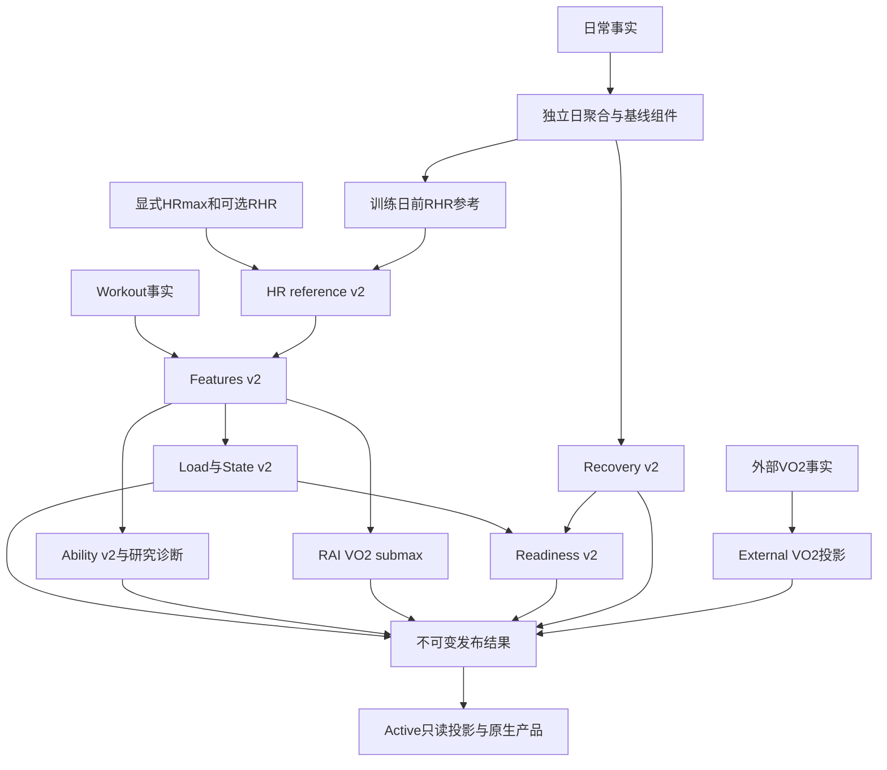

# RAI 运动能力模型补全实施方案

日期：2026-11-07（Asia/Shanghai）。版本：`rai-model-completion-plan/1`。状态：**实施规格，尚未实施**。

配套文件：[验收标准与矩阵](RAI_MODEL_COMPLETION_ACCEPTANCE.md)、[Codex 执行提示词](RAI_MODEL_COMPLETION_CODEX_PROMPT.md)、[实现差距核查](audits/RAI_MODEL_DESIGN_GAP_AUDIT_2026-11-06.md)。

## 1. 目标、范围与完成定义

目标是补齐核查报告 G01–G14，使原生 iOS、Go API／Worker、PostgreSQL 上的新模型形成真实可计算、可解释、可回算、可受控切换和可回滚的完整工程链路。复用现有同步及分析基础设施，不另建服务、队列或客户端。

交付分四层，必须分别签核：

| 层 | 本次提示词的执行范围 | 何时可以完成 |
| --- | --- | --- |
| E 工程 | 实现全部 E0–E11；合成数据、本机隔离 PG、Swift／Simulator、合成切换回滚 | 对应硬门禁全过，代码实际运行；真机不在场也继续完成此层 |
| D 真机与数据通路 | 准备真实 App 流程和验收工具；仅在后续会话已有明确设备／读取范围授权时执行 | 真实记录、完整性、删除／恢复和模型输入通路有独立证据 |
| C 现实适用性与校准 | 实现合成研究流程验证、协议与聚合工具；真实研究另行启动 | 预登记、独立标签／留出数据及逐模型验收真实完成 |
| A 产品启用 | 实现执行器，合成环境实际演练；真实数据集默认仍 legacy | D／C／产品门禁及明确发布授权全部成立后另行执行 |

**工程完成不要求制造现实研究结果，也不允许借真机或实验室暂缺停止其余工程。真实产品不自动启用。** 编写本文件的会话只交付文档；后续使用提示词才开始工程实施。

除 G01–G14，工程范围还包括原文已经给出定义的研究模块：最大努力确认与 maximal_supported、CS／D′、load_settling_window、aerobic_efficiency。它们单独版本和研究态输出，不能阻塞独立模型的合格结果。Running Economy、CP、没有独立证据的乳酸阈、核验跑道／跑步机距离、马拉松预测、伤病／疾病预测仍为 future／unsupported；不新增臆测公式。

## 2. 开始时必须核对的基线

文档编写基线为 `main / 18eab55` 加工作区，最高 migration 29。入口有 `docs/IMPLEMENTATION.md`、App 图标及核查报告的既有改动；实施时重新读取 HEAD、status、适用 AGENTS 和真实源码，不能按此短 SHA 强制恢复工作区。

先读：原 [模型设计](RAI_MODEL_ARCHITECTURE.md)、核查报告、[Feature](WORKOUT_FEATURE_CONTRACT.md)、[Load](TRAINING_LOAD_V1_CONTRACT.md)、[Ability](RUNNING_ABILITY_V1_CONTRACT.md)、[Recovery](RECOVERY_FOUNDATION_CONTRACT.md)、[Readiness](TRAINING_READINESS_CONTRACT.md)、[产品合同](ATHLETE_MODEL_PRODUCT_CONTRACT.md)、[完整性合同](WORKOUT_SYNC_COMPLETENESS_CONTRACT.md)、[UA 总合同](UNIFIED_ACCEPTANCE_CONTRACT.md)、[产品启用计划](PRODUCT_ACTIVATION_PLAN.md)。

记录模型／schema／mapping／source policy／migration checksum／输入上限和现有结果身份；用已存在合成 golden 固定旧 v1 数值与语义。核查内容已被其他工作补齐时，补验证及追踪，不重复实现。原设计与原架构方案原文保留，禁止修改 `../running`。

## 3. 已决策的兼容与版本策略

### 3.1 规格差异的处理

| 决策 | 实施要求 |
| --- | --- |
| D01 既有 v1 | 已冻结数值、质量、缺失、窗口、hash 和历史不可变；不把补全塞进原 v1 |
| D02 Readiness 数学 | 保留后续冻结合同的 180 日有限残余、36h 衰减、前 42 完整日滚动 B、≥5 训练日／跨度≥14 日／1 AU floor；不恢复早期 14 日／周一冻结 B。v2 只显式升级依赖及新增诊断，差异继续写明 |
| D03 HR 门槛 | 保留目前 `[30,220)`、连接跳变及 HRmax 零冲突默认策略；不因想提高可用率自动放宽。原文局部 MAD 判别只作为未来单独策略，不属于本次强制改动 |
| D04 夜间 HRV／睡眠 | 原文未完成的夜间／静息 estimator、规律性和自报目标放入 Recovery v2；旧全天代表值及 duration-only v1 继续可查 |
| D05 confidence | 各已冻结模型保留自身 policy；新增模型明确冻结组成、cap 和 freshness。产品只表示证据支持，不改造成统一准确概率 |
| D06 默认范围 | 所有负荷／准备度仅代表已记录且符合来源策略的跑步；完整性证明不等于所有运动、HealthKit 授权成功或已证实休息 |

这是后续实现的默认选择，不需要让执行者反复询问是否覆盖 v1。需要改变以上数学或门槛时，先交付独立设计差异和新版本，不得借“修复”静默改变。

### 3.2 新版本和 manifest

| 组件 | 目标身份 | 本次新增语义 |
| --- | --- | --- |
| 特征 | `rai.workout_features/v2` | 可信 reference、重叠区间、来源上下文及新诊断资格；复用 v1 纯函数原语 |
| 单次负荷／状态 | `rai.training_load.hrr_integral/v2`、`rai.load_state.exp_finite/v2` | 剂量及有限核不变，显式 reference policy／重叠 knownness |
| 跑力 | `rai.running_ability/v2`、对应 curve／endurance v2 | 来源切换、证据模式与 annotation；评分尺度不变 |
| RAI VO₂ | `rai.vo2max.submax/v1` | 新有条件估计；不能复用 external identity |
| 生理恢复 | `rai.recovery.physiological/v2` | 夜间上下文、睡眠规律性／目标、持续偏离 |
| 准备度 | `rai.readiness.training/v2` | 兼容明确指定的 v2 Recovery／Load；保留 D02 数学 |
| 诊断 | `rai.workout_durability/v1`、`rai.aerobic_efficiency/v1`、`rai.critical_speed/v1`、`rai.load_settling/v1` | 独立定义、原因、研究态和有界依赖 |
| 产品 | `rai.athlete_model/2`、`rai.product_metric_mapping/2` | 新增 RAI／external VO₂ 分支、历史与诊断；保留 schema 1 解码 |

如这些身份在实施前已被占用，先确认真实语义，再顺延版本并统一合同／测试／manifest。禁止复用已发布身份。

新 stack manifest 固定所有 component、config、schema、mapping、输入／来源／annotation policy、日历边界策略及支持的消费者版本。manifest canonical hash 进入 scope、assignment 和 run lineage。仍只有 active＋candidate 两个可读通道；阶段中间 artifacts／draft manifest 不是第三个可读通道。旧 active 默认 legacy，旧 candidate/history 保留审计，不就地改写历史结果。

数值依赖示意如下；dirty／审计边还需按实际lineage补齐，不能从图中不存在的箭头暗加数值依赖：

## 4. 数据、事务和权限总设计

1. 复用 facts／tombstones／commit log／jobs／dirty_scopes／runs／results／artifacts／publications／model inputs／dependencies。原始事实、删除屏障、日志、dirty/job、最终回执同一 dataset 锁事务，不改下载水位来源。
2. migration 只追加；schema 注册表、input kind、result family、job kind、roles、sqlc、readiness 检查、恢复／迁移边界一起更新。旧 migration 和 checksum 不改。同步不能依赖迁移、备份或全库重算。
3. 新输入采用 typed、append-only、版本化 registry：`hr_reference/2`、`sleep_target/1`、`effort_annotation/1`、`workout_overlap_resolution/1`、必要的 `source_context_selection/1`。不存在任意 JSON 写入入口。有效期、known-at、supersedes／revoke、同 dataset subject、无环和冲突解析必须事务校验。
4. 输入撤销与删除立即撤下受影响 current 引用；旧 upload、旧 bundle、旧 annotation、旧 baseline 不能复活 UUID。历史 artifact 保留，产品不把 withdrawn 历史当可用 fallback。
5. 发布锁顺序继续 dataset→job→dirty，快照 REPEATABLE READ，发布前重新核对 generation、manifest／assignment、上游 run/hash、删除、lease/fencing 和输入有效期。artifact/result/publication/clean/run/job/attempt terminal 原子提交。
6. API 新读路径需要最小权限 SQL 投影／固定函数，仅返回 active 允许的 typed 字段；不得为了读产品一次性授予 API 任意 artifact、ledger、candidate 或 assignment 写权限。若用 SECURITY DEFINER，固定 search_path、无动态 SQL、绑定已认证 principal 的 dataset，真实角色负例必须通过。
7. 管理执行器独立 `internal/admin`；application／httpapi 不可导入它。Worker 不获得 raw 修改、任意配置、一般性 dependency 或 activation 权限。API/Worker 仍同镜像。
8. 模型无 I/O、时钟、随机或全局可变策略；时间、日历、来源／个人输入由边界层显式传入。公开日志无健康值、位置、睡眠时刻、凭证或真实对象唯一标识。

## 5. E0 — 基线、版本与需求冻结

交付 `docs/RAI_MODEL_COMPLETION_DECISIONS.md`：实际入口、复用／新增列表、D01–D06、最终版本 manifest、DAG、input registry、影响范围和权限矩阵。它应把本方案细化到实际函数和 migration，不重新讨论已决策的产品范围。

创建持续更新的 G01–G14→阶段→代码→验收 ID→结果索引；可选／future 项也要显式追踪。先运行受影响现有合成基线，记录失败与缓存，不把旧报告当本轮 PASS。工程决策记录完成后继续 E1，不停在规划阶段。

出口：MC-B01–MC-B08。

## 6. E1 — 普通同步的完整性闭环

在正常用户同步／启动恢复路径接入已实现的 completeness v2，不复制验收专用控制器。单次 durable ACK 仍立即独立返回；全量证明作为低优先级、可暂停续跑的控制流，不能让用户等待所有历史才看到一条已导入记录。

- 保留 eligible／excluded／unknown inventory、源策略和 exclusion evidence。unsupported／unknown 不静默跳过；用户只选择上传时不可宣称全量完整。
- 同流 query、anchor、candidate／committed 游标、manifest 和 receipt 绑定固定 cutoff／collector／fingerprint／generation；重启、离线、lost ACK 复用原字节与原回执。
- 捕获期间新事实／删除使旧证明失效，不能把 cutoff 后数据夹入旧 manifest，也不能通过重设 anchor 获得 complete。
- 优先恢复已备 pending，再做增量；共同限流、取消／后台 eventual recovery、不同时重复发起同一完整性周期。后台执行时机不作系统无法保证的承诺。
- verified receipt 才进入 M6／v2 readiness；没有 proof 时 unknown 保留，禁止真实路径填写 syntheticCoverage。证明不得强迫 enroll／激活新模型。
- 保留最近同步提速成果和 strict gzip／metadata／捕获 ACK 身份边界；不为了完整性重新引入全量归档或每样本刷盘。

涉及：`App/SyncCoordinator.swift`、`ProductModel.swift`／`RAIApp.swift` 正常入口、`SyncCore/WorkoutCompleteness*`、`OutboxStore`、服务端 completeness／readiness 输入及相关集成测试。出口：MC-S01–MC-S10。

## 7. E2 — 可信个人参考、重叠保护和来源上下文

### 7.1 HR reference 与用户输入

`hr_reference/2` 分别保存 HRmax／显式 RHR 的数值、单位、测量／确认时间、取得方法、来源说明、有效区间和撤销／取代关系。HRmax 测量／确认年龄≤365 日，显式 RHR≤90 日，必须对 Workout start 求值，不得把 recordedAt 当 measuredAt；年龄按绝对秒计算，日=86400秒，恰等边界允许，未来测量拒绝。HRmax>RHR>0；测量范围与支持域分别校验，不使用年龄公式或默认参数。user_confirmed只是明确自报，不能标成实验室测得。

RHR 默认优先采用唯一合格的显式 reference；没有显式项时才采用训练日前 `[d−28,d−1]` 同上下文日常 RHR median，至少14日且前7日至少3日，保留其 baseline run/hash／日期／source epoch。显式项冲突时返回 conflict，不能偷偷回退 baseline。HRmax 仍必须显式测量／确认，日常最高 HR 不是 HRmax。

新输入的HRmax必需、显式RHR可空，两者各自带测量时间。供reference的RHR baseline是独立可发布组件，不依赖当日RHR／HRV／Sleep／完整Recovery可用；不能直接复用一个因为今日组件缺失而collecting的Recovery对象充当过去RHR历史。既有raw RHR、derived baseline、用户显式参数各保留来源层次。

每日 baseline 正常滚动不是新政策 epoch；来源／定义／HRmax 依据改变才换 epoch。每次训练使用其当时 reference 快照，今日资料不得追溯覆盖旧 run。晚到／删除／撤销触发依赖闭包。新增输入表单只写 RAI 个人配置，不写 HealthKit，不改变 WorkoutKit 授权。

### 7.2 重叠 Workout

对同 dataset、符合已冻结来源策略的 running Workouts，使用可定位 active 区间求相交；严格正长度相交即标 `possible_duplicate`／`overlap_unresolved`。active 不确定时用整个事件区间作保守冲突范围。相接不相交，跨午夜／DST 按绝对时间判断。

保留各 Workout 原始事实及独立剂量；聚合时重叠区间不能算两遍，也不能静默选一个。仅非重叠部分可进入已知下界，冲突部分记 unknown，完整日负荷／受影响 state／readiness 为 null。native HR 贡献在边界准确切分，不能用整场平均比例伪造精确积分；summary 仍为 partial。

提供明确、可撤销、带 known-at 的 resolution 输入，声明同次训练并选择聚合 primary／排除重复派生贡献，保留双方 raw；无证据不自动合并 UUID。Workout 删除或 resolution 撤销重新计算相交邻域，不能留下永久 unknown 或让已删项参与。邻域查询有时间索引、计数上限，超限显式失败，不做 lifetime 扫描。

### 7.3 设备／来源变化与误标

source epoch 来自受支持来源／版本／描述符等价类，不能冒充真实物理设备认证。新 epoch 不立即接旧 epoch 的能力／VO₂ 趋势：标 context_shift，分池收集到正常成熟门槛；未经独立确认的跨 epoch 值不连趋势，支持上限0.4。显式 source selection／equivalence 需有版本输入及证据，不可按 UUID 或较高分选择。

多个未明确取代的context并存时返回source_selection_required；不按最后UUID／最高速度选池。描述符相同不能识别的物理设备变化属于观测限制，不能宣称本功能已经消除全部设备偏差。

新增 `activity_mismatch_suspected` 组合诊断。默认工程规则：同一连续区间≥120秒的可信速度≥6m/s，且该区间≥90%的显式步数时间支持得到cadence<80steps/min，才进入“误标疑似”；缺步数／无记录不满足此组合。可信路线／速度差>5%或来源冲突另记质量原因，不能只因一个GPS跳点确认坐车。以上为保守工程假设，纳入新policy，不能宣称生理分类准确率；表现／VO₂拒绝，通用HR load独立判断，不改raw activity type。先用正常高速跑、车辆样式、步数缺失及低质量GPS反例冻结测试。

出口：MC-I01–MC-I12；旧 v1 golden 必须不变。

## 8. E3 — 自有 RAI 条件式 VO₂max

新建纯领域 `internal/vo2max`，与 `vo2maxexternal` 平行；从 versioned feature／steady artifact 和 reference 读取，不在 reader／手机重算，不依赖跑力、计划、功率、Apple VO₂、体重或性别。注册实际 handler、snapshot loader、publisher、dependency、admin inspect 和日界 freshness；未注册／不支持的身份必须明确失败。

### 8.1 资格与单次候选

- ≥25min 户外 Workout，前10min剔除，暂停／恢复后3min不取；按原始时间网格取不重叠5min段，≥3段且共同有效支持合计≥15min。
- HR／speed 共同时间支持各≥95%；r∈[0.55,0.85]，v∈[134,300] m/min；速度 CV≤5%，HR trend≤1 bpm/min、前后效率漂移≤5%；90%距离绝对grade≤1%，pause≤2%且不跨候选；距离核对≤5%。
- 温度已知且不在[5,25]°C、湿度>85%拒绝；缺天气保留 environment_unknown，cap≤0.5，不补标准天气／不调用天气接口或旧详情环境惩罚。
- HRmax／RHR 需 E2 合格且 as-of 可见，地形未知不可用。窗口 HR 和速度在相同有效支持上加权，不拿不重叠的均值配对。
- `r=(HR−HRrest)/(HRmax−HRrest)`，`V=3.5+0.2v/r`，v单位m/min，V单位mL/kg/min。单次 Workout 取合格片段 V 的中位数；[15,90]以外只留 outside_domain，不能 clamp。每Workout只算一次独立证据。

### 8.2 跨 Workout 汇总与时间规则

1. 最近42日同 reference／source context，≥3次独立 Workout、跨度≥7日、至少一次最近14日。使用 log(V)，初始权重 `q*exp(-ageDays/28)`。
2. 同本地日总初始权重≤1；water-filling 后单 Workout 归一化权重≤1/3。weighted median／quantile 使用稳定 evidence ID 决定同值顺序，不随机。
3. `m=weightedMedian(y)`，`s=max(1.4826*weightedMedian(abs(y-m)),0.04)`；winsorize 到 m±2s，再按归一化权重求 log target。
4. 相对其他独立候选中位数偏离>20%的新候选先隔离；14日内另一次独立证据在其±10%内才能确认。确认只在当时 known-at／as-of 可见时生效，不能未来泄漏。
5. 最新合格证据日 h 的 h−6…h target 按 `exp(-k/7)` 平滑，≥3个有效target日才有估计。各日复用证据不增加 n_eff；没有新证据不更新数值，只处理 freshness。所有 target 仅用 end≤min(dayEnd,asOf) 的事实。
6. `q_channel=min(1,observedSeconds/T+0.5*interpolatedSeconds/T)`，T为候选共同支持目标时长，不能把“插值占已覆盖部分的比例”误当覆盖率；`q_workout=min(qHR,qSpeed,sourceSupport,contextSupport)`。受支持且provenance完整的sourceSupport=1只表示工程支持，未知来源不通过；合格context=1，允许缺天气时contextSupport=.7。`qAggregate=Σw*q_workout/Σw`，`n_eff=(Σw)^2/Σw²`按独立Workout；`C=min(.6,qAggregate*min(1,n_eff/10)*exp(-ageDays/28))`，未知天气另cap≤.5。完整q和权重policy纳入config hash。
7. 14日 aging、28日 stale/current null、42日 expired；历史审计保留、删除失效立即撤引用。3–4次 preliminary，≥5次且跨度≥14日 established，数量不能解除 experimental。

### 8.3 不确定性与输出

所有入选证据做 leave-one-Workout-out 重拟合。敏感性8角点：HRrest±5、HRmax±10、氧耗系数0.18／0.22，取完整估计范围；不是95%区间。任一角点非finite／HRmax≤RHR／r≤0 → sensitivity_unbounded。相对全宽 `(upper−lower)/central>0.30` 时 value=null、仅留候选；不允许删掉不利角点或调整阈值求出值。

敏感性固定中心估计的evidence集合、已确认排除及时间权重，在同一集合上重算候选和稳健汇总；角点不重新筛掉不利样本，不把角点r越过中心eligibility区间当成删除理由，但必须满足上文数学定义域。LOO子集不足3次而无法满足权重cap／成熟条件时，范围明确null＋loo_support_insufficient；中心至多preliminary、cap≤0.4，不能伪造区间或称稳定。单候选51.5的数学验收并不保证该fixture通过敏感性发布门槛。

输出 typed value、unit、status、quality、confidence／含义、validationStatus=experimental、evidence counts／IDs、reference epochs、candidate exclusions、sensitivity／LOO range、asOf／evidenceAt／publishedAt、manifest。外部 VO₂ 单独 provider／origin／sampleDate，永不融合、替代或用于训练本模型。

出口：MC-V01–MC-V16，含真正可出值及因敏感性过宽而合理 abstain 的两种独立 fixture。

## 9. E4 — 夜间 baseline、Recovery v2 与 Readiness v2

### 9.1 夜间 HRV

按 dataset 时区构建 wake-day 的00–06 civil区间，与可识别主睡眠／明确受支持静息上下文相交。SDNN 的实际测量支持须落在该交集中，同 source／algorithm／acquisition-duration epoch 至少2次有效值，取 ln(ms) 后中位。只有“发生在凌晨”不证明静息；无上下文返回 context_missing，不退回全天 estimator 冒充夜间值。

不新增无限采集类型；需要而当前 metadata 不支持时，先显式扩展 registry／capability／跨端fixture，未知字段依旧阻断。不能删掉 metadata 继续上传。baseline `[d−28,d−1]`，≥14有效日且前7日≥3，median／1.4826MAD与floor沿用原设计；今日不入今日baseline。

### 9.2 睡眠规律性和目标

复用已经实现的 source-separated 主睡眠并集、awake优先、跨日／nap规则；不按REM/deep分期加权。增加主睡眠中点的本地圆周时间：23:50与00:10相差20min。baseline使用过去28日同上下文成熟主睡眠，至少14晚且最近7晚≥3；采用最小化圆周绝对距离和的观测中点 medoid，确定性同值规则；对径／同样支持且无法识别中心时标 regularity_ambiguous，不能当偏差0。

睡眠目标优先有效自报 sleep_target（0<hours≤24；是输入合法性，不是建议睡多久），无则用过去28日中位时长并标 relative_to_habit。缺regularity或目标支持时给partial组件／原因，不给完整v2 Recovery。目标变更按有效期影响派生，不回写raw。

### 9.3 公式、持续偏离与准备度

v2按原设计 §8.2：zH／zR robust标准化，`aH/R=clamp((z−1)/2,0,3)`；`aS=clamp(max(0,target−sleep)/1.5+0.25*max(0,midpointDeviationHours−1),0,2)`；`Baut=.25*max(aH,aR)+.10*min(aH,aR)`；`P=100*exp(-(Baut+.15*aS))`。保存每项burden与贡献。缺sleep只保留autonomicOnly，不当完整P，cap≤0.5。

同一组件在连续3个当地有效日超过其不利 deadband 才标 persistent_deviation；缺日打断，不能把不同组件轮流异常拼成连续。标记不自动改变公式或诊断。极高HRV（新policy默认 zH≤−3）标 context_shift而不奖励，阈值明确为工程假设并纳入版本。

Readiness v2 仅消费声明兼容的完整 Recovery v2 和 Load v2 ledger，数学保持D02；新旧P、AU／quality／knownness不得混用。保留读时Freshen、到证据／coverage／日界失效；无Workout也能由日界调度刷新，不用每分钟创建永久run。

出口：MC-R01–MC-R14。

## 10. E5 — 跑力 v2、长跑及研究诊断

### 10.1 跑力与最大努力确认

demonstrated 延续现有90日／20–90min／80%分位、独立训练／长短覆盖、γ网格、LOO、平滑和0–100刻度；增加E2来源隔离及明确不兼容趋势。不能因为补了VO₂／负荷／恢复／跑姿就加到跑力。

maximal_supported 单列pool／mode／config：≥3次独立、版本化确认的比赛／接近最大努力，持续时间覆盖≥2倍且含≥40min，50%稳健分位；保留质量、异常／LOO和原评分尺度。annotation须当时可见，user_confirmed与独立核验来源分开，不从高HR／课型推断；未外部校准cap≤0.7。撤销、Workout删除、事后确认不能回填过去预测。模式之间不连趋势。

### 10.2 长跑耐久性

以M1／v2发布的≥60min连续支持为基础，排除前10min，两个等有效时长半段；稳定地形／来源、speed CV≤10%、HR／speed支持≥90%。`EF=v(m/min)/HR`，`decoupling=1−EF2/EF1`，`paceDecay=1−v2/v1`。两半均速差>5%不解读HR drift；缺HR可有paceDecay，缺speed不能有两者。提供最近42日≥3次同类长跑的中位趋势、90日最长已完成连续时长，不能推断还能跑多久或机械扣跑力。

“同类”默认相对最新合格长跑：同source epoch／terrain context、平均速度差≤10%、连续时长差≤25%；双方温度都已知时差≤5°C。环境缺失保留partial／混杂限制，不补标准天气；跨epoch／未知地形不连趋势。这些工程匹配阈值进入诊断config，不能在看趋势后临时调宽。

### 10.3 CS／D′、效率与消退窗

- CS研究：近42日3–15min，标准3／5／10min或真实12min事件支持；≥3独立Workout、≥3时长、最长／最短≥2.5。每Workout总权重≤1，WLS拟合D=CS*t+D′。Workout级LOO最大`abs(CS_leave−CS_full)/CS_full≤5%`，`relativeRMSE=sqrt(Σw*((Dhat−D)/D)^2/Σw)≤3%`、0<CS<各观测均速、D′>0；LOO子集至少两种时长，否则不可识别。不合格null。非确认最大努力仅low研究态，D′不做用户“无氧电量”，不称乳酸阈。
- aerobic_efficiency：合格共同稳态支持上的 `v(m/min)/HR`，单位m/beat，可缺HRmax／RHR；保留地形、速度、来源／环境上下文，不能因缺reference而连这个旁路也拒绝。只做同上下文趋势，不能换名VO₂／economy。
- load_settling：基于v2相同D／B，`h=36*max(0,ln(D/(.25B)))`小时；D=0定义h=0。P≥85、完整coverage／B才可输出分桶：<12、[12,24)、[24,36)、[36,48]、>48小时。P阈值为工程显示策略，不是医学界限。研究详情标“若后续无新增运动，模型负荷残余回到参考范围”，不称身体完全恢复或预测睡眠。

出口：MC-A01–MC-A12。

## 11. E6 — 有界回算、历史、影响范围

提供同一套CLI：`plan`／`execute`／`resume`／`status`／`diff`／`cancel`，参数显式dataset、manifest／stack、from／through、asOf、view、operation／actor；不隐式所有dataset或全历史。请求1–366当地输出日，默认合成验收180日；按31日或更小预算分块，先按DAG算warmup与上游。plan纯读，列出输出范围、依赖窗、数量、容量拒绝和缺输入；不读取／打印健康值。

复用jobs／runs／artifacts和审计；若现有操作结构不足，只允许一张通用操作进度表保存身份／阶段／游标／checkpoint引用，不另建模型事实／值存储。每块input hash、target asOf、manifest和父operation固定；重启／重试无重复发布，取消不删已提交事实／历史。中间块只写staged结果，全部目标及warmup依赖完成才将完整candidate manifest置ready；不提前clean未覆盖日期。

| 变化 | 至少处理的范围 |
| --- | --- |
| 日负荷d | acute／chronic d…d+179；trend7延至d+186 |
| RHR日d→训练reference | 训练日d+1…d+28，再组合load/state／readiness依赖；不得只固定180日 |
| VO₂证据日d | 42日池＋6日平滑至d+47；current持有／lastKnown引用也核验，最远参考d+74 |
| 表现证据日d | 90日池＋13日平滑至d+102；持有引用最远参考d+129 |
| 日常事实d | signal／睡眠归属邻域、未来28日baseline、连续偏离所需2日尾部及readiness |
| overlap／source／annotation | 受影响时间邻域、对应模型窗、其持有引用及下游闭包 |

将AffectedRanges写成纯函数，用独立直接重建oracle验证闭包；时间上限是依赖合成结果，不可把所有算法硬设同一窗。删除在事实事务立即使current不可读，重算完成前无过期假值。

历史接口只展示真实存在的immutable结果和view／known-at。revised可按当前允许事实回算；无法合法重建的as-known返回明确historical_input_unavailable或原run审计，禁止用备份、退役dataset／旧import复活事实。diff显示单位／版本／模式分界、值→null／null→值及支持原因；真实默认只给计数和分箱，精确数值仅合成或获准私有研究输出。

出口：MC-H01–MC-H10。

## 12. E7 — 产品API、历史和共享详情

固定新增正式路由 `GET /v2/analysis/athlete`，schema=`rai.athlete_model/2`；不再同时增加别名。历史为 `GET /v2/analysis/athlete/history`，支持metric、显式日期区间、limit≤90、opaque cursor和view。候选只走管理员受限CLI／合成测试，不开放`?channel=candidate`。

个人typed输入使用独立路由：`POST /v2/model-inputs/hr-references`、`/sleep-targets`、`/workout-efforts`、`/workout-overlap-resolutions`、`/source-context-selections`；撤销用`POST /v2/model-inputs/{id}/revocations`，不UPDATE旧输入。由在线领域服务调用受限Store事务，不导入admin。认证principal只能操作自己的dataset，subject必须存在且未删除，提供有界列表／当前解析结果供表单读取；body的dataset不作为权限依据。同input ID／canonical body重试原receipt，冲突4xx；input／audit／dirty-job／receipt原子提交。该独立合同不改变Workout bundle身份或开放旧sample写路由，配置值不进入普通日志。

各POST固定typed schema和必需字段：inputID／subject、effectiveFromUs／effectiveThroughUs、supersedesID、provenance及该kind的typed payload；known-at／createdAt由服务器赋值，不信任客户端伪造记录时间。receipt至少含inputID／schema／content hash、acceptedAtUs、analysisStatus与实际jobIDs，并持久保存供重试；没有受影响job可为合法空数组。不要把新配置receipt假装成Workout receipt，或把参数时间当下载提交水位；是否需要独立输入审计序号在E0按现有结构定稿，不能引入sequence水位。

当前快照包含独立typed metric：runningAbility、physiologicalRecovery、trainingReadiness、trainingLoad、raiVO2Max、externalVO2Max，诊断只放详情。每项含单位／mode／source／state／reason／freshness／evidenceAt／asOf／evaluationAt／computedAt／publishedAt／model／payload／mapping版本及validationStatus；root带assignment revision／manifest identity。保留schema1，未知版本可解码但不展示未知数值。

路由只读active assignment。legacy active时返回not_product_activated及真实旧入口兼容，不把candidate或旧readiness改名。缺证据正常200＋null＋reason；全dataset无分析可按明确合同404。认证、跨dataset、未支持参数／日期与真正DB／schema／generation故障分别返回适当4xx／5xx，不能把技术错误当insufficient成功。多metric局部技术故障可返回显式partial_response及逐项错误，不称complete_response。

上段“只读active”约束指标GET，而非个人输入POST。旧App继续旧接口；新App在legacy assignment下保持独立的旧版首页路径，不把新API的not_product_activated变成整页丢失或把旧值改新标签。个人输入查询仅返回本人被允许的typed配置，不透出candidate数值或内部全量artifact。

reader在一个RR只读快照内批量校验manifest、清洁generation、上游lineage、source／parameter、删除与freshness；不调用Calculate、raw loader或admin。history cursor绑定dataset／metric／assignment／model／view／范围；跨版本／mode断线，删除withdrawn点不当lastKnown。

详情增加versioned分析投影，分析数值／qualifications从发布artifact读取；raw路线／活动／展示降采样仍可为原生图表读取，但不能再次定义HR支持、速度、负荷或grade分析。未发布／dirty为pending/null，不回落旧算法后仍标新版本。legacy详情保持原合同。

出口：MC-P01–MC-P05，及MC-T07／MC-T08。

## 13. E8 — 原生iOS和训练消费者

在现有SwiftUI导航中接入typed API和新模型详情，不增加Web／Watch／桌面客户端。默认普通真实账户仍legacy；合成Simulator以实际active assignment进入同一正式reader和页面，不靠App硬编码fixture冒充端到端。

- 首页跑力＋“恢复（训练参考）”明确对应readiness；physiological proxy／VO₂分源／负荷及诊断在详情。RAI VO₂始终experimental直到独立验收；Apple为外部估计，不能平均两者。
- collecting／limited／unavailable／stale／source_conflict／sync_incomplete／technical_error分别显示，null不是0／100；不承诺跑几次一定有值，不显示confidence百分比或虚构趋势。
- 中文reason映射、单位转换和舍入只在presentation。score整数，VO₂≤1位小数，速度／配速转换有测试，证据时间不冒充更新时间。
- 支持VoiceOver、最大可访问性字号、深浅色、窄屏和未知schema；不得泄露raw metadata／UUID／内部config。
- 训练生成器增加显式versioned adapter：消费已激活、兼容且fresh的Readiness v2／Load v2和其knownness；本轮仅沿用现有“低readiness提示”行为，不新加自动处方、配速推导或WorkoutKit改排程。null导致保守提示／不可用原因，不当正常或100。旧计划／执行历史不可变，新计划保存输入assignment／model／asOf和缺失证据；回滚后新请求使用旧adapter，历史不重写。

出口：MC-P06–MC-P12。

## 14. E9 — 切换、shadow和回滚执行器

实现真实可执行的管理员plan／promote／rollback，不能只去掉active=legacy约束、把静态gate改true。additive迁移支持allowlisted manifest及append-only assignment audit；API／Worker无权切换。

门禁证据绑定model／config／manifest、feature/source/input／mapping／consumer版本、目标dataset／cohort、有效期、reviewer和报告摘要。至少Engineering、Device/Data、模型适用性、UX／隐私／性能、rollback、明确启用授权分别校验。external VO₂要求来源／语义而非伪造RAI生理准确性。没有真实证据的gate默认false，不能通过CLI传布尔值伪造通过。

合成演练采用由本机测试harness创建的明确synthetic标记数据库及dataset，不能只靠localhost／环境变量认定合成。真实执行器拒绝synthetic证据用于真实目标。allowlisted真实stack未授权时保持legacy。

promote在dataset锁内检查candidate完整ready、无dirty、manifest／上游fresh、所有gate／consumer兼容，再原子新增assignment revision＋audit。并发事实提交必须串行；指针检查后但commit前失效不能漏过。合法insufficient结果可以存在，但缺handler／failed／半回算不能伪装正常空值。

rollback指向previous active的**当前仍有效输出**；旧stack未持续跟踪事实时先做有界补齐再切，不显示冻结旧快照。默认保留active和previous stack的有界dirty跟踪与warm standby；已有candidate是next stack时，以versioned scope跟踪previous派生，不增加第三可读通道。禁止清raw、Down migration、恢复备份或全量重算。切换前后客户端／计划／缓存绑定assignment revision，旧请求或in-flight结果不能重新覆盖当前版本。

shadow执行器只在合成环境自动跑；未来真实shadow按UA4另行授权。只输出经过最小组大小抑制的availability／state／latency／failure aggregate；不同语义legacy／new不直接相减。真实cohort、时窗、最小组大小和隐私审阅未冻结不执行。

出口：MC-X01–MC-X12；必须使用真实HTTP／PG／App消费者完成一次synthetic legacy→new→previous-active流程。

## 15. E10 — 现实验收准备与研究工具

工具使用同一条真实App／API／Worker路径，能输出每模型n/N、阻断原因、输入流／manifest／来源状态和耗时聚合；默认不读取／输出健康值。研究数据导出不是普通日志：仅在另获授权的隔离范围内，最小字段、化名映射分离、访问控制、保留／撤回、审计；原始健康值和个体prediction/outcome永不进入git。

实现以合成数据验证的prospective prediction快照、known-at冻结、按athlete及时间互斥split、独立outcome关联、重复观测cluster分析和撤回流程。不能用今天revised重算冒充过去预测，不能用Apple VO₂当自有模型真值或同次训练窗口自证跑力。

更新UA1／UA2／UA3／UA4的版本支持说明，以本方案新模型和诊断为对象；旧v1研究结论不得直接移给v2。提供待签核study addendum和运行手册，未填cohort／用途／样本精度依据／阈值／reviewer时gate保持关闭。拟议科学门槛见验收文档C组，不能由执行者看结果后改低。

出口：MC-C01–MC-C04的工程部分；MC-D／MC-C真实执行按授权和可用条件独立记录。

## 16. E11 — 综合回归、性能和交付

开发阶段使用 `scripts/local/test.sh quick` 和定向测试；每个事务阶段增加本机新建隔离PG18/race，阶段收尾`gate`。最终一次`full`覆盖race、vet、build、sqlc稳定性和全量PG；Swift package、Simulator和真实App→HTTP→PG合成E2E使用现有本机入口并扩展新能力。不每次迭代重复完整真机历史。

性能用普通优化构建，实际loopback TCP／认证／准入／PG，warmup3、有效尝试至少30并保留失败；race仅作正确性门禁，不签性能。新增modelperf入口若需要，先实现并证明构建／fixture／计时口径，再测量。具体阈值见MC-F组。

必须交付：

1. 实际源码、additive migration／sqlc、合同／fixture、运行工具和有意义测试。
2. `docs/RAI_MODEL_COMPLETION_DECISIONS.md` 与 `docs/RAI_MODEL_COMPLETION_RESULT.md`，后者逐阶段／G01–G14／全部验收ID记状态、证据、失败历史与剩余风险。
3. `docs/evidence/model-completion/` 的manifest／机器可读矩阵／命令摘要／合成oracle／数据库故障与权限／性能／Simulator和切换回滚证据；大日志可留`.local/logs/model-completion/`并记录摘要。公开材料仅合成或已审查聚合。
4. 追加`docs/IMPLEMENTATION.md`真实结果，保留已有字节前缀与历史FAIL；更新相关合同的版本说明，不改原设计原文。
5. 未授权／条件不具备的真实项目明确NOT RUN／NOT VERIFIED；不能把其余工程完成改称整体生理／产品验收通过。

## 17. 执行顺序与停止规则

顺序：E0→E1→E2→E3→E4→E5→E6→E7→E8→E9→E10→E11。独立模块可在其依赖已冻结后交错推进，但共享事务、migration、版本和合同统一收口。工程各阶段完成后继续，不因某一个阶段有报告就结束。

P0／P1：raw丢失、删除复活、提前anchor、未知字段丢弃、跨dataset泄漏、candidate越权、旧generation发布／错clean或版本混用，立即阻断相关发布并修复；其他独立安全工作继续。环境短暂不可用先修复本机入口；缺真实设备／outcome不是工程停工理由。

数值不出值时先查证据／单位／时间支持／政策资格，不得默认HR、伪造coverage、降低qualification或改变科学阈值让页面出现数字。性能不达标要定位和报告，不能削弱durability／预算／测试密度。实测不可达可提出独立更版方案，现门槛保持FAIL。

不自动部署、不切真实入口、不激活真实数据集、不迁移／清理云端状态、不读取生产、不提交凭证、不commit／push。本地可逆实现和合成演练在提示词授权范围内自主完成。

## 18. 需求追踪与预期代码落点

| 核查项 | 主要阶段 | 验收组／关键项 | 预期改动范围 |
| --- | --- | --- | --- |
| G01 自有VO₂ | E2／E3 | MC-V01–MC-V16 | 新pure vo2max包、analysis／jobs、PG input／publish／query、admin、sqlc／migration |
| G02 新指标API | E7 | MC-P01–MC-P04、MC-T07–MC-T08 | httpapi新route、athletemodel schema2、最小权限PG投影、OpenAPI／JSON schema |
| G03 原生产品 | E8 | MC-P06–MC-P09 | ProductCore typed API、App/ProductModel／ProductViews／WorkoutDetailView及原生新详情 |
| G04 切换回滚 | E9 | MC-X01–MC-X12 | admin model-stack／release gate、assignment audit、DB权限／约束、consumer revision |
| G05 六个月回算 | E6 | MC-H01–MC-H10 | admin统一操作、jobs、有界checkpoint／finalize、范围纯函数／diff |
| G06 共享详情 | E7 | MC-P05 | storage/postgres/workout_detail与workoutdetail版本化投影；legacy分支保留 |
| G07 训练消费者 | E8 | MC-P10–MC-P12 | training context／generator adapter、PG training input、plan lineage、Swift训练页 |
| G08 历史趋势 | E6／E7／E8 | MC-H08–MC-H09、MC-P04 | history query／cursor、athletemodel trend、ProductCore／App历史展示 |
| G09 HR参考 | E2 | MC-I01–MC-I05、MC-I12 | 新typed input／reference resolver、feature exposure v2、daily baseline依赖、输入表单 |
| G10 夜间HRV | E4 | MC-R01–MC-R04 | recovery v2 daily canonicalization／calendar／baseline、相关loader和artifact |
| G11 睡眠／偏离 | E2／E4 | MC-R05–MC-R10 | typed sleep target、sleep／circular policy、persistent history、原因及Swift表单 |
| G12 长跑诊断 | E5 | MC-A06–MC-A07 | feature v2 companion／durability pure函数、42日query及详情 |
| G13 重叠保护 | E2 | MC-I06–MC-I09 | active interval邻域、resolution、load v2 ledger／state knownness、删除传播 |
| G14 来源／误标 | E2／E5 | MC-I10–MC-I11、MC-A05 | source context policy、feature v2 qualification、ability／VO₂分池及趋势边界 |
| 研究模块 | E5 | MC-A04–MC-A12 | effort／maximal、CS／D′、efficiency／settling typed artifacts与研究详情 |
| 真实验收／校准 | E10 | MC-D01–MC-D10、MC-C01–MC-C08 | 本机独立工具、prospective snapshot／研究pipeline、UA版本addendum；真实执行另授权 |

新增包名和文件名可以按当前代码合理调整，但职责／DAG／验收不可丢失；改变落点写入DECISIONS和最终追踪。`scripts/check-boundaries.py`、OpenAPI、sqlc、roles、migration readiness、旧schema恢复测试和Swift shared fixture必须随真实改动更新，不能只修改主算法。
