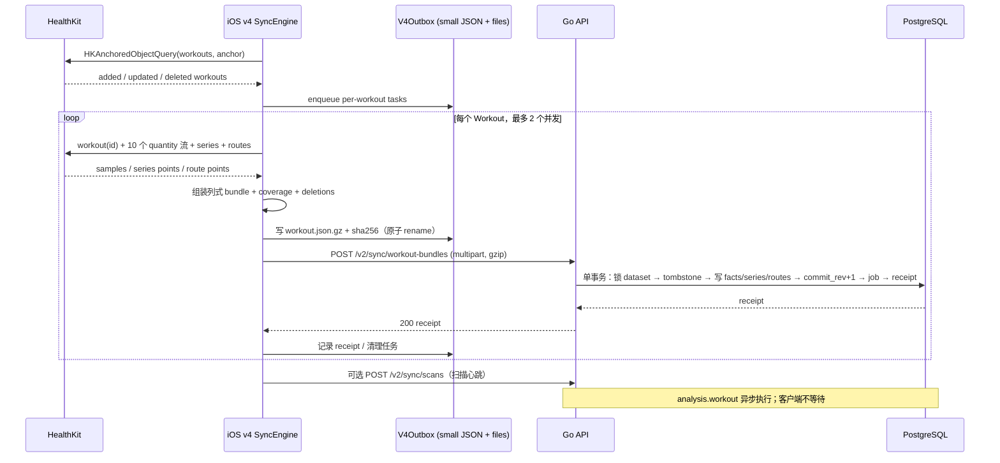

# RAI Workout 同步 v4 简化实施方案

状态：提案（未实施）
日期：2026-11-08
范围：`apps/server` 的 workout bundle 导入链路、`ios/RAI` 的 Workout 同步与本地待办
目标：学习 RQrun 的“一个 Workout 一个包、按指标数组、服务端一次解析”，同时保留 RAI 的事务、删除、幂等和不可变回执不变量

---

## 0. 结论

可以学，而且应该学，但不是照搬。

RQrun 真正值得学的是**同步单元**和**载荷形状**：

- 一个 Workout 一次上传，不再逐 sample / page / batch 注册；
- 客户端只负责“把这次读到的数据装进一个包”，不做全库证明；
- 服务端一次解析、一次事务提交、异步分析；
- 指标按数组组织，而不是每个 sample 一个带完整来源和元数据的对象。

RQrun 不能照搬的是**可靠性边界**：

- 不做删除同步，源端删了云端不删；
- 不做认证/签名，token 放 URL，明文 JSON；
- 异步解析 + 客户端轮询，失败语义和事务边界都比现在弱；
- first-write-wins，没有不可变回执历史；
- 640 KB 不压缩、无 gzip。

因此建议做 **v4**：

> 保留 v3 的“单 Workout 单包 + 单事务 + 不可变回执 + 显式删除”，
> 去掉 v3 的“全量完整性证明 + 逐 sample 来源/哈希/观察 + 逐字段反射校验 + 单体 state.json”，
> 把载荷改成列式数组，把校验压到一次线性扫描。

预期收益（目标值，需实测）：

| 指标 | 现状（Round 2 真机） | v4 目标 |
|---|---:|---:|
| S60 端到端 P50 / P95 | 8.18s / 11.26s | ≤5s / ≤8s |
| S60H 端到端 P50 / P95 | 18.27s / 24.64s | ≤10s / ≤14s |
| 服务端 P95 S60 / S240 | 4.76s / 19.72s | ≤1s / ≤4s |
| S60 bundle 原始字节 | 8.57 MB | ≤1.5 MB |
| 客户端 bundle 构建 | 5.4s | ≤1.5s |
| 客户端状态（200 Workout） | 3.9 MB 实测，曾 116 MB | ≤16 MB |
| 客户端上传前校验项 | 约 30 项 | ≤5 项 |
| 服务端 bundle 语义校验项 | 约 40 项 | ≤12 项 |

注意：HK 读取本身仍占 S60 约 5s、S60H 约 11.6s。v4 主要解决 bundle 构建、上传、服务端解码/写入和本地状态放大；**不能单独把 S60H 压到 8s 以内**，必须同时保留 Round 2 的流并发与 capture 批策略。

---

## 1. 目标与非目标

### 1.1 目标

1. 一个 Workout 一个不可变 bundle，继续一次 POST、一个事务、一个 `analysis.workout` job、一个回执。
2. 客户端不再生成 200 天完整性 manifest、page、anchor、proof、source-policy 排除证据。
3. 客户端不再为每个 sample 生成 provenance、canonical 身份、内容哈希和逐字段观察。
4. 服务端只做一次线性校验；不做反射式逐层字段比对，不做逐 sample 的二次遍历。
5. 载荷改为列式数组：`streams[].samples[]`、并行 `uuids[]`、series 用索引、route 用点数组。
6. 本地状态从“单一大 JSON”改为“每 Workout 一个小任务 + 每 Workout 一个大文件”；先做小状态，SQLite 作为后续可选。
7. 保留：Workout UUID 幂等、原字节 SHA-256、显式删除屏障、单事务、不可变回执、未知字段拒绝、仅支持类型白名单。

### 1.2 非目标

- 不改 HealthKit 只读权限模型，不增加 Web/Watch/桌面客户端。
- 不改认证方式，不把 token 放 URL，不做无签名上传。
- 不把服务端导入改成 RQrun 式“先收后异步解析”。当前同步导入 + 异步分析已经满足边界；异步解析会破坏“事实/屏障/日志/待办/回执同一事务”。
- 不丢弃不支持字段，不把未知 metadata 静默转成空。
- 不删除 `health_samples` / `workout_samples` / series / route 的现有表结构；v4 复用同一套规范化事实。
- 不做全库摘要、全量重算、备份恢复依赖。

---

## 2. 现状：复杂度到底在哪

### 2.1 链路

当前 v3 的客户端主路径在 `ios/RAI/App/SyncCoordinator.swift:839` 的 `performSync`：

```text
读 task → 复用已备 bundle 或重建
  → readWorkout(anchor) 判断删除
  → health.workout(id) + source policy 分类
  → discoverySnapshot + 原始 Workout 事件
  → 10 个 quantity 流并发 capture（CaptureGate/CaptureWriter）
  → 每个流的 samples + series + coverage + cursor + coveredEventIDs + provenance
  → routes capture + route provenance
  → 组装 WorkoutBundle（逐 sample Event 对象）
  → 写 multipart 文件
  → POST /v2/sync/workout-bundles
  → 校验 ACK 的 11 个 count + analysis job
```

服务端在 `apps/server/internal/httpapi/server.go:320` 接收，`DecodeWorkoutBundleJSON` 解码，`ImportWorkoutBundle` 在 `apps/server/internal/storage/postgres/workout_bundles.go:29` 单事务导入。

### 2.2 复杂度来源

| 层 | 现状 | 代价 | 判断 |
|---|---|---|---|
| 完整性 v2 | 200 天 inventory、12 个 stream、page/anchor/proof、generation/previousManifest、strict `knownCutoffUs` | 客户端每轮全量重读；proof 复用被 422 阻塞；`state.json` 膨胀 | 删除 |
| 逐 sample 来源 | `observation.provenance.samples[]` / `routes[]` 每个 sample/route 一条 | 载荷 + 服务端逐条校验；`bundle_observation.go` 534 行 | 删除 |
| 逐 sample 身份哈希 | `WorkoutCoreIdentity.canonical`、`content_sha256`、同 UUID 不同内容 409 | 客户端 canonical JSON + 哈希；服务端冲突检查 | 客户端不再生成 canonical/哈希；服务端保留一次 `content_sha256` 用于持久化/幂等 |
| 严格 schema 反射 | `exactJSONFields` 对每个嵌套对象 `json.Unmarshal` 到 map；50k samples | P06 decode 1.65s；分配/反射成本高 | 改为一次 token 扫描 + 类型化 decode |
| 完整性/发现状态 | `LocalState` 单 JSON，含 `discovery`、`workoutCompleteness`、`captureManifest` | 实测 3.9MB，现场 116MB；每次 commit 全量编码覆写 | 删除；每 Workout 小状态 + 文件 |
| ACK 过度校验 | 11 个 count、analysis job 数量/UUID/状态、delete 计数 | 客户端代码复杂，失败路径多 | 只校验 5 个必要字段 |
| 重复读/重复哈希 | `forceNewBundle`、同一不可变数据反复读取/哈希/解码 | bundle build 5.4s | 每 Workout 一次 capture，字节复用 |

### 2.3 代码规模

| 文件 | 行数 | v4 处理 |
|---|---:|---|
| `ios/RAI/App/SyncCoordinator.swift` | 1506 | 保留 v3 兼容；新增 v4 engine，v3 排空后删除旧路径 |
| `ios/RAI/App/HealthKitClient.swift` | 1199 | 复用 `bundleSamples` / `bundleSeries` / `bundleRoutes`，不改查询 |
| `ios/RAI/Sources/SyncCore/OutboxStore.swift` | 758 | v4 用新的小状态；旧 store 仅服务 v3 待办 |
| `ios/RAI/Sources/SyncCore/CaptureSegments.swift` | 560 | v4 不用于逐 sample；可保留为 v3 |
| `ios/RAI/Sources/SyncCore/WorkoutCompleteness.swift` | 477 | v4 不调用；v3 排空后删除 |
| `ios/RAI/Sources/SyncCore/HealthDiscovery.swift` | 289 | v4 不调用；v3 排空后删除 |
| `ios/RAI/Sources/SyncCore/HealthIntegrity.swift` | 253 | 保留 source 分类；删除 canonical/逐 sample 身份 |
| `apps/server/internal/syncing/workout_bundle.go` | 655 | 增加 v4 分支，v3 原样保留 |
| `apps/server/internal/syncing/bundle_writes.go` | 620 | 不改写路径，只复用 |
| `apps/server/internal/syncing/protocol.go` | 619 | v4 不复用 v2 信封；保留旧协议 |
| `apps/server/internal/syncing/bundle_observation.go` | 534 | 增加 v4 轻量分支 |
| `apps/server/internal/syncing/bundle_decode.go` | 407 | v3 保留；v4 新 decoder |
| `apps/server/internal/syncing/bundle_integrity.go` | 342 | v4 不走逐 sample 冲突检查 |
| `apps/server/internal/syncing/workout_completeness_v2.go` | 314 | v4 不写；后续删除 |
| `apps/server/internal/syncing/workout_completeness.go` | 289 | v4 不写；后续删除 |

---

## 3. 从 RQrun 学什么、不学什么

| RQrun 做法 | 采用 | RAI v4 的调整 |
|---|---|---|
| 一个 Workout 一次 `upload_record` | 是 | 保持 `POST /v2/sync/workout-bundles`，一个 multipart `file` |
| `originalRecode.json` 单文件 | 是 | 单文件，但 gzip；文件名 `workout.json.gz` |
| 每指标一个数组（`heart_rates_list` 等） | 是 | `streams[]`，每个 stream 一个类型 + 列式 `samples[]` |
| 客户端只读自己勾选的 Workout | 是 | 仍由用户选择；新增按 anchored query 增量入队 |
| 本地“上传成功”表去重 | 是 | 用不可变回执 + `bundleSHA256`，不是本地布尔表 |
| 每个指标独立读取/错误，不阻断整条 | 是 | 变成 `coverage` 的 `complete/partial/unavailable`，单 Workout 隔离 |
| 服务端异步解析，客户端轮询状态 | 否 | 保持同步导入 + 异步分析；回执即最终导入结果 |
| 不做完整性证明 | 是 | 只做每 Workout coverage；全局 knownness 用可选 scan heartbeat |
| 不做 sample 级身份 | 部分 | 保留 sample UUID 用于 upsert/显式删除；不做内容哈希冲突 |
| 不做删除同步 | 否 | 保留 Workout 删除 + sample/route 显式删除；缺席永不删除 |
| 明文 JSON、640 KB、不压缩 | 否 | 列式 + gzip；服务端仍限制解压比和 decoded 大小 |
| 硬编码 Authorization、token 放 URL | 否 | 保持 Bearer + device token |
| first-write-wins | 否 | 同 UUID 同字节返回原回执；不同字节形成新不可变回执 |
| 数组 200k / JSON 5MB 上限 | 部分 | 保留 50k samples、1M points、16 routes、32MiB decoded、8MiB gzip |

一句话：**学它的“包”和“数组”，不学它的“弱一致性”。**

---

## 4. v4 设计

### 4.1 原则

1. **一个 Workout = 一个不可变 bundle。** 同一 Workout 的新数据形成新 bundle、新 revision、新回执；旧回执按 `bundleSHA256` 永久可查。
2. **瘦客户端、厚服务端。** 客户端只声明“我读了哪些流、读到了什么、哪些明确删除”；服务端做一次规范化、一次校验、一次事务。
3. **Coverage 不是删除授权。** 快照中缺席的 sample/route 永不删除；只有 `deletions` / `routeDeletions` / `DELETE` 才删除。
4. **UUID 身份，不做内容哈希冲突。** 同一 `(sampleType, sampleUUID)` 同内容幂等；不同内容仍拒绝（HealthKit sample 不可变，出现即异常），不引入 last-write-wins 事实覆盖。
5. **未知字段拒绝。** 不静默丢弃；但只校验 wire 形状和明示支持的类型，不校验“客户端证明”。
6. **分析异步。** 导入回执不等于分析完成；分析失败不回滚导入。

### 4.2 端到端流程



### 4.3 v4 载荷

示例（数值均为合成数据）：

```json
{
  "protocolVersion": 4,
  "metadataRegistryVersion": 2,
  "datasetID": "11111111-1111-4111-8111-111111111111",
  "datasetEpoch": "22222222-2222-4222-8222-222222222222",
  "collectorEpoch": "33333333-3333-4333-8333-333333333333",
  "workoutID": "44444444-4444-4444-8444-444444444444",
  "startUs": 1700000000000000,
  "endUs": 1700003600000000,
  "workout": {
    "activityType": 37,
    "durationUs": 3600000000,
    "totalDistance": { "value": 10000.0, "unit": "m" },
    "totalEnergyBurned": { "value": 700.0, "unit": "kcal" }
  },
  "sources": [
    {
      "bundleID": "com.apple.health.44444444-4444-4444-8444-444444444444",
      "name": "Apple Watch",
      "version": "10.0",
      "productType": "Watch7,1",
      "operatingSystemVersion": "10.0"
    }
  ],
  "streams": [
    {
      "type": "HKQuantityTypeIdentifierHeartRate",
      "kind": "quantity",
      "unit": "count/min",
      "source": 0,
      "samples": [
        [1700000000000000, 1700000005000000, 120.0],
        [1700000005000000, 1700000010000000, 121.0]
      ],
      "uuids": [
        "55555555-5555-4555-8555-555555555551",
        "55555555-5555-4555-8555-555555555552"
      ]
    },
    {
      "type": "HKQuantityTypeIdentifierDistanceWalkingRunning",
      "kind": "quantity",
      "unit": "m",
      "source": 0,
      "samples": [[1700000000000000, 1700000010000000, 12.5]],
      "uuids": ["66666666-6666-4666-8666-666666666661"]
    }
  ],
  "series": [
    {
      "stream": 0,
      "sample": 0,
      "points": [
        [1700000000000000, 1700000001000000, 120.0],
        [1700000001000000, 1700000002000000, 121.0]
      ]
    }
  ],
  "routes": [
    {
      "routeID": "77777777-7777-4777-8777-777777777777",
      "source": 0,
      "points": [
        [1700000000000000, 31.2304, 121.4737, null, 5.0, 5.0, null, null]
      ]
    }
  ],
  "deletions": [],
  "routeDeletions": [],
  "observation": {
    "version": 1,
    "observedAtUs": 1700000010000000,
    "provenance": {
      "workout": {
        "bundleID": "com.apple.health.44444444-4444-4444-8444-444444444444",
        "name": "Apple Watch",
        "version": "10.0",
        "productType": "Watch7,1",
        "operatingSystemVersion": "10.0"
      },
      "samples": [],
      "routes": []
    },
    "coverage": {
      "workout": { "state": "complete", "sampleCount": 1, "queryCompleted": true, "localPersisted": true },
      "HKQuantityTypeIdentifierHeartRate": { "state": "complete", "sampleCount": 2, "queryCompleted": true, "localPersisted": true },
      "series:HKQuantityTypeIdentifierHeartRate": { "state": "complete", "sampleCount": 2, "queryCompleted": true, "localPersisted": true },
      "HKQuantityTypeIdentifierDistanceWalkingRunning": { "state": "complete", "sampleCount": 1, "queryCompleted": true, "localPersisted": true },
      "route": { "state": "complete", "sampleCount": 1, "queryCompleted": true, "localPersisted": true }
    }
  }
}
```

#### 字段说明

| 字段 | 必填 | 说明 |
|---|---|---|
| `protocolVersion` | 是 | 固定 `4` |
| `metadataRegistryVersion` | 是 | 与 v3 相同；未知版本拒绝 |
| `datasetID/datasetEpoch/collectorEpoch` | 是 | 与 v3 相同，UUID 规范 |
| `workoutID` | 是 | HKWorkout UUID；`workout` 内不再重复 |
| `startUs/endUs` | 是 | Workout 源起止时间；服务端据此构造 v3 `Event` 并校验 `durationUs <= endUs-startUs` |
| `workout` | 是 | 现有 `Workout` 对象（activityType/duration/distance/energy/statistics/events/activities），不含 Event 包装 |
| `sources` | 是 | 去重后的来源数组；最多 16 个；`bundleID` 必填，其余字段可选但长度受限 |
| `streams` | 是 | 最多 32 个；`type` 必须在 `Units` 白名单；`kind` 为 `quantity` 或 `category`；`unit` 必须匹配注册表 |
| `streams[].samples` | 是 | 三元组 `[startUs, endUs, value]`；start≤end；value 有限；category 必须整数 |
| `streams[].uuids` | 是 | 与 `samples` 等长；UUID 规范；同一 bundle 内 `(type,uuid)` 唯一 |
| `streams[].source` | 是 | `sources` 下标 |
| `streams[].src` | 否 | 与 `samples` 等长，覆盖单个 sample 的来源下标；仅混合来源时发送 |
| `streams[].metadata` | 否 | 与 `samples` 等长的对象数组；仅非空时发送；未知 key 拒绝 |
| `series` | 是 | 可为空；`stream`/`sample` 是下标；points 三元组；unit 继承 stream |
| `routes` | 是 | 最多 16 个；`source` 是 `sources` 下标；每个点固定 8 元组 `[recordedAtUs, lat, lon, altitude, horizontalAccuracy, verticalAccuracy, speed, course]`，后 6 项可为 null；`sequence` 由数组下标生成 |
| `deletions` | 否 | `[{type, uuid}]`；只允许白名单类型；最多 10k |
| `routeDeletions` | 否 | routeID 数组；最多 256 |
| `observation` | 是 | `version=1`、`observedAtUs`、`provenance.workout`、`coverage`；`provenance.samples/routes` 必须为空数组（v4 不再逐 sample 证明） |

#### HTTP 形状

```http
POST /v2/sync/workout-bundles HTTP/1.1
Authorization: Bearer <device-token>
Content-Type: multipart/form-data; boundary=rai-v4

--rai-v4
Content-Disposition: form-data; name="file"; filename="workout.json.gz"
Content-Type: application/gzip

<gzip bytes>
--rai-v4--
```

成功回执（200）只要求客户端读取 5 个字段；`counts`/`analysisJobIDs` 仍返回，供服务端诊断和 UI 展示，但客户端不据此判定导入失败：

```json
{
  "workoutID": "44444444-4444-4444-8444-444444444444",
  "bundleSHA256": "9f2c...",
  "ingestStatus": "committed",
  "commitRevision": 12,
  "analysisStatus": "queued",
  "analysisJobIDs": ["..."],
  "counts": { "workoutInserted": 1, "samplesInserted": 5464, "samplesUnchanged": 0 }
}
```

ACK 丢失时：

```http
GET /v2/sync/workout-bundles/44444444-4444-4444-8444-444444444444?sha256=9f2c...
```

返回同一回执；不重新导入、不新增 revision/job。

#### 为什么这样更小

- 不再为每个 sample 重复 `op/kind/type/uuid/source/quantity/metadata` 这些 key；每个 sample 只保留 2 个时间戳、1 个值、1 个 UUID。
- source 只写一次；unit 每个 stream 只写一次；series 用 `[stream,sample]` 索引；route 用数组。
- S60 典型 5,464 个 sample：v3 约 8.57 MB；v4 原始约 0.7–1.2 MB，gzip 后约 0.2–0.4 MB。
- 50k sample 上限时 v4 原始约 3.5–4.5 MB，gzip 后约 1–1.5 MB；仍在 32MiB/8MiB 限制内。

### 4.4 校验分层

v4 只保留 12 类语义校验，全部 O(n) 单次扫描：

| # | 层 | 校验 |
|---|---|---|
| 1 | 传输 | Bearer、`multipart/form-data`、恰好一个 `file`、gzip 解压比/大小、UTF-8 |
| 2 | 信封 | `protocolVersion=4`、metadata registry 已知、三个 epoch UUID 规范 |
| 3 | Workout | `workoutID` 规范；`startUs/endUs` 合法且 `startUs<endUs`；`workout.activityType/duration/distance/energy` 合法；`Workout.Validate(startUs,endUs)` |
| 4 | 来源 | `sources` ≤16；`bundleID` 非空≤255；下标在范围 |
| 5 | 流 | `streams` ≤32；类型在 `Units`；`kind`/`unit` 匹配；同类型不重复 |
| 6 | 样本 | 总数 ≤50k；三元组长度/有限值/start≤end；UUID 规范且 bundle 内唯一 |
| 7 | 类别 | `kind=category` 时 value 必须是整数；`kind=quantity` 时 unit 必须匹配 |
| 8 | Series | ≤50k 条、≤1M 点；`stream/sample` 下标有效；point 合法且落在父 sample 内 |
| 9 | Route | ≤16 条、≤1M 点；routeID 唯一；经纬度范围；时间/数值有限 |
| 10 | 删除 | `deletions` ≤10k、类型白名单、UUID 规范；`routeDeletions` ≤256 |
| 11 | Coverage | key 必须是 `workout`/`route`/`series:<type>`/白名单类型；state 在枚举内；`sampleCount` 与实际数组一致（partial 可小于实际） |
| 12 | Observation | `version=1`、`observedAtUs>0`；`provenance.workout` 合法；`samples/routes` 为空 |

明确删除的校验：

- 200 天 inventory / manifest / page / anchor / proof / generation / previousManifest；
- 每个 sample 的**客户端** provenance、canonical JSON、content hash、跨 bundle 身份冲突链；服务端仍为持久化和幂等计算一次 `content_sha256`，但不再要求客户端证明，也不做逐 sample 的双向协商；
- `completeSampleTypes` 必须覆盖所有样本类型；
- ACK 的 11 个 count 与 job 数组的逐项匹配；
- 客户端上传前的整包重复解码/哈希/再校验。

### 4.5 服务端事务

复用现有 `ImportWorkoutBundle`，事务顺序不变：

1. 锁 dataset 行。
2. 校验 dataset epoch / collector epoch。
3. 先查 Workout 永久删除屏障。
4. 检查 Workout / sample / route 身份；同 UUID 同内容幂等，不同内容 409。
5. 插入/确认 Workout、`health_samples`、`workout_samples`。
6. 写入 sealed `series_uploads` / `series_chunks`。
7. 写入并 seal `workout_routes` / `route_chunks` / `route_points`。
8. 保留快照中未出现的旧子事实；coverage 不触发删除。
9. 应用显式 `deletions` / `routeDeletions`（写 tombstone、删事实、写 change event）。
10. `commit_rev+1` → dirty scope → `analysis.workout` job → `change_events` → `workout_imports` 回执 → commit。

关键点：**v4 只换 wire codec 和校验，不换 store 写路径。** 因此 `bundle_writes.go`、`workout_bundles.go` 的行锁、幂等、tombstone、job、receipt 逻辑全部复用，风险最低。服务端仍会为每个 sample 计算 `content_sha256`（`health_samples` 列必填，且用于幂等/冲突保护），但这是一次线性规范化，不再叠加客户端证明和反射式逐字段检查。

### 4.6 客户端流程

新增三个文件，旧 v3 路径保留一个版本：

| 文件 | 职责 | 估算 |
|---|---|---:|
| `ios/RAI/Sources/SyncCore/WorkoutBundleV4.swift` | 列式编码器、gzip、multipart、ACK 轻校验 | ~400 行 |
| `ios/RAI/Sources/SyncCore/V4Outbox.swift` | 每 Workout 任务、anchor、receipt、sample 索引 sidecar | ~250 行 |
| `ios/RAI/App/V4SyncEngine.swift` | Workout 列表增量、单 Workout 捕获、上传、删除 | ~500 行 |

复用：

- `HealthKitClient.bundleSamples(type:workout:)`：一次 `HKSampleQueryDescriptor`，`predicateForObjects(from: workout)`，最多 50,001 检测截断。
- `HealthKitClient.bundleSeries(type:workout:)`：一次 `HKQuantitySeriesSampleQueryDescriptor`，按父 sample 分组。
- `HealthKitClient.captureRoutes(workout:store:)`：复用现有 route 读取与批策略。
- `Normalizer.quantity/source/us`：复用规范化。
- `HealthSourcePolicy.classification`：复用来源分类；只保留 `apple_watch/associated_apple_watch` 为 eligible。

v4 engine 不再使用：

- `WorkoutCompleteness`、`HealthDiscovery`、`CaptureSegments`、`CaptureGate`、`CaptureWriter`、`CaptureManifest`、`coveredEventIDs`、`captureCursors`；
- `discoverySnapshot`、`originalWorkout` 的发现 journal；
- 逐 sample `provenance`、`WorkoutCoreIdentity.canonical`、`content_sha256` 客户端计算。

### 4.7 本地状态

先做“小状态”，不强制 SQLite：

```text
Application Support/RAI/sync-v4/
  state.json                  # 每 Workout 一条任务，预计 200 条约 200KB
  payloads/<workoutID>.json.gz
  samples/<workoutID>.idx     # 可选：上次已上传的 (type,uuid) 列表，用于删除 diff
```

`state.json` 结构：

```json
{
  "version": 1,
  "scope": { "datasetID": "...", "datasetEpoch": "...", "collectorEpoch": "..." },
  "workoutAnchor": "<base64>",
  "tasks": {
    "<workoutID>": {
      "phase": "pending|capturing|uploading|done|failed",
      "payload": "payloads/<id>.json.gz",
      "sha256": "...",
      "bytes": 123456,
      "attempts": 0,
      "nextAttemptAtUs": 0,
      "receipt": { "commitRevision": 12, "bundleSHA256": "..." },
      "lastError": null
    }
  }
}
```

约束：

- 每次只改一个 task 的小对象；原子写临时文件 + rename。
- 大 payload 永不进 `state.json`。
- sample 索引 sidecar 只在需要删除 diff 时读写，不进内存。
- 200 个 Workout 的状态目标 ≤16MB；普通 commit ≤256KB；冷启动 ≤500ms。

如果后续要支持多进程/更强崩溃一致性，再把 `state.json` 换成 P1 已设计的 `sync.sqlite`；v4 不把 SQLite 作为前置条件，避免一次性引入两个大变更。

### 4.8 删除与幂等

| 场景 | 行为 |
|---|---|
| 同一 Workout 同字节重试 | 服务端按 `(dataset,workout,bundleSHA256)` 返回原回执；不增 revision/job |
| 同一 Workout 新字节 | 新 bundle、新 revision、新回执；旧回执仍可按 hash 查 |
| Workout 在 HealthKit 删除 | 客户端发 `DELETE /v2/sync/workout-bundles/{id}`；服务端写 tombstone；旧 bundle 重放 410 |
| Sample 删除 | 客户端在 bundle 的 `deletions` 中显式列出；服务端写 sample tombstone；旧 bundle 不得复活 |
| Route 删除 | `routeDeletions`；同上 |
| 快照中缺席 | **永不删除**；coverage 只影响分析 knownness |
| 读取失败/权限丢失 | `coverage=partial/unavailable`；不生成删除，不阻断其他 Workout |

### 4.9 完整性替代

v4 用两层替代 v2 完整性证明：

1. **每 Workout coverage**：`observation.coverage` 声明每个流的状态和计数；分析按 Workout 标记 `complete/partial/unknown`。
2. **可选 scan heartbeat**：`POST /v2/sync/scans`，记录本次扫描到的 `scannedThroughUs`、`workoutCount`、`coverage` 摘要；服务端表 `workout_sync_scans` 追加写。它只声明“我扫到了哪里”，不证明“全世界没有漏”，因此不再有 200 天 inventory/page/anchor 链。

建议：

- MVP 先做每 Workout coverage；scan heartbeat 放在 S4。如果 M6 的“训练负荷 knownness”在 S4 前就依赖全局完整，则提前到 S3；否则模型只能按单 Workout 标 partial/unknown。
- 任何情况下不伪造 `complete`；没有 coverage 的旧 v3 数据标 `unknown`。

---

## 5. 服务端实现

### 5.1 新增/修改文件

| 文件 | 变更 | 估算 |
|---|---|---:|
| `apps/server/internal/syncing/workout_bundle_v4.go` | 新增：v4 结构、重复 key 扫描、decode、validate、转 `WorkoutBundle` | ~550 行 |
| `apps/server/internal/syncing/workout_bundle.go` | `Validate()` 增加 `ProtocolVersion==4` 分支；receipt 增加 `protocolVersion` | ~40 行 |
| `apps/server/internal/syncing/bundle_observation.go` | `validateObservation` 增加 v4 分支：允许空 samples/routes provenance；coverage 计数校验 | ~80 行 |
| `apps/server/internal/httpapi/server.go` | 读取 `protocolVersion` 后分派 v3/v4 decoder；handshake 增加 v4 capability | ~40 行 |
| `apps/server/internal/syncing/workout_delete.go` | `Validate()` 接受 protocol 3/4 | ~2 行 |
| `apps/server/internal/syncing/workout_bundle_v4_test.go` | 单元/黄金向量/fuzz | ~500 行 |
| `apps/server/integration/workout_bundle_v4_test.go` | 真实隔离 PG：幂等、删除、冲突、限额 | ~400 行 |

不改：

- `bundle_writes.go`（写路径）；
- `workout_bundles.go`（事务/回执/ job）；
- `health_samples` / `workout_samples` / series / route 表；
- `workout_imports` 表结构（v4 的 compact JSON 直接存 `payload jsonb`）。

### 5.2 解码策略

1. 读 top-level `map[string]json.RawMessage`，检查 key 集合：必填齐全、可选合法、未知拒绝。
2. 用 token 扫描器拒绝重复 object key；数组不参与重复检查。
3. `workout`、`observation` 用 `json.Decoder` + `DisallowUnknownFields` 解码到现有结构。
4. `streams/series/routes` 用自定义 `UnmarshalJSON` 的定长结构解码（`SampleV4` 的 `[startUs,endUs,value]`、`RoutePointV4` 的 8 元组），避免 `[]any` 和反射。
5. 转换为现有 `WorkoutBundle`：
   - `Workout` Event：`op=upsert, kind=workout, type=HKWorkoutTypeIdentifier, uuid=workoutID, startUs/endUs`（来自 top-level `startUs/endUs`），`Workout` 指针指向 `workout` 对象；
   - 每个 stream 的每个 sample → 一个 `Event{Op:"upsert", Kind:"sample", Type, UUID, StartUs, EndUs, Quantity/Category, Source, Metadata}`；
   - series → `WorkoutBundleSeries`；
   - routes → `WorkoutBundleRoute`；
   - `CompleteSampleTypes` 由 coverage 中 `state=complete` 且实际有样本的流生成，仅用于旧字段兼容（v4 不要求它覆盖全部流）；
   - `Observation` 保持现有 `BundleObservation` 类型。
6. 调用现有 `bundle.Validate()` 的 v4 分支，再进入 `ImportWorkoutBundle`。

### 5.3 为什么不用 `map[string]any` 全量解码

- `map[string]any` 会为 50k 个 sample 分配 50k 个 `[]any` + `map`，GC 压力大；
- 类型化数组直接分配 `[]float64`/`[]string`，内存连续；
- 一次 token 扫描只做 key 重复检查，不做反射字段比对；
- 目标 decode ≤300ms（50k sample），比现在 1.65s 降 5 倍。

---

## 6. 客户端实现

### 6.1 编码器

`WorkoutBundleV4.encode(...)`：

1. 输入：`HKWorkout`、每个 quantity type 的 `[HKSample]`、`[String:[JSON]]` series、`[HealthRouteBundle]` routes、source、deletions、coverage。
2. 每个 stream：
   - 按 `startDate` 排序（HealthKit 已排序，仍显式稳定排序）；
   - 写 `type/kind/unit/source`；
   - 写 `samples` 三元组、`uuids`；
   - 仅当 sample 来源不一致时写 `src[]`；
   - 仅当有非空 metadata 时写 `metadata[]`。
3. series：按父 sample 在 stream 中的下标写 `stream/sample/points`。
4. routes：点数组固定 8 元组，缺失值写 `null`。
5. observation：`provenance.workout` + coverage（按 stream 统计 `sampleCount`）。
6. gzip：`compression_level` 默认 5；文件名 `workout.json.gz`；multipart 单 part。
7. 原子写：临时文件 → fsync → rename；`sha256` 与字节数写入 task。

### 6.2 捕获并发

- 10 个 quantity 流 + route 流，最多 3 个并发（可配置 2–3）。
- 每个流内部：`bundleSamples` 一次查询 + `bundleSeries` 一次查询；不再逐 sample 写 capture segment。
- 失败只影响该流：`coverage[type]=partial/unavailable`，其他流继续；整包仍可上传。
- 若 `samples.count > 50_000`，该流标 `partial` 并截断？**不截断**：直接失败该 Workout，避免上传不完整事实。`bundleSamples` 已有 50,001 检测，复用。

### 6.3 上传与 ACK

`V4Delivery`：

1. 从 outbox 取 task，校验文件 sha256。
2. POST multipart；`Content-Type: multipart/form-data`。
3. 200 后只校验：
   - `workoutID == id`
   - `bundleSHA256 == 本地 hash`
   - `ingestStatus == committed`
   - `commitRevision > 0`
   - `analysisStatus ∈ {queued, not_required}`
4. 存 receipt；清 task；刷新分析状态异步进行。
5. 网络错误/5xx/429：指数退避重试同一文件字节；`409` 身份冲突：标记失败并保留证据；`410`：按已删除处理。

不再校验 11 个 count、job UUID 数组、delete 计数；这些是服务端诊断字段，客户端不据此决定成功。

### 6.4 增量与无变化

- 首次：`HKAnchoredObjectQuery` 取全部 Workout（按 endDate 倒序，最近优先）。
- 后续：持久化 anchor；只处理 added/updated/deleted。
- 每个 Workout 存 `fingerprint`（start/end/duration/energy/distance/source/metadata 的稳定哈希）。
- 若 task 已有 receipt 且指纹未变、无显式删除：跳过上传（用户下拉刷新可 `force=true` 重读）。
- 不依赖 `discovery.generation`、`captureManifest`、`coveredEventIDs`。

### 6.5 删除

- Workout 删除：anchor 结果中的 `HKDeletedObject`（workout type）→ `DELETE`。
- Sample/route 删除：
  - 上次上传后保留 `samples/<workoutID>.idx`，内容是 `type:uuid` 行；
  - 重读同一 Workout 时做 diff：旧有新无 → `deletions`；routeID 同理；
  - 若没有 sidecar（首次/迁移），本次不做 sample 删除，只做 upsert；下一次重读再 diff；
  - 权限丢失/读取失败绝不生成 deletion。

---

## 7. 数据库与迁移

### 7.1 必需迁移

**无。** v4 复用 `workout_imports` 的 `payload jsonb` 和现有事实表；receipt 结构不变（只多一个可选 `protocolVersion` 字段）。

### 7.2 可选迁移

```sql
-- 00030_workout_sync_scans.sql（仅 scan heartbeat 需要，S4 可选）
CREATE TABLE workout_sync_scans (
    dataset_id uuid NOT NULL REFERENCES datasets(id),
    scan_id uuid NOT NULL,
    dataset_epoch uuid NOT NULL,
    collector_epoch uuid NOT NULL,
    scanned_through_us bigint NOT NULL,
    workout_count integer NOT NULL CHECK (workout_count >= 0),
    coverage jsonb NOT NULL,
    client_version text NOT NULL,
    received_at timestamptz NOT NULL DEFAULT now(),
    PRIMARY KEY (dataset_id, scan_id)
);
```

如果要做 `workout_imports.protocol_version` 便于运维查询：

```sql
ALTER TABLE workout_imports
    ADD COLUMN protocol_version integer NOT NULL DEFAULT 3
    CHECK (protocol_version IN (3, 4));
```

该列只用于观测，不参与幂等；幂等仍是 `(dataset_id, workout_uuid, bundle_sha256)`。

### 7.3 旧完整性表

- `workout_sync_completeness`（migration 00028）保留只读，不再写新行。
- `POST /v2/sync/workout-completeness` 保留一个版本，返回 legacy 兼容；v3 排空后删除。
- 不 drop 表，不迁移旧行；旧 receipt 仍可查。

---

## 8. 兼容、灰度、回滚

### 8.1 服务端

1. 先部署带 v4 codec 的版本，`SYNC_V4_ENABLED=0`；handshake 仍返回 3。
2. 内部合成数据集打开开关，handshake 返回：
   - `workoutPayloadVersion: 4`
   - `bundleProtocolVersion: 4`
   - `bundleCompact: true`
   - 保留 `workoutPayloadVersion: 3` 的旧客户端不受影响（旧客户端读不到 4 就继续用 3；新客户端只在 `>=4` 时走 v4）。
3. 观察 v4 导入的成功率、P95、409/422 分布；再默认打开。
4. v3 端点与 v4 同路径，按 body `protocolVersion` 分派；旧客户端无感。

### 8.2 客户端

- `ClientConfiguration.syncProtocolV4` 开关，默认关；只有 handshake `bundleProtocolVersion>=4` 且开关开时启用。
- 旧 v3 待办继续走 `SyncCoordinator` 原路径，直到排空；新 Workout 走 `V4SyncEngine`。
- 一个版本后删除 v3 路径；删除前必须确认没有 `phase != done` 的 v3 task。

### 8.3 回滚

- 服务端关开关：新客户端回退 v3；已导入的 v4 事实仍在标准表，v3 可继续读写；v4 回执仍可 GET。
- 客户端关开关：回退 v3；未上传的 v4 payload 保留，v3 会重新构建（同一 Workout 可能产生新 bundle 回执，但事实幂等/不删除）。
- 不做数据回滚；v4 不改变事实表结构，回滚风险低。

---

## 9. 测试与验收

### 9.1 功能验收（必须全过）

| # | 场景 | 期望 |
|---|---|---|
| 1 | 合成 S60 fixture 分别走 v3/v4 | 规范化后的 `health_samples/workout_samples/series/routes` 完全一致（除 receipt hash/protocol） |
| 2 | 同 Workout 同字节重试 | 返回原回执，`commit_rev` 不变，无新 job/event |
| 3 | 同 Workout 新字节 | 新回执，`commit_rev+1`，旧回执按 hash 可查 |
| 4 | Workout DELETE 后重放旧 bundle | 410，事实不复活，tombstone 存在 |
| 5 | bundle 带 `deletions` | sample tombstone + association 删除；旧 bundle 不复活 |
| 6 | 某流读取失败 | `coverage=partial`，其他流提交，不生成删除 |
| 7 | 未知字段/重复 key/显式 null | 422，无部分提交 |
| 8 | 超过 50k samples / 1M points / 16 routes | 413/422，无部分提交 |
| 9 | gzip bomb / 解压比 >100:1 | 413，无 DB 写 |
| 10 | dataset/collector epoch 不匹配 | 409，无 DB 写 |
| 11 | 100 个 Workout 首同步，其中一个失败 | 其余 99 个成功；失败项单独重试；无全局限塞 |
| 12 | ACK 丢失后 GET by sha256 | 返回原回执，不重复导入 |

### 9.2 性能验收

| # | 场景 | 门槛 |
|---|---|---|
| P1 | S60 bundle 原始字节 | ≤1.5 MB |
| P2 | S60 bundle 构建 | ≤1.5s |
| P3 | 服务端 decode 50k sample | ≤300ms |
| P4 | 服务端导入 P95 S60 / S240 | ≤1s / ≤4s |
| P5 | 端到端 S60 P50/P95 | ≤5s / ≤8s |
| P6 | 端到端 S60H P50/P95 | ≤10s / ≤14s |
| P7 | 200 Workout 状态文件 | ≤16MB；commit ≤256KB；冷启动 ≤500ms |
| P8 | 10 次首导入合计 | ≤40s（现状 80.2s） |

测量方法沿用 `docs/WORKOUT_SYNC_SPEED_ROUND2_RESULT.md` 的本机 Mac 真机 harness；记录 P50/P95、RSS、HK 读取、bundle build、upload、server phases。不得用模拟器数字替代真机。

### 9.3 命令

```bash
scripts/local/test.sh quick
scripts/local/test.sh gate
# 事务变更另跑真实隔离 PostgreSQL 集成测试
go test -race ./...
go vet ./...
```

iOS：

```bash
scripts/local/test.sh swift
scripts/local/test.sh simulator
```

（以仓库实际脚本为准；不得连接生产库、不得记录健康值、不得提交凭证。）

---

## 10. 风险与缓解

| 风险 | 影响 | 缓解 |
|---|---|---|
| coverage 过度声明 `complete` | 分析把缺失当完整 | 只在 query 完成且无错误时写 `complete`；任何错误写 `partial`；v3/v4 事实 parity 测试；UI 标“数据不完整” |
| 列式 decoder 漏字段/错位 | 合法数据被拒或错写 | 黄金向量 + fuzz + 与 v3 同 fixture 对比；严格数组长度；不允许 null 顶替数字 |
| 客户端重写回归 | 丢事实/重复上传 | 特性开关；v3 双跑合成数据；旧路径保留一个版本；每 Workout 隔离 |
| HK 读取仍是瓶颈 | 性能目标不达标 | 保留 2–3 流并发；最近 Workout 优先；不在主线程做 state 写；明确 S60H 目标 ≤14s |
| sample 删除映射漏 | 云端残留旧 sample | sidecar diff；周期重读最近 30 天；用户“重新同步”强制全读 |
| 全局 knownness 回退 | 训练负荷误判 | S4 scan heartbeat（必要时提前到 S3）；没有 scan 时标 unknown；不伪造 complete |
| 旧完整性代码腐烂 | 维护成本 | v3 排空后删除 `WorkoutCompleteness`/`HealthDiscovery` 及服务端 completeness 端点；先在文档标记 legacy |
| v4/v3 同 Workout 回执混用 | 客户端看到旧 revision | 客户端以自己最后一次 receipt 为准；服务端 GET 带 `sha256`；不按时间猜 |

---

## 11. 实施阶段

| 阶段 | 内容 | 交付 | 估算 |
|---|---|---|---:|
| S0 | 合同草案、基线测量、开关骨架 | `contracts/sync-v4.md`、baseline 指标、feature flag | 2 人日 |
| S1 | 服务端 v4 codec + validate + handler 分派 + 单测 | v4 端点可收合成包；v3 不回归 | 5 人日 |
| S2 | 服务端真实 PG 集成 + 幂等/删除/限额 | 集成测试全过 | 3 人日 |
| S3 | 客户端 encoder + outbox + engine + gzip/upload/ACK | 模拟器端到端；v3 待办不受影响 | 7 人日 |
| S4 | 删除 diff、增量 anchor、scan heartbeat（可选） | 真机首同步/重复同步/删除 | 4 人日 |
| S5 | 真机性能、RSS、状态大小、文档 | `WORKOUT_SYNC_V4_RESULT.md`、`IMPLEMENTATION.md` 更新 | 5 人日 |
| S6 | v3 排空、删旧 completeness/discovery 代码 | 净删 ≥2,000 行；最终 gate | 3 人日 |

合计约 **29 人日**；两名工程师并行（服务端 S1–S2、客户端 S3–S4）约 **3.5–4 周**。不含 v3 排空后的清理，可另开一个 PR。

### 11.1 每阶段完成定义

- S1：`go test ./apps/server/internal/syncing` + `go test ./apps/server/internal/httpapi` 通过；v3 golden 不变；v4 golden 覆盖未知字段/重复 key/三类限额。
- S2：真实隔离 PostgreSQL 18 集成测试通过；幂等重试、删除屏障、409、无部分提交均有断言。
- S3：模拟器合成数据端到端；v4 payload 可被服务端接受；ACK 5 项校验；失败重试同一字节。
- S4：真机 S60/S60H；删除/重同步；状态文件 ≤16MB；无 v3 任务阻塞。
- S5：性能门槛表全绿或明确记录未达标项；`IMPLEMENTATION.md` 写真实证据与未验证项。
- S6：`go test -race ./...`、`go vet ./...`、依赖边界检查；净删行数统计；旧端点返回 410/删除。

---

## 12. 交付物

1. `contracts/sync-v4.md`：v4 wire 合同（本方案第 4 节细化）。
2. `docs/WORKOUT_SYNC_V4_SIMPLE_PLAN.md`：本文件。
3. 服务端：`workout_bundle_v4.go` + 测试 + handshake flag。
4. 客户端：`WorkoutBundleV4.swift`、`V4Outbox.swift`、`V4SyncEngine.swift` + 测试。
5. `docs/WORKOUT_SYNC_V4_RESULT.md`：真机性能、RSS、状态大小、失败项。
6. `docs/IMPLEMENTATION.md`：更新真实证据与未验证项；不得用 mock 通过替代真机/数据库验收。

---

## 13. 待确认决策

| # | 决策 | 推荐 | 影响 |
|---|---|---|---|
| D1 | 是否接受“每 Workout coverage，删除 200 天完整性证明” | 接受 | 这是减负的核心；不接受则 v4 收益有限 |
| D2 | 是否保留 sample 级显式删除 | 保留（sidecar diff） | 保留删除优先；代价是每 Workout 一个索引文件 |
| D3 | v3 双协议保留多久 | 1 个版本 | 留太久旧代码腐烂；太短旧待办风险 |
| D4 | scan heartbeat 放 MVP 还是 S4 | S4（若 M6 依赖则提前到 S3） | 影响全局 knownness，不影响单 Workout 导入 |

建议先确认 D1/D2，再开始 S0。D1 若否决，v4 只能做“载荷压缩 + 校验加速”，无法去掉完整性系统，性能与复杂度收益会明显缩小。
