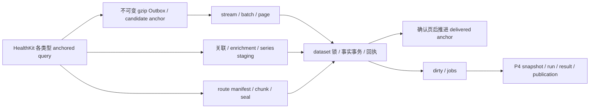
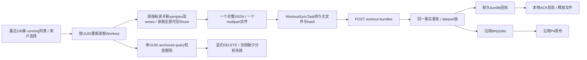

# RAI V2 — RQrun 对标 Workout 同步专项审查

审查日期：2026-11-01，Asia/Shanghai。性质：READ ONLY 工程审查；唯一仓库写入是本报告。代码定位均相对于 /Users/tp/raI，指本轮工作树，不能仅凭 HEAD 重建。只使用合成数据、独立模拟器和一次性 PostgreSQL 18；没有读取真实 HealthKit、连接生产数据库、执行数据重置、部署、commit 或 push。用户明确要求只新增报告，因此本轮未更新 IMPLEMENTATION.md。

## 1. Executive Summary

**结论：FAIL。** 共记录 16 项问题：2 项 P0、8 项 P1、6 项 P2。

已经实现真正的单 Workout 逻辑上传实体，并非仅改 JSON 外观：当前产品使用一个 multipart 请求携带 Workout、scalar samples、quantity series 和多条 Route；后端同一事务写入事实、关联、封口路线、提交日志、dirty/job 和回执，COMMIT 后才 ACK。数据库以 dataset + HKWorkout UUID 唯一，分析继续通过 P4 的快照、版本化 run/result、generation 和 publication 发布。

但不能认定已经实现可靠的 Workout-centric Incremental Sync。发现两项 P0：未排序的新旧快照会永久删除有效新样本；未知 UUID 删除没有屏障，随后旧上传能复活该 UUID。此外，v3 删除不触发派生状态失效；增量发现入口被最近 100 条手动列表替代；断网后的回执 404 会终止自动恢复；缺失必填数值可静默落为 0；迟到 metadata/provenance 没有可达上传路径。下文逐项给出定位、复现与最小修复方向。

本报告将正常路径已有保障与新路径缺陷分开：四个并发相同 bundle 返回相同耐久回执、回执写入失败整笔回滚的审查探针通过；P0/P1 并非由缺少编译、mock 或数据库环境推测得出。现有套件通过不能覆盖新增反例。

RQrun 基准仅采用用户提供的单次户外跑步抓包事实及仓库参考文档。不将其服务器去重、事务、重试、授权解释或所有运动覆盖视为已证实。RAI 无需模仿 RQrun 的 token URL、multipart 形式或第三方派生步频。

## 2. 改造范围

### 2.1 Git 基线

| 项目 | 本轮实测 |
|---|---|
| 分支 | main |
| HEAD | aeb769c82f6af6c47d7cac82874f48ff37f635fc |
| upstream | origin/main；本地记录同 HEAD，ahead=0、behind=0 |
| 工作树 | 不干净；入口 45 个 tracked 修改、20 个 untracked 文件 |
| staged diff | 空 |
| unstaged diff | 45 文件，1,730 行新增 / 2,518 行删除；不含 untracked 内容 |
| 已提交未合并 | 本地 branch -vv / --all 只见 main 与同位置 origin/main；相对该引用为 0。未 fetch，不证明服务器实时状态或其他远端分支 |
| 本次归属 | 以 HEAD 到工作树的差异及新增文件为改造集合；历史分析、P3 storage、jobs 文件仅为依赖审查，不冒充本次新增 |

最近相关提交：aeb769c 原生运动详情/本地开发；b7f869b 全量跑步 statistics 和只读 metadata；1783517、945db85 历史审查修复；62511f9 P4/P5；8e40573 iOS 回执校验；537b526 P3/P3.5。新 WorkoutBundle、schema 14/15 和 per-workout 改造尚未提交，不能把此前报告的 PASS 绑定到当前 HEAD。

已阅读 AGENTS.md、原架构方案相关不变量/采集/事务/删除章节、ARCHITECTURE.md、IMPLEMENTATION.md、V2_PHASE0_BASELINE.md、P3 冻结合同、P4 算法合同、sync-v2/v3 相关契约、最近 per-workout 报告及 bundle evidence，并与源码交叉检查。历史 V2_PER_WORKOUT_SYNC_RESULT.md 已自称 Protocol 2 历史报告；其 page/stream 通过结论不能验证当前 Protocol 3。

### 2.2 核心模块与实际调用链

产品入口：ProductViews.WorkoutSyncView → SyncModel.loadWorkouts / syncWorkouts / retry → SyncCoordinator.syncWorkout → HealthKitClient.workout / bundleSamples / bundleSeries / bundleRoutes → Normalizer → WorkoutBundleAssembler → OutboxStore.savePayload + setBundle → BackgroundTransfers → RAIAPIClient。

后端：POST /v2/sync/workout-bundles → Bearer Authenticate + Admit + 进程上传槽 → multipart/严格 JSON/DTO 校验 → Store.ImportWorkoutBundle → dataset 行锁/epoch/collector 重验 → workouts、health_samples、workout_samples、series、route/chunk/points → dirty_scopes/jobs/change_events/workout_imports → COMMIT → ACK。

分析：jobs.Claim → jobs.Process → LoadAnalysis（REPEATABLE READ）→ StartAnalysisRun → analysis.Analyze → PublishAnalysis（dataset/job/dirty 锁、lease/fencing、generation CAS、results/publication/job 原子提交）→ GET /v2/analysis/workouts/{id}。上传不等待分析。

Worker、分析算法与绝大多数旧 storage 文件没有本次 diff。新增代码直接复用既有表和 P4 发布器，正常分析不是空 handler。完整增量文件清单见本报告末尾；备份脚本/角色/文档为 schema 版本连带调整，不属于 HealthKit 读取算法。

## 3. 架构对比

### 3.1 改造前：HEAD 的 P3/P3.5



### 3.2 改造后：当前可达路径



单 Workout 聚合是正确简化方向；不需要普通跑步在网络层逐 sample 关联、逐 Route 分块。内部 chunk/manifest 可继续服务已有封口投影和分析读取，不代表手机仍在多次上传。当前发现、删除和迟到补充的语义却没有随网络简化完整迁移。

| 旧机制 | 当前状态 | 是否应保留其正确性作用 |
|---|---|---|
| stream / batch / page | HTTP 注册移除，旧 Go methods/表、Swift builders/pipeline 仍在，主要由历史测试和 Probe 调用 | 不必保留原网络形态，但必须补回发现游标、可靠待办和乱序保护 |
| association | 网络请求移除；bundle.samples 成员关系在事务内写 workout_samples | 合理，复合 FK 与单一 Workout 关联仍有必要 |
| route manifest / chunk / seal | 外部端点移除；服务端按 5,000 点切内部块，调用 rai_route_append_chunk / rai_route_seal | 仍保护投影和 sealed 输入；不能说数据库 chunk 已全部删除 |
| series chunks / seal | 外部端点移除；在导入事务内写 sealed series | 父 sample、单位、区间和内容身份仍必须验证 |
| enrichment | 外部路由及客户端发送路径移除；旧 helper/storage 仍留存 | 迟到 metadata / 来源版本仍需版本化语义，当前功能断裂 |
| 双 hash chain | 网络文件现由 bundleSHA256 绑定；Route 内部内容链/载荷链仍在，二者输入均为 canonical 点内容 | 可保留内部完整性；不应将 canonical 块摘要描述为原 HTTP gzip 块摘要 |
| tombstone / dataset commit_rev | 表及普通导入检查保留 | 必须保留；v3 未知删除和快照差分违反其完整语义 |
| P4 publication | 沿用原实现 | 必须保留；v3 删除漏 dirty，使其输入变更通知失效 |

旧路由实际返回 404；不能用直接调用旧 Store 的通过用例证明旧客户端还能同步。启动/列表读取会 purgeLegacyPages；已捕获的旧页不能自动通过新接口交付。升级与重置风险见 RQ-010。

## 4. RQrun 对标矩阵

| 审查项目 | RQrun 参考 | RAI 实际实现 | 结论 |
|---|---|---|---|
| Workout 发现 | 用户选择可见 Workout；推荐 anchored 增量 | 最近 100 条 running 列表；单 UUID anchor 只检查删除 | FAIL：不是完整增量发现 |
| UUID 身份 | HKWorkout.uuid | workouts 主键 dataset_id + workout_uuid；样本/路线各自 UUID | PASS：数据库唯一约束存在 |
| Route 读取 | HKWorkoutRoute + 全部 GPS | descriptor 异步序列，逐 Route 等待完成；空 Route 被跳过 | PARTIAL：有完成性/原顺序边界问题 |
| 心率读取 | 原始时间序列 | HeartRate 关联 sample + 多值 series；statistics 独立保存 | 实现存在；真机 NOT RUN |
| 功率读取 | RunningPower | 独立类型查询，W，异常不丢其他类型 | 实现存在；真机 NOT RUN |
| 步频读取 | 抓包中存在步频数组，原始来源未被源码证实 | StepCount 原始 count；没有伪造 running cadence | 步数支持；独立原始步频未证实，不应强制推导 |
| 单次上传 | 单 Workout 一个逻辑文件 | 一个 multipart 请求，一个事务，protocolVersion=3 | PASS；gzip 不支持 |
| 本地 Outbox | RQrun 内部实现未证实 | 原子 state.json + 不可变文件 + task UUID/hash | PARTIAL：已封包可恢复，网络失败分类有缺陷 |
| 服务端幂等 | 内部规则未知 | Workout/sample/route 内容冲突拒绝；hash 历史回执 | 普通重复 PASS；乱序快照/未知删除 FAIL |
| 异步分析 | 上传后查询处理状态 | ACK 后沿用 P4 job/publication，查询单 Workout 分析 | 正常链路 PASS；删除失效 FAIL |
| 失败恢复 | 抓包不足以证明 | POST 不确定结果后 GET 原 hash；后台 session 可重连 | PARTIAL；场景 A 自动恢复 FAIL |

### 4.1 数据读取逐项核对

| 数据 | 真实来源/单位/处理 | 审查结果 |
|---|---|---|
| Workout、UUID、事件、活动 | HKWorkout；HKWorkoutEvent 原始类型/顺序；微秒时间；统计独立数组 | 未用平均心率替代逐点样本；未用汇总距离冒充 GPS |
| GPS | 关联 HKWorkoutRoute，HKWorkoutRouteQueryDescriptor 的 async sequence；经纬度原 Double；时间转微秒 | 会等待 async 序列完成；并非直接误用 done；多个 Route 串行读取。零点、count、限额见 RQ-012 |
| 心率 | HeartRate，count/min | predicateForObjects(from: workout)，按 sample.startDate 排序；series 按父 UUID 分组 |
| 距离、速度、功率 | DistanceWalkingRunning m；RunningSpeed m/s；RunningPower W | 显式类型，不跨 Workout 用时间重叠猜关联 |
| 步数 | StepCount，count | 不把步数或配速冒充 Watch 步频；服务端 cadence 在没有真实对应输入时 unavailable |
| 跑步动态 | RunningStrideLength m；GroundContactTime ms；VerticalOscillation m | 单位转换代码和合成单元测试覆盖；原始多值 series 保留各自开始/结束时间 |
| 能量 | ActiveEnergyBurned / BasalEnergyBurned，kcal | 独立查询；缺少此指标不应阻止 Workout |
| 天气 | metadata 中 Temperature 转 degC、Humidity 为比率 | 正确读取可用源字段；不是外部天气反推 |
| 来源/设备 | payload 只有 source.bundleID；列表中 sourceName/deviceName 仅用于 UI | Watch 硬件/软件/来源版本没有上传，见 RQ-007 |

Normalizer 保留 Double，时间明确取整至微秒，不应声称保留亚微秒精度或 HealthKit 最初所用单位字符串；保存的是规范单位下的原始事实。没有发现第三方平滑、降采样或生成健康数据替换 Watch 原始数据。单点 quantity 是父 sample 的 HealthKit quantity，成功读取的多点 series 单独保存；series 错误会保留 scalar 并记录本地 error，后续需用户重读补齐，没有可靠自动细项待办。

HealthKit 无法通过空结果识别读取权限被拒。[Apple 授权状态说明](https://developer.apple.com/documentation/healthkit/hkauthorizationstatus)支持这一限制；空结果也不能反向证明指标 available。Route descriptor 正是 Apple 提供的 async 查询方式，见[官方 descriptor](https://developer.apple.com/documentation/healthkit/hkworkoutroutequerydescriptor)和[路线读取说明](https://developer.apple.com/documentation/healthkit/reading-route-data)。不能仅因没有显式 done 参数就判定此实现漏等回调。

### 4.2 Anchor、Outbox 与场景 A–E

没有发现当前新路径在保存 Outbox 前推进 anchor 的代码：nextWorkoutAnchor 只在正常上传 ACK 后尝试保存。但它不是发现新 Workout 的游标；也没有和 task 一起持久化 candidate anchor，恢复原文件的分支不会补交该候选值。这样的保守落后可能重读，不证明全局增量发现安全。

OutboxStore 以同一个 state.json 原子替换权威状态，先写 payload、再写引用；写失败不更新内存。已封包的 Workout UUID/hash/boundary/file 可跨重启恢复。actor running 限制当前 coordinator 并发；稳定 background URLSession 和 taskDescription 可重连在途上传。未封包的 PREPARING 在重启后变成 interrupted，必须人工重试；没有声称从 HealthKit 回调中途自动续读。

| 场景 | 源码/合成验证结论 | 设备边界 |
|---|---|---|
| A 请求未提交，网络失败 | FAIL：POST 网络错误后 GET 404 覆盖原可重试错误，任务转 FAILED，foreground recovery 不处理 | 真机断网 NOT RUN |
| B 已提交但 ACK 丢失 | 服务器原 hash GET 与重复提交返回原回执；审查并发/回滚探针通过 | 完整 iPhone 丢 ACK E2E NOT RUN |
| C 上传时进程退出 | 已持久文件/task 可恢复；准备期仅记录 interrupted 供人工重试 | iPhone 强杀、锁屏、OS 后台恢复 NOT RUN；macOS 旧 page 测试不替代 |
| D 两个 Observer 通知 | 当前根本没有 Observer 注册；不能称此场景 PASS。单 coordinator running + task UUID 可防当前显式调用重复 | NOT RUN / 未实现通知路径 |
| E 读取尚未完成 | 样本/series/Route await 完成后才组包；单项失败仍可上传 partial | 零点/空指标与服务端完整性标记不充分，见 RQ-011/012 |

### 4.3 API、事务、安全与容量边界

请求为 POST multipart/file JSON；schema 使用 protocolVersion=3，没有另一个 schema_version。样本、Route、series 的单位与身份白名单有校验；未知/重复 JSON key 与 null 拒绝。但必填字段遗漏没有被严格拒绝，见 RQ-006。客户端没有手工 Content-Length，由 URLSession.fromFile 发送；实际手机链路的 header/代理行为 NOT RUN。

身份隔离是 dataset，而非任意请求中的 user_id：设备 Bearer 查得 Principal.DatasetID，事务重验 dataset/epoch/collector，跨 dataset 不可信正文不能改变写入目标。workouts 复合主键和子表复合 FK 提供数据库层约束。正常 duplicate/conflict 不是 Go 单独查重。

TLS：Release 客户端只接受 HTTPS；Debug HTTP 仅配置主机。Keychain 使用 AfterFirstUnlockThisDeviceOnly。服务器可配置原生 TLS，并有 Bearer 撤销/角色测试；本轮未接入实际家庭入口，因此不把配置存在记为生产 HTTPS 验收。没有 token URL 参数或本轮输出真实 token；没有在所审业务日志发现健康值、GPS/请求正文或 DSN 输出。现有设备 token 为持久凭证，支持撤销，没有 OAuth 短期 access/refresh 流程；属于已知产品范围，不能声称已实现 token 刷新。

进程全局 2 个上传槽、单设备 1 个槽确实在读 body 前取得；v3 没有调用旧持久 AcquireUpload 租约，因此 handshake 的 datasetUploads/deviceUploads 不证明多 API 实例共享限额。当前单实例范围内有界，多实例全局限额 NOT VERIFIED。样本上限 50,000，Route 16，series/Route 各 1,000,000 点，file 32 MiB；P4 快照仅允许 250,000 observations/Route 点，接收上限不等于可分析上限。超出分析能力的事实仍保留，但客户端目前只把 analysis_not_ready 显示为 analyzing，没有按 ACK job IDs 查询终态失败。这属于需补齐的可观察性风险。

JSON 路径多次遍历：RejectNulls 的通用解码、DecodeStrictJSON 的 token/重复 key/精确字段检查及 typed decode、HTTP 和 Store 重复 Validate。存在多份 Data/String/JSON 数组复制；Swift JSON.data 逐层构造 Data/String，server/route canonicalization 也重复；本轮未测进程峰值内存。未发现足够证据认定新逻辑整体 O(n²)，主要是 O(n) 处理、排序和逐 series 数据库往返。删除 N 个 sample 时旧 association-deleted trigger 仍逐个生成 dirty/job，随后 bundle 再生成一次；因此单 bundle 永远只有一个 analysis job 的文档承诺不适用于此情形。

## 5. 缺陷清单

按 P0 → P1 → P2 排序。FAIL 的探针是对正确行为的断言失败，不是把缺陷复现记为功能通过；附加探针只存在 /tmp 审查副本，未加入工程。

### RQ-001 · P0 · 晚到旧快照可永久删除有效的新样本/路线

- 位置：apps/server/internal/storage/postgres/workout_bundles.go:149、:165、:396、:420、:432；syncing/workout_bundle.go:37；SyncCoordinator.swift:149、:206。
- 触发：新包包含 A+B 并标记该类型完整；较早采集、从未被服务端记录过 hash 的旧包 A 晚到。请求没有 observation version、base revision/CAS 或 stream 顺序。dataset 锁只排序到达，不排序采集先后；手机取消后台等待后重建包也能产生此条件。
- 影响：B 被当作 HealthKit 删除写永久 tombstone；随后重放真正的新包返回 sample_deleted。Route 集合同理。已确认的 raw 被无来源删除，不能靠重试修复。
- 复现：TestReviewStaleSnapshotMustNotDeleteNewerFacts。先 Import(A+B)，再 Import(A, completeSampleTypes=[kind])，观察 health_samples 从 2 变 1；再 Import(A+B) 得 sample_deleted。真实隔离 PG/race 已失败复现。
- 修复建议：最小安全方案是停止用普通可见快照缺席生成永久删除，改传明确 HKDeletedObject/来源删除待办；若确需完整快照替换，必须验证覆盖范围和因果版本，以 CAS 拒绝陈旧快照，保留原回执。
- 对应测试：新/旧不同 hash 乱序、相同内容不同编码、取消后旧后台上传晚到、Route 子集、权限范围缩小；所有测试必须验证原新事实未消失且可重试。

### RQ-002 · P0 · 未知 Workout 删除不建立屏障，旧上传可复活 UUID

- 位置：apps/server/internal/storage/postgres/workout_bundles.go:483–498；ios/RAI/App/SyncCoordinator.swift:295–305。
- 触发：本地已捕获删除，DELETE 先于原待传 bundle 到达；服务器尚无 Workout。
- 影响：DELETE 返回 404，客户端将它视为已删除；数据库没有 tombstone。迟到原包正常创建已删除的 UUID，违反 delete-wins。已有 UUID 删除检查不弥补这个窗口。
- 复现：TestReviewUnknownDeleteMustFencePendingUpload：准备包但不提交 → DeleteWorkoutBundle → workout_not_found → Import 原包成功。PG/race 已复现。
- 修复建议：未知删除也在同一事务保存永久 Workout tombstone、提交日志及稳定回执；无旧范围时不伪造分析范围。客户端只确认真实删除回执，不把 404 当屏障已存在。
- 对应测试：DELETE-before-first-upload、并发 DELETE/POST 两种顺序、重复未知删除、旧 epoch/collector 被拒；验证没有 Workout 可复活。

### RQ-003 · P1 · v3 Workout 删除没有使已发布派生状态失效

- 位置：apps/server/internal/storage/postgres/workout_bundles.go:499–554；migrations/00012_analysis.sql:115；storage/postgres/analysis_query.go:AnalysisCurrentSQL。
- 触发：Workout 及 training_state 已发布后调用新 DELETE。
- 影响：只删 raw/route、推进 revision 和 change event，未登记旧时间范围 dirty/job。级联删除 association 的 trigger 查不到已删除父行；训练状态仍作为 clean current 返回，旧 Workout publication 也没有清理 job。原 P4 直接 batch 删除路径具有失效逻辑，不能替新端点兜底。
- 复现：TestReviewV3DeleteMustInvalidatePublishedState：Import → 真实 jobs.Process 发布 Workout/state → DELETE → CurrentTrainingState 仍成功；jobs 总数删除前后均为 2。PG/race 已复现。
- 修复建议：删除前读取父时间范围，在同事务登记 Workout dirty/job，复用 state 依赖传播；后续 Worker 按已删除输入清理 publication。保留不可变历史。
- 对应测试：v3 HTTP DELETE 后立即隐藏 workout/state；Worker 恢复后正确重发；代际并发、删除事务故障回滚、P5 反馈失效。

### RQ-004 · P1 · 没有可达的 Workout 增量发现和持续删除捕获

- 位置：ios/RAI/App/HealthKitClient.swift:104–139；RAIApp.swift:79–89；SyncCoordinator.swift:49–83、:125–135；ProductViews.swift:713。
- 触发：超过 100 条历史记录、旧 Workout 迟到更新、已同步 Workout 在 HealthKit 删除。
- 影响：产品每次只枚举最近 100 条 running；没有分页或全局 anchored discovery。readWorkout 必须先有 UUID 且显式再次同步才执行；删除的 Workout 已不在选择列表，foreground recovery 又不读 HealthKit。因而它的删除即使存在 HKDeletedObject 也缺少可靠执行入口。没有 Observer 不是手动产品本身的缺陷，缺少正式增量发现/删除待办才是本任务失败点。
- 复现：静态可达性已确认：全仓 App 无 HKObserverQuery/enableBackgroundDelivery 调用；read(type:) 只有声明和实现，当前 coordinator 不调用。构造 101 条合成发现结果/已知 UUID 删除应加入 mock 测试；真实 HealthKit 部分 NOT RUN。
- 修复建议：恢复固定谓词的 Workout anchored discovery，原子持久化发现/删除意图与 anchor；保留用户选择作为上传策略。已知 pending/删除任务应不依赖可见列表，历史分页不能截断。
- 对应测试：101+ Workout、重复通知、发现后落盘失败、准备期强杀、已同步对象被删、迟到旧日期 Workout、重启后只处理未交付项。

### RQ-005 · P1 · POST 网络失败后的 GET 404 把可重试任务变成终态失败

- 位置：ios/RAI/App/SyncCoordinator.swift:239–240、:259–265、:56–79；RAIApp.swift:238–242；SyncCore/OutboxStore.swift:18。
- 触发：POST 没到服务器，或已到但尚未提交，客户端遇网络错误；随后原 hash GET 返回 workout_import_not_found。
- 影响：GET 的 404 覆盖原可重试错误；phase=FAILED，前台自动重试循环不再执行，recoverPending 也忽略该失败。原包尚在，人工重试可恢复，但场景 A 所要求的自动继续失败。
- 复现：模拟器 TestRQrunOfflineThen404RemainsRecoverable 使用合成 HealthKitReading、抛 notConnectedToInternet 的 FileUploader、返回 404 的 URLProtocol。结果 phase 实际 failed；再调用 recoverPending 上传次数仍 1，预期 2。两个断言失败。
- 修复建议：恢复查询 404 表示尚未找到回执，应保留原网络错误和原文件，进入 retry pending/backoff；区分永久 4xx 和未知提交结果，不重建包。
- 对应测试：POST 前断线、服务端提交中 GET 404、提交后 GET 200、GET 自身超时、重启恢复、429 Retry-After。

### RQ-006 · P1 · v3 严格解码遗漏必填存在性，缺值能被提交为 0

- 位置：apps/server/internal/httpapi/server.go:306–314；syncing/protocol.go:248、:274；syncing/workout_bundle.go:82、:149、:168；Quantity.Value 和 WorkoutBundlePoint 非指针数值。
- 触发：从合法包删除 samples[0].quantity.value 或 routes[0].points[0].latitude；也可遗漏整个必填 samples 数组。
- 影响：DecodeStrictJSON 检查未知/重复 key，但未调用原 Event/Workout 必填校验；Go 零值通过 Validate。没有提供的健康值/坐标被当作真实 0 持久化并 ACK。不是合法单位换算，也不是可接受的缺失表达。
- 复现：TestReviewMissingRequiredFieldsMustReject 三个 HTTP 子用例实际均 200，预期 422；已在 PG/race 执行。样本 value 与 latitude 漏值均可形成有效但虚构的规范投影。
- 修复建议：逐 DTO 验证必填 key，或用指针/自定义 Unmarshal 区分未给与显式零；复用递归 Event、quantity、Route/series point 的严格存在性校验，明确 samples 必填且允许 []。
- 对应测试：每个必填字段逐一删除；合法 0 必须接受；遗漏、null、错拼写、重复字段必须事务前拒绝且无任何事实/job/receipt。

### RQ-007 · P1 · enrichment 路径退役后，迟到 metadata 与设备 provenance 没有替代通道

- 位置：ios/RAI/App/HealthKitClient.swift:373–402；SyncCoordinator.swift:135–136、:219；httpapi/server.go:48–53；storage/postgres/workout_bundles.go:56–65。
- 触发：同一 Workout 后补 metadata/statistics；或要求保存 sourceRevision/Watch 硬件和软件信息。
- 影响：Normalizer 把可变化 metadata 放进不可变 Workout 哈希，再次上传会 workout_identity_conflict，样本/Route 新增也随整个事务被拒绝。workoutProvenance 只被测试调用，当前上传不携带来源 name、device 型号/硬件/软件/来源版本；其注释指向已移除的 workout-enrichments 路由。列表显示设备名不等于服务端保存来源事实。
- 复现：rg workoutProvenance 仅见定义和 AppTests；Go 改包 metadata 保持 UUID 即命中第 65 行冲突。旧 enrichment tests 直接调 storage，不验证新客户端可达性；当前真实迟到 metadata E2E NOT RUN。
- 修复建议：保持核心 Workout 身份不可变，在 bundle 内引入有明确 source/version 的追加补充事实并同事务处理，或恢复受版本控制的 enrichment 能力；设备/来源字段显式进入被支持的载荷，禁止默默拼回旧身份。
- 对应测试：原核心字节重试、追加/陈旧/冲突 enrichment、补充与 late sample 同包、设备来源字段端到端落库、删除后补充被拒。

### RQ-008 · P1 · handler 声称 120 秒，但实际 HTTP 读超时仍只有 15 秒

- 位置：apps/server/cmd/rai/main.go:145；httpapi/server.go:158–165；SyncCore/RAIAPIClient.swift:37；BackgroundTransfers.swift:24。
- 触发：慢速蜂窝、暂停或较大文件使 body 传输超过 15 秒；处理/ACK 超过 25 秒也受 WriteTimeout 影响。
- 影响：context 120 秒不能延长 http.Server 的 socket deadline；合法包被读为 body_read_failed，属于当前非 retryable 400。客户端请求 60 秒、resource 3600 秒亦不能放宽服务端 deadline。
- 复现：TestReviewBundle120SecondBudgetMustAllow16SecondUpload 使用与 main 相同 ReadTimeout/WriteTimeout，分两段发送合法 multipart，中间 16 秒。约 15.006 秒得到 HTTP 400，预期 200；PG/race 执行。
- 修复建议：按真实上传预算协调 header/body/write/request/resource 与代理超时，保留慢请求和吞吐限额；网络读超时不得错误成为永久 payload 失败。
- 对应测试：带真实 http.Server 配置的低速上传、提交后慢 ACK、客户端/代理 timeout、恢复原 hash 回执。

### RQ-009 · P1 · 异常 ACK 计数未验证，客户端释放唯一原包

- 位置：ios/RAI/App/SyncCoordinator.swift:310–325、:270–282；SyncCore/Wire.swift:35–37。
- 触发：回执 counts 字段存在但为负数/错误类型；analysisJobIDs 非数组时 list 退化为空也可穿过 allSatisfy。
- 影响：当前 validate 只检查 counts key 存在，未验证类型、非负、上限或与包的关系；将异常回执标为 ACK 后释放并 GC 原上传文件，失去安全恢复依据。当前服务端正常输出不触发此错误；这是客户端对异常/不兼容响应的失败关闭缺口，不宣称已发生网络攻击。
- 复现：模拟器 TestRQrunNegativeACKCountsCannotDiscardBundle 提供负数 counts，其余身份正确；任务没有 receipt_mismatch 且 bundleFile 已清除，两个断言失败。
- 修复建议：用 typed receipt DTO 或完整字段验证，验证 bool、非负整数、数组存在性/UUID、状态与 job 一致性后再持久 ACK/回收；保留 hash/receipt 审计字段。
- 对应测试：逐个错误类型/缺字段、负数/溢出、缺失或非数组 jobs、queued 空 jobs、合法零和 no-op。

### RQ-010 · P1 · 必须清空旧事实的升级路径会移除屏障和用户训练事实，却保留 epoch

- 位置：contracts/sync-v3.md:设计目标；docs/IMPLEMENTATION.md:456；scripts/rai-reset-v2-data.sh:1–75；SyncCore/OutboxStore.swift:298–319。
- 触发：按当前文档将非空 v2 数据集切到 v3，并运行显式重置脚本。
- 影响：脚本不只删可重算数据，还 TRUNCATE training_overrides、training_executions、training_commands、参数、tombstone 和回执；保留 datasets/devices/collector leases，也就保留旧 dataset/collector epoch。旧文件可再次被接受；客户端已完成任务仍可能显示已同步。自动 purge 旧页又移除尚未交付的数据。该方案不能证明无损升级或旧请求 fencing；脚本有显式确认并不自动补足这些语义。
- 复现/证据：只读核对脚本 TRUNCATE 清单与保留清单即可确认；**本轮没有执行重置脚本**，真实升级/客户端对账 NOT RUN。此项是当前文档规定的发布阻断项，不是声称普通新库上传会自行清库。
- 修复建议：首选版本兼容读取/定点转换或独立全新 dataset，在明确保留用户训练事实的前提下切换；任何批准的破坏性重置必须改变 dataset/collector 代次、fence 旧文件，并明确客户端重新绑定与人工确认。不要让每次同步依赖重置或迁移。
- 对应测试：独立合成非空 v2 数据集、旧待传页、已删除 UUID、用户 override/execution、schema 升级后旧请求拒绝与新客户端状态重建。此轮不实施。

### RQ-011 · P2 · 空指标和空路线被标为 available，无法准确表达 partial

- 位置：ios/RAI/App/SyncCoordinator.swift:145–150、:206–207；SyncCore/WorkoutSync.swift:WorkoutCoverage；refreshAnalysis:341–346。
- 触发：某指标成功返回 []，或 route 查询没有可见点。
- 影响：coverage=available / sampleCount=0，missing 为空。虽没有据空类型触发删除，也没有断言拒绝授权，但无法区分没有可见值、尚未到达、failed 与 complete；coverage/UI 对完整性的解释失真。
- 复现：模拟器 TestRQrunEmptyQueriesRemainUnknownCoverage：所有类型返回空；RunningPower 实际 available，missing 不含该类型，两个断言失败。
- 修复建议：明确 empty/unknown/missing、partial、failed 等状态，不把空查询解释成授权；将未完成细项及重试意图持久化，服务端也应能保留 coverage，而非仅有本地诊断。
- 对应测试：功率缺失而 HR/GPS 存在、权限不透明、全部零点、单指标失败、重启后补齐、发布状态与原始覆盖分离。

### RQ-012 · P2 · Route 完整性没有逐 Route 证明，零点 Route 被遗漏

- 位置：ios/RAI/App/HealthKitClient.swift:171–190；SyncCoordinator.swift:184–216；server missingWorkoutChildren:432–449。
- 触发：多 Route 中一条返回零点、路线枚举触达 100 限额、读取时点数不符合 route.count；另有至少一条非空 Route。
- 影响：空 Route 被 continue 丢掉，completeRoutes 只依据总点数>0；与服务器按缺席删除结合，可把旧有效 Route 写成永久墓碑。枚举最多 100 且无截断识别；未核验每条 Route 声明 count。异步等待本身正确，问题在完整性判定。
- 复现：源码路径确定；构造旧 A+B、新读取 A 零点/B 非空，当前包只含 B 且 completeRoutes=true，服务端差分会删 A。真实 HealthKit 暂不可用/点数变化 NOT RUN，不能把它说成真机已发生。
- 修复建议：逐 Route 记录声明数/实际数/读取结果，任何范围不确定时不得给整组 authoritative 标志；空 Route 保留 unknown 待办；枚举用上限+1并拒绝超限，或者安全分页/显式阻塞。
- 对应测试：多 Route 一条空/报错、分批回调、取消、数量截断、迟到 Route；验证既有 sealed Route 不被误删。

### RQ-013 · P2 · 新入口拒绝时间回跳原始 GPS，与既有 P4 规则不一致

- 位置：apps/server/internal/syncing/workout_bundle.go:167–174；docs/P4_ALGORITHM_CONTRACT.md 的 2026-10-29 addendum；integration/workout_detail_test.go:203。
- 触发：合法 GPS 序列相邻 recordedAtUs 回退，坐标等字段均合法。
- 影响：v3 Validate 直接 422 整包；旧协议允许保留 raw 顺序，由 workout.features/v2 跳过不递增连接。客户端又把 422 当永久错误；并未仅让 Route 质量 partial。
- 复现：TestReviewRouteClockRegressionMustPreserveRaw，第二点时间设为首点-1 微秒，实际 unsupported_payload。PG 环境中的 DTO 探针失败；既有 P4 回归通过也覆盖不到 v3。
- 修复建议：保留来源点/sequence，不排序或删除以修饰 raw；沿用 P4 已冻结的连接质量规则，或者显式版本化新语义并保留可恢复载荷。
- 对应测试：v3 HTTP 导入回跳/相等时间、raw 回读顺序、其他 Workout 指标正常发布及 skippedNonIncreasingTimeConnections。

### RQ-014 · P2 · 单请求路径未实现压缩，普通和长跑都承担原始 JSON 成本

- 位置：SyncCoordinator.swift:219–260；SyncCore/WorkoutBundle.swift:multipart；httpapi/server.go:260–262。
- 触发：任何 bundle 上传；Content-Encoding=gzip 会被 415 拒绝。
- 影响：本轮 40 分钟合成 JSON 约 1.27 MB、gzip 约 0.15 MB；4 小时约 7.59 MB、gzip 约 0.9 MB。现有 gzip helper 仅历史路径使用，不代表 v3 已压缩。上限后直接 bundle_too_large，没有可选大对象退化路径。
- 复现：源码与本轮实际 Swift/Go 压缩对照；压缩仅离线测量，**没有把压缩结果冒充当前 HTTP 上传**。
- 修复建议：为普通单逻辑请求增加有 wire/decoded 双限额的压缩合同；先验证常见跑步无需网络 chunk。仅在实测超限时增加可选有界 fallback，避免恢复逐 sample 请求。
- 对应测试：gzip 正常/损坏/压缩炸弹/解压超限、原字节重试及摘要定义、40 分钟/4 小时低速传输。

### RQ-015 · P2 · multipart 只限制 file 缓冲，未限制整个 body，拒绝前仍读完超大 part

- 位置：apps/server/internal/httpapi/server.go:278–300，尤其 :289 与 :294 的 part.Close。
- 触发：file 大于 32 MiB 或额外 part 很大。
- 影响：LimitReader 只控制已缓存字节；multipart.Part.Close 会 drain 余下 part，返回 413/422 前仍消耗任意额外输入。没有包裹整个 r.Body 的 MaxBytesReader；文档所称请求上限与实际读取上限不一致。并非已验证进程内存无限，内存与 wire 消耗应分别表述。
- 复现：TestReviewMultipartSizeMustBoundBytesRead：40 MiB 合成 file，状态虽为 413，但计数 reader 实际被读 41,943,286 字节，超过 33,554,432 的 file 限额；PG/race 已复现。
- 修复建议：进入 multipart parser 前设置全请求 wire 上限，含可控 framing 开销；超限关闭/中止 body，不能为了 Close 完整 drain 任意大小；仍保持 part 数量/字段白名单。
- 对应测试：file 超限、超大额外 part/preamble/epilogue、无 Content-Length/chunked、边界大小，断言实际读取量和无业务写入。

### RQ-016 · P2 · 合法 4 小时规模导入成功，但 P4 快照超时进入失败重试

- 位置：apps/server/internal/storage/postgres/analysis_input.go:18–66（LoadAnalysis）、:370（AnalysisSamplesSQL）；storage/postgres/store.go:44（连接 statement_timeout=2s）；jobs/worker.go:147–176。
- 触发：本轮合成 4 小时、26,382 个 scalar samples / 13,698 个 GPS 点，远低于协议及 P4 点数上限。
- 影响：Import 已提交约 7.59 MB 源包及耐久 ACK，但 jobs.Process 首次执行和独立复跑都停留 queued / analysis_storage_transient；客户端分析状态没有成功发布。这证明当前长跑边界未通过，不能用 5,000-sample 测试通过外推。
- 复现：TestReviewSyntheticDurationMatrix/240。独立复跑 PG Import 9,527 ms；分阶段探针 LoadAnalysis 在 2,005.574 ms 返回 SQLSTATE 57014 / canceling statement due to statement timeout。前一次完整矩阵和后一次独立运行的失败均保留。随后 pgx QueryTracer 确认超时发生于 AnalysisSamplesSQL（workout_samples/health_samples/series_uploads 关联读取），2,008.567 ms 返回同一 SQLSTATE；不是算法计算或 publication 超时。
- 修复建议：先定位实际超时 SQL 的执行计划、扫描/排序行数和数据分布，优化同 Workout 的关联读取与索引/统计信息；再评估有界 snapshot 预算，不能直接无界延长超时或截断 raw。保留当前 job/事实并验证重试可最终成功。
- 对应测试：20–240 分钟矩阵、冷/热统计、同样数量的 multi-point series、真实 claim/重试/发布、API 显示分析终态失败；记录每阶段时间而非只报成功上传。

## 6. 测试结果

本节后续表格记录本轮命令、完整套件最终状态及性能实测；历史报告数值不替代本轮结果。复现文件只位于 /tmp/rai-rqrun-go-copy 和 /tmp/rai-rqrun-ios-copy，测试使用当前业务源码副本；新增探针断言正确行为，失败保留，不修改实现使其通过。

### 6.1 环境与已有门禁

本机：macOS x86_64，Xcode 26.6 / Build 17F113；新建独立 iPhone 12 Pro Max 模拟器，iOS 26.5。真实 iPhone 12 Pro Max 在 devicectl 中为 connected；报告不记录设备个人名称/标识。Go/PG 验证使用仓库 test-remote.sh / remote-test.sh：fnOS/N100 host Go 1.27.3，每次创建独立、带本次 label 的 PostgreSQL 18.6 容器和随机临时数据库，测试结束删除所拥有的容器/卷。没有使用已有服务的数据库 URL。

PG 实测 fsync=on、full_page_writes=on、synchronous_commit=on、data_checksums=on、shared_buffers=128MB。不是 mock、内存数据库或关闭耐久性的数据库。

| 命令/验证 | 状态 | 本轮结果与边界 |
|---|---|---|
| git status --short --branch；branch -vv；log --all；diff；diff --cached；ls-files --others | PASS（只读检查） | 工作树基线见 §2；未 fetch/merge |
| swift test --scratch-path /tmp/rai-rqrun-swift-review | PASS | Swift Testing 68 tests / 8 suites，另有 WorkoutBundleTests 的 2 项 XCTest；合计 70 个列出用例。包含大量旧 page/stream 测试，不能视作 70 项 v3 E2E |
| xcodebuild -project RAI.xcodeproj -scheme RAI -configuration Debug -destination generic/platform=iOS -derivedDataPath /tmp/rai-rqrun-xcode-review CODE_SIGNING_ALLOWED=NO build | PASS | BUILD SUCCEEDED；未签名、未安装，不是真机运行 |
| Go：go test -race -count=1 ./... | PASS | 当前工作树源码，非历史 evidence |
| Go：go vet ./... | PASS | exit 0 |
| python3 ../../scripts/check-boundaries.py | PASS | 在线图 250 packages；排除 admin/migrations/goose；analysis/training 无数据库、网络、文件 I/O |
| go test -race -count=1 -tags=integration -p 1 -timeout=30m ./... | PASS | integration 包 532.206s；全部命令最终 unit=0 vet=0 boundaries=0 integration=0 |
| App 原有 NormalizerTests | PASS | 隔离模拟器实际执行 16 项，0 failures，含单位/metadata 测试 |
| App 审查附加 3 项反例 | FAIL | 3 tests，6 个失败断言；整个 RAITests 合并结果为 TEST FAILED，不能只报原有 16 项通过 |
| WorkoutSyncScreenUITests | PASS | 隔离模拟器 1 项，20.415s，TEST EXECUTE SUCCEEDED；只证明入口/文案，不证明 HealthKit 上传 |
| 同 bundle 四并发 / 原始回执一致 | PASS | 审查附加 PG/race 探针；workouts=1、imports=1、jobs=1、samples=2 |
| 故障注入 workout_imports 插入失败 | PASS | 所有 raw、route/series、dirty、jobs、change、import 行均回滚为 0 |
| 新旧包乱序、未知删除、缺字段、GPS 回跳 | FAIL | 首组审查附加 PG/race 套件 12.309s，见 §6.2 |
| v3 删除失效、multipart 读取界限、慢上传 | FAIL | 第二组审查附加 PG/race 套件 25.460s，见 §6.2 |
| 20/40/60/120 分钟合成构包→PG→P4 | PASS（所测功能） | 单次 non-race 测量；不是 SLO/p95 |
| 240 分钟合成 P4 分析 | FAIL | 两次实际 jobs.Process 尝试进入 analysis_storage_transient 重试队列；原始包导入成功。分阶段定位见 RQ-016 与 §6.3 |
| 真机授权、GPS/样本读取、上传、断网/强杀 | NOT RUN | 设备可识别不代表获得读取真实健康数据的授权；本轮未安装/运行 App 或访问手机健康库 |
| 实际 fnOS 已有 API / 家庭 TLS / 生产数据库 | NOT RUN | 没有连接生产，也未把历史 schema14 evidence 当成当前部署证据 |
| scale / p7capacity / p7faults 等额外 build tags、生产 soak | NOT RUN | 本轮仅常规、race 和 integration，加本轮时长矩阵；不宣称运行所有 tag 专项 |
| 为获得 PASS 而跳过失败测试 | 无 | 本轮没有这类 SKIPPED；附加失败与 4 小时失败完整保留。未选 build tag 的测试归 NOT RUN |

服务端四项门禁实际在一次 wrapper 中顺序执行并分别记录退出码：

```sh
# 从仓库根执行；四项 go/python 命令在远端副本 apps/server 工作目录运行。
bash scripts/test-remote.sh bash -c 'go test -race -count=1 ./...; unit_status=$?; go vet ./...; vet_status=$?; python3 ../../scripts/check-boundaries.py; boundary_status=$?; go test -race -count=1 -tags=integration -p 1 -timeout=30m ./...; integration_status=$?; printf "REVIEW_GATE_STATUS unit=%s vet=%s boundaries=%s integration=%s\n" "$unit_status" "$vet_status" "$boundary_status" "$integration_status"; test "$unit_status$vet_status$boundary_status$integration_status" = 0000'
```

主日志：/tmp/rai-rqrun-go-review.log；普通 Swift 初轮为工具直接输出，测试列表另存 /tmp/rai-rqrun-swift-test-list.log；iPhoneOS 构建 /tmp/rai-rqrun-build-review.log；App 测试 /tmp/rai-rqrun-ios-tests.log 及 /tmp/rai-rqrun-ios-tests.xcresult；UI /tmp/rai-rqrun-ui-review.log 及对应 xcresult。这些临时路径供本机复查，不是持久归档承诺，关键结论已写入本报告。

### 6.2 反例执行命令与结果

下列新增探针只写入 /tmp 的源码副本；业务实现与审查工作树相同。不能将其保存位置误认为本轮修改了工程测试。

```sh
# cwd=/tmp/rai-rqrun-go-copy
bash scripts/test-remote.sh bash -c 'go test -race -count=1 -tags=integration -p 1 -run "^TestReview(Stale|Unknown|Missing|RouteClock|Concurrent|Receipt)" -v ./integration; defect_status=$?; printf "REVIEW_DEFECT_PROBES_EXIT=%s\n" "$defect_status"; go test -count=1 -tags=integration -p 1 -run "^TestReviewSyntheticDurationMatrix$" -v ./integration; perf_status=$?; printf "REVIEW_PERF_EXIT=%s\n" "$perf_status"; test "$perf_status" = 0'
bash scripts/test-remote.sh go test -race -count=1 -tags=integration -p 1 -run '^TestReview(V3Delete|MultipartSize|Bundle120)' -v ./integration

# cwd=/tmp/rai-rqrun-ios-copy；只测试合成 HKWorkout/URLProtocol/FileUploader。
xcodebuild -project RAI.xcodeproj -scheme RAI -configuration Debug -destination 'platform=iOS Simulator,id=670F99DD-8B8B-4DE0-BE38-182691B246EB' -derivedDataPath /tmp/rai-rqrun-ios-test-dd -resultBundlePath /tmp/rai-rqrun-ios-tests.xcresult CODE_SIGNING_ALLOWED=NO -only-testing:RAITests test
```

| 探针 | 实际结果 | 正确预期 |
|---|---|---|
| StaleSnapshotMustNotDeleteNewerFacts | remaining_samples=1，重传新包 sample_deleted | 维持 2 或拒绝陈旧快照 |
| UnknownDeleteMustFencePendingUpload | DELETE workout_not_found；随后原包导入成功 | 有耐久屏障，旧上传被拒 |
| MissingRequiredFieldsMustReject / quantity.value | HTTP 200 | 422，无写入 |
| 同上 / route.latitude | HTTP 200 | 422，无写入 |
| 同上 / samples array | HTTP 200 | 422，无写入 |
| RouteClockRegressionMustPreserveRaw | unsupported_payload | 保留 raw，交 P4 质量规则 |
| V3DeleteMustInvalidatePublishedState | 删除后 CurrentTrainingState 仍成功；jobs 2→2 | 隐藏旧发布且同事务入队 |
| MultipartSizeMustBoundBytesRead | 40 MiB part 实读 41,943,286 B 后才 413 | 限额附近中止读取 |
| Bundle120SecondBudgetMustAllow16SecondUpload | 15.006 秒，HTTP 400 | 合法 16 秒 body 在声明预算内可完成 |
| OfflineThen404RemainsRecoverable | FAILED，recover 后上传计数仍 1 | retry pending，原文件再次恢复 |
| EmptyQueriesRemainUnknownCoverage | 空 RunningPower 为 available、missing 无此类型 | empty/unknown/missing，不能证明 complete |
| NegativeACKCountsCannotDiscardBundle | 无 receipt_mismatch，原包已释放 | 拒绝异常回执并留包 |

附加客户端三个反例又以合成 HKWorkout 的实际 UUID 同时作为查询 UUID/bundle workoutID 复跑，仍为 3 tests / 6 failures；最终记录见 /tmp/rai-rqrun-ios-final-probes.log 与 /tmp/rai-rqrun-ios-final-probes.xcresult。复跑使用 -only-testing:RAITests/RQrunReadOnlyReviewTests，其余参数同上，独立模拟器 ID 为 742C1D2A-DFDC-4C6B-81FC-A2EC636C751F，resultBundlePath 改为该最终路径。两个审查专用模拟器在收尾清理，重现命令需重新创建模拟器并代入新 ID。

PG 日志为 /tmp/rai-rqrun-defect-probes.log、/tmp/rai-rqrun-additional-probes.log。第一组功能探针 exit=1；性能矩阵 exit=1，wrapper 也非零；第二组 exit=1。没有将这些失败归为基础设施阻塞或静默删除。

### 6.3 性能与容量实测

两套合成器依据 RQrun 参考的点密度按时长线性缩放：40 分钟 HR 456、power 887、StepCount 887、distance 884、stride 423、contact 428、vertical 432，GPS 2,283。**StepCount 是原始步数样本，用来保持规模，不声称等同 RQrun 原始步频。** 所有 UUID/值/坐标/时间为新生成或固定合成值，没有真实位置；没有拷贝 RQrun 抓包。标量样本数量总计 4,397；此矩阵不带 multi-point series，不能代表所有 HealthKit 工作负载或 series 最坏成本。

Swift：调用当前 WorkoutBundleAssembler.data / JSON.data 及 Wire.gzip；在 macOS x86_64 Debug package 运行，每档一次。Go：fnOS/N100 non-race，当前 DTO 解码/Validate、真实 PG 导入及 jobs.Process，常规大套件在首次矩阵时仍运行，存在主机 I/O 干扰。不能横向比较两种语言的绝对性能。4 小时单独复跑时常规大套件已结束，失败仍存在。

| 时长 | samples / GPS | Swift JSON B | Swift gzip B | Swift 编码 ms | Swift gzip ms |
|---|---:|---:|---:|---:|---:|
| 20 min | 2,197 / 1,141 | 632,823 | 79,110 | 330.18 | 5.51 |
| 40 min | 4,397 / 2,283 | 1,265,779 | 155,736 | 664.98 | 12.85 |
| 60 min | 6,594 / 3,424 | 1,897,916 | 231,587 | 1,009.79 | 16.20 |
| 120 min | 13,191 / 6,849 | 3,795,965 | 460,599 | 2,003.91 | 32.12 |
| 240 min | 26,382 / 13,698 | 7,591,245 | 918,711 | 4,054.73 | 70.60 |

| 时长 | Go JSON B / gzip B | Go marshal ms | Go gzip / gunzip ms | 解码+校验 ms | PG Import ms | P4 Worker ms |
|---|---:|---:|---:|---:|---:|---:|
| 20 min | 632,762 / 74,907 | 7.37 | 6.18 / 3.83 | 90.44 | 689.58 | 206.67 |
| 40 min | 1,265,718 / 148,370 | 20.61 | 15.26 / 5.08 | 144.53 | 1,223.91 | 216.93 |
| 60 min | 1,897,855 / 222,279 | 20.16 | 17.64 / 7.42 | 240.92 | 2,196.04 | 555.22 |
| 120 min | 3,795,904 / 442,096 | 42.27 | 46.51 / 15.29 | 505.95 | 4,725.11 | 1,425.98 |
| 240 min（独立复跑） | 7,591,184 / 882,084 | 53.57 | 56.83 / 22.82 | 723.24 | 9,527.13 | FAIL：queued / analysis_storage_transient |

PG Import 包含 Store 复验、事实/Route 投影、dirty/job、JSONB 原包与回执事务提交，不包含网络和前一列 HTTP 同等解码开销。Worker 包含领取、快照、run、算法和发布；没有个人 TRIMP 参数，缺失 load 按合同为 unavailable，不能称生理评分验收。Go gunzip 是离线对照，不是当前 Go HTTP 行为；Swift gzip 也是测量潜力，当前上传未使用。

真实 40 分钟 HealthKit 总读取耗时、GPS 读取、各指标分别查询耗时、iPhone JSON/gzip、蜂窝网络传输、客户端峰值内存/耗电：**NOT RUN**。App 当前仅聚合记录 healthkit_read_ms、route_read_ms，缺少每个类型和纯序列化/压缩的独立测量；bundle_build_ms 还包含读取时间，不能拿它当纯构包耗时。

普通 20–120 分钟合成包足够小，可以用单个压缩 JSON 完成逻辑上传；本轮没有发现普通跑步必须恢复网络 chunk 的证据。4 小时这个密度的未压缩包也低于 32 MiB，但分析失败说明“能上传”不等于“能可靠处理”。对于真正超限长跑/高频 series，应按实测选择可选 chunk 或明确可恢复阻塞；不能先让所有普通跑步承担多步骤协议。现有上限检查发生在大量数据已驻内存后，峰值内存和手机后台预算仍需实测。

性能日志：/tmp/rai-rqrun-swift-perf.log、/tmp/rai-rqrun-defect-probes.log、/tmp/rai-rqrun-four-hour-retest.log；附加分阶段定位为 /tmp/rai-rqrun-four-hour-diagnostic.log，SQL tracer 证据为 /tmp/rai-rqrun-four-hour-query-trace.log。后二者使用同一 240 分钟命令和临时探针分阶段记录，均实际 FAIL。Swift 复现命令为在 /tmp/rai-rqrun-ios-copy 执行 swift test --scratch-path /tmp/rai-rqrun-swift-perf-build --filter RQrunReviewPerformanceTests；4 小时独立复跑命令为在 /tmp/rai-rqrun-go-copy 执行 bash scripts/test-remote.sh go test -count=1 -tags=integration -p 1 -run '^TestReviewSyntheticDurationMatrix$/^240$' -v ./integration。每档单次，没有 p50/p95/p99 声明。

## 7. 仍未验证的问题

1. 真机 HealthKit：Apple Watch 原生 running 的发现、Workout 关联样本覆盖、GPS 全 Route、单点/多点 series、来源修订、真实单位/时间精度、权限范围变化及真实迟到 metadata。设备已连接，但本轮只有只读设备枚举和未签名构建；不读取未经授权真实健康数据。
2. 真机生命周期：手机锁屏/首次解锁、系统杀死/用户强退、后台 URLSession 回调落盘、上传已提交而本地 ACK 尚未持久化、ACK 与 anchor 独立写入之间崩溃、准备期中断后的可靠人工/自动恢复。模拟器与旧 macOS SIGKILL 证据不能代替这些验收。
3. 真机性能：真实 40 分钟各 HealthKit 查询耗时、内存峰值、JSON/gzip、网络传输、耗电与后台时间预算。Swift/macOS 数字只证明所测编码器成本。
4. 部署：已有 fnOS 服务的实际 schema/镜像、TLS/家庭公网链路、代理超时、资源限制、实际 API 多副本全局上传槽。本轮 PG 容器是一次性合成环境，未连接既有业务库。
5. 大载荷：50,000 samples、百万 series/Route 点的 v3 HTTP 极限、iPhone 内存、压缩支持、长连接中断/恢复、持续重试和超分析上限的明确终态。额外 scale/p7capacity/p7faults tag 未运行。普通集成中的旧大对象用例不等于 v3 满限验收。
6. 解析/安全：新 multipart 整体字节界限已有失败证据；业务 JSON 深度预算没有单独实现和本轮恶意深度专项，不能把标准库限制当已校准资源门禁。Array 数量验证存在，但不代表解析前内存受同样上限控制。没有开展生产攻击或访问真实 GPS/token。
7. 迁移/升级：空库迁移、重复迁移/历史升级回归随完整 integration 运行；专门验证非空 schema14→15 历史回执及用户训练事实保留、旧客户端待办对账、破坏性 reset 后新 epoch 的流程未运行。重置脚本未执行。
8. 异步失败体验：导入 ACK 的 job IDs 为耐久待办，不能保证分析必成功。4 小时失败已证实；客户端未使用 job IDs 区分 queued/failed/永久超限，真实终态反馈及有限重试收敛尚未验收。
9. 不做的推断：没有用抓包中的 RQrun 权限字符串证明 HealthKit 授权状态，没有把 RQrun 的服务端去重或内部 Outbox 当事实，也没有把本轮 mock HealthKit 看成真实设备覆盖。

## 8. 下一步修复计划

本轮不实施。建议按以下最小顺序推进，并用上述失败探针作为修复前基线：

1. **先修删除安全（RQ-001/002/003）**：停止未排序普通快照缺席删除；未知 DELETE 持久屏障；已知删除保存旧时间范围并同事务 dirty/job。补真实 PG 的旧包/新包/删除并发、故障回滚与 P4 状态隐藏。保留正常单 Workout 原子导入。
2. **修严格载荷和 ACK（RQ-006/009）**：必填字段存在性/合法零/typed receipt；异常响应必须保留原包。复验相同 UUID 相同内容、不同内容、相同内容不同文件字节与历史 hash 回执。
3. **修发现与恢复（RQ-004/005）**：正式 anchored discovery + 持久发现/删除待办；用户选择继续控制上传。GET 404 保留原网络错误/退避，已封包自动恢复，准备期任务可定位重建；新增取消/重启与重复通知测试。
4. **补回来源与迟到事实（RQ-007/011/012/013）**：有版本的 metadata/provenance 追加语义；逐指标/Route coverage 和待办；保留 GPS 原顺序与已冻结 P4 质量规则。无样本/权限不透明不能作权威删除证据。
5. **打通传输和容量（RQ-008/014/015/016）**：统一 socket/handler/client 预算，包裹整体 wire 限额；为普通单请求增加有界 gzip；定位 4 小时快照 SQL timeout，再选必要的可选 fallback。不要通过截断数据或无界并发取得通过。
6. **解决升级出口（RQ-010）**：明确新 dataset/兼容策略、用户训练事实保留、epoch fencing 和客户端对账。未完成前不将 reset 脚本当通用升级方案，禁止自动执行。
7. **修复后验收**：先重跑附加反例直到通过，再跑受影响 Swift/Go 与真实隔离 PG；完成 race/vet/边界门禁。获得明确真实健康数据测试授权后，才安装到 iPhone 并执行所选 Workout 的 HealthKit→API→PG→publication、重复、断网和强杀验收。生产部署和入口切换仍需独立授权。

### 审查边界与文件清单

下表是审查入口已有的 65 个变更文件。M 为 tracked unstaged，? 为 untracked；不含本报告。没有 staged 内容。文件归属描述其当前 diff，不把整个历史文件内容都算成本次新增。

| Git | 文件 | 归属 |
|---|---|---|
| M | README.md | 说明/架构/历史改造记录 |
| M | apps/server/cmd/rai/main.go | API/Store/版本组装 |
| M | apps/server/integration/admission_test.go | 测试/Probe 验证（需区分旧路径与 v3） |
| M | apps/server/integration/p3_sync_test.go | 测试/Probe 验证（需区分旧路径与 v3） |
| M | apps/server/integration/p7_security_test.go | 测试/Probe 验证（需区分旧路径与 v3） |
| M | apps/server/integration/page_test.go | 测试/Probe 验证（需区分旧路径与 v3） |
| ? | apps/server/integration/per_workout_sync_test.go | 测试/Probe 验证（需区分旧路径与 v3） |
| M | apps/server/integration/series_test.go | 测试/Probe 验证（需区分旧路径与 v3） |
| M | apps/server/integration/sync_test.go | 测试/Probe 验证（需区分旧路径与 v3） |
| M | apps/server/integration/upload_test.go | 测试/Probe 验证（需区分旧路径与 v3） |
| ? | apps/server/integration/workout_bundle_test.go | 测试/Probe 验证（需区分旧路径与 v3） |
| M | apps/server/integration/workout_package_test.go | 测试/Probe 验证（需区分旧路径与 v3） |
| M | apps/server/internal/admin/operations.go | API/Store/版本组装 |
| ? | apps/server/internal/httpapi/bundle_admission_test.go | 测试/Probe 验证（需区分旧路径与 v3） |
| M | apps/server/internal/httpapi/server.go | API/Store/版本组装 |
| M | apps/server/internal/storage/postgres/store.go | API/Store/版本组装 |
| ? | apps/server/internal/storage/postgres/workout_bundles.go | v3 bundle 核心 |
| M | apps/server/internal/syncing/protocol.go | API/Store/版本组装 |
| M | apps/server/internal/syncing/store.go | API/Store/版本组装 |
| ? | apps/server/internal/syncing/workout_bundle.go | v3 bundle 核心 |
| ? | apps/server/internal/syncing/workout_bundle_test.go | 测试/Probe 验证（需区分旧路径与 v3） |
| ? | apps/server/internal/syncing/workout_delete.go | v3 bundle 核心 |
| ? | apps/server/migrations/00014_workout_imports.sql | 新 schema/权限/校验清单 |
| ? | apps/server/migrations/00015_workout_import_history.sql | 新 schema/权限/校验清单 |
| M | apps/server/migrations/checksums.json | 新 schema/权限/校验清单 |
| M | contracts/CHANGELOG.md | 协议/对外契约 |
| M | contracts/openapi-v2.yaml | 协议/对外契约 |
| ? | contracts/sync-v3.md | 协议/对外契约 |
| M | deploy/postgres/roles.sql | 新 schema/权限/校验清单 |
| M | docs/ARCHITECTURE.md | 说明/架构/历史改造记录 |
| M | docs/IMPLEMENTATION.md | 说明/架构/历史改造记录 |
| M | docs/P7_BACKUP_RESTORE.md | 说明/架构/历史改造记录 |
| M | docs/P7_DEPLOYMENT.md | 说明/架构/历史改造记录 |
| M | docs/P7_OPERATIONS.md | 说明/架构/历史改造记录 |
| M | docs/P7_RELEASE_CHECKLIST.md | 说明/架构/历史改造记录 |
| M | docs/RAI_MONTHLY_BACKUP.md | 说明/架构/历史改造记录 |
| ? | docs/RQrun-HealthKit-上传协议.md | 说明/架构/历史改造记录 |
| ? | docs/V2_PER_WORKOUT_SYNC_AUDIT.md | 说明/架构/历史改造记录 |
| ? | docs/V2_PER_WORKOUT_SYNC_RESULT.md | 说明/架构/历史改造记录 |
| ? | docs/evidence/per-workout-sync-acceptance.json | 既有改造证据（非本轮重跑记录） |
| ? | docs/evidence/workout-bundle-2026-10-31.json | 既有改造证据（非本轮重跑记录） |
| M | ios/RAI/App/BackgroundTransfers.swift | iOS 单 Workout 路径/Outbox/遗留 builders |
| M | ios/RAI/App/HealthKitClient.swift | iOS 单 Workout 路径/Outbox/遗留 builders |
| M | ios/RAI/App/ProductModel.swift | iOS 单 Workout 路径/Outbox/遗留 builders |
| M | ios/RAI/App/ProductViews.swift | iOS 单 Workout 路径/Outbox/遗留 builders |
| M | ios/RAI/App/RAIApp.swift | iOS 单 Workout 路径/Outbox/遗留 builders |
| M | ios/RAI/App/SyncCoordinator.swift | iOS 单 Workout 路径/Outbox/遗留 builders |
| M | ios/RAI/AppTests/NormalizerTests.swift | 测试/Probe 验证（需区分旧路径与 v3） |
| M | ios/RAI/README.md | 说明/架构/历史改造记录 |
| M | ios/RAI/Sources/SyncCore/BatchBuilder.swift | iOS 单 Workout 路径/Outbox/遗留 builders |
| M | ios/RAI/Sources/SyncCore/OutboxStore.swift | iOS 单 Workout 路径/Outbox/遗留 builders |
| M | ios/RAI/Sources/SyncCore/RAIAPIClient.swift | iOS 单 Workout 路径/Outbox/遗留 builders |
| M | ios/RAI/Sources/SyncCore/RouteBuilder.swift | iOS 单 Workout 路径/Outbox/遗留 builders |
| M | ios/RAI/Sources/SyncCore/Wire.swift | iOS 单 Workout 路径/Outbox/遗留 builders |
| ? | ios/RAI/Sources/SyncCore/WorkoutBundle.swift | iOS 单 Workout 路径/Outbox/遗留 builders |
| ? | ios/RAI/Sources/SyncCore/WorkoutSync.swift | iOS 单 Workout 路径/Outbox/遗留 builders |
| M | ios/RAI/Tests/SyncCoreTests/APITests.swift | 测试/Probe 验证（需区分旧路径与 v3） |
| ? | ios/RAI/Tests/SyncCoreTests/WorkoutBundleTests.swift | 测试/Probe 验证（需区分旧路径与 v3） |
| ? | ios/RAI/Tests/SyncCoreTests/WorkoutTaskTests.swift | 测试/Probe 验证（需区分旧路径与 v3） |
| M | ios/RAI/Tools/SyncProbe/Probe.swift | 合成 Probe（不是真机） |
| M | ios/RAI/UITests/ProductUITests.swift | 测试/Probe 验证（需区分旧路径与 v3） |
| M | scripts/rai-backup.py | 运维版本连带/显式 reset（未运行） |
| ? | scripts/rai-reset-v2-data.sh | 运维版本连带/显式 reset（未运行） |
| M | scripts/rai-restore.py | 运维版本连带/显式 reset（未运行） |
| M | scripts/test-monthly-restore.sh | 运维版本连带/显式 reset（未运行） |

入口集合核对：45 个 tracked 修改，20 个 untracked，共 65 个。

收尾只读边界核验：入口所有 Git 可见既有文件的 SHA-256 均与审查前一致；HEAD 与 staged 状态未变，新增文件仅 docs/audits/RQrun_WORKOUT_SYNC_REVIEW.md。原方案、AGENTS.md、业务代码、迁移、协议及 IMPLEMENTATION.md 保持入口字节。审查临时模拟器与一次性 PG 容器已清理；/tmp 合成探针与日志留作本机复查。
